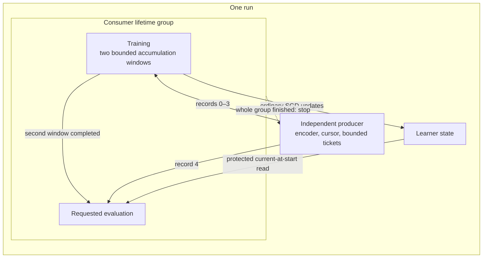

# xDSL and Pliron comparison and working-substrate choice, October-November 2026

This is a fresh primary root after the prior long candidate thread. It has no recorded fork parent. The surrounding repository evidence and actual user corrections establish continuity; no ancestry is invented. Only the historical prefix is hashed because the source session is still being appended.

The task is machinery for stateful heterogeneous data/model workflows that can represent training. Python authoring is fixed independently of machinery language, and ordinary users normally compose provided behavior. Custom Python is an experimental baseline, not a predetermined winner.

The comparison distinguishes real framework contributions from project semantics and the shared execution owner. Six matched cases and independent expectations provide bounded evidence; frontend agreement is not validation of a second ownership implementation, and subprocess timing is not an inherent Rust/Python framework cost.

The [matched machinery evidence](../snapshots/fe46babf-machinery_comparison.md) and case documents retain tradeoffs. After upstream-capability discussion and corrections about regions/graphs, MLIR ties and authoring, the user accepts xDSL as the working substrate. Pliron is credible; it does not require adopting Burn or another backend. This choice does not finalize the project's language.

Captured 2026-11-06T08:32:06.683877+00:00. 403 visible user/assistant messages. Exact bodies, annotations, historical links and line endings are preserved. Reasoning, tools, generated context and compaction summaries are omitted.

[Machine-readable provenance](18-framework-comparison-and-xdsl-choice.json) | [Sources](18-source-records.json) | [Notepad](../decision-notepad.md)

## Message index

- [001 user: <external_codex_apps_open_page>{"page_id":null}</external_codex_apps_open_page>](#m001)
- [002 user: Hi. Time to start a new session with a fresh and ready mindset. Please look around first to catch up](#m002)
- [003 assistant: I’ll refresh the project context and current work status, leaving the uncommitted file’s contents un](#m003)
- [004 assistant: I’m using the Beads skill to refresh the tracked work and handoff notes. This session’s Beads contex](#m004)
- [005 user: <send_user_message_question_reply>](#m005)
- [006 assistant: I’ll leave `research/ir_architecture_report.md` unread. Beads already shows progress beyond the olde](#m006)
- [007 assistant: I’m caught up on the project guidance, changelog, roadmap, OpenSpec status, and current Beads handof](#m007)
- [008 user: <external_codex_apps_open_page>{"page_id":null}</external_codex_apps_open_page>](#m008)
- [009 user: can you tell me your understanding of what we're trying to do based on the discovery you did?](#m009)
- [010 assistant: My understanding is that we’re building **our own IR-based training system that describes and execut](#m010)
- [011 user: u got most of it, other than the wording being more like ir based system that can represent training](#m011)
- [012 assistant: I’ll read the report now, keeping your correction in view: an IR-based system that can represent tra](#m012)
- [013 assistant: The scope correction is explicit: a data-only workflow must be valid, with model and training semant](#m013)
- [014 assistant: I’ve read the full report, including the framework/backend amendment.](#m014)
- [015 user: need to check xdsl and pliron (or any other of the systems listed) to see if they are a good fit whi](#m015)
- [016 assistant: I’ll do a bounded fit assessment against our requirements and the report’s tradeoffs, using concrete](#m016)
- [017 assistant: I’m using OpenSpec explore for the design assessment and codebase-memory where I need to verify loca](#m017)
- [018 assistant: Both xDSL and Pliron look plausible as infrastructure for our own semantics. xDSL provides concrete ](#m018)
- [019 assistant: I found concrete graph support in both: xDSL has cyclic parse/print tests, and current Pliron has gr](#m019)
- [020 assistant: The screen supports deeper evaluation of xDSL and Pliron, with MLIR retained as a credible third opt](#m020)
- [021 assistant: **xDSL and Pliron both merit deeper evaluation. MLIR also remains a credible third candidate.** This](#m021)
- [022 user: # Response annotations:](#m022)
- [023 assistant: **It depends on the deep-dive results. There’s no requirement to choose custom.** My wording implied](#m023)
- [024 user: cloned upstream to home\imi\Projects\sd-scripts-resources so we can use it to look](#m024)
- [025 assistant: I’ll check what’s available under `/home/imi/Projects/sd-scripts-resources` and use those local chec](#m025)
- [026 assistant: Confirmed—the resources directory contains xDSL, Pliron, LLVM/MLIR, IREE, DaCe, Timely, Beam, and Fl](#m026)
- [027 user: meaning now](#m027)
- [028 assistant: Understood—I’ll continue the fit assessment now using the local checkouts, starting with xDSL and Pl](#m028)
- [029 assistant: I’ll check behavior through focused upstream tests as well as source. xDSL can run in a temporary Py](#m029)
- [030 assistant: The first local checks passed: 425 xDSL tests covering traits, regions, rewriting, printing, and ana](#m030)
- [031 assistant: The local results strengthen both candidates: Pliron passed 57 focused IR tests in the LLVM-free tes](#m031)
- [032 assistant: I’ve now inspected the local implementations and run focused upstream checks. **xDSL and Pliron both](#m032)
- [033 user: do you want to rerun it with llvm 23?](#m033)
- [034 assistant: Yes—one rerun with LLVM 23 and the **unmodified upstream configuration** is worthwhile. It would che](#m034)
- [035 user: &#x20;like this?](#m035)
- [036 assistant: Yes—that’s the right approach. The checkout here is `/home/imi/Projects/sd-scripts-resources/pliron`](#m036)
- [037 assistant: The package set resolves to LLVM **23.1.3**. I’ve pinned that Nixpkgs snapshot for this run; Nix is ](#m037)
- [038 assistant: LLVM 23 is available, but `llvm-sys` failed its automatic lookup at `llvm-config-23`, even though `l](#m038)
- [039 assistant: The prefix fixed discovery. Linking now fails on `zlib` and `libxml2`. I’ll use a temporary developm](#m039)
- [040 assistant: Yes, with two adjustments: a development shell supplying `zlib`/`libxml2`, and an explicit LLVM pref](#m040)
- [041 user: which system would you want to test?](#m041)
- [042 assistant: **xDSL first, then Pliron using the same cases.**](#m042)
- [043 user: Okay let's lay it out first for xdsl then](#m043)
- [044 assistant: I’ll lay out a bounded xDSL experiment against the report and our existing contracts: what it should](#m044)
- [045 assistant: The existing keyed join already checks every member before consuming any, so it’s useful to reuse. I](#m045)
- [046 assistant: I’d make this **one isolated xDSL experiment**, answering:](#m046)
- [047 user: <external_codex_apps_open_page>{"page_id":null}</external_codex_apps_open_page>](#m047)
- [048 user: alright, we can start on it](#m048)
- [049 assistant: I’ll start with the data-only B case: xDSL authoring, verification, round-trip, preparation, and exe](#m049)
- [050 assistant: The existing OpenSpec still treats this as research before production design selection. I’m tracking](#m050)
- [051 assistant: `Feed` and `Workers` both import Torch and depend on the older candidate’s runtime types. For B, I’l](#m051)
- [052 assistant: The first implementation now has separate semantic acceptance, target preparation, and runtime ticke](#m052)
- [053 assistant: The first run executes successfully from serialized xDSL and records the policy revision actually us](#m053)
- [054 assistant: All 70 checks now pass. The key progress test confirms that feedback applies while the output slot r](#m054)
- [055 assistant: The B checks are passing, including cancellation followed by an entered publication failure and fail](#m055)
- [056 assistant: The saved prepared IR shows owner references, nested source ancestry, call chains, handoff retention](#m056)
- [057 assistant: The current result supports a limited conclusion: xDSL provides useful typed structure, round-trippi](#m057)
- [058 assistant: Review is still running. The implementation and saved evidence are unchanged while it finishes; the ](#m058)
- [059 assistant: Review found no blocking correctness or ownership issues. It identified three useful corrections: ch](#m059)
- [060 assistant: The review corrections pass all 83 tests, with Ruff and ty also clean. The GIL remained disabled thr](#m060)
- [061 assistant: Implemented and reviewed the xDSL B experiment.](#m061)
- [062 user: thoughts?](#m062)
- [063 assistant: I’ll check the retained results and review, then assess what B tells us about xDSL’s fit.](#m063)
- [064 assistant: My take: **xDSL has earned continued testing. The strongest evidence is that it can carry our descri](#m064)
- [065 user: lets do all of these before asking 3rd party for viewpoints on our approach, commit first and then t](#m065)
- [066 assistant: I’ll commit the completed B experiment first, then implement and test A using the existing owner mac](#m066)
- [067 assistant: B is committed as `2131f31d` (`Add xDSL data-only feedback research experiment`).](#m067)
- [068 assistant: The existing owner services can support A without restructuring them. One target restriction needs a](#m068)
- [069 assistant: A’s first execution passed through the existing engine: four selected samples formed two accumulatio](#m069)
- [070 assistant: The failure tests caught a reporting bug: cancellation of peer work after an encoder failure was bei](#m070)
- [071 assistant: The combined suite now passes 157 tests, including rejection checks for missing, mismatched, swapped](#m071)
- [072 assistant: The 158-test combined suite and all 156 focused legacy owner-service checks pass. A’s saved plan now](#m072)
- [073 assistant: A now provides concrete owner-integration evidence: the shared xDSL structures lower into one existi](#m073)
- [074 assistant: The required code review failed with a GLM 429 usage-limit response, so it produced no verdict. I’m ](#m074)
- [075 assistant: The OMP fallback is running and has started inspecting the A diff. The saved evidence still matches ](#m075)
- [076 assistant: The fallback reviewer is tracing the implementation against the owner services and failure controls.](#m076)
- [077 assistant: I’ve adopted the updated review routing. The interactive OMP review already running fits it, so I’ll](#m077)
- [078 assistant: The fallback review has reached its test and diff checks; there’s no verdict yet. I’ve also confirme](#m078)
- [079 assistant: The OMP review passed and independently reran all 158 tests. It found no correctness gaps. I’ll make](#m079)
- [080 assistant: Committed B as `2131f31d`.](#m080)
- [081 user: how does it feel with a and b visible now?](#m081)
- [082 assistant: I’ll look at A and B together and assess what the owner integration adds to the earlier representati](#m082)
- [083 assistant: **I’m more positive about xDSL now, while keeping the execution architecture provisional.**](#m083)
- [084 user: lets see C through](#m084)
- [085 user: after committing changes](#m085)
- [086 assistant: I’ll commit the completed A changes first, then carry C through implementation, tests, and correctne](#m086)
- [087 assistant: A is committed as `6d103b14` (`Add xDSL correlated data and model owner experiment`).](#m087)
- [088 assistant: A is committed as `6d103b14`. I’m continuing C: checking that the offered two-pass grant produces a ](#m088)
- [089 assistant: The first C run matches the expected result: the unchanged two-pass callable restores the weight to ](#m089)
- [090 assistant: C now has separate checks for the phase/authority contract, numerical handback, and retained optimiz](#m090)
- [091 assistant: All 241 A/B/C tests pass, with the GIL disabled before and after the suite. The 83 new C tests cover](#m091)
- [092 assistant: The evidence now records successful execution, rejected handbacks, and partial retained-owner failur](#m092)
- [093 assistant: The extra diagnostic reproduces with only this installed Python’s `asyncio.shield`; it does not requ](#m093)
- [094 assistant: C adds useful evidence for xDSL: the delegated phases, retained authority, and handback edge are vis](#m094)
- [095 assistant: The implementation and evidence are ready for assessment; review is the remaining gate for C. Its fi](#m095)
- [096 assistant: The reviewer has not returned a verdict yet. C’s checks and artifacts are complete, including six fa](#m096)
- [097 assistant: The review returned with no blocking correctness defects. I’m applying its two small consistency fix](#m097)
- [098 assistant: The follow-up gates pass: 245 tests, with the GIL still disabled before and after, plus Ruff, format](#m098)
- [099 assistant: A is committed as `6d103b14`. C is complete and reviewed; C’s changes remain uncommitted.](#m099)
- [100 user: alright, so how does the full picture look like?](#m100)
- [101 assistant: I’ll check the current findings against the original goals, then pull together what A, B and C estab](#m101)
- [102 assistant: The strongest shift is that xDSL now carries three different kinds of work through reconstruction an](#m102)
- [103 assistant: **The IR-based direction now has working evidence across data processing, ordinary training and dele](#m103)
- [104 user: how do you feel compared to the previous execution candidate we did on our own?](#m104)
- [105 assistant: I’ll compare them on what each actually demonstrates: representation, execution ownership, transform](#m105)
- [106 assistant: **I feel better about xDSL as the representation foundation; our previous candidate still has much s](#m106)
- [107 user: commit the stuff please, and we'll get an external review on it](#m107)
- [108 assistant: I’ll check the pending C changes and review evidence, then commit them. I’ll leave the architecture ](#m108)
- [109 assistant: The pending files match the qualified snapshot, and the saved review and 245-test results are intact](#m109)
- [110 assistant: Committed as `6bea859b` — **Add xDSL granted two-pass authority experiment**.](#m110)
- [111 user: # Files pasted by the user:](#m111)
- [112 assistant: I’ll read the external review, check its claims against the implementation and evidence, and separat](#m112)
- [113 assistant: The source supports the main finding: A and B check binding compatibility without fully checking cor](#m113)
- [114 assistant: All four reported mutation claims reproduce. A produces `4` instead of `3` for sample 1’s left value](#m114)
- [115 assistant: **The review holds up. I reproduced all four concrete mutation claims against `6bea859b`.**](#m115)
- [116 user: lets get on these then](#m116)
- [117 assistant: I’ll start with the verification repair, including the prepared fields’ authority and the corruption](#m117)
- [118 assistant: I’ll keep the fixed backend protocols and verify their descriptors after decoding. The repair will c](#m118)
- [119 assistant: The repair passes 304 tests, including 59 new regressions, with the GIL disabled before and after. T](#m119)
- [120 assistant: The saved probes now show all reported mutations rejected during preparation, including A’s swapped ](#m120)
- [121 assistant: For fusion, I’m limiting the first rewrite to ordered local stages with supported payload contracts ](#m121)
- [122 assistant: The repair review approved the change with no blockers. I’m applying a few small follow-ups: consist](#m122)
- [123 assistant: The repair is complete and reviewed: 309 tests pass, with the GIL disabled before and after; Ruff, f](#m123)
- [124 assistant: The first fused B and A runs pass their independent oracles. A now enters one compiled local group p](#m124)
- [125 assistant: Fusion now passes 356 tests, including physical stop/cancellation and invalid-return cases, with the](#m125)
- [126 assistant: The fusion checks are complete, and I’m sending the implementation for review. The retained local pr](#m126)
- [127 assistant: The fusion review is still running. For the mixed workflow, I’ve confirmed a useful backend constrai](#m127)
- [128 assistant: The fusion review has not returned a verdict yet, so I’m keeping that gate open. The mixed-case desi](#m128)
- [129 assistant: The fusion review approved the rewrite and runtime change with no blocking findings. I’m finishing t](#m129)
- [130 assistant: The correspondence repair and fusion experiment are complete and reviewed. I’m moving on to the mixe](#m130)
- [131 assistant: The mixed case will use a feedback handoff between the learning activity and the producer-owned poli](#m131)
- [132 assistant: The first mixed run completed three owner-managed updates. Learning feedback changed later selection](#m132)
- [133 assistant: The pressure tests pass, including repeated cancellation and a physical failure after stop. They exp](#m133)
- [134 assistant: The full suite passes: 398 tests, with the GIL disabled before and after; the Torch-free suite passe](#m134)
- [135 assistant: The mixed milestone is in required review. The remaining extension test will add one preprocessing o](#m135)
- [136 assistant: The extension can stay inside B’s existing selector, handoff, and feedback runtime. Its resource wil](#m136)
- [137 assistant: The mixed evidence is complete, and its review is still running. The qualification stays narrow: it ](#m137)
- [138 assistant: The extension sketch uses a typed two-lane value produced from a frozen coefficient resource, then r](#m138)
- [139 assistant: The mixed review approved the implementation and found no ownership, correspondence, drain, or oracl](#m139)
- [140 assistant: The extension now runs through B’s existing runtime. Its new operation produces a typed pair using a](#m140)
- [141 assistant: The extension tests now cover the key boundaries. xDSL rejects an invalid payload width at construct](#m141)
- [142 assistant: The expanded suite passes 449 tests, including the existing A/B/C and mixed cases; the Torch-free ru](#m142)
- [143 assistant: All four follow-ups are implemented. The extension has passed the final gates and is ready for its r](#m143)
- [144 assistant: The final review is running. The new resource ABI covers immutable configuration snapshots; live mod](#m144)
- [145 assistant: While the review runs, I’m checking one remaining authority boundary: disabling archived observation](#m145)
- [146 assistant: That check found a real dependency: mixed feedback read the latest contribution from the recorder. W](#m146)
- [147 assistant: The extension review also approved the work, with small robustness and documentation notes. The arch](#m147)
- [148 assistant: The final gates pass: 457 research tests, plus 256 in the Torch-free environment with three optional](#m148)
- [149 assistant: Completed all four follow-ups:](#m149)
- [150 user: <external_codex_apps_open_page>{"page_id":null}</external_codex_apps_open_page>](#m150)
- [151 user: what commit message to use?](#m151)
- [152 assistant: ```text](#m152)
- [153 user: **revew:**](#m153)
- [154 assistant: I’ll check the three findings against the committed code, fix the confirmed issues, and extend the a](#m154)
- [155 assistant: The source matches all three findings. I’ll bound selection work between yields, require the baselin](#m155)
- [156 assistant: All three reproduce locally: the heartbeat waits until the 20,000th exclusion, the pack reports `ret](#m156)
- [157 assistant: The focused checks confirm the fixes, including both `python -O` workflows and the expanded archive-](#m157)
- [158 assistant: The focused suite passes: 158 tests, plus 109 in the Torch-free environment. The new probes show cal](#m158)
- [159 assistant: The full suite passes: 471 tests with the GIL disabled before and after, plus 261 Torch-free tests a](#m159)
- [160 assistant: The before/after probes and eight archive-erasure cases are saved. I’m submitting the correction for](#m160)
- [161 assistant: The saved probe’s heartbeat moved from filter call 20,000 to call 64. Cancellation ran before the fi](#m161)
- [162 assistant: Review is still running. The reviewed source snapshot remains fixed, and the saved probes, optimized](#m162)
- [163 assistant: The optimized-mode checks execute full B and extension sessions, then validate their reports in the ](#m163)
- [164 assistant: Review found no blocking issues and confirmed the fixes and pressure coverage. I’m applying its smal](#m164)
- [165 assistant: All three findings were valid and are fixed:](#m165)
- [166 user: commit pls](#m166)
- [167 assistant: I’ll commit the reviewed fixes and their evidence, keeping the separate IR report out of the commit.](#m167)
- [168 assistant: Committed as `d967faf4` — `Fix xDSL exclusion progress and runtime outcome contracts`.](#m168)
- [169 user: what do you think about this system compared to the original first candidate? what would the next st](#m169)
- [170 assistant: I’ll revisit both candidates’ evidence and the architecture report, then separate what xDSL has demo](#m170)
- [171 assistant: xDSL now looks like a credible IR foundation: reconstruction, a real rewrite and an independently ad](#m171)
- [172 assistant: **xDSL is now my leading candidate for the IR infrastructure.** The original candidate remains valua](#m172)
- [173 user: which of these would you want to do before testing the next candidate? all 4?](#m173)
- [174 assistant: **No. I’d do 1 and a small part of 3 before starting the next candidate.** Those four steps cover th](#m174)
- [175 user: Okay, then let's check that. and we still haven't established a language design and implementations ](#m175)
- [176 assistant: I’ll consolidate the findings and check which conformance expectations can be shared with the next c](#m176)
- [177 assistant: The existing oracles already check arithmetic, associations and outcomes without importing either fr](#m177)
- [178 assistant: The checks passed: 781 existing tests, with the GIL disabled before and after. Separately, all six o](#m178)
- [179 assistant: The assessment is written. It records the demonstrated behavior, fixture restrictions, reusable chec](#m179)
- [180 assistant: The review service returned a quota error (429), so independent review is still pending. I’m recordi](#m180)
- [181 assistant: Recorded the candidate comparison, separating demonstrated behavior, fixture restrictions and unreso](#m181)
- [182 user: "The strongest parts are:](#m182)
- [183 assistant: I’ll make both adjustments: identify xDSL as a viable provisional baseline, and define the shared co](#m183)
- [184 assistant: Both changes are in place. The assessment now supports using xDSL provisionally while language desig](#m184)
- [185 assistant: The Sol medium review returned no actionable findings. It independently reproduced the oracle replay](#m185)
- [186 assistant: Updated the assessment with both adjustments:](#m186)
- [187 user: commit it please](#m187)
- [188 assistant: I’ll check the diff and validation record, then commit the reviewed assessment and evidence.](#m188)
- [189 assistant: Committed as `3b549cd0` — `Clarify provisional xDSL baseline and comparison boundaries`.](#m189)
- [190 user: <external_codex_apps_open_page>{"page_id":null}</external_codex_apps_open_page>](#m190)
- [191 user: I think we're ready for the pliron experiment. but we need to use 0.20.0](#m191)
- [192 assistant: I’ll start the bounded Pliron comparison with **0.20.0 pinned explicitly**, using B’s feedback case ](#m192)
- [193 assistant: I’m using the Beads skill to track this slice and the codebase-memory skill to find the B case’s bin](#m193)
- [194 assistant: Pliron **0.20.0 is published** and matches the local checkout’s declared version. I’ll use the exact](#m194)
- [195 assistant: There’s a useful version distinction: the published 0.20.0 crate comes from an earlier revision than](#m195)
- [196 assistant: The first vertical path works: native Pliron acceptance and preparation feed the existing Python run](#m196)
- [197 assistant: The checks now pass: **103 Pliron tests plus 261 existing Torch-free xDSL tests**, with three option](#m197)
- [198 assistant: The slice and its evidence are ready for review. Pliron looks promising enough for the bounded paylo](#m198)
- [199 assistant: One bridge limitation is explicit in the record: Python still imports xDSL’s modules because B’s exi](#m199)
- [200 assistant: The final combined run also confirms the GIL stayed disabled before and after all **364 passing test](#m200)
- [201 assistant: The comparison notes now separate what Pliron supplied from what we still implemented: the framework](#m201)
- [202 assistant: `review-mcp` finished with **no actionable findings**. It read the new files directly and checked co](#m202)
- [203 assistant: Completed the bounded B experiment with **Pliron 0.20.0 exactly pinned**.](#m203)
- [204 user: commit please so we can get a review](#m204)
- [205 assistant: I’ll check the experiment’s diff and recorded verification, then commit the scoped changes for exter](#m205)
- [206 assistant: Committed as `5a737c27` — `Add pinned Pliron 0.20.0 feedback experiment`.](#m206)
- [207 user: **here**](#m207)
- [208 assistant: I’ll check both findings, fix complete document parsing and the ignored requirements file, then run ](#m208)
- [209 assistant: Both findings are confirmed. The parser helper discards the remainder, and the requirements file was](#m209)
- [210 assistant: The new regressions reproduced the parsing bug: **12 rejection checks failed before the fix**. All 1](#m210)
- [211 assistant: I’ve also checked that every file in the source hash record is visible to normal Git addition. The e](#m211)
- [212 assistant: The required review finished with **no actionable findings**. It confirmed the EOF check covers all ](#m212)
- [213 assistant: Both findings were valid and are fixed.](#m213)
- [214 user: check please:](#m214)
- [215 assistant: I’ll check the assessment against the current implementation and comparison boundaries, especially t](#m215)
- [216 assistant: I’m using the OpenSpec explore skill for this design check. The key question is whether the proposed](#m216)
- [217 assistant: The assessment matches the code: the local interface exposes only cardinality, while verification an](#m217)
- [218 assistant: I agree with the assessment. **The best next slice is the independent extension plus one resource-aw](#m218)
- [219 user: lets go ahead with this](#m219)
- [220 assistant: I’ll implement the payload/resource extension and resource-aware grouping analysis, with diagnostic ](#m220)
- [221 assistant: One correction to that plan: I’ll preserve the reviewed parser and packaging fixes, and leave commit](#m221)
- [222 assistant: I’ll widen the local-stage interface once so each operation can describe its schemas, resource uses ](#m222)
- [223 assistant: The extension now executes through the existing scalar runtime and passes the shared pair oracle, in](#m223)
- [224 assistant: All **190 Pliron tests** pass, including 72 extension checks. They cover invalid pair payloads, decl](#m224)
- [225 assistant: The combined qualification passes: **451 tests**, with three optional Torch skips and the GIL disabl](#m225)
- [226 assistant: The independent replay check passes too: all six saved reports are accepted with framework and runti](#m226)
- [227 assistant: The grouping rule is deliberately conservative: the opaque-effect case remains executable, and its l](#m227)
- [228 assistant: The review found no execution or authorization bug, and flagged four small follow-ups. I’ll address ](#m228)
- [229 assistant: Those follow-ups are fixed. The final gates pass: **456 Python tests and one Rust regression test**,](#m229)
- [230 assistant: Implemented the extension and resource-aware grouping analysis on **Pliron 0.20.0**.](#m230)
- [231 user: commit please, we'll continute tomorrow](#m231)
- [232 assistant: I’ll verify the final diff and recorded evidence, then commit the reviewed fixes and extension for t](#m232)
- [233 assistant: Committed as `98fbbb23` — `Extend Pliron contracts and resource-aware grouping`.](#m233)
- [234 user: <external_codex_apps_open_page>{"page_id":null}</external_codex_apps_open_page>](#m234)
- [235 user: review result](#m235)
- [236 assistant: The independent review supports closing this experiment within its stated scope. I’ll record it in B](#m236)
- [237 assistant: This gives us a clean close for the scoped experiment. The strongest confirmation is that **extensio](#m237)
- [238 user: lets do the concrete case?](#m238)
- [239 assistant: I’ll define the case’s observable behavior and lifetime rules first, using the existing owner exampl](#m239)
- [240 assistant: I’m using the codebase-memory skill to check the existing lifetime and requested-activity paths. The](#m240)
- [241 assistant: The existing examples give us a useful starting point: completion can request evaluation, and evalua](#m241)
- [242 assistant: The producer should stop when the group containing training **and** evaluation finishes. That fits a](#m242)
- [243 assistant: The concrete case is **one producer serving finite training and a requested evaluation, with product](#m243)
- [244 user: <external_codex_apps_open_page>{"page_id":null}</external_codex_apps_open_page>](#m244)
- [245 user: 2 pieces of feedback:](#m245)
- [246 assistant: I’ll incorporate these clarifications and start the bounded Pliron implementation. Pending requests ](#m246)
- [247 assistant: I’m also applying the free-threaded Python skill for the worker and cancellation checks. The existin](#m247)
- [248 assistant: The Python target now runs through the existing engine. It keeps window selection separate from the ](#m248)
- [249 assistant: The native representation now includes producer stop dependencies, pending requests, consumer-group ](#m249)
- [250 assistant: The first 71 focused checks pass. They cover late and prefetched evaluation input, orderly stop on b](#m250)
- [251 assistant: The broader run hit a test-environment conflict: B checks that Torch has not been imported, while th](#m251)
- [252 assistant: The Torch-free suite passes: **503 tests, four optional skips**, with the GIL disabled throughout.](#m252)
- [253 assistant: The scoped owner suite passes: **500 tests with the GIL disabled before and after**.](#m253)
- [254 assistant: I found an adapter bug: cancellation before a worker enters was wrapped as `NotEntered(CancelledErro](#m254)
- [255 assistant: The pre-entry cancellation fix passes its deterministic regressions, and all **31 composition runtim](#m255)
- [256 assistant: The saved evidence covers **11 outcomes**, including pending and partial cancellation. A separate re](#m256)
- [257 assistant: The source and artifact checks pass, including preservation of the earlier B/extension implementatio](#m257)
- [258 assistant: The review found **no logic errors or authority bypasses** in the bounded experiment. It raised smal](#m258)
- [259 assistant: The post-review gates pass: **503 Torch-free tests with four optional skips, and 508 owner tests**. ](#m259)
- [260 assistant: Implemented the concrete composition case, incorporating both reviews.](#m260)
- [261 user: commit the changes please](#m261)
- [262 assistant: I’ll check the final diff and evidence, then commit the composition experiment.](#m262)
- [263 assistant: Committed as `2f4c9353` — `Test Pliron lifetime composition with existing owners`.](#m263)
- [264 user: <external_codex_apps_open_page>{"page_id":null}</external_codex_apps_open_page>](#m264)
- [265 user: # Files pasted by the user:](#m265)
- [266 assistant: I’ll read the proposed milestone and the current candidate assessments, then prepare a matched compa](#m266)
- [267 assistant: The proposal gives us a useful endpoint: match the six existing cases, align the resource transforma](#m267)
- [268 assistant: The current records confirm the gaps in the proposal. Pliron has B, the resource extension, and life](#m268)
- [269 assistant: The draft now specifies each case’s arithmetic and causal requirements, including A’s summed gradien](#m269)
- [270 assistant: The link checks and independent replay passed: 20 retained reports accepted and 15 deliberate corrup](#m270)
- [271 assistant: Prepared the matched-comparison plan and Beads milestone `sd-scripts-syv.31.25`, with eight bounded ](#m271)
- [272 user: 1 thing before getting to it:](#m272)
- [273 assistant: I’ll make those two clarifications and record this assessment separately from the failed provider re](#m273)
- [274 assistant: I’ll use the existing opaque **offset** variant. It gives us a valid program that must execute unfus](#m274)
- [275 assistant: The xDSL representation round-trips with real typed SSA links, including the producer’s forward refe](#m275)
- [276 assistant: Control setup exposed a small gap in B: xDSL validates a decoded plan during preparation, but has no](#m276)
- [277 assistant: The xDSL lifetime checks pass so far: 50 document/contract tests and 28 owner tests, including late ](#m277)
- [278 assistant: Both broader gates pass: **582 Torch-free tests with five optional skips**, and **615 owner tests**,](#m278)
- [279 assistant: The new evidence replay accepts all **17 retained reports** and rejects **15 corruptions**. I also v](#m279)
- [280 assistant: The documented CLI also cold-loads the saved xDSL artifact and runs the prefetched case successfully](#m280)
- [281 assistant: The reviewer is still running. All local checks and the evidence bundle are complete; I’m allowing t](#m281)
- [282 assistant: The review returned with **no blocking correctness, authority or liveness findings**. I’ll address i](#m282)
- [283 assistant: The post-review gates pass: **589 Torch-free tests with five optional skips**, and **623 owner tests](#m283)
- [284 assistant: Applied both clarifications and completed control setup and the xDSL lifetime port.](#m284)
- [285 user: commit and go ahead](#m285)
- [286 assistant: I’ll commit the reviewed control and lifetime work, then start Pliron C using the existing authority](#m286)
- [287 assistant: Committed as `7386bba3` — `Match framework controls and port lifetime composition to xDSL`.](#m287)
- [288 assistant: C’s current xDSL adapter contains the owner-facing execution and reporting code we need to reuse. I’](#m288)
- [289 assistant: The Pliron C prototype builds against **0.20.0** and accepts, prepares and cold-loads the typed auth](#m289)
- [290 assistant: Native C now passes the contract and owner checks, including failed handback, forged advancement att](#m290)
- [291 assistant: The broader gates pass: **639 Torch-free tests with six optional skips**, and **678 owner tests**, w](#m291)
- [292 assistant: Pliron C now passes the numerical, handback, cancellation and partial-failure checks. I’m finishing ](#m292)
- [293 assistant: The saved-plan checks pass in fresh normal and `python -O` processes. Independent replay also accept](#m293)
- [294 assistant: The final gates pass: **639 Torch-free tests with six optional skips**, and **685 owner tests**, wit](#m294)
- [295 assistant: The C implementation and evidence are staged for the required `review-mcp` review against `HEAD`. Th](#m295)
- [296 assistant: `review-mcp` failed with a provider HTTP 429 quota error and returned no review. The local gates and](#m296)
- [297 assistant: Committed the control/lifetime slice as `7386bba3`, then implemented Pliron C.](#m297)
- [298 user: let's commit this part too and before moving on we'll check if external review has any input on the ](#m298)
- [299 assistant: I’ll commit the C slice with the recorded review failure, then hold off on the next comparison step ](#m299)
- [300 assistant: Committed as `4558da99` — `Represent temporary optimization authority in Pliron`.](#m300)
- [301 user: nothing actionable, we can continue](#m301)
- [302 assistant: I’ll record the external review outcome and continue with resource-aware grouping alignment: matchin](#m302)
- [303 assistant: The main gap is in xDSL: its grouping rule still permits only scalar, resource-free stages. Pliron a](#m303)
- [304 assistant: xDSL now produces the intended four-to-one group, including both payload type transitions. The focus](#m304)
- [305 assistant: Both candidates now make the intended legality decisions. Pliron’s mutation probes also pass: changi](#m305)
- [306 user: continue please](#m306)
- [307 assistant: Continuing. The 21 new comparison tests pass, covering one group versus three, forged cold groups, c](#m307)
- [308 assistant: The paired capture is complete: it retains normal and opaque runs, invalid/domain outcomes, hidden-l](#m308)
- [309 assistant: The broader gates pass: **660 Torch-free tests with six optional skips**, and **706 owner tests**, w](#m309)
- [310 assistant: The source and artifact hashes check out, all documentation links resolve, and the 136 historical ar](#m310)
- [311 assistant: `review-mcp` again returned an HTTP 429 quota failure, so it supplied no assessment of this slice. T](#m311)
- [312 assistant: Grouping alignment is implemented: both candidates group four frozen-read stages into one, while an ](#m312)
- [313 user: if the review doesnt work use a 6.1 sol medium review](#m313)
- [314 assistant: I’ll run a GPT-6.1 Sol review at medium reasoning on the staged grouping changes, then address any a](#m314)
- [315 assistant: The reviewer independently ran the 102 focused Python tests and all three native tests; they passed.](#m315)
- [316 assistant: The GPT-6.1 Sol medium review found **no actionable findings**. It independently reran the 102 focus](#m316)
- [317 assistant: GPT-6.1 Sol at medium reasoning completed the fallback review: **no actionable findings**.](#m317)
- [318 user: then ready to commit](#m318)
- [319 assistant: I’ll commit the reviewed grouping slice and verify the working tree is clean.](#m319)
- [320 assistant: Committed as `0055062d` — `Align resource-aware grouping across xDSL and Pliron`.](#m320)
- [321 user: can go directly to the next task](#m321)
- [322 assistant: I’ll move on to the Pliron A port: correlation and accumulation, using its own IR verification and p](#m322)
- [323 assistant: A’s key requirements are atomic two-member admission, summed contributions across each window, and e](#m323)
- [324 assistant: The shared target extraction passes all 217 existing xDSL A/C/mixed owner tests. The native A repres](#m324)
- [325 assistant: The first native A run passes the independent oracle: two updates produce `0.8 → -0.60625 → 10.41984](#m325)
- [326 assistant: The focused tests pass for atomic rejection without either member being claimed, retained associatio](#m326)
- [327 assistant: The broader gates passed, including evaluation mode held during physical use and restored afterward.](#m327)
- [328 assistant: The Pliron A port has passed the full checks: 721 Torch-free tests with seven optional skips, and 78](#m328)
- [329 assistant: The required review service failed with a provider quota error. I’ll retain that failure and use the](#m329)
- [330 assistant: The evidence check is complete: all eight saved A artifacts pass cold validation, and the independen](#m330)
- [331 assistant: The fallback review returned no actionable findings and independently passed 122 A tests. It did not](#m331)
- [332 assistant: Completed Pliron A: correlation and accumulation, with independent IR verification, preparation and ](#m332)
- [333 user: <external_codex_apps_open_page>{"page_id":null}</external_codex_apps_open_page>](#m333)
- [334 user: alright, commit please and then next task in line](#m334)
- [335 assistant: I’ll commit the reviewed A changes, then work on the next queued task: the Pliron mixed workflow por](#m335)
- [336 assistant: Committed A as `1a10d943` — `Represent correlation and accumulation in Pliron`.](#m336)
- [337 assistant: The existing mixed runtime already provides the needed admission, feedback, and physical-drain behav](#m337)
- [338 assistant: The first Pliron mixed run passes the independent checker, and all 49 existing mixed runtime tests p](#m338)
- [339 assistant: The new mixed runtime tests pass, including repeated cancellation with a held model read, later phys](#m339)
- [340 assistant: The full gates passed: 792 Torch-free tests with eight optional skips, and 861 owner tests. The GIL ](#m340)
- [341 assistant: The independent replay accepted all 20 truthful records, rejected both wrong-map executions, and cau](#m341)
- [342 assistant: The review service failed again with a provider quota error. I’ll retain the failed attempt and use ](#m342)
- [343 assistant: The fallback review returned no actionable findings. It independently passed all 149 new cases and 5](#m343)
- [344 assistant: Committed A as **`1a10d943` — Represent correlation and accumulation in Pliron**, then completed the](#m344)
- [345 user: should be good to commit and move onto the next](#m345)
- [346 assistant: I’ll commit the reviewed mixed workflow changes, then start the matched diagnostics and phase-cost t](#m346)
- [347 assistant: Committed the mixed port as `139ab2dc` — `Represent mixed feedback and model ownership in Pliron`.](#m347)
- [348 assistant: The protocol is fixed at three warm-ups, twenty measured paired runs per repeated phase, and ten fre](#m348)
- [349 assistant: The release build and both isolated mixed-progress checks passed, with the GIL disabled. Correctness](#m349)
- [350 assistant: Collection finished with **2,800 repeated-phase samples and 120 fresh starts**, with no sample or pr](#m350)
- [351 assistant: My audit found a measurement gap: the collector’s “end-to-end” path performs a cold artifact reconst](#m351)
- [352 assistant: The natural endpoint collection also completed without failures. It changes the picture: **C is clos](#m352)
- [353 assistant: The diagnostic comparison is mixed: Pliron gives richer frozen-resource errors, while xDSL attribute](#m353)
- [354 assistant: The retained source and artifact hashes match, and the regression gates passed. The task stays open ](#m354)
- [355 assistant: The environment audit confirms there is no GIL override: ordinary Torch imports leave the GIL disabl](#m355)
- [356 assistant: The review is taking longer than the earlier attempts. Repository policy allows it up to the configu](#m356)
- [357 assistant: The review validated the recorded numbers and endpoint separation, then found five fixes: protect di](#m357)
- [358 assistant: The fixes are implemented. **Twenty focused tests pass**, including real timeout/partial-output rete](#m358)
- [359 assistant: The CLI smoke check wrote sixteen rejection messages and a complete provenance sidecar to a separate](#m359)
- [360 assistant: The follow-up review confirmed the five fixes and the table values. It found one small record gap—th](#m360)
- [361 assistant: Committed the mixed port as **`139ab2dc`**, then completed the matched machinery comparison.](#m361)
- [362 user: alright, commit this and then we'll check if there's any feedback](#m362)
- [363 assistant: I’ll check the staged changes and review record, then commit this comparison milestone and pause for](#m363)
- [364 assistant: Committed as `fe46babf` — **Record matched xDSL and Pliron machinery comparison**.](#m364)
- [365 user: what is our criteria for the system we select? It shouldn't just be "it fits this one specific scena](#m365)
- [366 assistant: I’ll check the comparison plan and governing design, then lay out the selection criteria and whether](#m366)
- [367 assistant: I’m using the OpenSpec explore guidance here. The plan already names “stateful, heterogeneous data a](#m367)
- [368 assistant: **We’re selecting machinery for a coherent, extensible IR system that can represent stateful, hetero](#m368)
- [369 user: from the checks, can we extrapolate based on our intention for the system which candidate would allo](#m369)
- [370 assistant: I’ll separate what the checks demonstrate from what we can reasonably infer about each candidate’s l](#m370)
- [371 assistant: Both look capable of supporting the intended system; the checks haven’t exposed a fundamental limit ](#m371)
- [372 assistant: **Yes. My inference is that both are credible long-term substrates for the intended system.** The ch](#m372)
- [373 user: I think pliron here could mean we might end up gravitating towards burn as a whole which would event](#m373)
- [374 assistant: I’ll check the report’s proposed composition model and the experiment’s remaining gaps, then explain](#m374)
- [375 assistant: The possible drift toward Burn is a separate scope decision we should keep explicit. Our current Pli](#m375)
- [376 user: your message cut off](#m376)
- [377 assistant: Here’s the complete explanation, more compactly.](#m377)
- [378 user: instead of looking at what we already did, do we even know how xdls and pliron works and what they a](#m378)
- [379 assistant: You’re right: the framework comparison needs a direct architectural judgment, beyond our fixtures. I](#m379)
- [380 assistant: I’m using the codebase-memory skill to locate the upstream code, with direct source reads where it i](#m380)
- [381 assistant: The upstream APIs support a direct “yes” for both: we can define our own operations, types, nested r](#m381)
- [382 assistant: **Yes—and I made the decision sound more uncertain than the architectural evidence warrants.** We ca](#m382)
- [383 user: did u see this](#m383)
- [384 assistant: I’d checked the Pliron pass API and parts of the xDSL docs, but I hadn’t read all four of these end ](#m384)
- [385 assistant: These are useful references for the question you raised. Pliron’s tutorial connects a custom languag](#m385)
- [386 assistant: **I’d seen the pass APIs and some xDSL documentation, but I hadn’t worked through this tutorial mate](#m386)
- [387 user: maybe do that? it would also help to get an idea of what we'd be looking at for language stuff](#m387)
- [388 assistant: I’ll compare the frameworks’ actual language-building models against our intended system, then sketc](#m388)
- [389 assistant: The key distinction is becoming clearer: adding a Python implementation of an existing operation can](#m389)
- [390 assistant: One concrete difference emerged in the pinned sources: Pliron’s conversion driver explicitly account](#m390)
- [391 assistant: **Both support the architecture we want. Pliron is particularly convincing as a dedicated compiler s](#m391)
- [392 user: first of all users don't normally do anything that's not already present, 2nd authoring has nothing ](#m392)
- [393 assistant: You’re right. **I gave an uncommon user-extension scenario too much weight and blurred Python author](#m393)
- [394 user: xdsl also has direct ties to mlir I think, if that's a benefit. and again we're not really looking a](#m394)
- [395 assistant: I’ll check what xDSL’s MLIR connection actually enables and whether it could benefit our machinery. ](#m395)
- [396 assistant: **Yes. xDSL’s MLIR connection is a substantive machinery advantage, and I underweighted it.** I’ve b](#m396)
- [397 user: # Response annotations:](#m397)
- [398 assistant: I’ll check xDSL’s region and graph model so I can distinguish what it supports from Pliron’s explici](#m398)
- [399 assistant: **It does—xDSL has regions and graph structures. My comparison made that distinction sound much larg](#m399)
- [400 user: so, what do u think?](#m400)
- [401 assistant: **I would choose xDSL as the working substrate for the system machinery.**](#m401)
- [402 user: okay, then there's that](#m402)
- [403 assistant: xDSL is the agreed working substrate for the system machinery. We can develop the language design on](#m403)

<a id="m001"></a>
## 001 User - 2026-10-29T04:24:16.151Z

Source: [01a185e6-b37c-7192-bd31-0ba5a575b23d, raw line 15](/home/imi/.codex/sessions/2026/10/29/rollout-2026-10-29T05-24-11-01a185e6-b37c-7192-bd31-0ba5a575b23d.jsonl:15).

<external_codex_apps_open_page>{"page_id":null}</external_codex_apps_open_page>

<a id="m002"></a>
## 002 User - 2026-10-29T04:24:17.282Z

Source: [01a185e6-b37c-7192-bd31-0ba5a575b23d, raw line 18](/home/imi/.codex/sessions/2026/10/29/rollout-2026-10-29T05-24-11-01a185e6-b37c-7192-bd31-0ba5a575b23d.jsonl:18).

Hi. Time to start a new session with a fresh and ready mindset. Please look around first to catch up with where things are, without trying to guess what the next ask will be. avoid reading the uncommitted file since we'll go over that together after


<a id="m003"></a>
## 003 Assistant (commentary) - 2026-10-29T04:24:20.406Z

Source: [01a185e6-b37c-7192-bd31-0ba5a575b23d, raw line 21](/home/imi/.codex/sessions/2026/10/29/rollout-2026-10-29T05-24-11-01a185e6-b37c-7192-bd31-0ba5a575b23d.jsonl:21).

I’ll refresh the project context and current work status, leaving the uncommitted file’s contents untouched.


<a id="m004"></a>
## 004 Assistant (commentary) - 2026-10-29T04:25:06.295Z

Source: [01a185e6-b37c-7192-bd31-0ba5a575b23d, raw line 30](/home/imi/.codex/sessions/2026/10/29/rollout-2026-10-29T05-24-11-01a185e6-b37c-7192-bd31-0ba5a575b23d.jsonl:30).

I’m using the Beads skill to refresh the tracked work and handoff notes. This session’s Beads context disables Git operations, so I’ll keep repository files closed until I know which file to avoid.


<a id="m005"></a>
## 005 User - 2026-10-29T04:25:35.928Z

Source: [01a185e6-b37c-7192-bd31-0ba5a575b23d, raw line 47](/home/imi/.codex/sessions/2026/10/29/rollout-2026-10-29T05-24-11-01a185e6-b37c-7192-bd31-0ba5a575b23d.jsonl:47).

<send_user_message_question_reply>
[{"questionItemId":"[\"request_user_input_async\",\"call_6a0b4010c6984b658e7702f727817416\",0]","question":"Which uncommitted file should I leave unread? The filename or path is enough.","answer":"/home/imi/Projects/sd-scripts/openspec/changes/rework-model-strategy-trainer/research/ir_architecture_report.md"}]
</send_user_message_question_reply>


<a id="m006"></a>
## 006 Assistant (commentary) - 2026-10-29T04:25:45.669Z

Source: [01a185e6-b37c-7192-bd31-0ba5a575b23d, raw line 51](/home/imi/.codex/sessions/2026/10/29/rollout-2026-10-29T05-24-11-01a185e6-b37c-7192-bd31-0ba5a575b23d.jsonl:51).

I’ll leave `research/ir_architecture_report.md` unread. Beads already shows progress beyond the older session notes; I’ll check the project guidance and current OpenSpec records to complete the refresh.


<a id="m007"></a>
## 007 Assistant (final_answer) - 2026-10-29T04:26:45.824Z

Source: [01a185e6-b37c-7192-bd31-0ba5a575b23d, raw line 68](/home/imi/.codex/sessions/2026/10/29/rollout-2026-10-29T05-24-11-01a185e6-b37c-7192-bd31-0ba5a575b23d.jsonl:68).

I’m caught up on the project guidance, changelog, roadmap, OpenSpec status, and current Beads handoffs.

- The architecture rework has sections 1–4 checked; section 5, production shapes and migration planning, remains open.
- Recent candidate work covers independent conformance checks, input/RNG ownership, the dispatch failure fix, and a completed whole-candidate assessment.
- Candidate evidence, accepted requirements, and production readiness remain distinct.

[ir_architecture_report.md](/home/imi/Projects/sd-scripts/openspec/changes/rework-model-strategy-trainer/research/ir_architecture_report.md) remains unread. I made no edits or task changes and haven’t selected a next task.

<oai-mem-citation>
<citation_entries>
MEMORY.md:187-200|note=[Prior session orientation checked against current project records]
</citation_entries>
<rollout_ids>
01a10cff-f22a-7973-96f2-f1a98c749d19
</rollout_ids>
</oai-mem-citation>

<a id="m008"></a>
## 008 User - 2026-10-29T05:15:20.529Z

Source: [01a185e6-b37c-7192-bd31-0ba5a575b23d, raw line 76](/home/imi/.codex/sessions/2026/10/29/rollout-2026-10-29T05-24-11-01a185e6-b37c-7192-bd31-0ba5a575b23d.jsonl:76).

<external_codex_apps_open_page>{"page_id":null}</external_codex_apps_open_page>

<a id="m009"></a>
## 009 User - 2026-10-29T05:15:21.697Z

Source: [01a185e6-b37c-7192-bd31-0ba5a575b23d, raw line 79](/home/imi/.codex/sessions/2026/10/29/rollout-2026-10-29T05-24-11-01a185e6-b37c-7192-bd31-0ba5a575b23d.jsonl:79).

can you tell me your understanding of what we're trying to do based on the discovery you did?


<a id="m010"></a>
## 010 Assistant (final_answer) - 2026-10-29T05:16:31.173Z

Source: [01a185e6-b37c-7192-bd31-0ba5a575b23d, raw line 85](/home/imi/.codex/sessions/2026/10/29/rollout-2026-10-29T05-24-11-01a185e6-b37c-7192-bd31-0ba5a575b23d.jsonl:85).

My understanding is that we’re building **our own IR-based training system that describes and executes an entire training run**. The existing diffusion training code supplies real requirements, domain implementations, and migration cases.

The central relationship is: a contract defines the supported obligations; an author explicitly describes a strategy against that contract; acceptance establishes a coherent run arrangement; preparation turns it into executable machinery. The Trainer then runs that prepared arrangement, with clear responsibility for timing, infrastructure, synchronization, and optimization mechanics. Specialized training behavior stays with its domain.

That description needs to cover the **connected system**: numerical work, input production, repetition, feedback, optimization, state access, and capability interactions such as validation and persistence. Its structure should let preparation derive dependencies, coordination, and lifetimes. Different lowerings and backends should preserve the same meaningful behavior while choosing their own execution machinery.

A major part of the work is making those meanings dependable under concurrency and failure. We need explicit answers about who owns current state, when a representation becomes stale, when work has actually finished, and what remains usable after partial failure. The recent dispatch correction illustrates this: work that can still mutate state must retain its protection even when submission reports an error.

The isolated execution candidate gives us executable evidence for those rules. Its independent conformance checks also give us a way to evaluate another implementation without requiring identical internal scheduling. Togeari contributes implementation ideas to our own design.

Where we stand, as I understand it: substantial semantic ground is settled, and the candidate has tested important mechanisms. Production representations and migration choices remain open, alongside broader backend and restoration qualification. The goal is to carry the accumulated meaning and evidence into a coherent implementation.

That understanding comes from the governing proposal/design and current Beads handoffs; I still haven’t read `ir_architecture_report.md`.

<a id="m011"></a>
## 011 User - 2026-10-29T05:25:56.709Z

Source: [01a185e6-b37c-7192-bd31-0ba5a575b23d, raw line 92](/home/imi/.codex/sessions/2026/10/29/rollout-2026-10-29T05-24-11-01a185e6-b37c-7192-bd31-0ba5a575b23d.jsonl:92).

u got most of it, other than the wording being more like ir based system that can represent training, but this is explored in the latest report. we can go over it now. go ahead an read it


<a id="m012"></a>
## 012 Assistant (commentary) - 2026-10-29T05:25:59.964Z

Source: [01a185e6-b37c-7192-bd31-0ba5a575b23d, raw line 95](/home/imi/.codex/sessions/2026/10/29/rollout-2026-10-29T05-24-11-01a185e6-b37c-7192-bd31-0ba5a575b23d.jsonl:95).

I’ll read the report now, keeping your correction in view: an IR-based system that can represent training.


<a id="m013"></a>
## 013 Assistant (commentary) - 2026-10-29T05:26:29.089Z

Source: [01a185e6-b37c-7192-bd31-0ba5a575b23d, raw line 111](/home/imi/.codex/sessions/2026/10/29/rollout-2026-10-29T05-24-11-01a185e6-b37c-7192-bd31-0ba5a575b23d.jsonl:111).

The scope correction is explicit: a data-only workflow must be valid, with model and training semantics supplied through extensions of the same structure. The report also separates the language’s semantics from the choice of IR framework. I’m continuing through the worked examples and proposed experiment.


<a id="m014"></a>
## 014 Assistant (final_answer) - 2026-10-29T05:26:58.335Z

Source: [01a185e6-b37c-7192-bd31-0ba5a575b23d, raw line 126](/home/imi/.codex/sessions/2026/10/29/rollout-2026-10-29T05-24-11-01a185e6-b37c-7192-bd31-0ba5a575b23d.jsonl:126).

I’ve read the full [report](/home/imi/Projects/sd-scripts/openspec/changes/rework-model-strategy-trainer/research/ir_architecture_report.md), including the framework/backend amendment.

Your correction changes the center of the design: **an IR-based system for hierarchical, stateful data and model workflows, capable of representing training.** A continuous data-only workflow should stand on its own. Training contributes domain semantics such as derivatives, accumulation windows, optimization ownership, and grants.

The report proposes a common foundation of activities, recursively composed regions, typed flows, persistent resources, and explicit effect/lifecycle contracts. Accepted semantic meaning then lowers into a prepared execution plan, backed by runtime owner services and selected numerical implementations. Preparation must preserve the accepted algorithm, admission, authority, and failure/completion obligations.

I also understand the infrastructure choices separately now: Python authoring is fixed; the machinery’s implementation language and IR framework remain open. Custom Python is the proposed experimental baseline, while xDSL and Pliron need evidence of fit. The CubeCL backend informs the integration boundary.

Section J proposes testing that foundation through composed data work, fused/unfused realizations, and three small conformance fixtures. I’m treating that experiment and the architectural recommendations as proposals for our discussion.

<a id="m015"></a>
## 015 User - 2026-10-29T06:24:48.148Z

Source: [01a185e6-b37c-7192-bd31-0ba5a575b23d, raw line 133](/home/imi/.codex/sessions/2026/10/29/rollout-2026-10-29T05-24-11-01a185e6-b37c-7192-bd31-0ba5a575b23d.jsonl:133).

need to check xdsl and pliron (or any other of the systems listed) to see if they are a good fit while consulting our needs and the report's benefits and tradeoffs. full deep dive is preserved for the ones that are genuinely promising


<a id="m016"></a>
## 016 Assistant (commentary) - 2026-10-29T06:24:52.189Z

Source: [01a185e6-b37c-7192-bd31-0ba5a575b23d, raw line 136](/home/imi/.codex/sessions/2026/10/29/rollout-2026-10-29T05-24-11-01a185e6-b37c-7192-bd31-0ba5a575b23d.jsonl:136).

I’ll do a bounded fit assessment against our requirements and the report’s tradeoffs, using concrete framework capabilities to identify which options merit a full deep dive.


<a id="m017"></a>
## 017 Assistant (commentary) - 2026-10-29T06:26:03.889Z

Source: [01a185e6-b37c-7192-bd31-0ba5a575b23d, raw line 149](/home/imi/.codex/sessions/2026/10/29/rollout-2026-10-29T05-24-11-01a185e6-b37c-7192-bd31-0ba5a575b23d.jsonl:149).

I’m using OpenSpec explore for the design assessment and codebase-memory where I need to verify local implementation details. I’ll compare semantic fit, useful IR machinery, and execution/backend fit separately—strength in one doesn’t establish the others.


<a id="m018"></a>
## 018 Assistant (commentary) - 2026-10-29T06:29:26.283Z

Source: [01a185e6-b37c-7192-bd31-0ba5a575b23d, raw line 198](/home/imi/.codex/sessions/2026/10/29/rollout-2026-10-29T05-24-11-01a185e6-b37c-7192-bd31-0ba5a575b23d.jsonl:198).

Both xDSL and Pliron look plausible as infrastructure for our own semantics. xDSL provides concrete verification, resource-effect, and rewrite machinery, but its general dataflow dead-code analysis still rejects nested regions and CFG successors. I’m checking which Pliron facilities offer comparable reuse, including its graph-region and analysis support.


<a id="m019"></a>
## 019 Assistant (commentary) - 2026-10-29T06:34:12.453Z

Source: [01a185e6-b37c-7192-bd31-0ba5a575b23d, raw line 244](/home/imi/.codex/sessions/2026/10/29/rollout-2026-10-29T05-24-11-01a185e6-b37c-7192-bd31-0ba5a575b23d.jsonl:244).

I found concrete graph support in both: xDSL has cyclic parse/print tests, and current Pliron has graph-aware dialect conversion with tests for mutual and self-references. I’m also keeping MLIR in the comparison: it explicitly supports stream-like graph regions, although its documented effect model leaves graph-region effects unresolved.


<a id="m020"></a>
## 020 Assistant (commentary) - 2026-10-29T06:38:38.669Z

Source: [01a185e6-b37c-7192-bd31-0ba5a575b23d, raw line 273](/home/imi/.codex/sessions/2026/10/29/rollout-2026-10-29T05-24-11-01a185e6-b37c-7192-bd31-0ba5a575b23d.jsonl:273).

The screen supports deeper evaluation of xDSL and Pliron, with MLIR retained as a credible third option. The key test is whether their verification and rewrite machinery preserves our flow, resource, authority, and failure contracts without hiding protocol in callbacks. I’ve recorded the evidence in Beads and left the report and governing artifacts unchanged.


<a id="m021"></a>
## 021 Assistant (final_answer) - 2026-10-29T06:39:39.734Z

Source: [01a185e6-b37c-7192-bd31-0ba5a575b23d, raw line 280](/home/imi/.codex/sessions/2026/10/29/rollout-2026-10-29T05-24-11-01a185e6-b37c-7192-bd31-0ba5a575b23d.jsonl:280).

**xDSL and Pliron both merit deeper evaluation. MLIR also remains a credible third candidate.** This screening gives us reasons to test them before settling on the report’s custom-Python baseline.

I compared them against our needs: recursive composition, typed flows, persistent resources, extensible semantic interfaces, inspectable transformations, and separation between accepted meaning, preparation, and runtime ownership.

| Candidate | Useful machinery verified | Main question for a deeper dive |
|---|---|---|
| **xDSL** | Declarative operation definitions, nested regions, resource-specific effects, use-def-aware rewriting, and inspection. Its tests include cyclic graph parsing/printing. | How much analysis infrastructure transfers to our service, flow, and lifecycle semantics? |
| **Pliron** | Explicit graph/SSACFG regions, checked operation interfaces, graph-aware conversion, and cached analyses with preservation/invalidation. | Does native machinery improve our implementation enough to justify its Python boundary, and where can backend infrastructure actually be shared? |
| **MLIR** | Operation-defined graph regions, extensible types, compiler tooling, and documented Python-defined dialects, passes, and rewrites. | Which tools/interfaces provide concrete reuse for our language, and which require substantial custom machinery? |

The evidence sharpens several report tradeoffs:

**xDSL offers substantial reusable machinery, with uneven analysis coverage.** Its `EffectInstance` can identify resources and affected values or symbols. Its general `DeadCodeAnalysis` still rejects nested regions and CFG successors; separate recursive DCE and region-branch facilities exist. That limitation needs to be assessed per facility. [Effect interfaces](https://github.com/xdslproject/xdsl/blob/a64701480640d012108a914d1644246c244f2fa1/xdsl/traits.py), [analysis implementation](https://github.com/xdslproject/xdsl/blob/a64701480640d012108a914d1644246c244f2fa1/xdsl/analysis/dead_code_analysis.py).

**Pliron is a serious machinery candidate independently of CubeCL.** Its graph-aware dialect conversion includes tests for mutual and self-references, and its pass infrastructure explicitly manages analysis invalidation. The DCE effect interface I inspected is boolean, so our finer resource, authority, and completion interfaces remain design work. Compiler-analysis invalidation also remains separate from runtime binding freshness. [Conversion tests](https://github.com/pliron-org/pliron/blob/2f291923e73f93562d2a941cadef9e3177d5410b/tests/dialect_conversion.rs), [pass infrastructure](https://github.com/pliron-org/pliron/blob/2f291923e73f93562d2a941cadef9e3177d5410b/src/pass.rs).

**MLIR deserves a fair comparison.** Its graph regions explicitly accommodate cyclic, stream-like relationships, and current documentation supports developing dialects, passes, and rewrites in Python. Its effect rationale still leaves graph-region effects unresolved, so our concurrency semantics remain our responsibility. [Graph regions](https://mlir.llvm.org/docs/LangRef/#graph-regions), [Python extensions](https://mlir.llvm.org/docs/Bindings/Python/#extending-mlir-in-python), [effect limitations](https://mlir.llvm.org/docs/Rationale/SideEffectsAndSpeculation/).

For the other systems, I’d prioritize **targeted investigations**: [IREE Stream](https://iree.dev/reference/mlir-dialects/Stream/) for prepared resource/completion machinery and [Timely](https://timelydataflow.github.io/timely-dataflow/chapter_5/chapter_5_2.html) for continuous progress. DaCe, Beam/Flink, and KIR/Togeari remain useful references or integrations; this screen hasn’t established enough benefit to prioritize adopting their whole semantic models.

The deeper comparison should use the same small pressure cases and require:

- Typed structure and canonical round-trip with stable semantic identities.
- Useful verification of flow, resource, and authority errors.
- One rewrite preserving provenance, observations, and partial failures.
- Lowering into prepared execution using our owner protocols.

These are source/documentation findings; I haven’t executed framework versions of our fixtures. Evidence and qualification gates are recorded in `sd-scripts-syv.31.5`.

<a id="m022"></a>
## 022 User - 2026-10-29T07:00:43.430Z

Source: [01a185e6-b37c-7192-bd31-0ba5a575b23d, raw line 287](/home/imi/.codex/sessions/2026/10/29/rollout-2026-10-29T05-24-11-01a185e6-b37c-7192-bd31-0ba5a575b23d.jsonl:287).


# Response annotations:
Each item contains text selected from an earlier Codex response and may include a user comment. Treat items as Annotation 1, Annotation 2, and so on in array order. Use every selection as context and address every comment. For every annotation you address, include its inline directive `:codex-annotation{index="N"}`, where N is its one-based array position (for example, `:codex-annotation{index="1"}`). Do not use unstructured annotation labels.
<response-annotations>
[{"text":"before settling on the report’s custom-Python baseline.","source":{"messageId":"msg_0da960560118e39b016ae2ea1081cc8191b67ae73439c3d17f","startOffset":137,"endOffset":192}}]
</response-annotations>

## My request:
is there anything saying we need to settle on custom or does it depend on the deep dive results?


<a id="m023"></a>
## 023 Assistant (final_answer) - 2026-10-29T07:01:05.345Z

Source: [01a185e6-b37c-7192-bd31-0ba5a575b23d, raw line 291](/home/imi/.codex/sessions/2026/10/29/rollout-2026-10-29T05-24-11-01a185e6-b37c-7192-bd31-0ba5a575b23d.jsonl:291).

**It depends on the deep-dive results. There’s no requirement to choose custom.** My wording implied a commitment that isn’t there. :codex-annotation{index="1"}

The report recommends custom Python as a practical experimental baseline while explicitly leaving the long-term infrastructure open. That recommendation can change with evidence.

We should choose based on semantic fit, useful machinery, ergonomics, and integration. Python **authoring** is fixed; the machinery’s language and framework remain open. We own the system’s semantics whichever infrastructure we choose.

<a id="m024"></a>
## 024 User - 2026-10-29T07:09:43.244Z

Source: [01a185e6-b37c-7192-bd31-0ba5a575b23d, raw line 298](/home/imi/.codex/sessions/2026/10/29/rollout-2026-10-29T05-24-11-01a185e6-b37c-7192-bd31-0ba5a575b23d.jsonl:298).

cloned upstream to home\imi\Projects\sd-scripts-resources so we can use it to look


<a id="m025"></a>
## 025 Assistant (commentary) - 2026-10-29T07:09:51.911Z

Source: [01a185e6-b37c-7192-bd31-0ba5a575b23d, raw line 301](/home/imi/.codex/sessions/2026/10/29/rollout-2026-10-29T05-24-11-01a185e6-b37c-7192-bd31-0ba5a575b23d.jsonl:301).

I’ll check what’s available under `/home/imi/Projects/sd-scripts-resources` and use those local checkouts for source inspection.


<a id="m026"></a>
## 026 Assistant (final_answer) - 2026-10-29T07:10:56.305Z

Source: [01a185e6-b37c-7192-bd31-0ba5a575b23d, raw line 310](/home/imi/.codex/sessions/2026/10/29/rollout-2026-10-29T05-24-11-01a185e6-b37c-7192-bd31-0ba5a575b23d.jsonl:310).

Confirmed—the [resources directory](/home/imi/Projects/sd-scripts-resources) contains xDSL, Pliron, LLVM/MLIR, IREE, DaCe, Timely, Beam, and Flink.

I’ll use these local sources, tests, and examples for further fit checks, verifying the checked-out versions where relevant.

<a id="m027"></a>
## 027 User - 2026-10-29T07:14:17.735Z

Source: [01a185e6-b37c-7192-bd31-0ba5a575b23d, raw line 317](/home/imi/.codex/sessions/2026/10/29/rollout-2026-10-29T05-24-11-01a185e6-b37c-7192-bd31-0ba5a575b23d.jsonl:317).

meaning now


<a id="m028"></a>
## 028 Assistant (commentary) - 2026-10-29T07:14:24.567Z

Source: [01a185e6-b37c-7192-bd31-0ba5a575b23d, raw line 320](/home/imi/.codex/sessions/2026/10/29/rollout-2026-10-29T05-24-11-01a185e6-b37c-7192-bd31-0ba5a575b23d.jsonl:320).

Understood—I’ll continue the fit assessment now using the local checkouts, starting with xDSL and Pliron and checking MLIR where it offers a relevant alternative.


<a id="m029"></a>
## 029 Assistant (commentary) - 2026-10-29T07:19:38.495Z

Source: [01a185e6-b37c-7192-bd31-0ba5a575b23d, raw line 361](/home/imi/.codex/sessions/2026/10/29/rollout-2026-10-29T05-24-11-01a185e6-b37c-7192-bd31-0ba5a575b23d.jsonl:361).

I’ll check behavior through focused upstream tests as well as source. xDSL can run in a temporary Python environment. Pliron’s normal test configuration pulls in LLVM 23, so I’m checking what can run here and will distinguish build limitations from framework limitations.


<a id="m030"></a>
## 030 Assistant (commentary) - 2026-10-29T07:24:38.662Z

Source: [01a185e6-b37c-7192-bd31-0ba5a575b23d, raw line 413](/home/imi/.codex/sessions/2026/10/29/rollout-2026-10-29T05-24-11-01a185e6-b37c-7192-bd31-0ba5a575b23d.jsonl:413).

The first local checks passed: 425 xDSL tests covering traits, regions, rewriting, printing, and analysis behavior on Python 3.14t. I also verified that MLIR’s Python extension layer attaches custom verifier callbacks. Pliron’s standard test build failed because `llvm-config-23` is unavailable; I’ll run its IR tests with that optional bridge disabled in the temporary copy.


<a id="m031"></a>
## 031 Assistant (commentary) - 2026-10-29T07:31:06.829Z

Source: [01a185e6-b37c-7192-bd31-0ba5a575b23d, raw line 452](/home/imi/.codex/sessions/2026/10/29/rollout-2026-10-29T05-24-11-01a185e6-b37c-7192-bd31-0ba5a575b23d.jsonl:452).

The local results strengthen both candidates: Pliron passed 57 focused IR tests in the LLVM-free test configuration, and xDSL’s cyclic graph parse/print checks passed after installing it with its package metadata. Neither test result establishes our workflow semantics, but both confirm useful machinery we can reuse. The remaining fit question is how cleanly our contracts work through their verifiers and transformations.


<a id="m032"></a>
## 032 Assistant (final_answer) - 2026-10-29T07:34:11.250Z

Source: [01a185e6-b37c-7192-bd31-0ba5a575b23d, raw line 468](/home/imi/.codex/sessions/2026/10/29/rollout-2026-10-29T05-24-11-01a185e6-b37c-7192-bd31-0ba5a575b23d.jsonl:468).

I’ve now inspected the local implementations and run focused upstream checks. **xDSL and Pliron both remain strong candidates; MLIR’s Python extension machinery also warrants serious consideration.**

| System | Local evidence | Implication |
|---|---|---|
| **xDSL** | **425 tests passed** on Python 3.14t, covering traits, regions, rewriting, printing, and analysis. Cyclic graph parse/print checks also passed. | Its structural verification and transformation machinery is practical to reuse. |
| **Pliron** | **57 IR tests passed**, covering cloning, cyclic conversion, rewriting, analysis invalidation, and verification around passes. | It is a credible native implementation option independently of CubeCL. |
| **MLIR** | Verified source paths for Python-defined custom verifiers and memory-effect interface callbacks. No executable build tested. | Python machinery development is more substantial than merely constructing native operations through wrappers. |

Pliron’s normal test build failed because LLVM 23 is unavailable. The successful checks used an unchanged source copy with the optional LLVM bridge disabled in its temporary test configuration.

The useful architectural finding is that **both frameworks provide reusable machinery for our proposed core**: operations, recursive regions, typed connections, extensible interfaces, and transformations. Training-specific vocabulary can remain in extensions. Neither framework requires an optimizer, tensor arithmetic, or a training clock in the common structure.

Two concrete boundaries need deliberate handling:

- **Program independence and identity:** xDSL cloning preserves attributes and locations but can retain external SSA references. Pliron’s cross-context cloning rejects unmapped external values. We still need explicit capture/import rules and stable semantic identities. [xDSL cloning](/home/imi/Projects/sd-scripts-resources/xdsl/xdsl/ir/core.py:1247), [Pliron cloning](/home/imi/Projects/sd-scripts-resources/pliron/src/irbuild/cloning.rs:245).
- **Transformation legality:** generic memory effects do not fully describe our admission, observations, failures, or physical completion. For example, xDSL’s DCE can remove unused read-only operations; our summaries must preserve any observable workflow behavior. [DCE implementation](/home/imi/Projects/sd-scripts-resources/xdsl/xdsl/transforms/dead_code_elimination.py:42).

MLIR’s custom Python verifiers actually attach to native verification, strengthening its position in the comparison. [Verifier attachment](/home/imi/Projects/sd-scripts-resources/llvm-project/mlir/python/mlir/dialects/ext.py:667).

My judgment is to advance xDSL and Pliron to the same small workflow experiment, retaining MLIR as a serious comparison. The decisive evidence will be how cleanly our contracts survive verification and one meaningful transformation. **Custom infrastructure has no presumed priority.**

Recorded in `sd-scripts-syv.31.6`; the report and production code remain unchanged.

<a id="m033"></a>
## 033 User - 2026-10-29T07:52:00.513Z

Source: [01a185e6-b37c-7192-bd31-0ba5a575b23d, raw line 475](/home/imi/.codex/sessions/2026/10/29/rollout-2026-10-29T05-24-11-01a185e6-b37c-7192-bd31-0ba5a575b23d.jsonl:475).

do you want to rerun it with llvm 23?


<a id="m034"></a>
## 034 Assistant (final_answer) - 2026-10-29T07:52:40.627Z

Source: [01a185e6-b37c-7192-bd31-0ba5a575b23d, raw line 480](/home/imi/.codex/sessions/2026/10/29/rollout-2026-10-29T05-24-11-01a185e6-b37c-7192-bd31-0ba5a575b23d.jsonl:480).

Yes—one rerun with LLVM 23 and the **unmodified upstream configuration** is worthwhile. It would check the normal build and linkage and, if successful, remove the configuration exception from the 57 passing tests.

That strengthens the validation evidence; the remaining framework-fit questions still concern our workflow semantics.

<a id="m035"></a>
## 035 User - 2026-10-29T08:56:03.570Z

Source: [01a185e6-b37c-7192-bd31-0ba5a575b23d, raw line 487](/home/imi/.codex/sessions/2026/10/29/rollout-2026-10-29T05-24-11-01a185e6-b37c-7192-bd31-0ba5a575b23d.jsonl:487).

&#x20;like this?


So you could do:
```perl
cd ~/Projects/pliron

nix shell \
  nixpkgs#llvmPackages_23.llvm.dev \
  nixpkgs#llvmPackages_23.libllvm \
  nixpkgs#llvmPackages_23.clang \
  -c bash
```

and now inside that spawned shell:
```lua
llvm-config --version
cargo test
```

Then:
```
exit
```


<a id="m036"></a>
## 036 Assistant (commentary) - 2026-10-29T08:57:26.107Z

Source: [01a185e6-b37c-7192-bd31-0ba5a575b23d, raw line 494](/home/imi/.codex/sessions/2026/10/29/rollout-2026-10-29T05-24-11-01a185e6-b37c-7192-bd31-0ba5a575b23d.jsonl:494).

Yes—that’s the right approach. The checkout here is `/home/imi/Projects/sd-scripts-resources/pliron`. I’ll restore the original manifest in the temporary copy, verify `llvm-config`, and run `cargo test` through `nix shell`.


<a id="m037"></a>
## 037 Assistant (commentary) - 2026-10-29T09:01:25.469Z

Source: [01a185e6-b37c-7192-bd31-0ba5a575b23d, raw line 530](/home/imi/.codex/sessions/2026/10/29/rollout-2026-10-29T05-24-11-01a185e6-b37c-7192-bd31-0ba5a575b23d.jsonl:530).

The package set resolves to LLVM **23.1.3**. I’ve pinned that Nixpkgs snapshot for this run; Nix is preparing the environment before Cargo starts with the original manifest.


<a id="m038"></a>
## 038 Assistant (commentary) - 2026-10-29T09:02:35.273Z

Source: [01a185e6-b37c-7192-bd31-0ba5a575b23d, raw line 548](/home/imi/.codex/sessions/2026/10/29/rollout-2026-10-29T05-24-11-01a185e6-b37c-7192-bd31-0ba5a575b23d.jsonl:548).

LLVM 23 is available, but `llvm-sys` failed its automatic lookup at `llvm-config-23`, even though `llvm-config` works. I’ll retry with `LLVM_SYS_231_PREFIX` set explicitly to the prefix reported by `llvm-config`.


<a id="m039"></a>
## 039 Assistant (commentary) - 2026-10-29T09:05:23.289Z

Source: [01a185e6-b37c-7192-bd31-0ba5a575b23d, raw line 565](/home/imi/.codex/sessions/2026/10/29/rollout-2026-10-29T05-24-11-01a185e6-b37c-7192-bd31-0ba5a575b23d.jsonl:565).

The prefix fixed discovery. Linking now fails on `zlib` and `libxml2`. I’ll use a temporary development shell with those build inputs so Nix supplies the library paths, then rerun with the upstream configuration unchanged.


<a id="m040"></a>
## 040 Assistant (final_answer) - 2026-10-29T09:11:57.225Z

Source: [01a185e6-b37c-7192-bd31-0ba5a575b23d, raw line 617](/home/imi/.codex/sessions/2026/10/29/rollout-2026-10-29T05-24-11-01a185e6-b37c-7192-bd31-0ba5a575b23d.jsonl:617).

Yes, with two adjustments: a development shell supplying `zlib`/`libxml2`, and an explicit LLVM prefix.

I tested it with LLVM **23.1.3** and the unmodified upstream configuration: **534 tests passed**, including LLVM JIT tests.

```bash
cd ~/Projects/sd-scripts-resources/pliron

nix develop --impure --expr '
  let pkgs = import (builtins.getFlake "nixpkgs").outPath {};
  in pkgs.mkShell {
    packages = with pkgs.llvmPackages_23; [ llvm.dev libllvm clang ];
    buildInputs = with pkgs; [ zlib libxml2 ];
  }
'
```

Inside that shell:

```bash
export LLVM_SYS_231_PREFIX="$(llvm-config --prefix)"
cargo test
```

[Full test log](/tmp/sd-scripts-ir-fit-cldxfe0w/llvm23-cargo-test-devshell.log).

<a id="m041"></a>
## 041 User - 2026-10-29T09:31:53.801Z

Source: [01a185e6-b37c-7192-bd31-0ba5a575b23d, raw line 624](/home/imi/.codex/sessions/2026/10/29/rollout-2026-10-29T05-24-11-01a185e6-b37c-7192-bd31-0ba5a575b23d.jsonl:624).

which system would you want to test?


<a id="m042"></a>
## 042 Assistant (final_answer) - 2026-10-29T09:32:52.433Z

Source: [01a185e6-b37c-7192-bd31-0ba5a575b23d, raw line 630](/home/imi/.codex/sessions/2026/10/29/rollout-2026-10-29T05-24-11-01a185e6-b37c-7192-bd31-0ba5a575b23d.jsonl:630).

**xDSL first, then Pliron using the same cases.**

xDSL gives us typed operations, regions, custom verification, and rewriting while keeping the machinery easy to inspect and revise. We can lower it into our prepared execution plan and existing owner services.

I’d start with:

- **Continuous data-only feedback:** bounded production, admission, feedback application, and shutdown.
- **Composed data/model work:** a model-assisted transform, accumulation, and requested evaluation.
- **A semantics-preserving rewrite:** fused versus unfused execution, including injected failures and preserved observations.

That tests whether the framework helps express and transform *our* language cleanly. Pliron would then provide a direct comparison against the same requirements. This chooses the experiment order; the results should determine the infrastructure.

<a id="m043"></a>
## 043 User - 2026-10-29T09:36:17.348Z

Source: [01a185e6-b37c-7192-bd31-0ba5a575b23d, raw line 637](/home/imi/.codex/sessions/2026/10/29/rollout-2026-10-29T05-24-11-01a185e6-b37c-7192-bd31-0ba5a575b23d.jsonl:637).

Okay let's lay it out first for xdsl then


<a id="m044"></a>
## 044 Assistant (commentary) - 2026-10-29T09:36:21.540Z

Source: [01a185e6-b37c-7192-bd31-0ba5a575b23d, raw line 640](/home/imi/.codex/sessions/2026/10/29/rollout-2026-10-29T05-24-11-01a185e6-b37c-7192-bd31-0ba5a575b23d.jsonl:640).

I’ll lay out a bounded xDSL experiment against the report and our existing contracts: what it should represent, what machinery it should reuse, and what evidence would establish fit.


<a id="m045"></a>
## 045 Assistant (commentary) - 2026-10-29T09:47:31.124Z

Source: [01a185e6-b37c-7192-bd31-0ba5a575b23d, raw line 686](/home/imi/.codex/sessions/2026/10/29/rollout-2026-10-29T05-24-11-01a185e6-b37c-7192-bd31-0ba5a575b23d.jsonl:686).

The existing keyed join already checks every member before consuming any, so it’s useful to reuse. Its per-feed capacity doesn’t establish the data-only fixture’s aggregate lookahead bound or feedback progress, though. I’ll make those explicit obligations in the experiment, with the data-only case as the first implementation handoff.


<a id="m046"></a>
## 046 Assistant (final_answer) - 2026-10-29T09:52:35.714Z

Source: [01a185e6-b37c-7192-bd31-0ba5a575b23d, raw line 706](/home/imi/.codex/sessions/2026/10/29/rollout-2026-10-29T05-24-11-01a185e6-b37c-7192-bd31-0ba5a575b23d.jsonl:706).

I’d make this **one isolated xDSL experiment**, answering:

> Can xDSL express our workflow semantics clearly, verify useful properties, and support transformations that preserve those semantics?

The proposed home is `docs_design/models-strategy-trainer/xdsl_candidate/`, alongside the existing candidate. Its results would inform the framework decision.

I propose using xDSL for **both the semantic representation and a small prepared representation**, so we exercise its definitions, verification, rewriting, and inspection machinery.

| Part | Responsibility |
|---|---|
| Common semantic structure | Activities, recursive regions, typed connections, persistent entities, resource uses, authority, effects, and lifecycle contracts. |
| Data extension | Keyed production, filtering, correlation/admission, exclusions, feedback, bounded outstanding work, and progress. |
| Training extension | Model/view requirements, derivatives, accumulation, contributions, advancement, and the existing bounded grant profile. |
| Prepared representation | Selected call chains, transport/protection/completion recipes, guards, and correspondence to semantic operations. |

Actual payloads, current model state, cursors, optimizer objects, queues, and futures stay with runtime owners. One IR value can identify a flow endpoint carrying many runtime products.

Structural verification, semantic acceptance, and executable readiness remain separate checks. A valid workflow unsupported by the CPU target should fail target preparation at the appropriate boundary.

We would use the [report’s three fixtures](/home/imi/Projects/sd-scripts/openspec/changes/rework-model-strategy-trainer/research/ir_architecture_report.md), starting with B:

| Order | Fixture | What it must establish |
|---|---|---|
| **B first** | Continuous data-only feedback | Production, policy changes, backpressure, and shutdown work independently of training. |
| **A second** | Two preparation paths, one model-assisted, feeding accumulation and requested evaluation | Correlated admission, source provenance, nested lifetimes, and independent evaluation completion. |
| **C third** | Existing two-pass arrangement with successful and failed handback | Training extends the common structure while preserving scoped authority and honest failure outcomes. |

The first executable arrangement would look like:

```text
+--------------- one service-group lifetime ----------------+
|                                                          |
| selector -> data region [map -> map] -> scorer -> sink     |
|    ^                                               |     |
|    +---------- keyed feedback after acknowledgement-+     |
|                                                          |
| Owners: source cursor, policy state, publication state    |
| Stop: close selection -> settle work -> drain uses        |
+----------------------------------------------------------+
```

For B, I’d propose a precise horizon of **two selected tickets awaiting feedback acknowledgement**, counted across buffers, handoffs, execution, and pending feedback. Tickets retain the policy revision actually used.

A key test would fill the output buffer, deliver feedback, and require acknowledgement to complete while that buffer remains blocked. That exposes whether control progress is real.

We should reuse the candidate’s protected current use, optimization ownership, input associations, worker draining, and independent checker approach through narrow adapters. Its [keyed join](/home/imi/Projects/sd-scripts/docs_design/models-strategy-trainer/execution_candidate/state.py:543) already checks every member before consuming any. The aggregate feedback horizon and responsive control protocol need explicit new handling; per-feed capacity doesn’t establish them.

Accepted xDSL remains authoritative. Any candidate objects generated by a bridge are backend artifacts, and their restrictions remain target restrictions.

The **one transformation** would produce unfused and fused prepared plans from the same accepted document. An xDSL rewrite would combine eligible local data stages while preserving:

- Logical membership, provenance, and policy application boundaries.
- Required observations and per-stage failure attribution.
- Admission, publication, authority, and protected-use boundaries.

Unknown effects make fusion unavailable. Memory-read-only classification alone is insufficient when failure or observation is meaningful.

I’d stage implementation into four reviewable handoffs:

1. **B end to end:** minimal IR definitions, verification, round-trip, preparation, execution, and independent feedback/progress checks.
2. **A:** model/optimization adapters, correlated admission, accumulation, and requested evaluation.
3. **C:** grant entry, handback, and failed/uncertain outcomes.
4. **Fusion:** compare both plans across all three fixtures, including deliberate corruption controls.

Each handoff gets focused tests, lint/types, and required review. Round-trip execution should work in a fresh process using symbolic implementation references, without retaining the authoring object. Conformance checks should compare required facts and causal relationships rather than identical internal scheduling.

The final assessment would weigh semantic fit, readable representations, diagnostics, machinery reused versus rebuilt, transformation discipline, and preparation/runtime costs separately.

**The first implementation scope would be B only.** I recorded this proposed layout in `sd-scripts-syv.31.8`; no implementation or governing artifacts have changed.


> Compaction boundary at raw line 714, 2026-10-29T10:15:57.012Z. The generated summary is omitted.

<a id="m047"></a>
## 047 User - 2026-10-29T10:15:59.547Z

Source: [01a185e6-b37c-7192-bd31-0ba5a575b23d, raw line 724](/home/imi/.codex/sessions/2026/10/29/rollout-2026-10-29T05-24-11-01a185e6-b37c-7192-bd31-0ba5a575b23d.jsonl:724).

<external_codex_apps_open_page>{"page_id":null}</external_codex_apps_open_page>

<a id="m048"></a>
## 048 User - 2026-10-29T10:16:01.105Z

Source: [01a185e6-b37c-7192-bd31-0ba5a575b23d, raw line 727](/home/imi/.codex/sessions/2026/10/29/rollout-2026-10-29T05-24-11-01a185e6-b37c-7192-bd31-0ba5a575b23d.jsonl:727).

alright, we can start on it


<a id="m049"></a>
## 049 Assistant (commentary) - 2026-10-29T10:16:04.970Z

Source: [01a185e6-b37c-7192-bd31-0ba5a575b23d, raw line 731](/home/imi/.codex/sessions/2026/10/29/rollout-2026-10-29T05-24-11-01a185e6-b37c-7192-bd31-0ba5a575b23d.jsonl:731).

I’ll start with the data-only B case: xDSL authoring, verification, round-trip, preparation, and execution with bounded feedback. I’ll keep it isolated as research and complete the checks and required review before moving to A.


<a id="m050"></a>
## 050 Assistant (commentary) - 2026-10-29T10:17:00.917Z

Source: [01a185e6-b37c-7192-bd31-0ba5a575b23d, raw line 772](/home/imi/.codex/sessions/2026/10/29/rollout-2026-10-29T05-24-11-01a185e6-b37c-7192-bd31-0ba5a575b23d.jsonl:772).

The existing OpenSpec still treats this as research before production design selection. I’m tracking B separately in Beads and checking which services can be reused without pulling Torch into the data-only path. The first implementation will make feedback acknowledgment and stop/drain behavior explicit in both the IR and runtime.


<a id="m051"></a>
## 051 Assistant (commentary) - 2026-10-29T10:20:41.580Z

Source: [01a185e6-b37c-7192-bd31-0ba5a575b23d, raw line 828](/home/imi/.codex/sessions/2026/10/29/rollout-2026-10-29T05-24-11-01a185e6-b37c-7192-bd31-0ba5a575b23d.jsonl:828).

`Feed` and `Workers` both import Torch and depend on the older candidate’s runtime types. For B, I’ll leave them intact and implement the small data-flow owner this case needs, using the same completion and input-association principles. I’ll pin xDSL 0.74.0 in an isolated uv environment so the experiment doesn’t refresh the project’s CUDA stack.


<a id="m052"></a>
## 052 Assistant (commentary) - 2026-10-29T10:24:57.880Z

Source: [01a185e6-b37c-7192-bd31-0ba5a575b23d, raw line 863](/home/imi/.codex/sessions/2026/10/29/rollout-2026-10-29T05-24-11-01a185e6-b37c-7192-bd31-0ba5a575b23d.jsonl:863).

The first implementation now has separate semantic acceptance, target preparation, and runtime ticket ownership. The runtime counts each ticket until feedback acknowledgment and retains its mailbox slot through publication and feedback, which gives us a direct test of control progress while the producer is blocked. Next I’m adding execution from serialized IR and independent result checks.


<a id="m053"></a>
## 053 Assistant (commentary) - 2026-10-29T10:29:08.231Z

Source: [01a185e6-b37c-7192-bd31-0ba5a575b23d, raw line 925](/home/imi/.codex/sessions/2026/10/29/rollout-2026-10-29T05-24-11-01a185e6-b37c-7192-bd31-0ba5a575b23d.jsonl:925).

The first run executes successfully from serialized xDSL and records the policy revision actually used for each ticket. The initial suite has 68 passing checks and two failures in expected diagnostic wording; I’m correcting those expectations. I’m also tightening the prepared-plan mapping and cancellation cleanup before review.


<a id="m054"></a>
## 054 Assistant (commentary) - 2026-10-29T10:31:45.381Z

Source: [01a185e6-b37c-7192-bd31-0ba5a575b23d, raw line 969](/home/imi/.codex/sessions/2026/10/29/rollout-2026-10-29T05-24-11-01a185e6-b37c-7192-bd31-0ba5a575b23d.jsonl:969).

All 70 checks now pass. The key progress test confirms that feedback applies while the output slot remains occupied and the producer is blocked. Real-thread tests also show that stop and repeated cancellation wait for physical completion. I’m adding combined cancellation/failure coverage and documenting the boundary between xDSL’s reusable machinery and our workflow semantics.


<a id="m055"></a>
## 055 Assistant (commentary) - 2026-10-29T10:37:07.008Z

Source: [01a185e6-b37c-7192-bd31-0ba5a575b23d, raw line 1029](/home/imi/.codex/sessions/2026/10/29/rollout-2026-10-29T05-24-11-01a185e6-b37c-7192-bd31-0ba5a575b23d.jsonl:1029).

The B checks are passing, including cancellation followed by an entered publication failure and failure after earlier tickets were acknowledged. The independent checker also rejects a shared wrong implementation that agrees across both reconstructions. I’m saving the IR, plan, and qualification evidence, then sending this bounded change for the required review.


<a id="m056"></a>
## 056 Assistant (commentary) - 2026-10-29T10:39:49.243Z

Source: [01a185e6-b37c-7192-bd31-0ba5a575b23d, raw line 1089](/home/imi/.codex/sessions/2026/10/29/rollout-2026-10-29T05-24-11-01a185e6-b37c-7192-bd31-0ba5a575b23d.jsonl:1089).

The saved prepared IR shows owner references, nested source ancestry, call chains, handoff retention, and feedback completion rules. The suite ran with the GIL disabled before and after testing. I also verified that the governing specs, architecture report, existing candidate, and root dependency files are unchanged. Review is still pending.


<a id="m057"></a>
## 057 Assistant (commentary) - 2026-10-29T10:42:30.964Z

Source: [01a185e6-b37c-7192-bd31-0ba5a575b23d, raw line 1111](/home/imi/.codex/sessions/2026/10/29/rollout-2026-10-29T05-24-11-01a185e6-b37c-7192-bd31-0ba5a575b23d.jsonl:1111).

The current result supports a limited conclusion: xDSL provides useful typed structure, round-tripping, and verification for B. Workflow admission, feedback, failure, and completion still require project-owned logic. The review is checking whether those boundaries are honest and whether any failure path loses ownership.


<a id="m058"></a>
## 058 Assistant (commentary) - 2026-10-29T10:45:25.996Z

Source: [01a185e6-b37c-7192-bd31-0ba5a575b23d, raw line 1136](/home/imi/.codex/sessions/2026/10/29/rollout-2026-10-29T05-24-11-01a185e6-b37c-7192-bd31-0ba5a575b23d.jsonl:1136).

Review is still running. The implementation and saved evidence are unchanged while it finishes; the model-adapter and fusion cases remain outside this B handoff.


<a id="m059"></a>
## 059 Assistant (commentary) - 2026-10-29T10:48:34.538Z

Source: [01a185e6-b37c-7192-bd31-0ba5a575b23d, raw line 1159](/home/imi/.codex/sessions/2026/10/29/rollout-2026-10-29T05-24-11-01a185e6-b37c-7192-bd31-0ba5a575b23d.jsonl:1159).

Review found no blocking correctness or ownership issues. It identified three useful corrections: check each loaded program against its declared horizon, derive dispatch by prepared chain roles rather than position, and report the installed xDSL version. I’ll apply those small fixes and rerun the affected checks.


<a id="m060"></a>
## 060 Assistant (commentary) - 2026-10-29T10:51:49.650Z

Source: [01a185e6-b37c-7192-bd31-0ba5a575b23d, raw line 1212](/home/imi/.codex/sessions/2026/10/29/rollout-2026-10-29T05-24-11-01a185e6-b37c-7192-bd31-0ba5a575b23d.jsonl:1212).

The review corrections pass all 83 tests, with Ruff and ty also clean. The GIL remained disabled through the suite without forcing it. I’m updating the retained evidence and closing the B task; A, C, fusion, and the framework decision remain open.


<a id="m061"></a>
## 061 Assistant (final_answer) - 2026-10-29T10:52:33.394Z

Source: [01a185e6-b37c-7192-bd31-0ba5a575b23d, raw line 1223](/home/imi/.codex/sessions/2026/10/29/rollout-2026-10-29T05-24-11-01a185e6-b37c-7192-bd31-0ba5a575b23d.jsonl:1223).

Implemented and reviewed the [xDSL B experiment](/home/imi/Projects/sd-scripts/docs_design/models-strategy-trainer/xdsl_candidate/README.md).

It demonstrates semantic/prepared IR, fresh-process reconstruction, bounded feedback under backpressure, and physical drain through failure and cancellation—with no Torch dependency.

**83 tests pass**, plus Ruff and ty. Review found no blocking issues; the minor corrections are verified.

B supports xDSL’s promise for representation and verification. A, C, and fusion remain open before choosing the framework.

<oai-mem-citation>
<citation_entries>
MEMORY.md:190-190|note=[research isolation boundary verified against current files]
</citation_entries>
<rollout_ids>
01a10cff-f22a-7973-96f2-f1a98c749d19
</rollout_ids>
</oai-mem-citation>

<a id="m062"></a>
## 062 User - 2026-10-29T13:00:47.714Z

Source: [01a185e6-b37c-7192-bd31-0ba5a575b23d, raw line 1230](/home/imi/.codex/sessions/2026/10/29/rollout-2026-10-29T05-24-11-01a185e6-b37c-7192-bd31-0ba5a575b23d.jsonl:1230).

thoughts?


<a id="m063"></a>
## 063 Assistant (commentary) - 2026-10-29T13:00:52.295Z

Source: [01a185e6-b37c-7192-bd31-0ba5a575b23d, raw line 1233](/home/imi/.codex/sessions/2026/10/29/rollout-2026-10-29T05-24-11-01a185e6-b37c-7192-bd31-0ba5a575b23d.jsonl:1233).

I’ll check the retained results and review, then assess what B tells us about xDSL’s fit.

<a id="m064"></a>
## 064 Assistant (final_answer) - 2026-10-29T13:02:15.461Z

Source: [01a185e6-b37c-7192-bd31-0ba5a575b23d, raw line 1248](/home/imi/.codex/sessions/2026/10/29/rollout-2026-10-29T05-24-11-01a185e6-b37c-7192-bd31-0ba5a575b23d.jsonl:1248).

My take: **xDSL has earned continued testing. The strongest evidence is that it can carry our description without distorting the data-only case.**

Nested composition, persistent flow endpoints, symbolic implementations, and separate accepted/prepared representations worked together. Reconstruction also stands independently of the Python authoring object. Those are useful architectural results.

I’d distinguish the credit carefully: feedback progress, physical drain and honest partial failure primarily validate **our workflow protocols**. xDSL supplies the structure, verification and serialization around them. We still own substantial semantic checking and runtime code, so the overall reduction in complexity remains unproven.

The next decisive test is **A using the existing owner machinery**. Can model-assisted data preparation, correlated admission, accumulation and independent evaluation fit through domain contracts and preparation while keeping the common structures coherent? B’s deliberately narrow scalar target hasn’t answered that yet.

Then C tests authority and handback; fusion tests whether xDSL’s transformation machinery repays its definition and integration costs.

So I’d continue with A. I’m encouraged by the representation fit, and I’d keep the framework decision open until we have owner-integration and transformation evidence. The 83 tests establish a useful bounded result; their number alone doesn’t establish framework suitability.

<a id="m065"></a>
## 065 User - 2026-10-29T13:08:34.461Z

Source: [01a185e6-b37c-7192-bd31-0ba5a575b23d, raw line 1255](/home/imi/.codex/sessions/2026/10/29/rollout-2026-10-29T05-24-11-01a185e6-b37c-7192-bd31-0ba5a575b23d.jsonl:1255).

lets do all of these before asking 3rd party for viewpoints on our approach, commit first and then test A


<a id="m066"></a>
## 066 Assistant (commentary) - 2026-10-29T13:08:38.392Z

Source: [01a185e6-b37c-7192-bd31-0ba5a575b23d, raw line 1258](/home/imi/.codex/sessions/2026/10/29/rollout-2026-10-29T05-24-11-01a185e6-b37c-7192-bd31-0ba5a575b23d.jsonl:1258).

I’ll commit the completed B experiment first, then implement and test A using the existing owner machinery. I’ll leave outside viewpoints until A, C, and fusion have results; each implementation handoff will still get the required code review.


<a id="m067"></a>
## 067 Assistant (commentary) - 2026-10-29T13:11:06.647Z

Source: [01a185e6-b37c-7192-bd31-0ba5a575b23d, raw line 1322](/home/imi/.codex/sessions/2026/10/29/rollout-2026-10-29T05-24-11-01a185e6-b37c-7192-bd31-0ba5a575b23d.jsonl:1322).

B is committed as `2131f31d` (`Add xDSL data-only feedback research experiment`).

For A, I’m checking a narrow lowering into the existing execution candidate so we can reuse its participant, accumulation, admission, evaluation, and worker owners. The xDSL document will remain authoritative; the older graph will be a generated backend artifact.


<a id="m068"></a>
## 068 Assistant (commentary) - 2026-10-29T13:20:37.635Z

Source: [01a185e6-b37c-7192-bd31-0ba5a575b23d, raw line 1395](/home/imi/.codex/sessions/2026/10/29/rollout-2026-10-29T05-24-11-01a185e6-b37c-7192-bd31-0ba5a575b23d.jsonl:1395).

The existing owner services can support A without restructuring them. One target restriction needs an explicit mapping: accumulation blocks share a window key, while A’s records have sample keys. I’ll put the sample-to-window/slot mapping in the prepared plan and validate it before atomic admission, so correlation stays visible and checkable.


<a id="m069"></a>
## 069 Assistant (commentary) - 2026-10-29T13:28:13.254Z

Source: [01a185e6-b37c-7192-bd31-0ba5a575b23d, raw line 1450](/home/imi/.codex/sessions/2026/10/29/rollout-2026-10-29T05-24-11-01a185e6-b37c-7192-bd31-0ba5a575b23d.jsonl:1450).

A’s first execution passed through the existing engine: four selected samples formed two accumulation windows, and the first window requested evaluation. Evaluation actually began at learner epoch 2, which matches the chosen current-at-start contract. I’m now adding independent numerical checks and missing/bad-member controls to test that admission consumes neither member on rejection.


<a id="m070"></a>
## 070 Assistant (commentary) - 2026-10-29T13:36:11.855Z

Source: [01a185e6-b37c-7192-bd31-0ba5a575b23d, raw line 1524](/home/imi/.codex/sessions/2026/10/29/rollout-2026-10-29T05-24-11-01a185e6-b37c-7192-bd31-0ba5a575b23d.jsonl:1524).

The failure tests caught a reporting bug: cancellation of peer work after an encoder failure was being labeled as cancellation of the whole run. I’m separating that from an external cancellation request. The source report will also distinguish work rejected before worker entry from work that actually entered and failed.


<a id="m071"></a>
## 071 Assistant (commentary) - 2026-10-29T13:43:14.720Z

Source: [01a185e6-b37c-7192-bd31-0ba5a575b23d, raw line 1591](/home/imi/.codex/sessions/2026/10/29/rollout-2026-10-29T05-24-11-01a185e6-b37c-7192-bd31-0ba5a575b23d.jsonl:1591).

The combined suite now passes 157 tests, including rejection checks for missing, mismatched, swapped, and stale-source members. B’s isolated environment also passes 100 tests and skips only the optional Torch runtime tests. The combined run kept the GIL disabled without forcing it. I’m finishing the owner-service regression checks and saving A’s evidence before code review.


<a id="m072"></a>
## 072 Assistant (commentary) - 2026-10-29T13:51:56.768Z

Source: [01a185e6-b37c-7192-bd31-0ba5a575b23d, raw line 1681](/home/imi/.codex/sessions/2026/10/29/rollout-2026-10-29T05-24-11-01a185e6-b37c-7192-bd31-0ba5a575b23d.jsonl:1681).

The 158-test combined suite and all 156 focused legacy owner-service checks pass. A’s saved plan now shows both the sample/window mapping and the owner protocols it uses. Evaluation completion is recorded only after the selected call’s validation and cleanup succeed. I’m sending the code review now; broader viewpoints on the approach will wait.


<a id="m073"></a>
## 073 Assistant (commentary) - 2026-10-29T13:56:42.299Z

Source: [01a185e6-b37c-7192-bd31-0ba5a575b23d, raw line 1731](/home/imi/.codex/sessions/2026/10/29/rollout-2026-10-29T05-24-11-01a185e6-b37c-7192-bd31-0ba5a575b23d.jsonl:1731).

A now provides concrete owner-integration evidence: the shared xDSL structures lower into one existing engine without adding training fields to the common runtime. Its limit is still narrow and explicit—the source and exclusions are finite, and this target realizes only two-contribution windows. Broader valid descriptions fail preparation. Review is still running.


<a id="m074"></a>
## 074 Assistant (commentary) - 2026-10-29T13:58:08.564Z

Source: [01a185e6-b37c-7192-bd31-0ba5a575b23d, raw line 1745](/home/imi/.codex/sessions/2026/10/29/rollout-2026-10-29T05-24-11-01a185e6-b37c-7192-bd31-0ba5a575b23d.jsonl:1745).

The required code review failed with a GLM 429 usage-limit response, so it produced no verdict. I’m using the repository-mandated OMP fallback through the [hcom-agent-messaging skill](/home/imi/.codex/skills/hcom-agent-messaging/SKILL.md). A’s code and passing test results are saved; review is the remaining gate.


<a id="m075"></a>
## 075 Assistant (commentary) - 2026-10-29T14:03:02.498Z

Source: [01a185e6-b37c-7192-bd31-0ba5a575b23d, raw line 1814](/home/imi/.codex/sessions/2026/10/29/rollout-2026-10-29T05-24-11-01a185e6-b37c-7192-bd31-0ba5a575b23d.jsonl:1814).

The OMP fallback is running and has started inspecting the A diff. The saved evidence still matches the current sources. C and fusion are recorded as the next dependent tasks; they remain unstarted while this handoff’s review finishes.


<a id="m076"></a>
## 076 Assistant (commentary) - 2026-10-29T14:05:45.524Z

Source: [01a185e6-b37c-7192-bd31-0ba5a575b23d, raw line 1834](/home/imi/.codex/sessions/2026/10/29/rollout-2026-10-29T05-24-11-01a185e6-b37c-7192-bd31-0ba5a575b23d.jsonl:1834).

The fallback reviewer is tracing the implementation against the owner services and failure controls. B remains committed at `2131f31d`; A is still an uncommitted, reviewable change with its passing results saved.


<a id="m077"></a>
## 077 Assistant (commentary) - 2026-10-29T14:06:41.409Z

Source: [01a185e6-b37c-7192-bd31-0ba5a575b23d, raw line 1860](/home/imi/.codex/sessions/2026/10/29/rollout-2026-10-29T05-24-11-01a185e6-b37c-7192-bd31-0ba5a575b23d.jsonl:1860).

I’ve adopted the updated review routing. The interactive OMP review already running fits it, so I’ll keep that review in progress and use native 6.1 Sol medium only if it times out.


<a id="m078"></a>
## 078 Assistant (commentary) - 2026-10-29T14:09:40.378Z

Source: [01a185e6-b37c-7192-bd31-0ba5a575b23d, raw line 1899](/home/imi/.codex/sessions/2026/10/29/rollout-2026-10-29T05-24-11-01a185e6-b37c-7192-bd31-0ba5a575b23d.jsonl:1899).

The fallback review has reached its test and diff checks; there’s no verdict yet. I’ve also confirmed that the legacy owner implementation, production code, and root dependency files have no diff.


<a id="m079"></a>
## 079 Assistant (commentary) - 2026-10-29T14:13:16.340Z

Source: [01a185e6-b37c-7192-bd31-0ba5a575b23d, raw line 1923](/home/imi/.codex/sessions/2026/10/29/rollout-2026-10-29T05-24-11-01a185e6-b37c-7192-bd31-0ba5a575b23d.jsonl:1923).

The OMP review passed and independently reran all 158 tests. It found no correctness gaps. I’ll make its small robustness suggestion—read loss normalization from the decoded IR—then refresh the evidence and close A’s handoff.


<a id="m080"></a>
## 080 Assistant (final_answer) - 2026-10-29T14:17:28.438Z

Source: [01a185e6-b37c-7192-bd31-0ba5a575b23d, raw line 1967](/home/imi/.codex/sessions/2026/10/29/rollout-2026-10-29T05-24-11-01a185e6-b37c-7192-bd31-0ba5a575b23d.jsonl:1967).

Committed B as `2131f31d`.

[A is implemented and tested](/home/imi/Projects/sd-scripts/docs_design/models-strategy-trainer/xdsl_candidate/README.md#a-correlated-data-model-work-and-evaluation), reusing the existing owners through one engine.

- **158 combined tests + 156 legacy owner checks pass.**
- Ruff, formatting and ty pass.
- OMP correctness review passed via [hcom-agent-messaging](/home/imi/.codex/skills/hcom-agent-messaging/SKILL.md), after `review-mcp` hit its provider quota.

A remains uncommitted. C and fusion are queued; broader approach viewpoints remain deferred.

<oai-mem-citation>
<citation_entries>
MEMORY.md:190-190|note=[research isolation boundary checked against current files]
</citation_entries>
<rollout_ids>
01a10cff-f22a-7973-96f2-f1a98c749d19
</rollout_ids>
</oai-mem-citation>

<a id="m081"></a>
## 081 User - 2026-10-29T14:28:08.172Z

Source: [01a185e6-b37c-7192-bd31-0ba5a575b23d, raw line 1974](/home/imi/.codex/sessions/2026/10/29/rollout-2026-10-29T05-24-11-01a185e6-b37c-7192-bd31-0ba5a575b23d.jsonl:1974).

how does it feel with a and b visible now?


<a id="m082"></a>
## 082 Assistant (commentary) - 2026-10-29T14:28:13.704Z

Source: [01a185e6-b37c-7192-bd31-0ba5a575b23d, raw line 1977](/home/imi/.codex/sessions/2026/10/29/rollout-2026-10-29T05-24-11-01a185e6-b37c-7192-bd31-0ba5a575b23d.jsonl:1977).

I’ll look at A and B together and assess what the owner integration adds to the earlier representation evidence.

<a id="m083"></a>
## 083 Assistant (final_answer) - 2026-10-29T14:30:30.439Z

Source: [01a185e6-b37c-7192-bd31-0ba5a575b23d, raw line 1995](/home/imi/.codex/sessions/2026/10/29/rollout-2026-10-29T05-24-11-01a185e6-b37c-7192-bd31-0ba5a575b23d.jsonl:1995).

**I’m more positive about xDSL now, while keeping the execution architecture provisional.**

B showed that data-only feedback could stand on its own. A adds something more consequential: the same semantic infrastructure can connect data preparation, model use, correlated admission, accumulation and evaluation to the existing owners. We preserved their behavior without adding training cases to the common runtime.

The evaluation case is particularly encouraging. The request retains the first window’s input membership while recording the model state actually evaluated—epoch 2 in the saved example. That separation between request identity, current state and completion is central to what we’re trying to represent.

The main gap is now clearer: **A and B share representation infrastructure, but use different execution realizations.** B has its scalar session; A lowers into the older engine. We haven’t yet demonstrated B-style dynamic feedback and A-style model ownership together under one run lifecycle. That remains an integration question, rather than evidence against xDSL.

There’s also substantial domain verification and lowering code still belonging to us. Fusion will help establish whether xDSL’s transformation machinery repays that integration cost.

So my assessment has moved from “promising representation machinery” to **“credible infrastructure for our workflow semantics.”** C still needs to pressure authority and handback, and fusion needs to demonstrate useful transformation. Those are now focused questions rather than basic doubts about whether xDSL can carry the description.

<oai-mem-citation>
<citation_entries>
MEMORY.md:190-190|note=[research scope checked against current experiment evidence]
</citation_entries>
<rollout_ids>
01a10cff-f22a-7973-96f2-f1a98c749d19
</rollout_ids>
</oai-mem-citation>

<a id="m084"></a>
## 084 User - 2026-10-29T14:32:02.729Z

Source: [01a185e6-b37c-7192-bd31-0ba5a575b23d, raw line 2002](/home/imi/.codex/sessions/2026/10/29/rollout-2026-10-29T05-24-11-01a185e6-b37c-7192-bd31-0ba5a575b23d.jsonl:2002).

lets see C through


<a id="m085"></a>
## 085 User - 2026-10-29T14:32:09.759Z

Source: [01a185e6-b37c-7192-bd31-0ba5a575b23d, raw line 2010](/home/imi/.codex/sessions/2026/10/29/rollout-2026-10-29T05-24-11-01a185e6-b37c-7192-bd31-0ba5a575b23d.jsonl:2010).

after committing changes


<a id="m086"></a>
## 086 Assistant (commentary) - 2026-10-29T14:32:17.332Z

Source: [01a185e6-b37c-7192-bd31-0ba5a575b23d, raw line 2013](/home/imi/.codex/sessions/2026/10/29/rollout-2026-10-29T05-24-11-01a185e6-b37c-7192-bd31-0ba5a575b23d.jsonl:2013).

I’ll commit the completed A changes first, then carry C through implementation, tests, and correctness review. C will reuse the existing two-pass ownership protocol, including failed and uncertain handback cases.


<a id="m087"></a>
## 087 Assistant (commentary) - 2026-10-29T14:40:28.008Z

Source: [01a185e6-b37c-7192-bd31-0ba5a575b23d, raw line 2083](/home/imi/.codex/sessions/2026/10/29/rollout-2026-10-29T05-24-11-01a185e6-b37c-7192-bd31-0ba5a575b23d.jsonl:2083).

A is committed as `6d103b14` (`Add xDSL correlated data and model owner experiment`).

C exposes a useful distinction: it’s a model-only authority exchange, so it shouldn’t need a data-flow horizon or buffer fields. I’ll make those container fields optional, keep them required by A/B’s contracts, and give C a typed handback edge into the retained final advancement.


> Compaction boundary at raw line 2126, 2026-10-29T14:50:53.027Z. The generated summary is omitted.

<a id="m088"></a>
## 088 Assistant (commentary) - 2026-10-29T14:51:02.832Z

Source: [01a185e6-b37c-7192-bd31-0ba5a575b23d, raw line 2136](/home/imi/.codex/sessions/2026/10/29/rollout-2026-10-29T05-24-11-01a185e6-b37c-7192-bd31-0ba5a575b23d.jsonl:2136).

A is committed as `6d103b14`. I’m continuing C: checking that the offered two-pass grant produces a verified handback, and that failed or interrupted work cannot authorize the retained optimizer step.


<a id="m089"></a>
## 089 Assistant (commentary) - 2026-10-29T14:52:18.691Z

Source: [01a185e6-b37c-7192-bd31-0ba5a575b23d, raw line 2178](/home/imi/.codex/sessions/2026/10/29/rollout-2026-10-29T05-24-11-01a185e6-b37c-7192-bd31-0ba5a575b23d.jsonl:2178).

The first C run matches the expected result: the unchanged two-pass callable restores the weight to `.8` and leaves a gradient of `4.32`; the retained owner then advances it to `.584` and clears the gradient. C’s model-only IR also needs no data horizon or feedback fields. I’m now testing failed handbacks and interruption while physical work is still running.


<a id="m090"></a>
## 090 Assistant (commentary) - 2026-10-29T14:56:59.111Z

Source: [01a185e6-b37c-7192-bd31-0ba5a575b23d, raw line 2274](/home/imi/.codex/sessions/2026/10/29/rollout-2026-10-29T05-24-11-01a185e6-b37c-7192-bd31-0ba5a575b23d.jsonl:2274).

C now has separate checks for the phase/authority contract, numerical handback, and retained optimizer outcome. The failure probes cover cases where weights are restored but the callable raises, the final gradient is missing, or physical work has not yet returned. These must remain unverified even when the numbers look ready.


<a id="m091"></a>
## 091 Assistant (commentary) - 2026-10-29T14:58:54.598Z

Source: [01a185e6-b37c-7192-bd31-0ba5a575b23d, raw line 2320](/home/imi/.codex/sessions/2026/10/29/rollout-2026-10-29T05-24-11-01a185e6-b37c-7192-bd31-0ba5a575b23d.jsonl:2320).

All 241 A/B/C tests pass, with the GIL disabled before and after the suite. The 83 new C tests cover clipping, failed handbacks, suspended grants, physical drain, and partial optimizer/reset failure. Restoring weights alone grants no advancement authority; after an entered optimizer failure, pending evidence remains and retry is rejected.


<a id="m092"></a>
## 092 Assistant (commentary) - 2026-10-29T15:02:50.987Z

Source: [01a185e6-b37c-7192-bd31-0ba5a575b23d, raw line 2356](/home/imi/.codex/sessions/2026/10/29/rollout-2026-10-29T05-24-11-01a185e6-b37c-7192-bd31-0ba5a575b23d.jsonl:2356).

The evidence now records successful execution, rejected handbacks, and partial retained-owner failures separately. I’m moving to the required correctness review. One detail needs assessment: cancellation followed by physical failure preserved both outcomes, but also printed an asyncio shield diagnostic. I’ll keep that visible in the review.


<a id="m093"></a>
## 093 Assistant (commentary) - 2026-10-29T15:04:30.358Z

Source: [01a185e6-b37c-7192-bd31-0ba5a575b23d, raw line 2405](/home/imi/.codex/sessions/2026/10/29/rollout-2026-10-29T05-24-11-01a185e6-b37c-7192-bd31-0ba5a575b23d.jsonl:2405).

The extra diagnostic reproduces with only this installed Python’s `asyncio.shield`; it does not require C or the owner engine. Its cancellation callback logs the later exception even when the drain observes it. I’ve retained that evidence. C’s correctness review is still running, so the handoff remains pending.


<a id="m094"></a>
## 094 Assistant (commentary) - 2026-10-29T15:07:23.561Z

Source: [01a185e6-b37c-7192-bd31-0ba5a575b23d, raw line 2454](/home/imi/.codex/sessions/2026/10/29/rollout-2026-10-29T05-24-11-01a185e6-b37c-7192-bd31-0ba5a575b23d.jsonl:2454).

C adds useful evidence for xDSL: the delegated phases, retained authority, and handback edge are visible in the IR and survive reconstruction. The existing owners still establish live readiness and own numerical state. This strengthens the representation case, while fusion and a combined dynamic feedback/model run remain unproven.


<a id="m095"></a>
## 095 Assistant (commentary) - 2026-10-29T15:09:30.377Z

Source: [01a185e6-b37c-7192-bd31-0ba5a575b23d, raw line 2484](/home/imi/.codex/sessions/2026/10/29/rollout-2026-10-29T05-24-11-01a185e6-b37c-7192-bd31-0ba5a575b23d.jsonl:2484).

The implementation and evidence are ready for assessment; review is the remaining gate for C. Its findings will apply to the current snapshot before I close the task. A remains committed, and C remains uncommitted.


<a id="m096"></a>
## 096 Assistant (commentary) - 2026-10-29T15:11:52.078Z

Source: [01a185e6-b37c-7192-bd31-0ba5a575b23d, raw line 2512](/home/imi/.codex/sessions/2026/10/29/rollout-2026-10-29T05-24-11-01a185e6-b37c-7192-bd31-0ba5a575b23d.jsonl:2512).

The reviewer has not returned a verdict yet. C’s checks and artifacts are complete, including six failed or partial outcomes. I’m leaving the task open until the review finishes or reaches its configured timeout.


<a id="m097"></a>
## 097 Assistant (commentary) - 2026-10-29T15:14:20.980Z

Source: [01a185e6-b37c-7192-bd31-0ba5a575b23d, raw line 2538](/home/imi/.codex/sessions/2026/10/29/rollout-2026-10-29T05-24-11-01a185e6-b37c-7192-bd31-0ba5a575b23d.jsonl:2538).

The review returned with no blocking correctness defects. I’m applying its two small consistency fixes: derive C’s report parameter from the prepared declaration, and recheck A’s horizon/capacity after plan decoding. Then I’ll rerun the affected gates and finalize C’s evidence.


<a id="m098"></a>
## 098 Assistant (commentary) - 2026-10-29T15:16:15.897Z

Source: [01a185e6-b37c-7192-bd31-0ba5a575b23d, raw line 2575](/home/imi/.codex/sessions/2026/10/29/rollout-2026-10-29T05-24-11-01a185e6-b37c-7192-bd31-0ba5a575b23d.jsonl:2575).

The follow-up gates pass: 245 tests, with the GIL still disabled before and after, plus Ruff, formatting, and type checks. The four added regressions cover A’s decoded plan bounds. I’m recording the review and final source hashes, then closing the C task.


<a id="m099"></a>
## 099 Assistant (final_answer) - 2026-10-29T15:17:48.104Z

Source: [01a185e6-b37c-7192-bd31-0ba5a575b23d, raw line 2596](/home/imi/.codex/sessions/2026/10/29/rollout-2026-10-29T05-24-11-01a185e6-b37c-7192-bd31-0ba5a575b23d.jsonl:2596).

A is committed as `6d103b14`. C is complete and reviewed; C’s changes remain uncommitted.

C demonstrates explicit two-pass authority and typed handback while existing owners retain clipping, advancement and reset. Failed or interrupted handbacks cannot advance; partial optimizer failures preserve pending ownership.

- **245 tests pass**, plus 39 existing owner checks.
- Ruff, formatting and type checks pass.
- Required review found no blocking defects.

[C findings and evidence](/home/imi/Projects/sd-scripts/docs_design/models-strategy-trainer/xdsl_candidate/README.md#c-offered-two-pass-authority-and-retained-advancement) strengthen xDSL’s case. Fusion remains next; framework selection stays open.

<oai-mem-citation>
<citation_entries>
MEMORY.md:189-190|note=[prior research scope checked against current workspace]
</citation_entries>
<rollout_ids>
01a10cff-f22a-7973-96f2-f1a98c749d19
</rollout_ids>
</oai-mem-citation>

<a id="m100"></a>
## 100 User - 2026-10-29T15:25:35.558Z

Source: [01a185e6-b37c-7192-bd31-0ba5a575b23d, raw line 2603](/home/imi/.codex/sessions/2026/10/29/rollout-2026-10-29T05-24-11-01a185e6-b37c-7192-bd31-0ba5a575b23d.jsonl:2603).

alright, so how does the full picture look like?


<a id="m101"></a>
## 101 Assistant (commentary) - 2026-10-29T15:25:39.248Z

Source: [01a185e6-b37c-7192-bd31-0ba5a575b23d, raw line 2607](/home/imi/.codex/sessions/2026/10/29/rollout-2026-10-29T05-24-11-01a185e6-b37c-7192-bd31-0ba5a575b23d.jsonl:2607).

I’ll check the current findings against the original goals, then pull together what A, B and C establish and what remains open.


<a id="m102"></a>
## 102 Assistant (commentary) - 2026-10-29T15:28:27.748Z

Source: [01a185e6-b37c-7192-bd31-0ba5a575b23d, raw line 2646](/home/imi/.codex/sessions/2026/10/29/rollout-2026-10-29T05-24-11-01a185e6-b37c-7192-bd31-0ba5a575b23d.jsonl:2646).

The strongest shift is that xDSL now carries three different kinds of work through reconstruction and execution, including C’s authority boundary. The main open question is whether the same representation supports useful transformations and broader composition. Pliron also remains credible: its LLVM 23 qualification passed, though it has less evidence from our workflow fixtures.


<a id="m103"></a>
## 103 Assistant (final_answer) - 2026-10-29T15:29:36.496Z

Source: [01a185e6-b37c-7192-bd31-0ba5a575b23d, raw line 2658](/home/imi/.codex/sessions/2026/10/29/rollout-2026-10-29T05-24-11-01a185e6-b37c-7192-bd31-0ba5a575b23d.jsonl:2658).

**The IR-based direction now has working evidence across data processing, ordinary training and delegated optimization. xDSL has earned a serious place as an implementation candidate.**

The three experiments test different architectural pressures:

| Experiment | What it establishes |
|---|---|
| **B: data-only feedback** | Work can involve persistent state, bounded production, feedback and stopping without any training or optimizer placeholders. |
| **A: correlated data/model work** | Explicit data composition can connect to protected model use, atomic admission, accumulation and independently requested evaluation. |
| **C: granted two-pass work** | A specialized numerical region can receive limited authority while existing owners retain handback verification, clipping, advancement and reset. |

Together, these support the report’s intended scope: **an IR-based system that can represent training alongside other stateful workflows.** The [experiment notes](/home/imi/Projects/sd-scripts/docs_design/models-strategy-trainer/xdsl_candidate/README.md) contain the concrete evidence.

The separation of responsibilities also looks useful. xDSL supplies operations, types, regions, use-def relationships, cloning and structural text. Our contracts define admission, provenance, authority and failure meaning. Preparation connects those contracts to concrete implementations; live owners establish readiness and retain protection through physical completion. Numerical computation can continue using PyTorch or selected numerical backends.

C strengthens that separation: we represented its authority boundary without changing the existing grant/optimizer owners. We also reconstructed execution without the authoring object. Those are practical benefits beyond having a readable graph.

There are still substantial limits:

- **Transformation:** fusion remains the agreed next test. It should show that we can change execution while preserving associations, source attribution, observable failures and ownership—not merely print and reconstruct a program.
- **Broader composition:** these are separate fixtures. B uses its small scalar runtime; A and C reuse the existing owner engine. A single dynamic run combining feedback, model work and granted execution remains unproven.
- **Generality and cost:** the fixtures have narrow CPU targets. They do not establish general streaming behavior, production performance, GPU completion contracts or distributed execution.

On framework choice, **xDSL currently has the strongest project-specific workflow evidence**. Pliron remains credible: its LLVM 23 qualification passed, but it has not received the equivalent workflow exercise. Its native/backend advantages still need demonstrating at an actual shared representation or analysis boundary. Custom IR remains an optional comparator.

My confidence in the architectural direction has increased considerably. The remaining decision is how much useful machinery a framework supplies once we start transforming and extending these programs. Fusion should give us the next meaningful answer before we seek broader viewpoints.

<oai-mem-citation>
<citation_entries>
MEMORY.md:387-410|note=[kept fixture assessment distinct from whole-system topology and adoption]
</citation_entries>
<rollout_ids>
01a14650-e205-7750-9522-dca86fe0d762
01a10542-1c0e-7f10-b7ea-a2a9583c344a
</rollout_ids>
</oai-mem-citation>

<a id="m104"></a>
## 104 User - 2026-10-29T16:29:00.967Z

Source: [01a185e6-b37c-7192-bd31-0ba5a575b23d, raw line 2665](/home/imi/.codex/sessions/2026/10/29/rollout-2026-10-29T05-24-11-01a185e6-b37c-7192-bd31-0ba5a575b23d.jsonl:2665).

how do you feel compared to the previous execution candidate we did on our own?


<a id="m105"></a>
## 105 Assistant (commentary) - 2026-10-29T16:29:05.237Z

Source: [01a185e6-b37c-7192-bd31-0ba5a575b23d, raw line 2668](/home/imi/.codex/sessions/2026/10/29/rollout-2026-10-29T05-24-11-01a185e6-b37c-7192-bd31-0ba5a575b23d.jsonl:2668).

I’ll compare them on what each actually demonstrates: representation, execution ownership, transformations, and how much machinery we maintain.


<a id="m106"></a>
## 106 Assistant (final_answer) - 2026-10-29T16:31:51.494Z

Source: [01a185e6-b37c-7192-bd31-0ba5a575b23d, raw line 2706](/home/imi/.codex/sessions/2026/10/29/rollout-2026-10-29T05-24-11-01a185e6-b37c-7192-bd31-0ba5a575b23d.jsonl:2706).

**I feel better about xDSL as the representation foundation; our previous candidate still has much stronger execution coverage.** The current experiments build on that work.

Our candidate was already a real IR-based execution system. Its accepted hierarchy derived coordination, input connections, protected state use, requests and optimization lifetimes. It also demonstrated alternative emissions and access specialization. Those achievements remain the foundation of the [current execution assessment](/home/imi/Projects/sd-scripts/docs_design/models-strategy-trainer/execution_candidate/system_assessment.md:21).

The comparison looks like this:

| Concern | Previous candidate | Current xDSL experiment |
|---|---|---|
| Execution breadth | More connected arrangements and extensive ownership, concurrency and failure qualification | Three narrower fixtures; A/C reuse the previous engine |
| Representation | Purpose-built Python records containing selected implementations | Explicit schemas, typed SSA connections, regions, canonical text and symbolic bindings |
| Data composition | Much preprocessing lived behind the producer implementation seam | Internal data stages and flow contracts are inspectable |
| Transformation evidence | Calls/inline emission and access specialization already demonstrated | Those emissions are reused; xDSL-level fusion remains pending |
| Infrastructure ownership | We maintain the representation mechanics | xDSL supplies generic mechanics; domain contracts and runtime obligations remain ours |

**The biggest improvement is the boundary around the program description.** We can now reconstruct accepted meaning from structural text, inspect a prepared plan, and resolve implementations separately. That makes checking, transforming and comparing realizations easier to approach systematically.

Some of that improvement comes from the new design, independently of xDSL. We could build equivalent boundaries ourselves. xDSL’s potential advantage is supplying reliable use-def maintenance, cloning, parsing and rewriting infrastructure while we concentrate on our semantics.

There is a cost: framework concepts, schemas, custom verification, bindings and adapters add complexity. We have not yet established lower overall maintenance cost or better performance.

C gives me confidence in the combination: **our existing grant and optimization mechanisms remained useful beneath the new representation.** Their difficult ownership rules survived the transition. The current adapter still generates the previous candidate’s backend records, so this is also a bridge whose eventual shape needs assessment.

My present preference is to continue testing **xDSL for representation and transformations, while preserving the demonstrated invariants and useful owner mechanisms from our candidate**. I’m increasingly interested in that combination. Fusion should help determine whether xDSL’s infrastructure earns its additional complexity.

<oai-mem-citation>
<citation_entries>
MEMORY.md:187-190|note=[kept execution research qualification separate from production adoption]
</citation_entries>
<rollout_ids>
01a10cff-f22a-7973-96f2-f1a98c749d19
</rollout_ids>
</oai-mem-citation>


<a id="m107"></a>
## 107 User - 2026-10-29T16:49:45.730Z

Source: [01a185e6-b37c-7192-bd31-0ba5a575b23d, raw line 2713](/home/imi/.codex/sessions/2026/10/29/rollout-2026-10-29T05-24-11-01a185e6-b37c-7192-bd31-0ba5a575b23d.jsonl:2713).

commit the stuff please, and we'll get an external review on it


<a id="m108"></a>
## 108 Assistant (commentary) - 2026-10-29T16:49:49.103Z

Source: [01a185e6-b37c-7192-bd31-0ba5a575b23d, raw line 2716](/home/imi/.codex/sessions/2026/10/29/rollout-2026-10-29T05-24-11-01a185e6-b37c-7192-bd31-0ba5a575b23d.jsonl:2716).

I’ll check the pending C changes and review evidence, then commit them. I’ll leave the architecture report out, as before.


<a id="m109"></a>
## 109 Assistant (commentary) - 2026-10-29T16:51:35.070Z

Source: [01a185e6-b37c-7192-bd31-0ba5a575b23d, raw line 2742](/home/imi/.codex/sessions/2026/10/29/rollout-2026-10-29T05-24-11-01a185e6-b37c-7192-bd31-0ba5a575b23d.jsonl:2742).

The pending files match the qualified snapshot, and the saved review and 245-test results are intact. I’m committing C’s code, regression checks, documentation and evidence.


<a id="m110"></a>
## 110 Assistant (final_answer) - 2026-10-29T16:52:38.693Z

Source: [01a185e6-b37c-7192-bd31-0ba5a575b23d, raw line 2772](/home/imi/.codex/sessions/2026/10/29/rollout-2026-10-29T05-24-11-01a185e6-b37c-7192-bd31-0ba5a575b23d.jsonl:2772).

Committed as `6bea859b` — **Add xDSL granted two-pass authority experiment**.

B/A/C are now committed for external review, including tests, documentation and evidence. All recorded hashes match the committed files; qualification records 245 passing tests.

The architecture report remains uncommitted. Nothing pushed.

<oai-mem-citation>
<citation_entries>
MEMORY.md:214-214|note=[research scope checked against current files before committing]
</citation_entries>
<rollout_ids>
01a10cff-f22a-7973-96f2-f1a98c749d19
</rollout_ids>
</oai-mem-citation>

<a id="m111"></a>
## 111 User - 2026-10-29T18:38:21.671Z

Source: [01a185e6-b37c-7192-bd31-0ba5a575b23d, raw line 2779](/home/imi/.codex/sessions/2026/10/29/rollout-2026-10-29T05-24-11-01a185e6-b37c-7192-bd31-0ba5a575b23d.jsonl:2779).


# Files pasted by the user:

## "**It looks like a substantive, carefully scoped experiment. I would continue wi…": /home/imi/.codex/attachments/de377b20-b3fa-444c-932a-375dfefee0d2/Pasted text.txt

## My request:
review to check


<a id="m112"></a>
## 112 Assistant (commentary) - 2026-10-29T18:38:25.852Z

Source: [01a185e6-b37c-7192-bd31-0ba5a575b23d, raw line 2782](/home/imi/.codex/sessions/2026/10/29/rollout-2026-10-29T05-24-11-01a185e6-b37c-7192-bd31-0ba5a575b23d.jsonl:2782).

I’ll read the external review, check its claims against the implementation and evidence, and separate actionable findings from suggestions and scope limits.


<a id="m113"></a>
## 113 Assistant (commentary) - 2026-10-29T18:41:00.753Z

Source: [01a185e6-b37c-7192-bd31-0ba5a575b23d, raw line 2827](/home/imi/.codex/sessions/2026/10/29/rollout-2026-10-29T05-24-11-01a185e6-b37c-7192-bd31-0ba5a575b23d.jsonl:2827).

The source supports the main finding: A and B check binding compatibility without fully checking correspondence to the accepted program. I’m reproducing the reported mutations now. This tests whether a faulty lowering or pass can escape detection; it does not show the normal generator producing a bad plan.


<a id="m114"></a>
## 114 Assistant (commentary) - 2026-10-29T18:44:56.812Z

Source: [01a185e6-b37c-7192-bd31-0ba5a575b23d, raw line 2872](/home/imi/.codex/sessions/2026/10/29/rollout-2026-10-29T05-24-11-01a185e6-b37c-7192-bd31-0ba5a575b23d.jsonl:2872).

All four reported mutation claims reproduce. A produces `4` instead of `3` for sample 1’s left value and still reports `stopped`; its independent oracle catches the error. B accepts horizon zero, an unsupported target, and a changed feedback recipe while retaining its built-in update.

The broader observations also match the source, but describe research limits rather than additional defects in the current fixtures. I’m recording the verification fix before fusion.


<a id="m115"></a>
## 115 Assistant (final_answer) - 2026-10-29T18:46:58.603Z

Source: [01a185e6-b37c-7192-bd31-0ba5a575b23d, raw line 2894](/home/imi/.codex/sessions/2026/10/29/rollout-2026-10-29T05-24-11-01a185e6-b37c-7192-bd31-0ba5a575b23d.jsonl:2894).

**The review holds up. I reproduced all four concrete mutation claims against `6bea859b`.**

| Probe | Local result |
|---|---|
| B: emitted horizon changed to zero | Preparation accepts it |
| B: emitted target changed to unsupported | Preparation accepts it |
| B: feedback recipe changed | Preparation accepts it; execution retains the built-in update |
| A: map implementations swapped under unchanged origins | Both lowerings report `stopped`, producing **4 instead of 3** for sample 1; the independent oracle rejects the result |

The underlying gaps are exactly as described:

- [A’s decoder](/home/imi/Projects/sd-scripts/docs_design/models-strategy-trainer/xdsl_candidate/model_adapter.py:425) checks binding compatibility without enforcing the accepted origin-to-implementation correspondence.
- [B’s decoder](/home/imi/Projects/sd-scripts/docs_design/models-strategy-trainer/xdsl_candidate/prepare.py:339) leaves root fields and protocol recipes insufficiently checked.

Our previous review missed these. The probes demonstrate detection gaps for faulty lowerings or passes; the ordinary generators still pass their baseline oracles.

The remaining recommendations are also supported:

- **Prepared-field authority needs clarification.** Fixed backend protocols are reasonable, provided their identifiers and requirements are checked. Every field need not become an interpreted instruction.
- **Extensibility remains narrowly demonstrated.** Whole-session verifiers, the closed local-operation vocabulary and hardcoded flow payloads support the reviewer’s concern.
- **The mixed feedback/model fixture would add valuable integration evidence.** The current fixtures remain separate.
- **Fusion needs a genuine execution difference**, with failure, validation, later-stage entry, origins and lifetimes preserved. Existing flattening and calls/inline comparisons do not establish that result.
- **Region/resource interfaces should grow only as concrete analyses require them.** A universal effect or plugin system would be premature.

I agree with the proposed order: **verification repair → fusion → mixed workflow → independent extension test**.

I recorded the repair as `sd-scripts-syv.31.14`, blocking fusion. No source files changed.

<oai-mem-citation>
<citation_entries>
MEMORY.md:255-256|note=[preserved semantic conformance and infrastructure boundaries during validation]
</citation_entries>
<rollout_ids>
01a10cff-f22a-7973-96f2-f1a98c749d19
</rollout_ids>
</oai-mem-citation>

<a id="m116"></a>
## 116 User - 2026-10-29T19:21:44.937Z

Source: [01a185e6-b37c-7192-bd31-0ba5a575b23d, raw line 2901](/home/imi/.codex/sessions/2026/10/29/rollout-2026-10-29T05-24-11-01a185e6-b37c-7192-bd31-0ba5a575b23d.jsonl:2901).

lets get on these then


<a id="m117"></a>
## 117 Assistant (commentary) - 2026-10-29T19:21:49.857Z

Source: [01a185e6-b37c-7192-bd31-0ba5a575b23d, raw line 2904](/home/imi/.codex/sessions/2026/10/29/rollout-2026-10-29T05-24-11-01a185e6-b37c-7192-bd31-0ba5a575b23d.jsonl:2904).

I’ll start with the verification repair, including the prepared fields’ authority and the corruption regressions. I’ll complete its checks and required review before moving on to fusion, then the mixed workflow and extension tests.

<a id="m118"></a>
## 118 Assistant (commentary) - 2026-10-29T19:25:26.250Z

Source: [01a185e6-b37c-7192-bd31-0ba5a575b23d, raw line 2941](/home/imi/.codex/sessions/2026/10/29/rollout-2026-10-29T05-24-11-01a185e6-b37c-7192-bd31-0ba5a575b23d.jsonl:2941).

I’ll keep the fixed backend protocols and verify their descriptors after decoding. The repair will check the selected implementations and their origins, stage order and ancestry, plan bounds, and the selection, handoff and feedback contracts before constructing execution.


<a id="m119"></a>
## 119 Assistant (commentary) - 2026-10-29T19:31:21.883Z

Source: [01a185e6-b37c-7192-bd31-0ba5a575b23d, raw line 3013](/home/imi/.codex/sessions/2026/10/29/rollout-2026-10-29T05-24-11-01a185e6-b37c-7192-bd31-0ba5a575b23d.jsonl:3013).

The repair passes 304 tests, including 59 new regressions, with the GIL disabled before and after. The environment without Torch passes 165 tests and skips the two numerical modules. I’m recording the field-authority rules and mutation evidence before the required review.


<a id="m120"></a>
## 120 Assistant (commentary) - 2026-10-29T19:35:01.213Z

Source: [01a185e6-b37c-7192-bd31-0ba5a575b23d, raw line 3051](/home/imi/.codex/sessions/2026/10/29/rollout-2026-10-29T05-24-11-01a185e6-b37c-7192-bd31-0ba5a575b23d.jsonl:3051).

The saved probes now show all reported mutations rejected during preparation, including A’s swapped bindings in both lowerings. The review is running. While it checks the repair, I’m examining the fusion boundary: the rewrite needs to change local dispatch while preserving each stage’s entry, validation, failure and source attribution.


<a id="m121"></a>
## 121 Assistant (commentary) - 2026-10-29T19:37:46.610Z

Source: [01a185e6-b37c-7192-bd31-0ba5a575b23d, raw line 3079](/home/imi/.codex/sessions/2026/10/29/rollout-2026-10-29T05-24-11-01a185e6-b37c-7192-bd31-0ba5a575b23d.jsonl:3079).

For fusion, I’m limiting the first rewrite to ordered local stages with supported payload contracts and no declared resource effects. Model access, publication, feedback and grant protocols will remain outside those groups. The prepared IR will expose the groups so we can check both stage correspondence and the dispatch change.


<a id="m122"></a>
## 122 Assistant (commentary) - 2026-10-29T19:42:38.251Z

Source: [01a185e6-b37c-7192-bd31-0ba5a575b23d, raw line 3131](/home/imi/.codex/sessions/2026/10/29/rollout-2026-10-29T05-24-11-01a185e6-b37c-7192-bd31-0ba5a575b23d.jsonl:3131).

The repair review approved the change with no blockers. I’m applying a few small follow-ups: consistent error classification, explicit regressions for missing and novel chains, and rejection of unknown executable properties in C. After those checks pass, I’ll begin the fusion implementation.


<a id="m123"></a>
## 123 Assistant (commentary) - 2026-10-29T19:46:03.441Z

Source: [01a185e6-b37c-7192-bd31-0ba5a575b23d, raw line 3177](/home/imi/.codex/sessions/2026/10/29/rollout-2026-10-29T05-24-11-01a185e6-b37c-7192-bd31-0ba5a575b23d.jsonl:3177).

The repair is complete and reviewed: 309 tests pass, with the GIL disabled before and after; Ruff, formatting and type checks pass too. The C follow-up clarified one detail: xDSL already rejected unknown properties structurally, and those failures now consistently become `NotReady`. I’m closing the repair task and starting fusion.


<a id="m124"></a>
## 124 Assistant (commentary) - 2026-10-29T19:54:50.303Z

Source: [01a185e6-b37c-7192-bd31-0ba5a575b23d, raw line 3265](/home/imi/.codex/sessions/2026/10/29/rollout-2026-10-29T05-24-11-01a185e6-b37c-7192-bd31-0ba5a575b23d.jsonl:3265).

The first fused B and A runs pass their independent oracles. A now enters one compiled local group per record instead of two guarded stage calls, while retaining all eight stage outcomes. The xDSL rewrite changes the prepared grouping and direct dispatch; next I’m checking invalid returns, later-stage entry, source mapping and physical drain.


<a id="m125"></a>
## 125 Assistant (commentary) - 2026-10-29T20:06:24.571Z

Source: [01a185e6-b37c-7192-bd31-0ba5a575b23d, raw line 3384](/home/imi/.codex/sessions/2026/10/29/rollout-2026-10-29T05-24-11-01a185e6-b37c-7192-bd31-0ba5a575b23d.jsonl:3384).

Fusion now passes 356 tests, including physical stop/cancellation and invalid-return cases, with the GIL disabled throughout. The negative checks verify that a failed stage prevents later work for that input, while allowing peer cancellation in other tasks. I’ve also retained the first timing run as a bounded local-dispatch measurement.


<a id="m126"></a>
## 126 Assistant (commentary) - 2026-10-29T20:13:12.972Z

Source: [01a185e6-b37c-7192-bd31-0ba5a575b23d, raw line 3443](/home/imi/.codex/sessions/2026/10/29/rollout-2026-10-29T05-24-11-01a185e6-b37c-7192-bd31-0ba5a575b23d.jsonl:3443).

The fusion checks are complete, and I’m sending the implementation for review. The retained local probe measured about 6.58 ms unfused versus 6.39 ms fused per 1,000 records, with higher fused preparation cost. That is a small, single-process result, not evidence of a production speedup.


<a id="m127"></a>
## 127 Assistant (commentary) - 2026-10-29T20:23:26.670Z

Source: [01a185e6-b37c-7192-bd31-0ba5a575b23d, raw line 3514](/home/imi/.codex/sessions/2026/10/29/rollout-2026-10-29T05-24-11-01a185e6-b37c-7192-bd31-0ba5a575b23d.jsonl:3514).

The fusion review is still running. For the mixed workflow, I’ve confirmed a useful backend constraint: producer continuation state has its own owner. Learning feedback will need to reach that owner through an explicit handoff, while model reads, updates and shutdown remain under the existing engine’s protection.


<a id="m128"></a>
## 128 Assistant (commentary) - 2026-10-29T20:27:48.655Z

Source: [01a185e6-b37c-7192-bd31-0ba5a575b23d, raw line 3559](/home/imi/.codex/sessions/2026/10/29/rollout-2026-10-29T05-24-11-01a185e6-b37c-7192-bd31-0ba5a575b23d.jsonl:3559).

The fusion review has not returned a verdict yet, so I’m keeping that gate open. The mixed-case design work has confirmed how to retain model-state provenance across protected reads and how completed advancement can feed the producer’s policy through an explicit handoff. I haven’t started its implementation.


<a id="m129"></a>
## 129 Assistant (commentary) - 2026-10-29T20:29:21.517Z

Source: [01a185e6-b37c-7192-bd31-0ba5a575b23d, raw line 3581](/home/imi/.codex/sessions/2026/10/29/rollout-2026-10-29T05-24-11-01a185e6-b37c-7192-bd31-0ba5a575b23d.jsonl:3581).

The fusion review approved the rewrite and runtime change with no blocking findings. I’m finishing two small cleanups it identified: report whether groups actually formed, and remove the unused flat dispatch field. Then I’ll move to the continuous feedback/model fixture.


> Compaction boundary at raw line 3654, 2026-10-29T20:39:51.576Z. The generated summary is omitted.

<a id="m130"></a>
## 130 Assistant (commentary) - 2026-10-29T20:40:05.182Z

Source: [01a185e6-b37c-7192-bd31-0ba5a575b23d, raw line 3669](/home/imi/.codex/sessions/2026/10/29/rollout-2026-10-29T05-24-11-01a185e6-b37c-7192-bd31-0ba5a575b23d.jsonl:3669).

The correspondence repair and fusion experiment are complete and reviewed. I’m moving on to the mixed workflow: continuous selection driven by learning feedback, with model reads and updates under the same owner engine. The key check is whether provenance and physical draining still hold when feedback, blocked publication, and model work overlap.


<a id="m131"></a>
## 131 Assistant (commentary) - 2026-10-29T20:41:22.113Z

Source: [01a185e6-b37c-7192-bd31-0ba5a575b23d, raw line 3717](/home/imi/.codex/sessions/2026/10/29/rollout-2026-10-29T05-24-11-01a185e6-b37c-7192-bd31-0ba5a575b23d.jsonl:3717).

The mixed case will use a feedback handoff between the learning activity and the producer-owned policy. The existing owner target requires those mutable states to have separate owners. Both activities can still use one engine, with the learner also supplying protected reads for preprocessing.


<a id="m132"></a>
## 132 Assistant (commentary) - 2026-10-29T20:47:11.459Z

Source: [01a185e6-b37c-7192-bd31-0ba5a575b23d, raw line 3811](/home/imi/.codex/sessions/2026/10/29/rollout-2026-10-29T05-24-11-01a185e6-b37c-7192-bd31-0ba5a575b23d.jsonl:3811).

The first mixed run completed three owner-managed updates. Learning feedback changed later selections, and the dynamic filter excluded key 4. I’m now adding a controlled stop with a real model read still running and another ticket blocked on publication, plus an independent numerical and causal checker.


<a id="m133"></a>
## 133 Assistant (commentary) - 2026-10-29T20:50:16.389Z

Source: [01a185e6-b37c-7192-bd31-0ba5a575b23d, raw line 3858](/home/imi/.codex/sessions/2026/10/29/rollout-2026-10-29T05-24-11-01a185e6-b37c-7192-bd31-0ba5a575b23d.jsonl:3858).

The pressure tests pass, including repeated cancellation and a physical failure after stop. They exposed a useful distinction: normal checkpoint stop discards unclaimed handoffs, while interruption can leave them retained in closed ports for diagnosis. The checker now verifies those actual dispositions separately. I’m running the full regression gates and using the Playwright skill to inspect the mixed workflow diagram before review.


<a id="m134"></a>
## 134 Assistant (commentary) - 2026-10-29T20:53:32.155Z

Source: [01a185e6-b37c-7192-bd31-0ba5a575b23d, raw line 3923](/home/imi/.codex/sessions/2026/10/29/rollout-2026-10-29T05-24-11-01a185e6-b37c-7192-bd31-0ba5a575b23d.jsonl:3923).

The full suite passes: 398 tests, with the GIL disabled before and after; the Torch-free suite passes 204 tests. One new fault test had assumed policy failure would stop learning before a second update. The run correctly retained another completed update from already admitted work, so the test now checks the causal bound and completed outcomes instead of task timing.


<a id="m135"></a>
## 135 Assistant (commentary) - 2026-10-29T20:59:33.859Z

Source: [01a185e6-b37c-7192-bd31-0ba5a575b23d, raw line 4021](/home/imi/.codex/sessions/2026/10/29/rollout-2026-10-29T05-24-11-01a185e6-b37c-7192-bd31-0ba5a575b23d.jsonl:4021).

The mixed milestone is in required review. The remaining extension test will add one preprocessing operation with its own payload type, declared resource use, outcomes, and lowering. I’m checking where that can fit through common local-composition interfaces, without adding another fixture-specific workflow verifier.


<a id="m136"></a>
## 136 Assistant (commentary) - 2026-10-29T21:04:21.472Z

Source: [01a185e6-b37c-7192-bd31-0ba5a575b23d, raw line 4101](/home/imi/.codex/sessions/2026/10/29/rollout-2026-10-29T05-24-11-01a185e6-b37c-7192-bd31-0ba5a575b23d.jsonl:4101).

The extension can stay inside B’s existing selector, handoff, and feedback runtime. Its resource will be an immutable, versioned configuration snapshot. The common interfaces need to expose schema, resource access, outcomes, and binding selection; fusion will keep resource-bearing and unfamiliar-schema stages as barriers.


<a id="m137"></a>
## 137 Assistant (commentary) - 2026-10-29T21:06:03.041Z

Source: [01a185e6-b37c-7192-bd31-0ba5a575b23d, raw line 4122](/home/imi/.codex/sessions/2026/10/29/rollout-2026-10-29T05-24-11-01a185e6-b37c-7192-bd31-0ba5a575b23d.jsonl:4122).

The mixed evidence is complete, and its review is still running. The qualification stays narrow: it proves external stop at a declared learning checkpoint, with blocked publication and physical model work present. Arbitrary mid-gradient stop and independently closing producers remain outside this experiment.


<a id="m138"></a>
## 138 Assistant (commentary) - 2026-10-29T21:11:17.012Z

Source: [01a185e6-b37c-7192-bd31-0ba5a575b23d, raw line 4165](/home/imi/.codex/sessions/2026/10/29/rollout-2026-10-29T05-24-11-01a185e6-b37c-7192-bd31-0ba5a575b23d.jsonl:4165).

The extension sketch uses a typed two-lane value produced from a frozen coefficient resource, then returns one lane to the existing scalar workflow. That lets the same workflow oracle check the surrounding behavior, while a separate check can catch a bad payload even when the final scalar looks correct.


<a id="m139"></a>
## 139 Assistant (commentary) - 2026-10-29T21:11:39.631Z

Source: [01a185e6-b37c-7192-bd31-0ba5a575b23d, raw line 4173](/home/imi/.codex/sessions/2026/10/29/rollout-2026-10-29T05-24-11-01a185e6-b37c-7192-bd31-0ba5a575b23d.jsonl:4173).

The mixed review approved the implementation and found no ownership, correspondence, drain, or oracle hole. I’m addressing its small follow-ups: reject a misconfigured pressure driver promptly, add the missing corruption regressions, and document the feedback descriptor and stop-order assumptions. Then I’ll implement the extension.


<a id="m140"></a>
## 140 Assistant (commentary) - 2026-10-29T21:16:45.838Z

Source: [01a185e6-b37c-7192-bd31-0ba5a575b23d, raw line 4252](/home/imi/.codex/sessions/2026/10/29/rollout-2026-10-29T05-24-11-01a185e6-b37c-7192-bd31-0ba5a575b23d.jsonl:4252).

The extension now runs through B’s existing runtime. Its new operation produces a typed pair using a checked immutable resource, and an ordinary local binding returns the scalar. Fusion combines the earlier pure stages and stops at the new resource and schema boundaries. I’m checking decode corruption, missing support, and failure behavior next.


<a id="m141"></a>
## 141 Assistant (commentary) - 2026-10-29T21:21:14.189Z

Source: [01a185e6-b37c-7192-bd31-0ba5a575b23d, raw line 4342](/home/imi/.codex/sessions/2026/10/29/rollout-2026-10-29T05-24-11-01a185e6-b37c-7192-bd31-0ba5a575b23d.jsonl:4342).

The extension tests now cover the key boundaries. xDSL rejects an invalid payload width at construction; preparation rejects missing codecs, resource mismatches, and unsupported lowering; runtime payload or outcome failures prevent later stages from entering. A shared wrong binding also shows why final-value agreement is insufficient: the scalar oracle passes, but the payload oracle catches the bad second lane.


<a id="m142"></a>
## 142 Assistant (commentary) - 2026-10-29T21:28:40.158Z

Source: [01a185e6-b37c-7192-bd31-0ba5a575b23d, raw line 4449](/home/imi/.codex/sessions/2026/10/29/rollout-2026-10-29T05-24-11-01a185e6-b37c-7192-bd31-0ba5a575b23d.jsonl:4449).

The expanded suite passes 449 tests, including the existing A/B/C and mixed cases; the Torch-free run passes 250 tests. I also made A and mixed reject unsupported local schemas during preparation, since their owner adapters still use the scalar local ABI. The extension’s schema/resource/outcome descriptors are now explicit in prepared IR and a schema-2 manifest.


<a id="m143"></a>
## 143 Assistant (commentary) - 2026-10-29T21:30:45.974Z

Source: [01a185e6-b37c-7192-bd31-0ba5a575b23d, raw line 4485](/home/imi/.codex/sessions/2026/10/29/rollout-2026-10-29T05-24-11-01a185e6-b37c-7192-bd31-0ba5a575b23d.jsonl:4485).

All four follow-ups are implemented. The extension has passed the final gates and is ready for its required review. It supplies a working example of a new operation, payload type, declared resource use, and lowering composing through common interfaces; broader service semantics remain bounded fixture contracts.


<a id="m144"></a>
## 144 Assistant (commentary) - 2026-10-29T21:34:08.553Z

Source: [01a185e6-b37c-7192-bd31-0ba5a575b23d, raw line 4525](/home/imi/.codex/sessions/2026/10/29/rollout-2026-10-29T05-24-11-01a185e6-b37c-7192-bd31-0ba5a575b23d.jsonl:4525).

The final review is running. The new resource ABI covers immutable configuration snapshots; live model reads and updates remain with the existing ownership services. The evidence records that boundary, and the framework choice remains open.


<a id="m145"></a>
## 145 Assistant (commentary) - 2026-10-29T21:37:10.432Z

Source: [01a185e6-b37c-7192-bd31-0ba5a575b23d, raw line 4551](/home/imi/.codex/sessions/2026/10/29/rollout-2026-10-29T05-24-11-01a185e6-b37c-7192-bd31-0ba5a575b23d.jsonl:4551).

While the review runs, I’m checking one remaining authority boundary: disabling archived observations should leave the live workflow able to run. This checks whether any report history accidentally became control state.


<a id="m146"></a>
## 146 Assistant (commentary) - 2026-10-29T21:39:23.691Z

Source: [01a185e6-b37c-7192-bd31-0ba5a575b23d, raw line 4583](/home/imi/.codex/sessions/2026/10/29/rollout-2026-10-29T05-24-11-01a185e6-b37c-7192-bd31-0ba5a575b23d.jsonl:4583).

That check found a real dependency: mixed feedback read the latest contribution from the recorder. With that archive disabled, it failed after the first update. I’ll carry the admitted input directly into the feedback callback and add a regression with source and learning archives disabled.


<a id="m147"></a>
## 147 Assistant (commentary) - 2026-10-29T21:43:50.664Z

Source: [01a185e6-b37c-7192-bd31-0ba5a575b23d, raw line 4636](/home/imi/.codex/sessions/2026/10/29/rollout-2026-10-29T05-24-11-01a185e6-b37c-7192-bd31-0ba5a575b23d.jsonl:4636).

The extension review also approved the work, with small robustness and documentation notes. The archive fix passes a prototype run: three updates and feedback applications complete with all observation archives disabled, and independent arithmetic matches the final weight. I’m applying that fix and the review follow-ups, then running the final gates.


<a id="m148"></a>
## 148 Assistant (commentary) - 2026-10-29T21:53:40.932Z

Source: [01a185e6-b37c-7192-bd31-0ba5a575b23d, raw line 4729](/home/imi/.codex/sessions/2026/10/29/rollout-2026-10-29T05-24-11-01a185e6-b37c-7192-bd31-0ba5a575b23d.jsonl:4729).

The final gates pass: 457 research tests, plus 256 in the Torch-free environment with three optional skips. The archive-erasure regression passes in both owner lowering modes. I’m saving the review follow-ups and before/after evidence, then closing the remaining tasks.


<a id="m149"></a>
## 149 Assistant (final_answer) - 2026-10-29T21:59:58.436Z

Source: [01a185e6-b37c-7192-bd31-0ba5a575b23d, raw line 4798](/home/imi/.codex/sessions/2026/10/29/rollout-2026-10-29T05-24-11-01a185e6-b37c-7192-bd31-0ba5a575b23d.jsonl:4798).

Completed all four follow-ups:

- A/B prepared-plan correspondence repair.
- Actual local fusion.
- Mixed feedback/model ownership, including archive-free execution.
- Independent payload/resource extension.

All required reviews approved. Final checks: **457 research tests pass**, plus **256 Torch-free tests** with three optional skips; GIL stays disabled, Ruff and ty pass.

[Findings and evidence](/home/imi/Projects/sd-scripts/docs_design/models-strategy-trainer/xdsl_candidate/README.md).

Changes remain uncommitted; your report is untouched. Framework choice remains open.

<oai-mem-citation>
<citation_entries>
MEMORY.md:255-256|note=[preserved independent conformance and framework infrastructure boundaries]
</citation_entries>
<rollout_ids>
01a10cff-f22a-7973-96f2-f1a98c749d19
</rollout_ids>
</oai-mem-citation>

<a id="m150"></a>
## 150 User - 2026-10-30T05:42:30.798Z

Source: [01a185e6-b37c-7192-bd31-0ba5a575b23d, raw line 4812](/home/imi/.codex/sessions/2026/10/29/rollout-2026-10-29T05-24-11-01a185e6-b37c-7192-bd31-0ba5a575b23d.jsonl:4812).

<external_codex_apps_open_page>{"page_id":null}</external_codex_apps_open_page>

<a id="m151"></a>
## 151 User - 2026-10-30T05:42:32.736Z

Source: [01a185e6-b37c-7192-bd31-0ba5a575b23d, raw line 4815](/home/imi/.codex/sessions/2026/10/29/rollout-2026-10-29T05-24-11-01a185e6-b37c-7192-bd31-0ba5a575b23d.jsonl:4815).

what commit message to use?


<a id="m152"></a>
## 152 Assistant (final_answer) - 2026-10-30T05:43:16.401Z

Source: [01a185e6-b37c-7192-bd31-0ba5a575b23d, raw line 4824](/home/imi/.codex/sessions/2026/10/29/rollout-2026-10-29T05-24-11-01a185e6-b37c-7192-bd31-0ba5a575b23d.jsonl:4824).

```text
Qualify xDSL plan verification, fusion, and workflow composition

- Enforce accepted/prepared plan correspondence
- Add guarded local fusion with failure and drain checks
- Exercise continuous feedback with shared model ownership
- Add independent payload, resource, and outcome contracts
- Preserve conformance controls, review evidence, and qualification limits

Validation: 457 research tests; 256 Torch-free tests.
```

<a id="m153"></a>
## 153 User - 2026-10-30T06:12:19.392Z

Source: [01a185e6-b37c-7192-bd31-0ba5a575b23d, raw line 4831](/home/imi/.codex/sessions/2026/10/29/rollout-2026-10-29T05-24-11-01a185e6-b37c-7192-bd31-0ba5a575b23d.jsonl:4831).

**revew:**


**The four follow-ups are implemented substantively, and the earlier correspondence holes are repaired.** I found one new progress issue, a smaller outcome-contract gap, and an inherited assertion bug.

Reviewed [`504dcf8`](https://github.com/Enferlain/sd-scripts/commit/504dcf88dcdb2b76218e19af89117f7f7de22c59). I independently reproduced:

- **457 passing tests**, with the GIL disabled before and after.
- **256 Torch-free tests**, with three optional skips.

My environment was Python **3.14.8t**, xDSL **0.74.0**, PyTorch **2.15.0+cpu**. No repository changes made.

**1. Medium: consecutive filtering exclusions can starve the entire event loop.**

In [mixed_adapter.py:598–610](https://github.com/Enferlain/sd-scripts/blob/504dcf88dcdb2b76218e19af89117f7f7de22c59/docs_design/models-strategy-trainer/xdsl_candidate/mixed_adapter.py#L598-L610), an excluded record immediately continues selection without any suspension point. Exclusions do not fill the outstanding-ticket horizon, so that bound never forces a yield.

I installed a finite probe filter that returned `False` 20,000 times before raising. A loop callback scheduled during the first invocation **had still not run at the 20,000th invocation**. It ran only after the producer failed.

Consequences for a long or indefinitely excluded stretch:

- feedback cannot run;
- sibling model work cannot progress;
- event-loop cancellation and timeout callbacks cannot execute.

The supplied filter only excludes isolated keys, so the normal fixture avoids this.

**Fix:** give selection a bounded processing quantum, then yield and recheck shutdown. A regression should verify heartbeat/feedback progress and cancellation during a long excluded stretch, using individually fast, returning filter calls.

**2. Low: declared outcomes can omit outcomes the runtime still produces.**

[resolve_local()](https://github.com/Enferlain/sd-scripts/blob/504dcf88dcdb2b76218e19af89117f7f7de22c59/docs_design/models-strategy-trainer/xdsl_candidate/payloads.py#L117-L120) checks agreement between the operation and binding, but does not require the baseline runtime outcomes.

I changed both sides of the pack contract to declare only:
```ini
outcomes = ("negative_input",)
```

Acceptance and preparation succeeded. Execution then completed successfully with the pack fact reporting `returned`, which was absent from that declaration.

This leaves the meaning of “possible outcomes” incomplete. Either:

- require the baseline outcomes and treat additional names as domain failures; or
- define baseline outcomes as implicitly available and make that distinction explicit in the interface.

The current fusion eligibility remains conservative, so I did not find an unsafe fusion resulting from this gap.

**3. Inherited issue: ticket removal is inside an assertion.**

[ScalarSession.\_retire()](https://github.com/Enferlain/sd-scripts/blob/504dcf88dcdb2b76218e19af89117f7f7de22c59/docs_design/models-strategy-trainer/xdsl_candidate/runtime.py#L224-L225) contains:
```python
assert self._active.pop(ticket.key) is ticket
```

Under `python -O`, the removal disappears. My probe produced **one retired ticket while outstanding remained one**. Eventually the horizon can remain full and prevent further progress.

This predates this commit, but remains in the expanded B/extension path. Move the mutation outside the assertion:
```python
removed = self._active.pop(ticket.key)assert removed is ticket
```

**The important mechanics otherwise hold up.**

| Follow-up               | Assessment                                                                                                                                              |
| ----------------------- | ------------------------------------------------------------------------------------------------------------------------------------------------------- |
| Prepared correspondence | Source/symbol correspondence, ancestry, completeness, bounds and fixed protocols are checked. The earlier compatible-binding substitution is closed.    |
| Fusion                  | A real rewrite and execution distinction. The generated coroutine preserves the per-stage guard structure and validation before later entry.            |
| Mixed ownership         | Uses the existing engine and protection services. Post-step feedback now receives the admitted record through the execution value link.                 |
| Independent extension   | Uses shared interfaces without extension-name dispatch. Decoded signatures are checked before lowering factories receive the declared frozen snapshots. |

The [archive-erasure test](https://github.com/Enferlain/sd-scripts/blob/504dcf88dcdb2b76218e19af89117f7f7de22c59/docs_design/models-strategy-trainer/xdsl_candidate/test_mixed_runtime.py#L309-L368) is particularly valuable: it removes observation lists and reconstructs the numerical result from owner facts. I would extend that specific check to **fused execution and cancellation with physical failure**; currently it covers both owner lowering modes with normal checkpoint shutdown.

I would keep the current implementation direction. The main immediate correction is exclusion-loop progress; the other two are small, local contract/runtime fixes.


<a id="m154"></a>
## 154 Assistant (commentary) - 2026-10-30T06:12:27.530Z

Source: [01a185e6-b37c-7192-bd31-0ba5a575b23d, raw line 4834](/home/imi/.codex/sessions/2026/10/29/rollout-2026-10-29T05-24-11-01a185e6-b37c-7192-bd31-0ba5a575b23d.jsonl:4834).

I’ll check the three findings against the committed code, fix the confirmed issues, and extend the archive-erasure test to cover fusion and cancellation with physical failure. Then I’ll run the gates and required review.


<a id="m155"></a>
## 155 Assistant (commentary) - 2026-10-30T06:24:05.946Z

Source: [01a185e6-b37c-7192-bd31-0ba5a575b23d, raw line 4907](/home/imi/.codex/sessions/2026/10/29/rollout-2026-10-29T05-24-11-01a185e6-b37c-7192-bd31-0ba5a575b23d.jsonl:4907).

The source matches all three findings. I’ll bound selection work between yields, require the baseline outcomes explicitly, and move retirement out of the assertion while retaining an explicit identity check.


<a id="m156"></a>
## 156 Assistant (commentary) - 2026-10-30T06:25:24.056Z

Source: [01a185e6-b37c-7192-bd31-0ba5a575b23d, raw line 4925](/home/imi/.codex/sessions/2026/10/29/rollout-2026-10-29T05-24-11-01a185e6-b37c-7192-bd31-0ba5a575b23d.jsonl:4925).

All three reproduce locally: the heartbeat waits until the 20,000th exclusion, the pack reports `returned` despite declaring only `negative_input`, and `python -O` leaves a retired ticket outstanding. I’ve saved those results before editing.


<a id="m157"></a>
## 157 Assistant (commentary) - 2026-10-30T06:33:34.701Z

Source: [01a185e6-b37c-7192-bd31-0ba5a575b23d, raw line 4989](/home/imi/.codex/sessions/2026/10/29/rollout-2026-10-29T05-24-11-01a185e6-b37c-7192-bd31-0ba5a575b23d.jsonl:4989).

The focused checks confirm the fixes, including both `python -O` workflows and the expanded archive-erasure cases. Two progress tests checked the wrong error surface: the run reports a generic producer failure, while the input ports retain the exact probe exception. I’ll check the exception where it is owned.


<a id="m158"></a>
## 158 Assistant (commentary) - 2026-10-30T06:37:16.777Z

Source: [01a185e6-b37c-7192-bd31-0ba5a575b23d, raw line 5016](/home/imi/.codex/sessions/2026/10/29/rollout-2026-10-29T05-24-11-01a185e6-b37c-7192-bd31-0ba5a575b23d.jsonl:5016).

The focused suite passes: 158 tests, plus 109 in the Torch-free environment. The new probes show callback progress, model-driven feedback, and cancellation during long excluded stretches. Archive-erasure now covers both fusion modes and repeated cancellation with physical failure.


<a id="m159"></a>
## 159 Assistant (commentary) - 2026-10-30T06:47:11.680Z

Source: [01a185e6-b37c-7192-bd31-0ba5a575b23d, raw line 5070](/home/imi/.codex/sessions/2026/10/29/rollout-2026-10-29T05-24-11-01a185e6-b37c-7192-bd31-0ba5a575b23d.jsonl:5070).

The full suite passes: 471 tests with the GIL disabled before and after, plus 261 Torch-free tests and three optional skips. Source lint, formatting and type checks pass. I’m preserving the older generated-code samples byte-for-byte and recording the new evidence before review.


<a id="m160"></a>
## 160 Assistant (commentary) - 2026-10-30T06:49:13.567Z

Source: [01a185e6-b37c-7192-bd31-0ba5a575b23d, raw line 5089](/home/imi/.codex/sessions/2026/10/29/rollout-2026-10-29T05-24-11-01a185e6-b37c-7192-bd31-0ba5a575b23d.jsonl:5089).

The before/after probes and eight archive-erasure cases are saved. I’m submitting the correction for the required review; no commit has been created.


<a id="m161"></a>
## 161 Assistant (commentary) - 2026-10-30T06:53:28.885Z

Source: [01a185e6-b37c-7192-bd31-0ba5a575b23d, raw line 5109](/home/imi/.codex/sessions/2026/10/29/rollout-2026-10-29T05-24-11-01a185e6-b37c-7192-bd31-0ba5a575b23d.jsonl:5109).

The saved probe’s heartbeat moved from filter call 20,000 to call 64. Cancellation ran before the finite fallback and drained cleanly. Those counts are observations; the implementation guarantees a yield after at most 64 returning selection attempts.


<a id="m162"></a>
## 162 Assistant (commentary) - 2026-10-30T06:56:52.691Z

Source: [01a185e6-b37c-7192-bd31-0ba5a575b23d, raw line 5129](/home/imi/.codex/sessions/2026/10/29/rollout-2026-10-29T05-24-11-01a185e6-b37c-7192-bd31-0ba5a575b23d.jsonl:5129).

Review is still running. The reviewed source snapshot remains fixed, and the saved probes, optimized-mode results and archive matrix all match it.


<a id="m163"></a>
## 163 Assistant (commentary) - 2026-10-30T06:59:28.177Z

Source: [01a185e6-b37c-7192-bd31-0ba5a575b23d, raw line 5143](/home/imi/.codex/sessions/2026/10/29/rollout-2026-10-29T05-24-11-01a185e6-b37c-7192-bd31-0ba5a575b23d.jsonl:5143).

The optimized-mode checks execute full B and extension sessions, then validate their reports in the parent process with assertions enabled. That checks end-to-end progress as well as ticket removal.


<a id="m164"></a>
## 164 Assistant (commentary) - 2026-10-30T07:01:58.655Z

Source: [01a185e6-b37c-7192-bd31-0ba5a575b23d, raw line 5162](/home/imi/.codex/sessions/2026/10/29/rollout-2026-10-29T05-24-11-01a185e6-b37c-7192-bd31-0ba5a575b23d.jsonl:5162).

Review found no blocking issues and confirmed the fixes and pressure coverage. I’m applying its small suggestion to set an explicit working directory for the optimized subprocess tests, then checking those tests from outside the repository.


<a id="m165"></a>
## 165 Assistant (final_answer) - 2026-10-30T07:05:31.803Z

Source: [01a185e6-b37c-7192-bd31-0ba5a575b23d, raw line 5202](/home/imi/.codex/sessions/2026/10/29/rollout-2026-10-29T05-24-11-01a185e6-b37c-7192-bd31-0ba5a575b23d.jsonl:5202).

All three findings were valid and are fixed:

- Selection yields after 64 attempts, including exclusions.
- Acceptance and preparation require the baseline outcomes.
- Ticket retirement works under `python -O`.

Archive-erasure tests now cover fusion and repeated cancellation with physical failure.

**471 research tests pass**, plus **261 Torch-free tests** with three optional skips. GIL remains disabled; Ruff/ty pass. Required review found no blockers.

[Evidence and review](/home/imi/Projects/sd-scripts/docs_design/models-strategy-trainer/xdsl_candidate/evidence_progress/qualification.json). No commit created.

<oai-mem-citation>
<citation_entries>
MEMORY.md:255-256|note=[preserved independent owner-visible conformance and runtime boundaries]
</citation_entries>
<rollout_ids>
01a10cff-f22a-7973-96f2-f1a98c749d19
</rollout_ids>
</oai-mem-citation>

<a id="m166"></a>
## 166 User - 2026-10-30T07:33:49.365Z

Source: [01a185e6-b37c-7192-bd31-0ba5a575b23d, raw line 5212](/home/imi/.codex/sessions/2026/10/29/rollout-2026-10-29T05-24-11-01a185e6-b37c-7192-bd31-0ba5a575b23d.jsonl:5212).

commit pls


<a id="m167"></a>
## 167 Assistant (commentary) - 2026-10-30T07:34:00.048Z

Source: [01a185e6-b37c-7192-bd31-0ba5a575b23d, raw line 5215](/home/imi/.codex/sessions/2026/10/29/rollout-2026-10-29T05-24-11-01a185e6-b37c-7192-bd31-0ba5a575b23d.jsonl:5215).

I’ll commit the reviewed fixes and their evidence, keeping the separate IR report out of the commit.


<a id="m168"></a>
## 168 Assistant (final_answer) - 2026-10-30T07:37:02.191Z

Source: [01a185e6-b37c-7192-bd31-0ba5a575b23d, raw line 5255](/home/imi/.codex/sessions/2026/10/29/rollout-2026-10-29T05-24-11-01a185e6-b37c-7192-bd31-0ba5a575b23d.jsonl:5255).

Committed as `d967faf4` — `Fix xDSL exclusion progress and runtime outcome contracts`.

Working tree is clean. No push performed.


> Compaction boundary at raw line 5262, 2026-10-30T08:48:33.499Z. The generated summary is omitted.

<a id="m169"></a>
## 169 User - 2026-10-30T09:20:15.419Z

Source: [01a185e6-b37c-7192-bd31-0ba5a575b23d, raw line 5273](/home/imi/.codex/sessions/2026/10/29/rollout-2026-10-29T05-24-11-01a185e6-b37c-7192-bd31-0ba5a575b23d.jsonl:5273).

what do you think about this system compared to the original first candidate? what would the next steps be here?


<a id="m170"></a>
## 170 Assistant (commentary) - 2026-10-30T09:20:18.903Z

Source: [01a185e6-b37c-7192-bd31-0ba5a575b23d, raw line 5277](/home/imi/.codex/sessions/2026/10/29/rollout-2026-10-29T05-24-11-01a185e6-b37c-7192-bd31-0ba5a575b23d.jsonl:5277).

I’ll revisit both candidates’ evidence and the architecture report, then separate what xDSL has demonstrated from what still needs testing.


<a id="m171"></a>
## 171 Assistant (commentary) - 2026-10-30T09:21:36.555Z

Source: [01a185e6-b37c-7192-bd31-0ba5a575b23d, raw line 5319](/home/imi/.codex/sessions/2026/10/29/rollout-2026-10-29T05-24-11-01a185e6-b37c-7192-bd31-0ba5a575b23d.jsonl:5319).

xDSL now looks like a credible IR foundation: reconstruction, a real rewrite and an independently added operation have all been exercised. The original candidate still has broader runtime coverage, and the xDSL model workflows reuse its owners.

The graph connection is closed, so I’m checking the relevant source directly, particularly where fixture-specific rules still limit the comparison.


<a id="m172"></a>
## 172 Assistant (final_answer) - 2026-10-30T09:23:56.054Z

Source: [01a185e6-b37c-7192-bd31-0ba5a575b23d, raw line 5343](/home/imi/.codex/sessions/2026/10/29/rollout-2026-10-29T05-24-11-01a185e6-b37c-7192-bd31-0ba5a575b23d.jsonl:5343).

**xDSL is now my leading candidate for the IR infrastructure.** The original candidate remains valuable as the foundation for execution and ownership. The experiments have made that combination considerably more convincing.

The important comparison is:

| Area | Original candidate | Current xDSL system |
|---|---|---|
| Structure | Project-defined graph records, wiring and traversal | Typed operations, regions, SSA connections and framework verification |
| Preparation | Mostly executable closures/services, with inspection output | Explicit accepted and prepared documents, checked against bindings and source meaning |
| Data work | Much of production sits behind provider implementations | Composed data stages are independently inspectable and transformable |
| Transformations | Custom lowering and specialization | Demonstrated framework rewrite with a distinct execution path |
| Runtime coverage | Broader ownership, concurrency, RNG and lifecycle qualification | Selected workflows reuse those owners; broader parity remains to be established |

The strongest evidence is the combination of **reconstruction, actual fusion, mixed feedback/model ownership and an independent operation/schema extension**. Together, these demonstrate useful infrastructure reuse while preserving our semantics. That goes substantially beyond making an existing graph printable. The [extension qualification](/home/imi/Projects/sd-scripts/docs_design/models-strategy-trainer/xdsl_candidate/README.md:595) is especially relevant.

There are still two substantial reservations.

First, **local extensibility is ahead of whole-workflow composability**. The independent extension uses common local interfaces, but whole-session contracts and adapters still describe particular fixture shapes. We have yet to demonstrate that substantially different arrangements compose through shared rules without each needing another bespoke verifier and lowering adapter.

Second, **the total complexity and cost advantage remain unproven**. xDSL supplies structural machinery; we still implement semantic checks, binding correspondence, ownership and progress. The correspondence repairs showed how much care that boundary needs. The fusion measurements also establish neither a meaningful production speedup nor an advantage over the original candidate.

I would take these next steps:

1. **Reconcile the completed experiments against the report.** Record what is demonstrated, what remains fixture-specific, and which restrictions belong to the selected target. The report’s initial A/B/C-plus-transformation experiment has largely been delivered; we should turn that into a decision rather than keep extending the prototype indefinitely.

2. **Run one bounded whole-workflow composition test.** My choice would be unequal-rate producers with filtering and a keyed join feeding model work. Require explicit missing-member, shutdown and failure behavior. The deciding question is whether shared composition interfaces handle it without a workflow-specific core branch. This tests a larger remaining uncertainty than another unary local operation.

3. **Carry selected original-candidate conformance cases across.** Prioritize multi-unit outcomes, retained state across regions, and changing worker timing/RNG. Reuse independent expectations and corruption controls. This establishes how much of the original system’s strength the new representation actually carries.

4. **Compare costs on matched work, then decide the substrate.** Separate acceptance/preparation, repeated coordination, retained memory and numerical execution. Assess machinery-development effort as well. If the composition and conformance results hold, specify the demonstrated semantic contracts and prepared-plan boundary, then choose production placement—the progression described in the [report’s decision criteria](/home/imi/Projects/sd-scripts/openspec/changes/rework-model-strategy-trainer/research/ir_architecture_report.md:1227).

**I would continue with xDSL for that next bounded test.** Custom infrastructure remains an available outcome of the comparison; nothing requires us to settle on it. Device ordering/completion should then receive its own integration qualification before moving into real training.

<oai-mem-citation>
<citation_entries>
MEMORY.md:255-256|note=[comparison context and independent ownership conformance principles]
</citation_entries>
<rollout_ids>
01a10cff-f22a-7973-96f2-f1a98c749d19
</rollout_ids>
</oai-mem-citation>

<a id="m173"></a>
## 173 User - 2026-10-30T09:26:21.241Z

Source: [01a185e6-b37c-7192-bd31-0ba5a575b23d, raw line 5350](/home/imi/.codex/sessions/2026/10/29/rollout-2026-10-29T05-24-11-01a185e6-b37c-7192-bd31-0ba5a575b23d.jsonl:5350).

which of these would you want to do before testing the next candidate? all 4?


<a id="m174"></a>
## 174 Assistant (final_answer) - 2026-10-30T09:27:04.184Z

Source: [01a185e6-b37c-7192-bd31-0ba5a575b23d, raw line 5357](/home/imi/.codex/sessions/2026/10/29/rollout-2026-10-29T05-24-11-01a185e6-b37c-7192-bd31-0ba5a575b23d.jsonl:5357).

**No. I’d do 1 and a small part of 3 before starting the next candidate.** Those four steps cover the broader selection process.

- **1 — Consolidate the findings:** distinguish demonstrated capabilities, fixture restrictions and unresolved questions. Establish the criteria we’ll use for every candidate.
- **3 — Extract shared expectations:** make the existing numerical, association, ownership and failure checks usable for comparison. Defer broader xDSL parity work.

Then test the next candidate against those requirements, deepening the investigation only if it looks promising.

I’d defer:

- **2 — The new composition case:** use it as a common pressure test for candidates that survive the initial assessment.
- **4 — Matched costs:** compare after another candidate demonstrates sufficient semantic fit. Performance work has more value at that point.

We have enough evidence to treat xDSL seriously. We don’t need to finish developing it before investigating an alternative.

<a id="m175"></a>
## 175 User - 2026-10-30T09:27:57.205Z

Source: [01a185e6-b37c-7192-bd31-0ba5a575b23d, raw line 5364](/home/imi/.codex/sessions/2026/10/29/rollout-2026-10-29T05-24-11-01a185e6-b37c-7192-bd31-0ba5a575b23d.jsonl:5364).

Okay, then let's check that. and we still haven't established a language design and implementations either way


<a id="m176"></a>
## 176 Assistant (commentary) - 2026-10-30T09:28:02.718Z

Source: [01a185e6-b37c-7192-bd31-0ba5a575b23d, raw line 5367](/home/imi/.codex/sessions/2026/10/29/rollout-2026-10-29T05-24-11-01a185e6-b37c-7192-bd31-0ba5a575b23d.jsonl:5367).

I’ll consolidate the findings and check which conformance expectations can be shared with the next candidate. I’ll keep language design and implementation choices explicitly open; the current dialects and adapters are experimental designs.


<a id="m177"></a>
## 177 Assistant (commentary) - 2026-10-30T09:30:41.508Z

Source: [01a185e6-b37c-7192-bd31-0ba5a575b23d, raw line 5415](/home/imi/.codex/sessions/2026/10/29/rollout-2026-10-29T05-24-11-01a185e6-b37c-7192-bd31-0ba5a575b23d.jsonl:5415).

The existing oracles already check arithmetic, associations and outcomes without importing either framework’s runtime, so we can reuse them without introducing a new comparison API.

I’m separating three things in the assessment: governing requirements, meanings chosen for each test case, and open language-design choices. Passing these experiments gives us evidence for a design; it doesn’t establish a shared grammar or final implementation.


<a id="m178"></a>
## 178 Assistant (commentary) - 2026-10-30T09:37:30.597Z

Source: [01a185e6-b37c-7192-bd31-0ba5a575b23d, raw line 5485](/home/imi/.codex/sessions/2026/10/29/rollout-2026-10-29T05-24-11-01a185e6-b37c-7192-bd31-0ba5a575b23d.jsonl:5485).

The checks passed: 781 existing tests, with the GIL disabled before and after. Separately, all six oracle modules loaded with framework/runtime imports blocked, checked nine saved reports and rejected six deliberate corruptions.

The comparison now makes an important distinction explicit: the cases use different algorithms, and several share the original owner engine. Their final numbers and test totals aren’t direct scores for choosing a framework.


<a id="m179"></a>
## 179 Assistant (commentary) - 2026-10-30T09:38:44.276Z

Source: [01a185e6-b37c-7192-bd31-0ba5a575b23d, raw line 5503](/home/imi/.codex/sessions/2026/10/29/rollout-2026-10-29T05-24-11-01a185e6-b37c-7192-bd31-0ba5a575b23d.jsonl:5503).

The assessment is written. It records the demonstrated behavior, fixture restrictions, reusable checks and open language questions. This step needed no runtime or oracle changes.

I’m sending it for the repository-required review, focused on unsupported conclusions and whether any experimental choice is being presented as settled.


<a id="m180"></a>
## 180 Assistant (commentary) - 2026-10-30T09:40:26.413Z

Source: [01a185e6-b37c-7192-bd31-0ba5a575b23d, raw line 5528](/home/imi/.codex/sessions/2026/10/29/rollout-2026-10-29T05-24-11-01a185e6-b37c-7192-bd31-0ba5a575b23d.jsonl:5528).

The review service returned a quota error (429), so independent review is still pending. I’m recording the failed attempt on the research issue; the assessment, test results and reproducible oracle checks are retained.


<a id="m181"></a>
## 181 Assistant (final_answer) - 2026-10-30T09:41:31.622Z

Source: [01a185e6-b37c-7192-bd31-0ba5a575b23d, raw line 5546](/home/imi/.codex/sessions/2026/10/29/rollout-2026-10-29T05-24-11-01a185e6-b37c-7192-bd31-0ba5a575b23d.jsonl:5546).

Recorded the [candidate comparison](/home/imi/Projects/sd-scripts/docs_design/models-strategy-trainer/candidate_comparison.md), separating demonstrated behavior, fixture restrictions and unresolved choices.

**Language design, authoring interfaces, framework and final implementations remain open.** The current experiments provide evidence to inform those decisions.

The existing oracles are reusable with candidate-specific adapters; no new comparison API was needed. Verification passed:

- **781 tests**, GIL disabled throughout.
- Six independent checker modules, nine saved reports and six rejected corruptions.

Changes are documentation and evidence only, uncommitted. Required review failed with a provider quota error (429); retry remains tracked in `sd-scripts-syv.31.18`.

<oai-mem-citation>
<citation_entries>
MEMORY.md:255-256|note=[independent conformance principles and representation versus runtime boundaries]
</citation_entries>
<rollout_ids>
01a10cff-f22a-7973-96f2-f1a98c749d19
</rollout_ids>
</oai-mem-citation>

<a id="m182"></a>
## 182 User - 2026-10-30T11:21:09.976Z

Source: [01a185e6-b37c-7192-bd31-0ba5a575b23d, raw line 5553](/home/imi/.codex/sessions/2026/10/29/rollout-2026-10-29T05-24-11-01a185e6-b37c-7192-bd31-0ba5a575b23d.jsonl:5553).

"The strongest parts are:

- It distinguishes **framework infrastructure, language semantics and runtime implementation**.
- It acknowledges that A/C/mixed reuse the original owner engine, so they aren’t independent validations of a second ownership implementation.
- It shares case meanings and independent expectations without freezing today’s report dictionaries or Python classes.
- It treats performance comparisons, broader parity and complete language composition as unresolved rather than inferring them from test totals.

I would make two adjustments.

**First, distinguish an open final decision from a usable provisional choice.** The document is more agnostic than my current recommendation. We now have enough evidence to use xDSL provisionally while developing the language. Comparing another candidate is reasonable, but should answer a specific question—such as better region semantics, reusable analyses or native integration. It doesn’t need to reopen whether xDSL is feasible.

A sentence like this would clarify that:

> xDSL is a demonstrated viable implementation substrate and can serve as the working baseline; comparison remains open where another candidate offers a concrete architectural or engineering advantage.

**Second, avoid making the current preparation choreography a universal comparison requirement.** “Reject before constructing owners or invoking lowering factories” is useful for the existing corruption tests, but owner construction might be pure, and another architecture may perform legitimate preparation before completing verification.

The reusable requirement should identify the protected boundary: **broken correspondence must not authorize execution, publish readiness or permit effects that depend on the invalid claim.** Earlier rejection can remain a stronger expectation for particular cases.

The pending independent review is also represented honestly: the quota failure supplied no approval."


also you can run a 6.1 sol medium review


<a id="m183"></a>
## 183 Assistant (commentary) - 2026-10-30T11:21:14.105Z

Source: [01a185e6-b37c-7192-bd31-0ba5a575b23d, raw line 5556](/home/imi/.codex/sessions/2026/10/29/rollout-2026-10-29T05-24-11-01a185e6-b37c-7192-bd31-0ba5a575b23d.jsonl:5556).

I’ll make both adjustments: identify xDSL as a viable provisional baseline, and define the shared correspondence requirement around readiness, execution and dependent effects. Then I’ll run the 6.1 Sol medium review you authorized.


<a id="m184"></a>
## 184 Assistant (commentary) - 2026-10-30T11:24:10.315Z

Source: [01a185e6-b37c-7192-bd31-0ba5a575b23d, raw line 5602](/home/imi/.codex/sessions/2026/10/29/rollout-2026-10-29T05-24-11-01a185e6-b37c-7192-bd31-0ba5a575b23d.jsonl:5602).

Both changes are in place. The assessment now supports using xDSL provisionally while language design remains open. It also allows pure construction and legitimate preparation before verification, provided invalid correspondence cannot authorize readiness, execution or dependent effects.

The Sol medium review is running.


<a id="m185"></a>
## 185 Assistant (commentary) - 2026-10-30T11:25:56.404Z

Source: [01a185e6-b37c-7192-bd31-0ba5a575b23d, raw line 5630](/home/imi/.codex/sessions/2026/10/29/rollout-2026-10-29T05-24-11-01a185e6-b37c-7192-bd31-0ba5a575b23d.jsonl:5630).

The Sol medium review returned no actionable findings. It independently reproduced the oracle replay and verified the retained hashes. Its graph checks also succeeded; I’ll record those separately from the earlier connection failures.

I’m recording the completed review and closing the consolidation issue.


<a id="m186"></a>
## 186 Assistant (final_answer) - 2026-10-30T11:26:52.366Z

Source: [01a185e6-b37c-7192-bd31-0ba5a575b23d, raw line 5650](/home/imi/.codex/sessions/2026/10/29/rollout-2026-10-29T05-24-11-01a185e6-b37c-7192-bd31-0ba5a575b23d.jsonl:5650).

Updated the [assessment](/home/imi/Projects/sd-scripts/docs_design/models-strategy-trainer/candidate_comparison.md) with both adjustments:

- **xDSL is a viable provisional working baseline**, while language design and final implementations remain open.
- Correspondence protects **readiness, execution and dependent effects**; earlier rejection remains case-specific.

The **GPT-6.1 Sol medium review found no actionable issues** and independently verified the replay and retained hashes. The original quota failure remains recorded separately.

`sd-scripts-syv.31.18` is closed. Changes remain uncommitted.

<oai-mem-citation>
<citation_entries>
MEMORY.md:255-256|note=[independent conformance principles and infrastructure versus runtime boundaries]
</citation_entries>
<rollout_ids>
01a10cff-f22a-7973-96f2-f1a98c749d19
</rollout_ids>
</oai-mem-citation>

<a id="m187"></a>
## 187 User - 2026-10-30T12:09:19.612Z

Source: [01a185e6-b37c-7192-bd31-0ba5a575b23d, raw line 5659](/home/imi/.codex/sessions/2026/10/29/rollout-2026-10-29T05-24-11-01a185e6-b37c-7192-bd31-0ba5a575b23d.jsonl:5659).

commit it please


<a id="m188"></a>
## 188 Assistant (commentary) - 2026-10-30T12:09:23.371Z

Source: [01a185e6-b37c-7192-bd31-0ba5a575b23d, raw line 5663](/home/imi/.codex/sessions/2026/10/29/rollout-2026-10-29T05-24-11-01a185e6-b37c-7192-bd31-0ba5a575b23d.jsonl:5663).

I’ll check the diff and validation record, then commit the reviewed assessment and evidence.


<a id="m189"></a>
## 189 Assistant (final_answer) - 2026-10-30T12:10:27.186Z

Source: [01a185e6-b37c-7192-bd31-0ba5a575b23d, raw line 5704](/home/imi/.codex/sessions/2026/10/29/rollout-2026-10-29T05-24-11-01a185e6-b37c-7192-bd31-0ba5a575b23d.jsonl:5704).

Committed as `3b549cd0` — `Clarify provisional xDSL baseline and comparison boundaries`.

Working tree is clean. No push performed.


> Compaction boundary at raw line 5711, 2026-10-30T14:07:57.598Z. The generated summary is omitted.

<a id="m190"></a>
## 190 User - 2026-10-30T14:32:29.066Z

Source: [01a185e6-b37c-7192-bd31-0ba5a575b23d, raw line 5725](/home/imi/.codex/sessions/2026/10/29/rollout-2026-10-29T05-24-11-01a185e6-b37c-7192-bd31-0ba5a575b23d.jsonl:5725).

<external_codex_apps_open_page>{"page_id":null}</external_codex_apps_open_page>

<a id="m191"></a>
## 191 User - 2026-10-30T14:32:31.096Z

Source: [01a185e6-b37c-7192-bd31-0ba5a575b23d, raw line 5728](/home/imi/.codex/sessions/2026/10/29/rollout-2026-10-29T05-24-11-01a185e6-b37c-7192-bd31-0ba5a575b23d.jsonl:5728).

I think we're ready for the pliron experiment. but we need to use 0.20.0


**"Yes. This is a good point for a bounded Pliron comparison.** xDSL now gives us a working baseline and reusable correctness expectations, so we can compare actual implementations.

The useful question is: **does Pliron give the machinery meaningful advantages in representation, analysis, transformation or Rust integration?**

I would start with **B’s data-only feedback case**, using the same arithmetic, admission bound, stop semantics and independent oracle:

1. Represent its entities, endpoints and nested local composition using actual Pliron operations, types and regions.
2. Verify and round-trip the accepted representation independently of Python authoring.
3. Lower it into an inspectable prepared representation, including correspondence checks.
4. Implement the same local fusion and preserve stage failures and completion.
5. Execute through a thin Python adapter using the existing bindings and oracle.

That exercises the framework without first rebuilding model ownership. If it looks promising, add the independent payload/resource extension, then one owner-integrated case.

Pliron has relevant mechanisms: explicit **graph versus SSA control-flow region kinds**, operation interfaces, and pass infrastructure with analysis preservation/invalidation. Those deserve direct evaluation against our requirements. [Region interfaces](https://github.com/pliron-org/pliron/blob/c468fd2699bd15492fccf1549fd6af5f72897373/src/builtin/op_interfaces.rs#L889-L929), [pass infrastructure](https://github.com/pliron-org/pliron/blob/c468fd2699bd15492fccf1549fd6af5f72897373/src/pass.rs).

Compare these dimensions:

| Dimension            | What we should learn                                         |
| -------------------- | ------------------------------------------------------------ |
| Semantic fit         | How naturally our region, flow and resource contracts fit    |
| Machinery ergonomics | Defining, inspecting, verifying and rewriting the IR         |
| Infrastructure reuse | Which framework facilities actually replace custom machinery |
| Python boundary      | Construction, diagnostics, bindings and execution handoff    |
| Native integration   | Concrete sharing opportunities with the backend              |

One version detail: current Pliron HEAD declares **0.20.0**, while your backend still pins **0.19.0**. Use an isolated, explicitly pinned experiment and record that difference; backend reuse needs version-specific evidence. [Pliron manifest](https://github.com/pliron-org/pliron/blob/c468fd2699bd15492fccf1549fd6af5f72897373/Cargo.toml), [backend pin](https://github.com/Enferlain/pytortch-backend-experiments/blob/5dd3cfb474d895f42239d2d59743e8b1049acded/cubecl_torch/native/Cargo.toml).

**Keep xDSL as the working baseline while screening Pliron.** The comparison should earn a deeper implementation through concrete advantages."


<a id="m192"></a>
## 192 Assistant (commentary) - 2026-10-30T14:32:35.453Z

Source: [01a185e6-b37c-7192-bd31-0ba5a575b23d, raw line 5732](/home/imi/.codex/sessions/2026/10/29/rollout-2026-10-29T05-24-11-01a185e6-b37c-7192-bd31-0ba5a575b23d.jsonl:5732).

I’ll start the bounded Pliron comparison with **0.20.0 pinned explicitly**, using B’s feedback case and the existing independent expectations. I’ll first check the comparison notes, local upstream checkout and toolchain, then keep the experiment isolated from xDSL and the backend.


<a id="m193"></a>
## 193 Assistant (commentary) - 2026-10-30T14:32:57.092Z

Source: [01a185e6-b37c-7192-bd31-0ba5a575b23d, raw line 5745](/home/imi/.codex/sessions/2026/10/29/rollout-2026-10-29T05-24-11-01a185e6-b37c-7192-bd31-0ba5a575b23d.jsonl:5745).

I’m using the Beads skill to track this slice and the codebase-memory skill to find the B case’s binding and runtime boundaries. The scope is B through execution and fusion; the resource extension and owner integration remain follow-ups if this produces a concrete advantage.


<a id="m194"></a>
## 194 Assistant (commentary) - 2026-10-30T14:34:05.104Z

Source: [01a185e6-b37c-7192-bd31-0ba5a575b23d, raw line 5793](/home/imi/.codex/sessions/2026/10/29/rollout-2026-10-29T05-24-11-01a185e6-b37c-7192-bd31-0ba5a575b23d.jsonl:5793).

Pliron **0.20.0 is published** and matches the local checkout’s declared version. I’ll use the exact crate release plus a lockfile. B can exercise core Pliron without LLVM, so this slice won’t need the LLVM 23 setup used for upstream’s JIT tests.

For execution, I’ll reuse B’s Python runtime and bindings. That keeps the comparison focused on Pliron’s representation and transformation machinery; it won’t count as independent runtime evidence.


<a id="m195"></a>
## 195 Assistant (commentary) - 2026-10-30T14:37:17.426Z

Source: [01a185e6-b37c-7192-bd31-0ba5a575b23d, raw line 5868](/home/imi/.codex/sessions/2026/10/29/rollout-2026-10-29T05-24-11-01a185e6-b37c-7192-bd31-0ba5a575b23d.jsonl:5868).

There’s a useful version distinction: the published 0.20.0 crate comes from an earlier revision than the local checkout, even though both declare 0.20.0. I’m checking against the release source.

The comparison will directly exercise graph regions for workflow wiring, SSA regions for ordered local composition, and analysis caching and invalidation around the fusion pass.


<a id="m196"></a>
## 196 Assistant (commentary) - 2026-10-30T14:42:22.236Z

Source: [01a185e6-b37c-7192-bd31-0ba5a575b23d, raw line 5949](/home/imi/.codex/sessions/2026/10/29/rollout-2026-10-29T05-24-11-01a185e6-b37c-7192-bd31-0ba5a575b23d.jsonl:5949).

The first vertical path works: native Pliron acceptance and preparation feed the existing Python runtime, and both fused and unfused runs pass B’s independent oracle. Fusion changes producer dispatch from two calls per ticket to one. The analysis probe also shows dispatch analysis being recomputed while the unchanged semantic analysis stays cached.

I’m now checking corrupted plans, stage failures and physical draining through cancellation. I’m applying the free-threaded Python skill for those checks and recording the GIL’s actual state without forcing it off.


<a id="m197"></a>
## 197 Assistant (commentary) - 2026-10-30T14:48:05.263Z

Source: [01a185e6-b37c-7192-bd31-0ba5a575b23d, raw line 6027](/home/imi/.codex/sessions/2026/10/29/rollout-2026-10-29T05-24-11-01a185e6-b37c-7192-bd31-0ba5a575b23d.jsonl:6027).

The checks now pass: **103 Pliron tests plus 261 existing Torch-free xDSL tests**, with three optional owner-test modules skipped. The new checks cover cold reconstruction under normal and optimized Python, corrupted correspondence, stage failures, blocked-publication feedback and cancellation during physical work.

Pliron shows a concrete fit for the region distinction and pass management. Native backend sharing remains unproven: the backend still pins 0.19.0, and this experiment uses a process bridge. I’m recording those limits before the required review.


<a id="m198"></a>
## 198 Assistant (commentary) - 2026-10-30T14:51:30.369Z

Source: [01a185e6-b37c-7192-bd31-0ba5a575b23d, raw line 6054](/home/imi/.codex/sessions/2026/10/29/rollout-2026-10-29T05-24-11-01a185e6-b37c-7192-bd31-0ba5a575b23d.jsonl:6054).

The slice and its evidence are ready for review. Pliron looks promising enough for the bounded payload/resource extension next, while xDSL remains the working baseline. The useful evidence here is concrete: region verification, structural correspondence, and analysis invalidation all work on B.

I’m submitting the native code, bridge, tests and comparison notes to `review-mcp` now.


<a id="m199"></a>
## 199 Assistant (commentary) - 2026-10-30T14:53:59.039Z

Source: [01a185e6-b37c-7192-bd31-0ba5a575b23d, raw line 6080](/home/imi/.codex/sessions/2026/10/29/rollout-2026-10-29T05-24-11-01a185e6-b37c-7192-bd31-0ba5a575b23d.jsonl:6080).

One bridge limitation is explicit in the record: Python still imports xDSL’s modules because B’s existing target and fixture types live there. Cold-load tests disable xDSL parsing and preparation, so Pliron performs the IR work. Removing that dependency or testing an in-process binding would be separate work.


<a id="m200"></a>
## 200 Assistant (commentary) - 2026-10-30T14:56:44.764Z

Source: [01a185e6-b37c-7192-bd31-0ba5a575b23d, raw line 6109](/home/imi/.codex/sessions/2026/10/29/rollout-2026-10-29T05-24-11-01a185e6-b37c-7192-bd31-0ba5a575b23d.jsonl:6109).

The final combined run also confirms the GIL stayed disabled before and after all **364 passing tests**. The release pin, saved artifacts and source hashes check out.

The main limit is architectural: this is a selected B profile. Its success establishes a useful Pliron comparison point, while general composition and resource semantics still need separate evidence.


<a id="m201"></a>
## 201 Assistant (commentary) - 2026-10-30T15:00:49.973Z

Source: [01a185e6-b37c-7192-bd31-0ba5a575b23d, raw line 6150](/home/imi/.codex/sessions/2026/10/29/rollout-2026-10-29T05-24-11-01a185e6-b37c-7192-bd31-0ba5a575b23d.jsonl:6150).

The comparison notes now separate what Pliron supplied from what we still implemented: the framework handled dominance, structural definition/use mapping and analysis invalidation; workflow legality, readiness and completion rules remain project code. The review is still pending.


<a id="m202"></a>
## 202 Assistant (commentary) - 2026-10-30T15:01:09.971Z

Source: [01a185e6-b37c-7192-bd31-0ba5a575b23d, raw line 6158](/home/imi/.codex/sessions/2026/10/29/rollout-2026-10-29T05-24-11-01a185e6-b37c-7192-bd31-0ba5a575b23d.jsonl:6158).

`review-mcp` finished with **no actionable findings**. It read the new files directly and checked correspondence, fusion, analysis validity and the documentation’s limits.

I’ll record the review and final verification, then leave the experiment uncommitted for you to inspect.


<a id="m203"></a>
## 203 Assistant (final_answer) - 2026-10-30T15:03:28.225Z

Source: [01a185e6-b37c-7192-bd31-0ba5a575b23d, raw line 6190](/home/imi/.codex/sessions/2026/10/29/rollout-2026-10-29T05-24-11-01a185e6-b37c-7192-bd31-0ba5a575b23d.jsonl:6190).

Completed the bounded B experiment with **Pliron 0.20.0 exactly pinned**.

- Real semantic/prepared IR, fresh-process reconstruction and correspondence checks.
- Actual fusion and framework-managed analysis invalidation.
- **103 new + 261 existing tests pass**, with three optional Torch skips; GIL stayed disabled.
- Required review found **no actionable issues**.

Pliron looks promising enough for the independent payload/resource extension next. Its region and pass machinery proved useful; native backend sharing remains untested. **xDSL stays the working baseline**, with language and final implementation choices open.

[Findings and evidence](/home/imi/Projects/sd-scripts/docs_design/models-strategy-trainer/pliron_candidate/README.md). Changes remain uncommitted.

<oai-mem-citation>
<citation_entries>
MEMORY.md:255-256|note=[Independent conformance and IR versus runtime comparison boundaries]
</citation_entries>
<rollout_ids>
01a10cff-f22a-7973-96f2-f1a98c749d19
</rollout_ids>
</oai-mem-citation>

<a id="m204"></a>
## 204 User - 2026-10-30T16:07:42.044Z

Source: [01a185e6-b37c-7192-bd31-0ba5a575b23d, raw line 6197](/home/imi/.codex/sessions/2026/10/29/rollout-2026-10-29T05-24-11-01a185e6-b37c-7192-bd31-0ba5a575b23d.jsonl:6197).

commit please so we can get a review


<a id="m205"></a>
## 205 Assistant (commentary) - 2026-10-30T16:07:46.123Z

Source: [01a185e6-b37c-7192-bd31-0ba5a575b23d, raw line 6200](/home/imi/.codex/sessions/2026/10/29/rollout-2026-10-29T05-24-11-01a185e6-b37c-7192-bd31-0ba5a575b23d.jsonl:6200).

I’ll check the experiment’s diff and recorded verification, then commit the scoped changes for external review.


<a id="m206"></a>
## 206 Assistant (final_answer) - 2026-10-30T16:08:52.762Z

Source: [01a185e6-b37c-7192-bd31-0ba5a575b23d, raw line 6234](/home/imi/.codex/sessions/2026/10/29/rollout-2026-10-29T05-24-11-01a185e6-b37c-7192-bd31-0ba5a575b23d.jsonl:6234).

Committed as `5a737c27` — `Add pinned Pliron 0.20.0 feedback experiment`.

Working tree is clean. No push performed.

<a id="m207"></a>
## 207 User - 2026-10-30T17:53:34.300Z

Source: [01a185e6-b37c-7192-bd31-0ba5a575b23d, raw line 6241](/home/imi/.codex/sessions/2026/10/29/rollout-2026-10-29T05-24-11-01a185e6-b37c-7192-bd31-0ba5a575b23d.jsonl:6241).

**here**


**"Two findings in [`5a737c2`](https://github.com/Enferlain/sd-scripts/commit/5a737c27749bac7eb364d9cf21ea343dc5420234).** The Pliron experiment otherwise implements the bounded comparison it claims.

**1. Medium: parsing accepts a valid prefix and silently ignores the remaining document.**

The wrapper in [prepare.rs:84–89](https://github.com/Enferlain/sd-scripts/blob/5a737c27749bac7eb364d9cf21ea343dc5420234/docs_design/models-strategy-trainer/pliron_candidate/native/src/prepare.rs#L84-L89) calls Pliron’s `parse_from_str` without requiring end-of-input. That helper discards the unconsumed remainder.

I reproduced all four cases:

| Input                                         | Result                                          |
| --------------------------------------------- | ----------------------------------------------- |
| Valid semantic IR followed by garbage         | Accepted; garbage disappears from returned text |
| Valid semantic IR followed by another session | Accepted; second session disappears             |
| Valid prepared IR followed by garbage         | Cold loading succeeds                           |
| Valid prepared IR followed by another session | Cold loading succeeds                           |

Cold loading also retains the unvalidated suffix in the returned artifact’s `prepared` text.

Appended operations are ignored, so this does not demonstrate execution of unchecked operations. It does mean the advertised document and the verified program can differ.

**Fix:** require complete consumption after permitted whitespace/comments. Add semantic and prepared-document regressions for trailing garbage and a second root.

**2. Medium: the documented dependency file was not pushed.**

[README.md:101–104](https://github.com/Enferlain/sd-scripts/blob/5a737c27749bac7eb364d9cf21ea343dc5420234/docs_design/models-strategy-trainer/pliron_candidate/README.md#L101-L104) instructs users to install:
```
pliron_candidate/requirements.txt
```

That file is absent from the committed directory, although [the qualification record includes its hash](https://github.com/Enferlain/sd-scripts/blob/5a737c27749bac7eb364d9cf21ea343dc5420234/docs_design/models-strategy-trainer/pliron_candidate/evidence/qualification.json#L168). The root ignore rule excludes `*.txt`, and the new candidate’s `.gitignore` has no exception.

Commit the file with an ignore exception, or consistently reference the existing xDSL requirements being reused. The current fresh-environment instructions fail.

**Independent validation:** the locked native build succeeded, and **364 tests passed with three skips**: 103 Pliron tests plus 261 existing Torch-free tests. The GIL remained disabled before and after. I used Python 3.14.8t, Rust 1.99.1 and Pliron 0.20.0.

The structural correspondence checks, real fusion and analysis invalidation hold up in the tested cases. The comparison assessment also incorporates the earlier clarifications appropriately. **I’d fix these two issues before closing the handoff; neither calls for changing the experiment’s architecture."**


<a id="m208"></a>
## 208 Assistant (commentary) - 2026-10-30T17:53:39.536Z

Source: [01a185e6-b37c-7192-bd31-0ba5a575b23d, raw line 6244](/home/imi/.codex/sessions/2026/10/29/rollout-2026-10-29T05-24-11-01a185e6-b37c-7192-bd31-0ba5a575b23d.jsonl:6244).

I’ll check both findings, fix complete document parsing and the ignored requirements file, then run the affected checks and required review.


<a id="m209"></a>
## 209 Assistant (commentary) - 2026-10-30T17:54:50.533Z

Source: [01a185e6-b37c-7192-bd31-0ba5a575b23d, raw line 6282](/home/imi/.codex/sessions/2026/10/29/rollout-2026-10-29T05-24-11-01a185e6-b37c-7192-bd31-0ba5a575b23d.jsonl:6282).

Both findings are confirmed. The parser helper discards the remainder, and the requirements file was present locally but excluded by `*.txt`; I missed that exclusion when committing.

I’ll add an EOF check at the shared parser entry point and a candidate-local ignore exception. The pinned Pliron grammar allows trailing whitespace but defines no comment syntax, so the tests will preserve whitespace handling and reject comment-like suffixes.


<a id="m210"></a>
## 210 Assistant (commentary) - 2026-10-30T17:57:08.440Z

Source: [01a185e6-b37c-7192-bd31-0ba5a575b23d, raw line 6329](/home/imi/.codex/sessions/2026/10/29/rollout-2026-10-29T05-24-11-01a185e6-b37c-7192-bd31-0ba5a575b23d.jsonl:6329).

The new regressions reproduced the parsing bug: **12 rejection checks failed before the fix**. All 15 document-boundary cases now pass, including trailing-whitespace checks.

The combined suite passes **379 tests**, with three optional Torch skips and the GIL disabled before and after. I also installed from the documented requirements file into a fresh environment and ran the saved fused plan successfully. I’m recording the corrections before review.


<a id="m211"></a>
## 211 Assistant (commentary) - 2026-10-30T18:00:01.484Z

Source: [01a185e6-b37c-7192-bd31-0ba5a575b23d, raw line 6360](/home/imi/.codex/sessions/2026/10/29/rollout-2026-10-29T05-24-11-01a185e6-b37c-7192-bd31-0ba5a575b23d.jsonl:6360).

I’ve also checked that every file in the source hash record is visible to normal Git addition. The earlier check only proved the requirements file existed locally; this checks the packaging boundary too. The fixes are awaiting the required review.


<a id="m212"></a>
## 212 Assistant (commentary) - 2026-10-30T18:02:27.209Z

Source: [01a185e6-b37c-7192-bd31-0ba5a575b23d, raw line 6381](/home/imi/.codex/sessions/2026/10/29/rollout-2026-10-29T05-24-11-01a185e6-b37c-7192-bd31-0ba5a575b23d.jsonl:6381).

The required review finished with **no actionable findings**. It confirmed the EOF check covers all parse paths and the ignore exception fixes normal Git inclusion.

It also noted that the packaging check was only recorded as a result. I’ll retain the exact verification command so it can be repeated before committing.


<a id="m213"></a>
## 213 Assistant (final_answer) - 2026-10-30T18:03:12.368Z

Source: [01a185e6-b37c-7192-bd31-0ba5a575b23d, raw line 6397](/home/imi/.codex/sessions/2026/10/29/rollout-2026-10-29T05-24-11-01a185e6-b37c-7192-bd31-0ba5a575b23d.jsonl:6397).

Both findings were valid and are fixed.

- Parsing now requires complete input across acceptance, preparation and cold loading; 15 regression cases cover it.
- `requirements.txt` is no longer ignored. Fresh installation and saved-plan execution succeed.

**379 tests pass**, three optional skips; GIL stayed disabled. Required review found **no actionable issues**.

Changes remain uncommitted.

<oai-mem-citation>
<citation_entries>
MEMORY.md:255-255|note=[Independent conformance verification context]
</citation_entries>
<rollout_ids>
01a10cff-f22a-7973-96f2-f1a98c749d19
</rollout_ids>
</oai-mem-citation>

<a id="m214"></a>
## 214 User - 2026-10-30T18:48:18.372Z

Source: [01a185e6-b37c-7192-bd31-0ba5a575b23d, raw line 6404](/home/imi/.codex/sessions/2026/10/29/rollout-2026-10-29T05-24-11-01a185e6-b37c-7192-bd31-0ba5a575b23d.jsonl:6404).

check please:

"\*\*Pliron now looks like a credible alternative for the IR machinery.\*\* The candidate demonstrates useful framework infrastructure on a real execution case. It does not yet give me a reason to prefer it over xDSL, but it gives me a reason to continue the comparison. \
&#x20;\
My strongest positive impression is the combination of \*\*region semantics, interfaces, structural equivalence, rewriting, and analysis management\*\*. Those are recurring machinery concerns that the framework handles. The candidate uses them rather than merely storing a custom graph inside Pliron objects. Its [implementation boundary table]\(https\://github.com/Enferlain/sd-scripts/blob/5a737c27749bac7eb364d9cf21ea343dc5420234/docs_design/models-strategy-trainer/pliron_candidate/README.md#L34-L72) describes that distinction accurately.
\

\
The main remaining question is: \*\*does that infrastructure stay helpful as the semantics become more heterogeneous, or does most important reasoning accumulate in a large project-specific validator?\*\*
\

\
I would explore the following, in this order.
\

\
\*\*1. Independent payload and resource extension—the best immediate next step.\*\*
\

\
The README already recommends this, and I agree. Today the bridge rejects resources and materializes integer-only payload contracts. That is an appropriate boundary for B, but it leaves extensibility largely untested. See [bridge.py]\(https\://github.com/Enferlain/sd-scripts/blob/5a737c27749bac7eb364d9cf21ea343dc5420234/docs_design/models-strategy-trainer/pliron_candidate/bridge.py#L61-L103).
\

\
Use the existing pair-payload/frozen-coefficient case, implemented in a separate extension module:
\

\
\- A registered operation reads a named, frozen resource.
\
\- Its output has a different payload type from its input.
\
\- Another operation consumes that type and returns the scalar expected downstream.
\
\- Native verification and cold loading retain the payload and resource contracts.
\
\- Fusion either handles the declared read safely or rejects the unsupported combination explicitly.
\

\
The interesting result is \*\*which existing code must change\*\*. Adding registration and target support is reasonable. Teaching the central validator every extension operation’s identity would suggest that the semantic interfaces are too weak.
\

\
The current \`LocalStageInterface\` exposes only cardinality, while local verification still requires every stage to consume and return the same \`RecordType\`. That is the precise seam worth testing in [local verification]\(https\://github.com/Enferlain/sd-scripts/blob/5a737c27749bac7eb364d9cf21ea343dc5420234/docs_design/models-strategy-trainer/pliron_candidate/native/src/prepare.rs#L204-L255).
\

\
\*\*2. Use an analysis to make a real legality decision.\*\*
\

\
The dispatch-count and source-hash analyses establish that caching, preservation, and invalidation work. They do not yet establish how useful Pliron’s analysis machinery is for your domain.
\

\
The resource extension could supply a small, meaningful analysis: a region’s resource-use summary, including required access and stability assumptions. Have a transformation consult it.
\

\
For example, grouping two operations that read frozen coefficients might be legal under one enclosing stable-use scope. Moving a read across a resource replacement would require different reasoning. The experiment should demonstrate one permitted transformation and one rejected transformation.
\

\
This would test whether interfaces and analyses compose cleanly enough to avoid duplicating legality checks across acceptance, preparation, and rewriting. It would also expose an important distinction: \*\*Rust ownership of IR objects does not establish ownership or exclusive use of the modeled resources.\*\*
\

\
\*\*3. Test composition beyond the fixed B profile.\*\*
\

\
The current acceptance logic deliberately requires three entities, four named endpoints, and one instance of each workflow role. That makes the experiment controlled; it does not establish a reusable whole-workflow composition model. See [the session validator]\(https\://github.com/Enferlain/sd-scripts/blob/5a737c27749bac7eb364d9cf21ea343dc5420234/docs_design/models-strategy-trainer/pliron_candidate/native/src/prepare.rs#L257-L345).
\

\
After the extension, I would choose \*\*one\*\* case involving different lifetimes:
\

\
\- A producer continues independently.
\
\- A nested consumer region performs bounded work.
\
\- Completion requests an evaluation activity.
\
\- Stopping the consumer settles admitted work without prematurely releasing the producer’s resources.
\

\
The question is whether enclosing regions can express startup, completion, failure, and draining contracts coherently. Accepting cyclic references in a \`Graph\` region does not answer that question.
\

\
I would reuse the existing runtime for this initially. You can evaluate the representation without simultaneously implementing another scheduler.
\

\
\*\*4. Exercise value-changing rewriting only where you expect to use it.\*\*
\

\
The current fusion is real, but its prepared calls have no SSA results. It therefore does not exercise result replacement or use remapping; the README [explicitly acknowledges this]\(https\://github.com/Enferlain/sd-scripts/blob/5a737c27749bac7eb364d9cf21ea343dc5420234/docs_design/models-strategy-trainer/pliron_candidate/README.md#L60-L65).
\

\
If semantic-region specialization is part of the intended machinery, try one small rewrite that replaces a value-producing operation or inlines a nested local region. Check downstream uses, verification, and source attribution afterward.
\

\
I would \*\*not add SSA results to prepared calls merely to demonstrate the framework\*\*. An ordered recipe can be the appropriate prepared representation. This experiment matters only at a layer where value rewriting serves an actual transformation.
\

\
\*\*5. Evaluate the Python boundary as a development interface.\*\*
\

\
Python authoring does not require Python machinery. But machinery in Rust still needs a usable boundary for:
\

\
\- Registering selected Python implementations and their contracts.
\
\- Reporting errors against the originating Python activity or selection.
\
\- Inspecting accepted and prepared representations.
\
\- Explaining why a target or transformation rejected something.
\

\
The subprocess/JSON boundary is sufficient for this experiment. Before investing in an in-process binding, I would test a few deliberately invalid extensions and inspect the resulting diagnostics. Can someone understand the failing resource, source activity, required contract, and proposed realization without reading \`prepare.rs\`?
\

\
That would tell us more about machinery ergonomics than a larger successful example alone.
\

\
The backend connection remains a potential advantage, but it needs a concrete beneficiary: a shared capability descriptor, compilation interface, analysis, or artifact contract. Using Pliron in both projects does not itself establish that advantage, especially with the [different pins and distinct IR responsibilities]\(https\://github.com/Enferlain/sd-scripts/blob/5a737c27749bac7eb364d9cf21ea343dc5420234/docs_design/models-strategy-trainer/pliron_candidate/README.md#L142-L158). Separate contexts and dialects may remain entirely appropriate. \
&#x20;\
\*\*My recommendation is to implement the independent payload/frozen-resource extension next, with one resource-aware legality analysis.\*\* That is a small experiment testing two consequential uncertainties: whether extension semantics compose, and whether Pliron reduces the machinery you must maintain. If that works well, the different-lifetime composition case is the next useful test. I would keep xDSL as the working baseline throughout that comparison."


<a id="m215"></a>
## 215 Assistant (commentary) - 2026-10-30T18:48:22.330Z

Source: [01a185e6-b37c-7192-bd31-0ba5a575b23d, raw line 6407](/home/imi/.codex/sessions/2026/10/29/rollout-2026-10-29T05-24-11-01a185e6-b37c-7192-bd31-0ba5a575b23d.jsonl:6407).

I’ll check the assessment against the current implementation and comparison boundaries, especially the proposed extension and resource analysis. I’ll keep this to a review of the recommendation.


<a id="m216"></a>
## 216 Assistant (commentary) - 2026-10-30T18:48:48.452Z

Source: [01a185e6-b37c-7192-bd31-0ba5a575b23d, raw line 6419](/home/imi/.codex/sessions/2026/10/29/rollout-2026-10-29T05-24-11-01a185e6-b37c-7192-bd31-0ba5a575b23d.jsonl:6419).

I’m using the OpenSpec explore skill for this design check. The key question is whether the proposed resource analysis tests the existing frozen-resource boundary or introduces mutable resource and lifetime semantics that need a larger experiment.


<a id="m217"></a>
## 217 Assistant (commentary) - 2026-10-30T18:51:38.868Z

Source: [01a185e6-b37c-7192-bd31-0ba5a575b23d, raw line 6455](/home/imi/.codex/sessions/2026/10/29/rollout-2026-10-29T05-24-11-01a185e6-b37c-7192-bd31-0ba5a575b23d.jsonl:6455).

The assessment matches the code: the local interface exposes only cardinality, while verification and the bridge still assume scalar payloads.

I’d combine the extension and legality analysis in the next slice, with diagnostics checked throughout. I’d defer resource replacement and a new stable-use scope; those add lifecycle semantics beyond the frozen-resource case we’re comparing.


<a id="m218"></a>
## 218 Assistant (final_answer) - 2026-10-30T18:52:16.705Z

Source: [01a185e6-b37c-7192-bd31-0ba5a575b23d, raw line 6466](/home/imi/.codex/sessions/2026/10/29/rollout-2026-10-29T05-24-11-01a185e6-b37c-7192-bd31-0ba5a575b23d.jsonl:6466).

I agree with the assessment. **The best next slice is the independent extension plus one resource-aware legality analysis, with diagnostic checks included throughout.**

The identified limitation is accurate: [LocalStageInterface](/home/imi/Projects/sd-scripts/docs_design/models-strategy-trainer/pliron_candidate/native/src/dialect.rs:66) exposes only cardinality, while [the bridge](/home/imi/Projects/sd-scripts/docs_design/models-strategy-trainer/pliron_candidate/bridge.py:61) rejects resources and constructs integer-only contracts.

I’d refine three points:

1. **Some shared-interface changes are expected.** This first extension should enrich the contract with input/output schemas, resource requirements and outcomes. Success means subsequent verification and lowering consume those descriptions without extension-name branches. Requiring zero central changes now would be an unfair test.

2. **Keep the legality experiment within frozen-resource semantics.** Resource replacement and a new stable-use scope would expand the language and runtime obligations. Start with the existing snapshot identity/version/digest guarantees. Demonstrate an allowed grouping and a valid unfused case where analysis declines grouping. Rejecting a malformed binding alone would establish preparation validation, rather than transformation legality. Preserve stage failures, validation and completion in the permitted rewrite.

3. **Judge the organization of custom reasoning.** Domain legality will remain project code in either framework. The useful measure is whether interfaces and analyses keep that reasoning reusable, avoid duplication and localize extension changes. A large validator alone doesn’t establish framework failure.

The remaining recommendations are well bounded:

- Make diagnostics part of the extension’s negative cases immediately.
- Test different lifetimes afterward, reusing the existing runtime and specifying backpressure and unfinished-work disposition.
- Keep value-changing rewriting conditional on an actual intended transformation.

The existing xDSL pair/resource implementation gives us a concrete comparison and independent expectations, including hidden-lane corruption checks. That should anchor the next experiment.

**Continue with Pliron 0.20.0; retain xDSL as the working baseline.** Neither the extension nor its interface should silently settle the final language design.

<oai-mem-citation>
<citation_entries>
MEMORY.md:255-255|note=[Independent conformance expectations for candidate comparison]
</citation_entries>
<rollout_ids>
01a10cff-f22a-7973-96f2-f1a98c749d19
</rollout_ids>
</oai-mem-citation>

<a id="m219"></a>
## 219 User - 2026-10-30T18:57:32.452Z

Source: [01a185e6-b37c-7192-bd31-0ba5a575b23d, raw line 6473](/home/imi/.codex/sessions/2026/10/29/rollout-2026-10-29T05-24-11-01a185e6-b37c-7192-bd31-0ba5a575b23d.jsonl:6473).

lets go ahead with this


<a id="m220"></a>
## 220 Assistant (commentary) - 2026-10-30T18:57:38.490Z

Source: [01a185e6-b37c-7192-bd31-0ba5a575b23d, raw line 6476](/home/imi/.codex/sessions/2026/10/29/rollout-2026-10-29T05-24-11-01a185e6-b37c-7192-bd31-0ba5a575b23d.jsonl:6476).

I’ll implement the payload/resource extension and resource-aware grouping analysis, with diagnostic checks alongside the negative cases. I’ll first commit the reviewed parser and packaging fixes as a separate change, then build on that baseline. Pliron stays pinned to 0.20.0.


<a id="m221"></a>
## 221 Assistant (commentary) - 2026-10-30T18:58:05.174Z

Source: [01a185e6-b37c-7192-bd31-0ba5a575b23d, raw line 6487](/home/imi/.codex/sessions/2026/10/29/rollout-2026-10-29T05-24-11-01a185e6-b37c-7192-bd31-0ba5a575b23d.jsonl:6487).

One correction to that plan: I’ll preserve the reviewed parser and packaging fixes, and leave committing for your explicit request. This slice will cover typed payloads, frozen-resource contracts and analysis-backed grouping; the runtime and lifecycle model stay as they are.


<a id="m222"></a>
## 222 Assistant (commentary) - 2026-10-30T19:03:14.316Z

Source: [01a185e6-b37c-7192-bd31-0ba5a575b23d, raw line 6533](/home/imi/.codex/sessions/2026/10/29/rollout-2026-10-29T05-24-11-01a185e6-b37c-7192-bd31-0ba5a575b23d.jsonl:6533).

I’ll widen the local-stage interface once so each operation can describe its schemas, resource uses and outcomes. The separate pair extension will provide those descriptions; verification and preparation will consume them generically.

The grouping analysis will summarize frozen reads and unknown effects. The positive case will group the typed pair stages. A numerically equivalent case with an opaque-effect stage will remain executable while grouping stops at that stage.


<a id="m223"></a>
## 223 Assistant (commentary) - 2026-10-30T19:10:54.021Z

Source: [01a185e6-b37c-7192-bd31-0ba5a575b23d, raw line 6636](/home/imi/.codex/sessions/2026/10/29/rollout-2026-10-29T05-24-11-01a185e6-b37c-7192-bd31-0ba5a575b23d.jsonl:6636).

The extension now executes through the existing scalar runtime and passes the shared pair oracle, including both payload lanes.

The analysis is affecting execution plans: the fully described case groups all four local stages; the opaque-effect case keeps that stage separate and groups the safe suffix. Both preserve the expected numbers, and the barrier case retains its observed effect. I’m adding cold-load corruption and resource-lowering failure tests next.


<a id="m224"></a>
## 224 Assistant (commentary) - 2026-10-30T19:16:29.618Z

Source: [01a185e6-b37c-7192-bd31-0ba5a575b23d, raw line 6694](/home/imi/.codex/sessions/2026/10/29/rollout-2026-10-29T05-24-11-01a185e6-b37c-7192-bd31-0ba5a575b23d.jsonl:6694).

All **190 Pliron tests** pass, including 72 extension checks. They cover invalid pair payloads, declared and undeclared domain outcomes, cold resource/signature corruption, and frozen-resource calls that finish or fail after cancellation.

The diagnostics now identify the source activity and, where applicable, the resource, expected contract, provided contract and selected target. I’m refreshing the saved artifacts for manifest schema 2 before the combined qualification and review.


<a id="m225"></a>
## 225 Assistant (commentary) - 2026-10-30T19:21:16.795Z

Source: [01a185e6-b37c-7192-bd31-0ba5a575b23d, raw line 6738](/home/imi/.codex/sessions/2026/10/29/rollout-2026-10-29T05-24-11-01a185e6-b37c-7192-bd31-0ba5a575b23d.jsonl:6738).

The combined qualification passes: **451 tests**, with three optional Torch skips and the GIL disabled before and after. All six saved artifact variants also reload and execute.

The extension’s names and rules live in its own modules; the shared verifier, bridge and grouping pass consume interfaces and descriptors. The resource analysis is still project code—Pliron supplies its management infrastructure. I’m sending the changes and that distinction to the required review now.


<a id="m226"></a>
## 226 Assistant (commentary) - 2026-10-30T19:25:40.637Z

Source: [01a185e6-b37c-7192-bd31-0ba5a575b23d, raw line 6773](/home/imi/.codex/sessions/2026/10/29/rollout-2026-10-29T05-24-11-01a185e6-b37c-7192-bd31-0ba5a575b23d.jsonl:6773).

The independent replay check passes too: all six saved reports are accepted with framework and runtime imports blocked, and 16 deliberate corruptions are rejected. A hidden pair-lane error is caught even when the downstream scalar result stays correct. The fresh dependency environment also reloads the extended fused plan successfully.


<a id="m227"></a>
## 227 Assistant (commentary) - 2026-10-30T19:29:54.493Z

Source: [01a185e6-b37c-7192-bd31-0ba5a575b23d, raw line 6806](/home/imi/.codex/sessions/2026/10/29/rollout-2026-10-29T05-24-11-01a185e6-b37c-7192-bd31-0ba5a575b23d.jsonl:6806).

The grouping rule is deliberately conservative: the opaque-effect case remains executable, and its local stage blocks grouping because the analysis lacks a complete resource footprint. The diagnostics report that uncertainty without treating the program itself as invalid.


<a id="m228"></a>
## 228 Assistant (commentary) - 2026-10-30T19:32:47.081Z

Source: [01a185e6-b37c-7192-bd31-0ba5a575b23d, raw line 6833](/home/imi/.codex/sessions/2026/10/29/rollout-2026-10-29T05-24-11-01a185e6-b37c-7192-bd31-0ba5a575b23d.jsonl:6833).

The review found no execution or authorization bug, and flagged four small follow-ups. I’ll address them before handoff: reject unsupported legacy registries clearly, report partial resource footprints accurately, check the runtime’s reserved-outcome vocabulary against the native contract, and add the opaque cold-load command to the README.


<a id="m229"></a>
## 229 Assistant (commentary) - 2026-10-30T19:36:00.222Z

Source: [01a185e6-b37c-7192-bd31-0ba5a575b23d, raw line 6884](/home/imi/.codex/sessions/2026/10/29/rollout-2026-10-29T05-24-11-01a185e6-b37c-7192-bd31-0ba5a575b23d.jsonl:6884).

Those follow-ups are fixed. The final gates pass: **456 Python tests and one Rust regression test**, with three optional Torch skips and the GIL disabled before and after the Python suite. The six saved variants have been regenerated and cold-loaded with the checked outcome ABI.

I’m recording the review dispositions and the remaining composition question, then leaving the work uncommitted.


<a id="m230"></a>
## 230 Assistant (final_answer) - 2026-10-30T19:39:24.995Z

Source: [01a185e6-b37c-7192-bd31-0ba5a575b23d, raw line 6923](/home/imi/.codex/sessions/2026/10/29/rollout-2026-10-29T05-24-11-01a185e6-b37c-7192-bd31-0ba5a575b23d.jsonl:6923).

Implemented the extension and resource-aware grouping analysis on **Pliron 0.20.0**.

- Separate pair/resource modules use shared schema, codec and outcome contracts.
- Analysis permits frozen-read grouping and preserves a valid opaque-effect barrier.
- Cold loading checks contracts before resource factories run; failure and cancellation retain physical completion evidence.

**456 Python tests + 1 Rust test pass**, with three optional skips and GIL disabled. Required review completed; four small follow-ups were fixed and checks rerun.

[Findings and evidence](/home/imi/Projects/sd-scripts/docs_design/models-strategy-trainer/pliron_candidate/README.md). xDSL remains the working baseline; language and final implementations remain open.

Changes are **uncommitted**. The different-lifetime composition case is recorded as the next separate experiment.

<oai-mem-citation>
<citation_entries>
MEMORY.md:255-255|note=[Independent conformance expectations reused for the extension]
</citation_entries>
<rollout_ids>
01a10cff-f22a-7973-96f2-f1a98c749d19
</rollout_ids>
</oai-mem-citation>

<a id="m231"></a>
## 231 User - 2026-10-30T19:42:19.941Z

Source: [01a185e6-b37c-7192-bd31-0ba5a575b23d, raw line 6930](/home/imi/.codex/sessions/2026/10/29/rollout-2026-10-29T05-24-11-01a185e6-b37c-7192-bd31-0ba5a575b23d.jsonl:6930).

commit please, we'll continute tomorrow


<a id="m232"></a>
## 232 Assistant (commentary) - 2026-10-30T19:42:24.199Z

Source: [01a185e6-b37c-7192-bd31-0ba5a575b23d, raw line 6933](/home/imi/.codex/sessions/2026/10/29/rollout-2026-10-29T05-24-11-01a185e6-b37c-7192-bd31-0ba5a575b23d.jsonl:6933).

I’ll verify the final diff and recorded evidence, then commit the reviewed fixes and extension for tomorrow’s continuation.


<a id="m233"></a>
## 233 Assistant (final_answer) - 2026-10-30T19:43:55.249Z

Source: [01a185e6-b37c-7192-bd31-0ba5a575b23d, raw line 6963](/home/imi/.codex/sessions/2026/10/29/rollout-2026-10-29T05-24-11-01a185e6-b37c-7192-bd31-0ba5a575b23d.jsonl:6963).

Committed as `98fbbb23` — `Extend Pliron contracts and resource-aware grouping`.

Working tree is clean; no push performed. Tomorrow’s next step is recorded: the different-lifetime composition experiment.


> Compaction boundary at raw line 6967, 2026-10-30T19:45:57.015Z. The generated summary is omitted.

<a id="m234"></a>
## 234 User - 2026-10-31T07:31:30.654Z

Source: [01a185e6-b37c-7192-bd31-0ba5a575b23d, raw line 6985](/home/imi/.codex/sessions/2026/10/29/rollout-2026-10-29T05-24-11-01a185e6-b37c-7192-bd31-0ba5a575b23d.jsonl:6985).

<external_codex_apps_open_page>{"page_id":null}</external_codex_apps_open_page>

<a id="m235"></a>
## 235 User - 2026-10-31T07:31:32.714Z

Source: [01a185e6-b37c-7192-bd31-0ba5a575b23d, raw line 6988](/home/imi/.codex/sessions/2026/10/29/rollout-2026-10-29T05-24-11-01a185e6-b37c-7192-bd31-0ba5a575b23d.jsonl:6988).

review result


"Reviewed [`98fbbb2 — Extend Pliron contracts and resource-aware grouping`](https://github.com/Enferlain/sd-scripts/commit/98fbbb23f7066355a06b34d22a87a688673b6f14). **I found no actionable correctness issues in this commit.**

Both previous findings are fixed: parsing requires complete input, and `requirements.txt` is committed with the ignore exception.

The mechanics look sound:

- **The extension works through shared contracts.** Payload types and local operations describe schemas, resources, and outcomes through interfaces. Pair-specific identities stay in the extension module; the central verifier follows the typed SSA chain. See [contract.rs](https://github.com/Enferlain/sd-scripts/blob/98fbbb23f7066355a06b34d22a87a688673b6f14/docs_design/models-strategy-trainer/pliron_candidate/native/src/contract.rs) and [pair_extension.rs](https://github.com/Enferlain/sd-scripts/blob/98fbbb23f7066355a06b34d22a87a688673b6f14/docs_design/models-strategy-trainer/pliron_candidate/native/src/pair_extension.rs).
- **Analysis drives a real transformation decision.** Known frozen reads permit grouping; opaque effects form barriers. Cold loading recomputes eligibility and rejects a forged group crossing that barrier, even when its individual call contracts are valid. Analysis preservation is appropriate because grouping leaves the semantic resource uses unchanged. See [prepare.rs](https://github.com/Enferlain/sd-scripts/blob/98fbbb23f7066355a06b34d22a87a688673b6f14/docs_design/models-strategy-trainer/pliron_candidate/native/src/prepare.rs#L683-L800).
- **Lowering stays behind verification.** Preparation and cold loading complete their document, binding, and manifest checks before invoking factories. Each factory receives only its declared frozen snapshots. Stage validation and completion boundaries remain present inside fused execution. See [bridge.py](https://github.com/Enferlain/sd-scripts/blob/98fbbb23f7066355a06b34d22a87a688673b6f14/docs_design/models-strategy-trainer/pliron_candidate/bridge.py#L75-L185).

I independently verified:

| Check                                 | Result                                                                  |
| ------------------------------------- | ----------------------------------------------------------------------- |
| Python suite                          | **456 passed, 3 optional Torch skips**: 195 Pliron + 261 existing tests |
| Free-threaded execution               | GIL disabled before and after                                           |
| Native regression                     | Passed                                                                  |
| Locked build, Clippy, Rust formatting | Passed                                                                  |
| Ruff checks/formatting, ty            | Passed                                                                  |
| Six checked-in artifact variants      | Successfully cold-loaded                                                |
| Recorded hashes                       | All 18 source and 41 artifact hashes matched                            |

The optional Torch owner cases were not exercised.

**This strengthens Pliron’s candidacy meaningfully.** It now demonstrates independent extension semantics and analysis-backed legality, beyond representing and executing B. The documentation also keeps the conclusions appropriately bounded: immutable snapshots do not establish mutable-resource authority, and different dispatch counts do not establish a framework performance advantage.

I would consider this experiment complete within its stated scope. The next useful question is different-lifetime composition—an independent producer, bounded consumer, and requested activity—rather than further polishing this local extension."


<a id="m236"></a>
## 236 Assistant (commentary) - 2026-10-31T07:31:50.732Z

Source: [01a185e6-b37c-7192-bd31-0ba5a575b23d, raw line 6994](/home/imi/.codex/sessions/2026/10/29/rollout-2026-10-29T05-24-11-01a185e6-b37c-7192-bd31-0ba5a575b23d.jsonl:6994).

The independent review supports closing this experiment within its stated scope. I’ll record it in Beads and check the saved boundary for the next comparison.


<a id="m237"></a>
## 237 Assistant (final_answer) - 2026-10-31T07:33:02.557Z

Source: [01a185e6-b37c-7192-bd31-0ba5a575b23d, raw line 7034](/home/imi/.codex/sessions/2026/10/29/rollout-2026-10-29T05-24-11-01a185e6-b37c-7192-bd31-0ba5a575b23d.jsonl:7034).

This gives us a clean close for the scoped experiment. The strongest confirmation is that **extension contracts compose through shared interfaces, and resource analysis drives an actual legality decision**. That meaningfully strengthens Pliron’s candidacy.

I agree with moving to **different-lifetime composition**. Before implementation, we should define one concrete case covering:

- A producer that remains active after its bounded consumer stops.
- Admission, backpressure and settlement of outstanding work.
- Completion-triggered evaluation, including which state it observes.
- Cancellation and physical failure while resources remain in use.

We can then test whether Pliron represents those obligations coherently while reusing the existing owner runtime and independent expectations.

**xDSL remains the working baseline; language design and final framework/runtime choices remain open.**

I recorded the supplied review against the completed Beads task. The next composition task remains unstarted.

<oai-mem-citation>
<citation_entries>
MEMORY.md:255-256|note=[Independent expectations and separation of framework machinery from runtime obligations]
</citation_entries>
<rollout_ids>
01a10cff-f22a-7973-96f2-f1a98c749d19
</rollout_ids>
</oai-mem-citation>

<a id="m238"></a>
## 238 User - 2026-10-31T07:38:49.160Z

Source: [01a185e6-b37c-7192-bd31-0ba5a575b23d, raw line 7041](/home/imi/.codex/sessions/2026/10/29/rollout-2026-10-29T05-24-11-01a185e6-b37c-7192-bd31-0ba5a575b23d.jsonl:7041).

lets do the concrete case?


<a id="m239"></a>
## 239 Assistant (commentary) - 2026-10-31T07:38:53.999Z

Source: [01a185e6-b37c-7192-bd31-0ba5a575b23d, raw line 7044](/home/imi/.codex/sessions/2026/10/29/rollout-2026-10-29T05-24-11-01a185e6-b37c-7192-bd31-0ba5a575b23d.jsonl:7044).

I’ll define the case’s observable behavior and lifetime rules first, using the existing owner examples as references. I’ll keep the language choices provisional and make the case concrete enough to implement and check independently.


<a id="m240"></a>
## 240 Assistant (commentary) - 2026-10-31T07:39:42.451Z

Source: [01a185e6-b37c-7192-bd31-0ba5a575b23d, raw line 7060](/home/imi/.codex/sessions/2026/10/29/rollout-2026-10-29T05-24-11-01a185e6-b37c-7192-bd31-0ba5a575b23d.jsonl:7060).

I’m using the codebase-memory skill to check the existing lifetime and requested-activity paths. The key pressure point will be stopping a consumer while its producer stays live and evaluation still has valid access to model state.


<a id="m241"></a>
## 241 Assistant (commentary) - 2026-10-31T07:42:52.241Z

Source: [01a185e6-b37c-7192-bd31-0ba5a575b23d, raw line 7108](/home/imi/.codex/sessions/2026/10/29/rollout-2026-10-29T05-24-11-01a185e6-b37c-7192-bd31-0ba5a575b23d.jsonl:7108).

The existing examples give us a useful starting point: completion can request evaluation, and evaluation can read the learner’s state when protected execution actually starts.

I’d extend that with a producer that serves both activities. Training finishes first; evaluation then consumes the next produced record. That makes the producer’s continued lifetime observable.


<a id="m242"></a>
## 242 Assistant (commentary) - 2026-10-31T07:46:05.041Z

Source: [01a185e6-b37c-7192-bd31-0ba5a575b23d, raw line 7154](/home/imi/.codex/sessions/2026/10/29/rollout-2026-10-29T05-24-11-01a185e6-b37c-7192-bd31-0ba5a575b23d.jsonl:7154).

The producer should stop when the group containing training **and** evaluation finishes. That fits an existing owner mechanism and gives us a concrete invalid variant: stopping it at training completion would leave evaluation without its producer.

I’ve also checked the fixture arithmetic independently: two accumulation windows move the weight from `0.8` to `0.77` to `0.635`; evaluation on the next record should return `6.35`.


<a id="m243"></a>
## 243 Assistant (final_answer) - 2026-10-31T07:48:38.376Z

Source: [01a185e6-b37c-7192-bd31-0ba5a575b23d, raw line 7179](/home/imi/.codex/sessions/2026/10/29/rollout-2026-10-29T05-24-11-01a185e6-b37c-7192-bd31-0ba5a575b23d.jsonl:7179).

The concrete case is **one producer serving finite training and a requested evaluation, with production outliving training**.



The crucial relationship is that **the producer stops when the consumer group finishes**. Training finishing leaves evaluation eligible to receive another record.

For the numerical fixture:

- Production selects increasing keys `k` and uses a frozen encoder to produce `x = 2*(k+1)`, with target `k+1`.
- The learner starts at `w = 0.8`.
- Training processes `(0,1)`, then `(2,3)`. Each window averages two gradients of `(w*x − target)²/2`, followed by one SGD update at learning rate `0.01`.
- Successful completion of the second window requests one evaluation. Its request identifies training members `(2,3)`; its own input is record `4`.

The independently calculated expectations are:

| Boundary | Expected result |
|---|---:|
| First window completes | `w = 0.77` |
| Second window completes | `w = 0.635` |
| Evaluation receives record 4 | `x = 10`, target `5` |
| Evaluation result | prediction `6.35`, loss `0.91125` |

Evaluation acquires the learner’s protected state when execution starts. This fixture has no subsequent writer, so it must observe learner epoch two.

Production has an explicit bound of **three selected but unsettled records**, covering physical work, unpublished results, ready records and consumer-held records. Ready transport capacity is two. These are separate bounds; queue capacity alone cannot establish the aggregate limit.

The normal pressure run deliberately holds record `4` until training has completely ended. Evaluation must then receive it while the producer remains live. While evaluation’s physical read is held, production publishes record `5` and enters physical work for record `6`. Evaluation finishes, the consumer group ends, and production receives its stop request. The run must drain record `6` before releasing its resources. Unused records receive explicit dispositions.

The stop and failure variants make the contract precise:

- **Orderly training stop before selecting window two:** retain the first update; issue no evaluation request.
- **Orderly stop after selecting window two:** finish that admitted window and preserve its evaluation request.
- **Run cancellation:** close new admissions, drain entered physical work, and preserve partial contributions, completed updates and uncertainty.
- **Physical failure during shutdown:** retain that failure alongside any evaluation result already completed.
- **Invalid lifetime wiring:** reject a producer stop boundary tied only to training while evaluation still depends on it.

Independent checks should catch wrong arithmetic, swapped request/input identities, exceeded bounds, premature release and fabricated consumption—even with diagnostic histories removed.

I recorded this definition in `sd-scripts-syv.31.22`. Implementation comes next, reusing the existing owner engine. The comparison question is whether Pliron can express and verify these relationships through reusable contracts. Language design and final implementation choices remain open.

<oai-mem-citation>
<citation_entries>
MEMORY.md:255-256|note=[Independent conformance expectations and separation of IR machinery from runtime lifetime obligations]
</citation_entries>
<rollout_ids>
01a10cff-f22a-7973-96f2-f1a98c749d19
</rollout_ids>
</oai-mem-citation>

<a id="m244"></a>
## 244 User - 2026-10-31T10:07:47.512Z

Source: [01a185e6-b37c-7192-bd31-0ba5a575b23d, raw line 7190](/home/imi/.codex/sessions/2026/10/29/rollout-2026-10-29T05-24-11-01a185e6-b37c-7192-bd31-0ba5a575b23d.jsonl:7190).

<external_codex_apps_open_page>{"page_id":null}</external_codex_apps_open_page>

<a id="m245"></a>
## 245 User - 2026-10-31T10:07:48.483Z

Source: [01a185e6-b37c-7192-bd31-0ba5a575b23d, raw line 7193](/home/imi/.codex/sessions/2026/10/29/rollout-2026-10-29T05-24-11-01a185e6-b37c-7192-bd31-0ba5a575b23d.jsonl:7193).

2 pieces of feedback:


**Yes—this is a good next composition case.** It tests whether one accepted representation can govern independent lifetimes, bounded repetition, a requested activity, shared state, and coordinated shutdown.

The important distinction is that **training finishing does not finish the consumer group**. Evaluation extends that group’s lifetime, while the producer remains available to serve it.

I would make the example’s contract explicit:

| Boundary                  | Required meaning                                                                                                          |
| ------------------------- | ------------------------------------------------------------------------------------------------------------------------- |
| Training                  | Two accumulation windows, each consuming two records. Each window performs its ordinary update.                           |
| Evaluation request        | Successful completion of the second window requests evaluation exactly once.                                              |
| Evaluation admission      | Evaluation consumes the next eligible record—record 4 in this fixture. Training cannot claim it.                          |
| Model access              | Evaluation obtains protected current state when its read begins and retains the required protection through physical use. |
| Consumer-group completion | Training and the requested evaluation have settled, including their physical work.                                        |
| Producer shutdown         | Consumer-group completion requests producer stop; producer settles admitted work and drains physical calls.               |
| Run completion            | Both the consumer group and producer have finished settling.                                                              |

**Keep the final two boundaries separate.** The consumer group must be able to finish and request producer stop without waiting for producer termination itself. Otherwise, the completion relationship becomes circular.

A few details make this a particularly useful experiment:

- **Record 4 may already be prefetched.** Its availability should not depend on constructing evaluation before the run starts. The representation must distinguish producing a record from admitting it to an activity.
- **“Current-at-start” needs an observable epoch.** Because evaluation follows the final training update here, it should observe that completed update if there are no other writers. Record the actual protected epoch.
- **Failure needs an enclosing rule.** If training fails before requesting evaluation, or evaluation fails after entry, the group should still cause producer shutdown and physical draining according to its selected failure policy.
- **An extra produced record should be harmless.** Permit bounded run-ahead and specify how an unclaimed record is discarded or settled during shutdown; avoid requiring an identical scheduling trace.

For the IR experiment, I would represent the producer activity, consumer lifetime region, repeated training region, evaluation request, resource accesses, and completion relationships. Keep cursor implementation, ticket bookkeeping, and queue mechanics in preparation/runtime.

**This would test the main uncertainty left by the local extension: whether composition and lifetime semantics remain coherent beyond the fixed B session shape.**


---


**This is ready to implement as the next bounded experiment.** The arithmetic checks out: `0.8 → 0.77 → 0.635`, then prediction `6.35` and loss `0.91125`.

The strongest parts are:

- **The aggregate admission bound is explicit.** Evaluation holding record 4, record 5 ready, and record 6 physically running exhaust the three-record allowance. Transport capacity alone cannot express that.
- **The normal run forces the lifetime distinction.** Holding record 4 until training ends prevents an implementation from passing accidentally because evaluation’s input arrived early.
- **Request provenance and input identity differ deliberately.** Training members `(2,3)` explain why evaluation was requested; record `4` supplies its data.
- **Shutdown preserves independent outcomes.** A completed evaluation and a later producer failure can both survive in the result.

I would make three details explicit during implementation:

1. **A pending evaluation request keeps the consumer group alive.** Between training completion and evaluation admission, there may be no executing consumer. Group completion must account for requested work awaiting input, otherwise it could stop the producer precisely when evaluation needs it.
2. **Give “window selected” a precise admission boundary.** Define when window two becomes committed to completion. If its two members can be acquired separately, preserve the partially acquired state and its disposition too.
3. **Scope the stop signals.** An orderly training stop after window-two admission permits that window and its evaluation request to finish. Run cancellation closes admission more broadly; a retained request may consequently be recorded as cancelled or unfulfilled rather than executed.

For the Pliron comparison, I would look especially at whether **pending-work obligations, completion boundaries, and producer-stop relationships become inspectable contracts used by verification and preparation**. The existing owner engine should continue supplying the execution mechanics.

No further pressure cases seem necessary before implementation. This case already tests the architectural question well; the next evidence should come from expressing it and seeing where special-case machinery becomes necessary.


<a id="m246"></a>
## 246 Assistant (commentary) - 2026-10-31T10:08:09.004Z

Source: [01a185e6-b37c-7192-bd31-0ba5a575b23d, raw line 7198](/home/imi/.codex/sessions/2026/10/29/rollout-2026-10-29T05-24-11-01a185e6-b37c-7192-bd31-0ba5a575b23d.jsonl:7198).

I’ll incorporate these clarifications and start the bounded Pliron implementation. Pending requests will keep the consumer group alive, window admission will have a precise boundary, and orderly training stop will remain distinct from run cancellation.

I’ll use the existing owner engine for execution and check the numerical and lifetime outcomes independently.


<a id="m247"></a>
## 247 Assistant (commentary) - 2026-10-31T10:09:54.362Z

Source: [01a185e6-b37c-7192-bd31-0ba5a575b23d, raw line 7228](/home/imi/.codex/sessions/2026/10/29/rollout-2026-10-29T05-24-11-01a185e6-b37c-7192-bd31-0ba5a575b23d.jsonl:7228).

I’m also applying the free-threaded Python skill for the worker and cancellation checks. The existing Python 3.14t environment has Torch available and keeps the GIL disabled after import.

I’ll use a separate composition executable within the pinned Pliron package, so the new lifecycle work can be checked without changing B’s execution path.


<a id="m248"></a>
## 248 Assistant (commentary) - 2026-10-31T10:23:15.683Z

Source: [01a185e6-b37c-7192-bd31-0ba5a575b23d, raw line 7352](/home/imi/.codex/sessions/2026/10/29/rollout-2026-10-29T05-24-11-01a185e6-b37c-7192-bd31-0ba5a575b23d.jsonl:7352).

The Python target now runs through the existing engine. It keeps window selection separate from the two physical input claims, and input settlement separate from optimizer completion.

The first probe caught an adapter error in how I read the invocation identity. I’m correcting that before connecting the native representation.


<a id="m249"></a>
## 249 Assistant (commentary) - 2026-10-31T10:36:56.454Z

Source: [01a185e6-b37c-7192-bd31-0ba5a575b23d, raw line 7519](/home/imi/.codex/sessions/2026/10/29/rollout-2026-10-29T05-24-11-01a185e6-b37c-7192-bd31-0ba5a575b23d.jsonl:7519).

The native representation now includes producer stop dependencies, pending requests, consumer-group settlement and protected model access. Preparation checks these contracts before creating executable dispatch.

I’m checking the adapter’s failure paths next, especially cancellation after one member of a window has been acquired.


<a id="m250"></a>
## 250 Assistant (commentary) - 2026-10-31T10:41:58.737Z

Source: [01a185e6-b37c-7192-bd31-0ba5a575b23d, raw line 7574](/home/imi/.codex/sessions/2026/10/29/rollout-2026-10-29T05-24-11-01a185e6-b37c-7192-bd31-0ba5a575b23d.jsonl:7574).

The first 71 focused checks pass. They cover late and prefetched evaluation input, orderly stop on both sides of window admission, partial-window cancellation, and a completed evaluation followed by producer failure.

I’m adding an explicit outcome for a request cancelled while awaiting input, then I’ll run the broader conformance suites and the required review.


<a id="m251"></a>
## 251 Assistant (commentary) - 2026-10-31T10:50:55.842Z

Source: [01a185e6-b37c-7192-bd31-0ba5a575b23d, raw line 7696](/home/imi/.codex/sessions/2026/10/29/rollout-2026-10-29T05-24-11-01a185e6-b37c-7192-bd31-0ba5a575b23d.jsonl:7696).

The broader run hit a test-environment conflict: B checks that Torch has not been imported, while the owner cases require Torch. I’ll run those suites in separate processes so both checks remain meaningful.

The focused composition checks, lint, type checking and Clippy are passing.


<a id="m252"></a>
## 252 Assistant (commentary) - 2026-10-31T10:55:31.626Z

Source: [01a185e6-b37c-7192-bd31-0ba5a575b23d, raw line 7736](/home/imi/.codex/sessions/2026/10/29/rollout-2026-10-29T05-24-11-01a185e6-b37c-7192-bd31-0ba5a575b23d.jsonl:7736).

The Torch-free suite passes: **503 tests, four optional skips**, with the GIL disabled throughout.

The broader owner run exposed two environment issues: some subprocess tests replace `PYTHONPATH`, and a legacy optimizer test loads Triton and enables the GIL. I’m retaining those results and setting up an isolated owner environment that reuses the installed Torch, so the composition checks can run with normal dependency discovery.


<a id="m253"></a>
## 253 Assistant (commentary) - 2026-10-31T11:02:14.007Z

Source: [01a185e6-b37c-7192-bd31-0ba5a575b23d, raw line 7803](/home/imi/.codex/sessions/2026/10/29/rollout-2026-10-29T05-24-11-01a185e6-b37c-7192-bd31-0ba5a575b23d.jsonl:7803).

The scoped owner suite passes: **500 tests with the GIL disabled before and after**.

The broader legacy run also produced two failures in the new stop cases. I’m investigating those before review, including a separate probe with the GIL enabled.


<a id="m254"></a>
## 254 Assistant (commentary) - 2026-10-31T11:05:59.169Z

Source: [01a185e6-b37c-7192-bd31-0ba5a575b23d, raw line 7839](/home/imi/.codex/sessions/2026/10/29/rollout-2026-10-29T05-24-11-01a185e6-b37c-7192-bd31-0ba5a575b23d.jsonl:7839).

I found an adapter bug: cancellation before a worker enters was wrapped as `NotEntered(CancelledError)` and then reported as failure during an orderly producer stop.

I’m preserving the original cancellation classification, as the existing adapters do. I’m also checking that an evaluation input is not reported consumed when its physical call never entered.


<a id="m255"></a>
## 255 Assistant (commentary) - 2026-10-31T11:20:14.260Z

Source: [01a185e6-b37c-7192-bd31-0ba5a575b23d, raw line 7959](/home/imi/.codex/sessions/2026/10/29/rollout-2026-10-29T05-24-11-01a185e6-b37c-7192-bd31-0ba5a575b23d.jsonl:7959).

The pre-entry cancellation fix passes its deterministic regressions, and all **31 composition runtime tests** pass in the separate GIL-enabled probe.

The broader legacy audit now has one remaining failure: the existing mixed-workflow heartbeat test after Triton enables the GIL. I’ll retain that result and track it separately. I’m preparing the saved artifacts and final review.


<a id="m256"></a>
## 256 Assistant (commentary) - 2026-10-31T11:44:57.430Z

Source: [01a185e6-b37c-7192-bd31-0ba5a575b23d, raw line 8156](/home/imi/.codex/sessions/2026/10/29/rollout-2026-10-29T05-24-11-01a185e6-b37c-7192-bd31-0ba5a575b23d.jsonl:8156).

The saved evidence covers **11 outcomes**, including pending and partial cancellation. A separate replay process forbids Torch, xDSL and runtime imports; it accepts those reports and rejects nine deliberate corruptions.

The scoped gates pass: **503 Torch-free checks and 502 owner checks**, with the GIL disabled throughout. I’m submitting the implementation for the required review now.


<a id="m257"></a>
## 257 Assistant (commentary) - 2026-10-31T11:47:48.671Z

Source: [01a185e6-b37c-7192-bd31-0ba5a575b23d, raw line 8181](/home/imi/.codex/sessions/2026/10/29/rollout-2026-10-29T05-24-11-01a185e6-b37c-7192-bd31-0ba5a575b23d.jsonl:8181).

The source and artifact checks pass, including preservation of the earlier B/extension implementation and evidence. The broader audit failure is retained under `sd-scripts-syv.31.23`; its cause is still unresolved.

The required review is pending. I’ll wait for its result before handing this back.


<a id="m258"></a>
## 258 Assistant (commentary) - 2026-10-31T11:56:17.667Z

Source: [01a185e6-b37c-7192-bd31-0ba5a575b23d, raw line 8262](/home/imi/.codex/sessions/2026/10/29/rollout-2026-10-29T05-24-11-01a185e6-b37c-7192-bd31-0ba5a575b23d.jsonl:8262).

The review found **no logic errors or authority bypasses** in the bounded experiment. It raised small diagnostic and documentation points.

I’m making malformed artifacts raise `Rejected` consistently, documenting exact manifest matching and the Python 3.14 requirement, and clarifying the terminal-cleanup invariant. Then I’ll rerun the affected gates.


<a id="m259"></a>
## 259 Assistant (commentary) - 2026-10-31T12:04:25.329Z

Source: [01a185e6-b37c-7192-bd31-0ba5a575b23d, raw line 8337](/home/imi/.codex/sessions/2026/10/29/rollout-2026-10-29T05-24-11-01a185e6-b37c-7192-bd31-0ba5a575b23d.jsonl:8337).

The post-review gates pass: **503 Torch-free tests with four optional skips, and 508 owner tests**. The GIL stayed disabled throughout both runs.

The bounded case is complete. I’m recording the final review outcome and hashes; the combined-suite heartbeat failure remains a separate open follow-up.


> Compaction boundary at raw line 8399, 2026-10-31T12:11:17.664Z. The generated summary is omitted.

<a id="m260"></a>
## 260 Assistant (final_answer) - 2026-10-31T12:11:46.195Z

Source: [01a185e6-b37c-7192-bd31-0ba5a575b23d, raw line 8415](/home/imi/.codex/sessions/2026/10/29/rollout-2026-10-29T05-24-11-01a185e6-b37c-7192-bd31-0ba5a575b23d.jsonl:8415).

Implemented [the concrete composition case](/home/imi/Projects/sd-scripts/docs_design/models-strategy-trainer/pliron_candidate/composition_case.md), incorporating both reviews.

The verified IR now expresses pending evaluation obligations, window admission, protected model access, and separate consumer-group, producer, and run completion. Execution reuses the existing owner engine.

The cases cover late and prefetched record 4, partial window acquisition, orderly stop, cancellation, physical failure, and draining. Normal execution observes epoch 2, prediction **6.35**, and loss **0.91125**.

Validation:

- **84 new tests**.
- Scoped suites: **503 passed, four optional skips**, and **508 passed**; GIL disabled throughout.
- Rust/Python quality gates passed.
- Required `review-mcp` completed; follow-ups addressed.

A broader audit exposed one failure in an existing mixed-progress test, tracked separately as `sd-scripts-syv.31.23`; its cause remains unresolved.

This strengthens Pliron’s composition evidence. xDSL remains the working baseline, and language design remains open. **Changes are uncommitted.**

<oai-mem-citation>
<citation_entries>
MEMORY.md:255-256|note=[Independent conformance and separation of IR machinery from runtime obligations]
</citation_entries>
<rollout_ids>
01a10cff-f22a-7973-96f2-f1a98c749d19
</rollout_ids>
</oai-mem-citation>

<a id="m261"></a>
## 261 User - 2026-10-31T13:15:56.890Z

Source: [01a185e6-b37c-7192-bd31-0ba5a575b23d, raw line 8423](/home/imi/.codex/sessions/2026/10/29/rollout-2026-10-29T05-24-11-01a185e6-b37c-7192-bd31-0ba5a575b23d.jsonl:8423).

commit the changes please


<a id="m262"></a>
## 262 Assistant (commentary) - 2026-10-31T13:16:00.416Z

Source: [01a185e6-b37c-7192-bd31-0ba5a575b23d, raw line 8427](/home/imi/.codex/sessions/2026/10/29/rollout-2026-10-29T05-24-11-01a185e6-b37c-7192-bd31-0ba5a575b23d.jsonl:8427).

I’ll check the final diff and evidence, then commit the composition experiment.


<a id="m263"></a>
## 263 Assistant (final_answer) - 2026-10-31T13:16:34.756Z

Source: [01a185e6-b37c-7192-bd31-0ba5a575b23d, raw line 8474](/home/imi/.codex/sessions/2026/10/29/rollout-2026-10-29T05-24-11-01a185e6-b37c-7192-bd31-0ba5a575b23d.jsonl:8474).

Committed as `2f4c9353` — `Test Pliron lifetime composition with existing owners`.

Working tree is clean. Not pushed.

<a id="m264"></a>
## 264 User - 2026-11-01T12:53:25.040Z

Source: [01a185e6-b37c-7192-bd31-0ba5a575b23d, raw line 8489](/home/imi/.codex/sessions/2026/10/29/rollout-2026-10-29T05-24-11-01a185e6-b37c-7192-bd31-0ba5a575b23d.jsonl:8489).

<external_codex_apps_open_page>{"page_id":null}</external_codex_apps_open_page>

<a id="m265"></a>
## 265 User - 2026-11-01T12:53:25.937Z

Source: [01a185e6-b37c-7192-bd31-0ba5a575b23d, raw line 8492](/home/imi/.codex/sessions/2026/10/29/rollout-2026-10-29T05-24-11-01a185e6-b37c-7192-bd31-0ba5a575b23d.jsonl:8492).


# Files pasted by the user:

## "**We should make the next milestone a matched comparison, with a fixed endpoint…": /home/imi/.codex/attachments/cc1c9760-029a-49c6-8d6d-2731db1fdf97/Pasted text.txt

## My request:
we should probably prepare for a proper comparison


<a id="m266"></a>
## 266 Assistant (commentary) - 2026-11-01T12:53:30.748Z

Source: [01a185e6-b37c-7192-bd31-0ba5a575b23d, raw line 8495](/home/imi/.codex/sessions/2026/10/29/rollout-2026-10-29T05-24-11-01a185e6-b37c-7192-bd31-0ba5a575b23d.jsonl:8495).

I’ll read the proposed milestone and the current candidate assessments, then prepare a matched comparison with a fixed scope, acceptance criteria, and stopping point.


<a id="m267"></a>
## 267 Assistant (commentary) - 2026-11-01T12:53:54.648Z

Source: [01a185e6-b37c-7192-bd31-0ba5a575b23d, raw line 8516](/home/imi/.codex/sessions/2026/10/29/rollout-2026-10-29T05-24-11-01a185e6-b37c-7192-bd31-0ba5a575b23d.jsonl:8516).

The proposal gives us a useful endpoint: match the six existing cases, align the resource transformation, and finish with a decision record. I’m using the Beads and codebase-memory skills to check the coverage and dependencies. I’ll keep this preparation in the research area, where it can guide both implementations while language design remains open.


<a id="m268"></a>
## 268 Assistant (commentary) - 2026-11-01T12:55:28.615Z

Source: [01a185e6-b37c-7192-bd31-0ba5a575b23d, raw line 8558](/home/imi/.codex/sessions/2026/10/29/rollout-2026-10-29T05-24-11-01a185e6-b37c-7192-bd31-0ba5a575b23d.jsonl:8558).

The current records confirm the gaps in the proposal. Pliron has B, the resource extension, and lifetime composition; xDSL has A/B/C, mixed ownership, and the extension, with a more conservative grouping policy.

I’ll define the required observations for each case and separate correctness gates from comparison criteria. That will let us compare the machinery without treating test totals or the two integration boundaries as framework scores.


<a id="m269"></a>
## 269 Assistant (commentary) - 2026-11-01T13:02:00.104Z

Source: [01a185e6-b37c-7192-bd31-0ba5a575b23d, raw line 8640](/home/imi/.codex/sessions/2026/10/29/rollout-2026-10-29T05-24-11-01a185e6-b37c-7192-bd31-0ba5a575b23d.jsonl:8640).

The draft now specifies each case’s arithmetic and causal requirements, including A’s summed gradients, the lifetime case’s mean gradients, and the permitted evaluation epochs. It also fixes the grouping exercise: compatible typed stages and frozen reads may group; opaque effects remain barriers.

I’ve created the implementation work in Beads. Next I’ll check the document links, replay the existing independent checkers, and review the plan for gaps. The ports remain unstarted.


<a id="m270"></a>
## 270 Assistant (commentary) - 2026-11-01T13:05:39.576Z

Source: [01a185e6-b37c-7192-bd31-0ba5a575b23d, raw line 8694](/home/imi/.codex/sessions/2026/10/29/rollout-2026-10-29T05-24-11-01a185e6-b37c-7192-bd31-0ba5a575b23d.jsonl:8694).

The link checks and independent replay passed: 20 retained reports accepted and 15 deliberate corruptions rejected. These verify checker reuse, not new matched execution.

The review service hit its provider usage limit and supplied no approval. I’ll record that failure explicitly and finish the planning handoff; no implementation work has started.


<a id="m271"></a>
## 271 Assistant (final_answer) - 2026-11-01T13:07:04.223Z

Source: [01a185e6-b37c-7192-bd31-0ba5a575b23d, raw line 8721](/home/imi/.codex/sessions/2026/10/29/rollout-2026-10-29T05-24-11-01a185e6-b37c-7192-bd31-0ba5a575b23d.jsonl:8721).

Prepared [the matched-comparison plan](/home/imi/Projects/sd-scripts/docs_design/models-strategy-trainer/matched_comparison.md) and Beads milestone `sd-scripts-syv.31.25`, with eight bounded tasks.

It fixes the six case meanings, independent correctness requirements, common resource-aware grouping policy, and separate evidence for machinery, diagnostics, maintenance, Python integration and costs.

After establishing B as the control, the order is:

1. xDSL lifetime composition.
2. Pliron C.
3. Transformation alignment.
4. Pliron A and mixed.
5. Matched assessment and decision record.

The endpoint is a preferred substrate with concrete reasons, weaknesses and reversal conditions. Language design remains open.

Local link checks and independent checker replay passed. The review service failed with HTTP 429 and supplied no approval; that outcome is recorded.

**Preparation is uncommitted; implementation tasks remain unstarted.**

<oai-mem-citation>
<citation_entries>
MEMORY.md:255-256|note=[Independent expectations and framework versus runtime responsibilities]
rollout_summaries/2026-10-05T16-57-42-tqYx-togeari_learning_and_next_ir_candidate_direction.md:21-23|note=[Replay limitations and reuse of existing independent conformance]
</citation_entries>
<rollout_ids>
01a10cff-f22a-7973-96f2-f1a98c749d19
</rollout_ids>
</oai-mem-citation>

<a id="m272"></a>
## 272 User - 2026-11-01T14:08:29.117Z

Source: [01a185e6-b37c-7192-bd31-0ba5a575b23d, raw line 8728](/home/imi/.codex/sessions/2026/10/29/rollout-2026-10-29T05-24-11-01a185e6-b37c-7192-bd31-0ba5a575b23d.jsonl:8728).

1 thing before getting to it:


**"Yes—this is ready to proceed, with two small clarifications before freezing the fixtures.** The comparison has matched semantics, independent checks, aligned transformation expectations, separated measurement costs, and a clear decision endpoint.

1. **Fix the opening scope statement.** Replace “IR machinery for a system that can represent training” with **“IR machinery for stateful, heterogeneous data and model workflows.”** The actual plan covers that broader domain; the introduction should preserve it.
2. **Specify a valid opaque-effect variant.** The transformation table uses an “opaque pack,” but both existing pack contracts require `read_frozen`; simply changing that effect currently makes the program invalid before grouping is considered.

   The simplest option is to reuse Pliron’s existing **opaque offset** case in both candidates:
   ```sql
   double | opaque offset | (frozen pack, first lane)
   ```
   Alternatively, explicitly define a pack variant that retains its declared frozen read while allowing additional unknown effects. Either way, require **successful unfused execution**, followed by rejection of a forged group crossing the barrier. That distinguishes transformation legality from ordinary contract rejection.

The rest is well scoped. Particularly good are the separation of framework infrastructure from shared runtime semantics, the prohibition on manufacturing oracle observations, the honest treatment of subprocess timing, and the early-stop rules that preserve coverage gaps.

I checked that both attached Markdown files match the hashes recorded in the preparation JSON. I did **not** independently rerun the recorded replays in this review.

The failed provider review should remain recorded as failed; this assessment can be recorded separately. **After those clarifications, proceed with control setup and the xDSL lifetime port. No additional planning phase is needed."**


<a id="m273"></a>
## 273 Assistant (commentary) - 2026-11-01T14:08:37.937Z

Source: [01a185e6-b37c-7192-bd31-0ba5a575b23d, raw line 8731](/home/imi/.codex/sessions/2026/10/29/rollout-2026-10-29T05-24-11-01a185e6-b37c-7192-bd31-0ba5a575b23d.jsonl:8731).

I’ll make those two clarifications and record this assessment separately from the failed provider review. Then I’ll freeze the controls and implement the xDSL lifetime case against the same contract and existing owner engine.


<a id="m274"></a>
## 274 Assistant (commentary) - 2026-11-01T14:10:31.366Z

Source: [01a185e6-b37c-7192-bd31-0ba5a575b23d, raw line 8771](/home/imi/.codex/sessions/2026/10/29/rollout-2026-10-29T05-24-11-01a185e6-b37c-7192-bd31-0ba5a575b23d.jsonl:8771).

I’ll use the existing opaque **offset** variant. It gives us a valid program that must execute unfused, followed by a forged group that must fail specifically for crossing the effect barrier.

For the lifetime port, I’m also applying the free-threaded Python skill. The port will use independent xDSL verification and preparation, then hand its verified declarations to the existing execution adapter and owner services.


<a id="m275"></a>
## 275 Assistant (commentary) - 2026-11-01T14:16:23.411Z

Source: [01a185e6-b37c-7192-bd31-0ba5a575b23d, raw line 8845](/home/imi/.codex/sessions/2026/10/29/rollout-2026-10-29T05-24-11-01a185e6-b37c-7192-bd31-0ba5a575b23d.jsonl:8845).

The xDSL representation round-trips with real typed SSA links, including the producer’s forward reference to consumer-group completion. One framework difference is already visible: this xDSL version needs project checks for the ordered training/evaluation bodies; it does not provide Pliron’s explicit graph-versus-SSA region distinction. I’ll record that as comparison evidence.


<a id="m276"></a>
## 276 Assistant (commentary) - 2026-11-01T14:22:09.141Z

Source: [01a185e6-b37c-7192-bd31-0ba5a575b23d, raw line 8892](/home/imi/.codex/sessions/2026/10/29/rollout-2026-10-29T05-24-11-01a185e6-b37c-7192-bd31-0ba5a575b23d.jsonl:8892).

Control setup exposed a small gap in B: xDSL validates a decoded plan during preparation, but has no public path for checking saved prepared text. I’ll expose the existing validation path so both B controls can cold-load their artifacts and reject corrupted correspondence before lowering factories run. This is a local addition to preparation; the scalar runtime stays the same.


<a id="m277"></a>
## 277 Assistant (commentary) - 2026-11-01T14:31:19.861Z

Source: [01a185e6-b37c-7192-bd31-0ba5a575b23d, raw line 9003](/home/imi/.codex/sessions/2026/10/29/rollout-2026-10-29T05-24-11-01a185e6-b37c-7192-bd31-0ba5a575b23d.jsonl:9003).

The xDSL lifetime checks pass so far: 50 document/contract tests and 28 owner tests, including late and prefetched input, partial-window cancellation, physical draining, archive erasure, and fresh cold execution with Pliron machinery disabled.

The valid opaque-offset control also executes unfused in both candidates. Forged groups crossing that offset now fail for grouping legality, with the pack’s frozen-read contract intact.


<a id="m278"></a>
## 278 Assistant (commentary) - 2026-11-01T14:38:16.041Z

Source: [01a185e6-b37c-7192-bd31-0ba5a575b23d, raw line 9074](/home/imi/.codex/sessions/2026/10/29/rollout-2026-10-29T05-24-11-01a185e6-b37c-7192-bd31-0ba5a575b23d.jsonl:9074).

Both broader gates pass: **582 Torch-free tests with five optional skips**, and **615 owner tests**, with the GIL disabled before and after each run.

The B controls now use matching bounds and transformation selections, and their failure, feedback-progress and physical-drain checks pass. The lifetime port also passes the shared owner witnesses. Resource-policy alignment remains a separate later task.


<a id="m279"></a>
## 279 Assistant (commentary) - 2026-11-01T14:49:56.866Z

Source: [01a185e6-b37c-7192-bd31-0ba5a575b23d, raw line 9172](/home/imi/.codex/sessions/2026/10/29/rollout-2026-10-29T05-24-11-01a185e6-b37c-7192-bd31-0ba5a575b23d.jsonl:9172).

The new evidence replay accepts all **17 retained reports** and rejects **15 corruptions**. I also verified that the prior 41 B/extension artifacts, 25 Pliron lifetime artifacts, original candidate files, and user report are unchanged.

The implementation review is running. The provider failure from the planning review and the separately supplied external assessment remain recorded as distinct outcomes.


<a id="m280"></a>
## 280 Assistant (commentary) - 2026-11-01T14:55:53.842Z

Source: [01a185e6-b37c-7192-bd31-0ba5a575b23d, raw line 9229](/home/imi/.codex/sessions/2026/10/29/rollout-2026-10-29T05-24-11-01a185e6-b37c-7192-bd31-0ba5a575b23d.jsonl:9229).

The documented CLI also cold-loads the saved xDSL artifact and runs the prefetched case successfully, observing epoch 2 and settling all work. Packaging, hash, lint and type checks pass. The remaining step is the implementation review; I’ll wait for its result before handing off.


<a id="m281"></a>
## 281 Assistant (commentary) - 2026-11-01T15:00:55.217Z

Source: [01a185e6-b37c-7192-bd31-0ba5a575b23d, raw line 9258](/home/imi/.codex/sessions/2026/10/29/rollout-2026-10-29T05-24-11-01a185e6-b37c-7192-bd31-0ba5a575b23d.jsonl:9258).

The reviewer is still running. All local checks and the evidence bundle are complete; I’m allowing the review its configured timeout.


<a id="m282"></a>
## 282 Assistant (commentary) - 2026-11-01T15:04:50.508Z

Source: [01a185e6-b37c-7192-bd31-0ba5a575b23d, raw line 9285](/home/imi/.codex/sessions/2026/10/29/rollout-2026-10-29T05-24-11-01a185e6-b37c-7192-bd31-0ba5a575b23d.jsonl:9285).

The review returned with **no blocking correctness, authority or liveness findings**. I’ll address its three recommended follow-ups now: directly test the structural comparator’s property and operand checks, make the lifetime artifact’s allowed fields explicit, and exercise B’s new saved-plan path in fresh normal and optimized children.

I’ll also clarify the capture helper’s default-name assumption. Multiplicity will remain a target limitation, preserving the distinction between semantic acceptance and target support.


<a id="m283"></a>
## 283 Assistant (commentary) - 2026-11-01T15:10:30.696Z

Source: [01a185e6-b37c-7192-bd31-0ba5a575b23d, raw line 9336](/home/imi/.codex/sessions/2026/10/29/rollout-2026-10-29T05-24-11-01a185e6-b37c-7192-bd31-0ba5a575b23d.jsonl:9336).

The post-review gates pass: **589 Torch-free tests with five optional skips**, and **623 owner tests**. The GIL stayed disabled throughout both runs.

The comparator, artifact-field and fresh B cold-load follow-ups are addressed. I’m recording the final evidence and closing the control and lifetime tasks; Pliron C and the later comparison work remain open.


<a id="m284"></a>
## 284 Assistant (final_answer) - 2026-11-01T15:12:50.941Z

Source: [01a185e6-b37c-7192-bd31-0ba5a575b23d, raw line 9358](/home/imi/.codex/sessions/2026/10/29/rollout-2026-10-29T05-24-11-01a185e6-b37c-7192-bd31-0ba5a575b23d.jsonl:9358).

Applied both clarifications and completed [control setup and the xDSL lifetime port](/home/imi/Projects/sd-scripts/docs_design/models-strategy-trainer/xdsl_candidate/lifetime_case.md).

Both candidates execute the valid opaque-offset variant unfused before rejecting a forged group across its barrier. The lifetime port independently verifies xDSL contracts and cold correspondence, then reuses the existing owner engine.

Validation:

- **115 new checks**.
- **589 Torch-free passes, five optional skips; 623 owner passes**, GIL disabled throughout.
- Implementation review completed with no blockers; recommended follow-ups addressed.
- Earlier plan-review outcomes remain separately recorded.

Pliron C is next. Grouping alignment and broader comparison remain open; the legacy progress issue remains separately tracked.

**Changes are uncommitted.**

<oai-mem-citation>
<citation_entries>
MEMORY.md:255-256|note=[Independent conformance and framework versus runtime responsibilities]
</citation_entries>
<rollout_ids>
01a10cff-f22a-7973-96f2-f1a98c749d19
</rollout_ids>
</oai-mem-citation>

<a id="m285"></a>
## 285 User - 2026-11-01T16:18:49.542Z

Source: [01a185e6-b37c-7192-bd31-0ba5a575b23d, raw line 9365](/home/imi/.codex/sessions/2026/10/29/rollout-2026-10-29T05-24-11-01a185e6-b37c-7192-bd31-0ba5a575b23d.jsonl:9365).

commit and go ahead


<a id="m286"></a>
## 286 Assistant (commentary) - 2026-11-01T16:18:56.519Z

Source: [01a185e6-b37c-7192-bd31-0ba5a575b23d, raw line 9368](/home/imi/.codex/sessions/2026/10/29/rollout-2026-10-29T05-24-11-01a185e6-b37c-7192-bd31-0ba5a575b23d.jsonl:9368).

I’ll commit the reviewed control and lifetime work, then start Pliron C using the existing authority fixture and owner services.


<a id="m287"></a>
## 287 Assistant (commentary) - 2026-11-01T16:21:34.262Z

Source: [01a185e6-b37c-7192-bd31-0ba5a575b23d, raw line 9405](/home/imi/.codex/sessions/2026/10/29/rollout-2026-10-29T05-24-11-01a185e6-b37c-7192-bd31-0ba5a575b23d.jsonl:9405).

Committed as `7386bba3` — `Match framework controls and port lifetime composition to xDSL`.

I’m now working on Pliron C: native IR and cold correspondence for delegated two-pass authority, followed by the existing owner’s verified handback and retained update. xDSL remains the working baseline.


<a id="m288"></a>
## 288 Assistant (commentary) - 2026-11-01T16:27:34.600Z

Source: [01a185e6-b37c-7192-bd31-0ba5a575b23d, raw line 9463](/home/imi/.codex/sessions/2026/10/29/rollout-2026-10-29T05-24-11-01a185e6-b37c-7192-bd31-0ba5a575b23d.jsonl:9463).

C’s current xDSL adapter contains the owner-facing execution and reporting code we need to reuse. I’ll extract that unchanged logic into a shared target so neither frontend has to call the other’s verifier or preparation code.

The critical boundary stays with the existing owner: restoration alone cannot authorize the final update; verified handback is required.


<a id="m289"></a>
## 289 Assistant (commentary) - 2026-11-01T16:41:52.615Z

Source: [01a185e6-b37c-7192-bd31-0ba5a575b23d, raw line 9566](/home/imi/.codex/sessions/2026/10/29/rollout-2026-10-29T05-24-11-01a185e6-b37c-7192-bd31-0ba5a575b23d.jsonl:9566).

The Pliron C prototype builds against **0.20.0** and accepts, prepares and cold-loads the typed authority program. The shared-target extraction also passes all **64 existing xDSL C tests**.

The native IR distinguishes delegated access, a handback claim and retained advancement. That claim is not runtime proof; the existing owner still verifies handback before allowing the update.


<a id="m290"></a>
## 290 Assistant (commentary) - 2026-11-01T17:03:20.987Z

Source: [01a185e6-b37c-7192-bd31-0ba5a575b23d, raw line 9698](/home/imi/.codex/sessions/2026/10/29/rollout-2026-10-29T05-24-11-01a185e6-b37c-7192-bd31-0ba5a575b23d.jsonl:9698).

Native C now passes the contract and owner checks, including failed handback, forged advancement attempts, physical draining, and partial optimizer/reset outcomes. Its fresh cold-load tests also pass with all xDSL imports blocked.

I’m checking the broader suites next and retaining the numerical and failure evidence for review.


<a id="m291"></a>
## 291 Assistant (commentary) - 2026-11-01T17:11:40.870Z

Source: [01a185e6-b37c-7192-bd31-0ba5a575b23d, raw line 9757](/home/imi/.codex/sessions/2026/10/29/rollout-2026-10-29T05-24-11-01a185e6-b37c-7192-bd31-0ba5a575b23d.jsonl:9757).

The broader gates pass: **639 Torch-free tests with six optional skips**, and **678 owner tests**, with the GIL disabled throughout.

I found the same saved-plan API gap in xDSL C that we closed for B. I’ll expose its existing validation path too, so the matched C case can cold-load saved prepared text in both frameworks.


> Compaction boundary at raw line 9764, 2026-11-01T17:14:34.266Z. The generated summary is omitted.

<a id="m292"></a>
## 292 Assistant (commentary) - 2026-11-01T17:15:32.800Z

Source: [01a185e6-b37c-7192-bd31-0ba5a575b23d, raw line 9826](/home/imi/.codex/sessions/2026/10/29/rollout-2026-10-29T05-24-11-01a185e6-b37c-7192-bd31-0ba5a575b23d.jsonl:9826).

Pliron C now passes the numerical, handback, cancellation and partial-failure checks. I’m finishing saved-plan loading for xDSL C, so both sides can validate persisted prepared IR before constructing model owners.


<a id="m293"></a>
## 293 Assistant (commentary) - 2026-11-01T17:17:25.478Z

Source: [01a185e6-b37c-7192-bd31-0ba5a575b23d, raw line 9900](/home/imi/.codex/sessions/2026/10/29/rollout-2026-10-29T05-24-11-01a185e6-b37c-7192-bd31-0ba5a575b23d.jsonl:9900).

The saved-plan checks pass in fresh normal and `python -O` processes. Independent replay also accepts the 21 expected success/failure reports and rejects both deliberately wrong computations plus 12 corrupted observations. I’m collecting the final gates and documenting what C adds to the comparison.


<a id="m294"></a>
## 294 Assistant (commentary) - 2026-11-01T17:20:15.320Z

Source: [01a185e6-b37c-7192-bd31-0ba5a575b23d, raw line 9963](/home/imi/.codex/sessions/2026/10/29/rollout-2026-10-29T05-24-11-01a185e6-b37c-7192-bd31-0ba5a575b23d.jsonl:9963).

The final gates pass: **639 Torch-free tests with six optional skips**, and **685 owner tests**, with the GIL disabled throughout. C supports Pliron’s authority representation while reusing the existing runtime; grouping alignment, A/mixed coverage and cost measurements remain the next comparison work.


<a id="m295"></a>
## 295 Assistant (commentary) - 2026-11-01T17:22:05.683Z

Source: [01a185e6-b37c-7192-bd31-0ba5a575b23d, raw line 10008](/home/imi/.codex/sessions/2026/10/29/rollout-2026-10-29T05-24-11-01a185e6-b37c-7192-bd31-0ba5a575b23d.jsonl:10008).

The C implementation and evidence are staged for the required `review-mcp` review against `HEAD`. The earlier slice is committed as `7386bba3`; this new C work remains uncommitted. The review will focus on authority boundaries, saved-plan correspondence and the shared-target extraction.


<a id="m296"></a>
## 296 Assistant (commentary) - 2026-11-01T17:23:21.374Z

Source: [01a185e6-b37c-7192-bd31-0ba5a575b23d, raw line 10031](/home/imi/.codex/sessions/2026/10/29/rollout-2026-10-29T05-24-11-01a185e6-b37c-7192-bd31-0ba5a575b23d.jsonl:10031).

`review-mcp` failed with a provider HTTP 429 quota error and returned no review. The local gates and independent replay pass, but C has no independent review approval.

I’ll record that failure in the qualification and leave the C changes uncommitted for review.


<a id="m297"></a>
## 297 Assistant (final_answer) - 2026-11-01T17:25:09.455Z

Source: [01a185e6-b37c-7192-bd31-0ba5a575b23d, raw line 10076](/home/imi/.codex/sessions/2026/10/29/rollout-2026-10-29T05-24-11-01a185e6-b37c-7192-bd31-0ba5a575b23d.jsonl:10076).

Committed the control/lifetime slice as `7386bba3`, then implemented [Pliron C](/home/imi/Projects/sd-scripts/docs_design/models-strategy-trainer/pliron_candidate/grant_case.md).

- **639 Torch-free tests passed**, six optional skips; **685 owner tests passed**. GIL remained disabled.
- Native checks, Ruff, ty and independent replay passed.
- `review-mcp` failed with HTTP 429 quota exhaustion; it supplied no review or approval.

C changes are staged and uncommitted. Next is resource-aware grouping alignment.

<oai-mem-citation>
<citation_entries>
MEMORY.md:255-256|note=[Independent conformance and separation of IR machinery from runtime ownership]
</citation_entries>
<rollout_ids>
01a10cff-f22a-7973-96f2-f1a98c749d19
</rollout_ids>
</oai-mem-citation>

<a id="m298"></a>
## 298 User - 2026-11-01T17:25:51.549Z

Source: [01a185e6-b37c-7192-bd31-0ba5a575b23d, raw line 10083](/home/imi/.codex/sessions/2026/10/29/rollout-2026-10-29T05-24-11-01a185e6-b37c-7192-bd31-0ba5a575b23d.jsonl:10083).

let's commit this part too and before moving on we'll check if external review has any input on the result so far


<a id="m299"></a>
## 299 Assistant (commentary) - 2026-11-01T17:26:03.001Z

Source: [01a185e6-b37c-7192-bd31-0ba5a575b23d, raw line 10089](/home/imi/.codex/sessions/2026/10/29/rollout-2026-10-29T05-24-11-01a185e6-b37c-7192-bd31-0ba5a575b23d.jsonl:10089).

I’ll commit the C slice with the recorded review failure, then hold off on the next comparison step until we’ve considered the external review.


<a id="m300"></a>
## 300 Assistant (final_answer) - 2026-11-01T17:26:51.896Z

Source: [01a185e6-b37c-7192-bd31-0ba5a575b23d, raw line 10130](/home/imi/.codex/sessions/2026/10/29/rollout-2026-10-29T05-24-11-01a185e6-b37c-7192-bd31-0ba5a575b23d.jsonl:10130).

Committed as `4558da99` — `Represent temporary optimization authority in Pliron`.

Working tree is clean. We’ll consider the external review before moving on.

<oai-mem-citation>
<citation_entries>
MEMORY.md:255-256|note=[Preserved separation of IR evidence and runtime ownership]
</citation_entries>
<rollout_ids>
01a10cff-f22a-7973-96f2-f1a98c749d19
</rollout_ids>
</oai-mem-citation>

<a id="m301"></a>
## 301 User - 2026-11-01T17:55:14.424Z

Source: [01a185e6-b37c-7192-bd31-0ba5a575b23d, raw line 10137](/home/imi/.codex/sessions/2026/10/29/rollout-2026-10-29T05-24-11-01a185e6-b37c-7192-bd31-0ba5a575b23d.jsonl:10137).

nothing actionable, we can continue


<a id="m302"></a>
## 302 Assistant (commentary) - 2026-11-01T17:55:18.093Z

Source: [01a185e6-b37c-7192-bd31-0ba5a575b23d, raw line 10140](/home/imi/.codex/sessions/2026/10/29/rollout-2026-10-29T05-24-11-01a185e6-b37c-7192-bd31-0ba5a575b23d.jsonl:10140).

I’ll record the external review outcome and continue with resource-aware grouping alignment: matching the legality rules and analysis checks across xDSL and Pliron.


<a id="m303"></a>
## 303 Assistant (commentary) - 2026-11-01T17:56:38.653Z

Source: [01a185e6-b37c-7192-bd31-0ba5a575b23d, raw line 10200](/home/imi/.codex/sessions/2026/10/29/rollout-2026-10-29T05-24-11-01a185e6-b37c-7192-bd31-0ba5a575b23d.jsonl:10200).

The main gap is in xDSL: its grouping rule still permits only scalar, resource-free stages. Pliron already groups the frozen pair extension. I’ll make xDSL’s rule follow the declared payload and frozen-read contracts, then check cache reuse and invalidation in both candidates.


<a id="m304"></a>
## 304 Assistant (commentary) - 2026-11-01T18:03:27.592Z

Source: [01a185e6-b37c-7192-bd31-0ba5a575b23d, raw line 10306](/home/imi/.codex/sessions/2026/10/29/rollout-2026-10-29T05-24-11-01a185e6-b37c-7192-bd31-0ba5a575b23d.jsonl:10306).

xDSL now produces the intended four-to-one group, including both payload type transitions. The focused suite has 80 passing tests and one failure from the old three-group expectation, which I’ve updated. I’m also testing real semantic edits in Pliron’s pass pipeline to verify that resource/effect changes invalidate legality results.


<a id="m305"></a>
## 305 Assistant (commentary) - 2026-11-01T18:08:58.713Z

Source: [01a185e6-b37c-7192-bd31-0ba5a575b23d, raw line 10386](/home/imi/.codex/sessions/2026/10/29/rollout-2026-10-29T05-24-11-01a185e6-b37c-7192-bd31-0ba5a575b23d.jsonl:10386).

Both candidates now make the intended legality decisions. Pliron’s mutation probes also pass: changing the offset to an opaque effect recomputes legality and yields three groups; changing the frozen-resource version recomputes its identity and still permits one group. Both resulting plans pass cold verification against the updated contracts.


<a id="m306"></a>
## 306 User - 2026-11-01T19:17:04.124Z

Source: [01a185e6-b37c-7192-bd31-0ba5a575b23d, raw line 10409](/home/imi/.codex/sessions/2026/10/29/rollout-2026-10-29T05-24-11-01a185e6-b37c-7192-bd31-0ba5a575b23d.jsonl:10409).

continue please


<a id="m307"></a>
## 307 Assistant (commentary) - 2026-11-01T19:17:12.265Z

Source: [01a185e6-b37c-7192-bd31-0ba5a575b23d, raw line 10414](/home/imi/.codex/sessions/2026/10/29/rollout-2026-10-29T05-24-11-01a185e6-b37c-7192-bd31-0ba5a575b23d.jsonl:10414).

Continuing. The 21 new comparison tests pass, covering one group versus three, forged cold groups, cache changes and fresh normal/`python -O` reconstruction. I’m collecting the execution evidence next, then I’ll run the broader gates and required review.


<a id="m308"></a>
## 308 Assistant (commentary) - 2026-11-01T19:22:47.172Z

Source: [01a185e6-b37c-7192-bd31-0ba5a575b23d, raw line 10505](/home/imi/.codex/sessions/2026/10/29/rollout-2026-10-29T05-24-11-01a185e6-b37c-7192-bd31-0ba5a575b23d.jsonl:10505).

The paired capture is complete: it retains normal and opaque runs, invalid/domain outcomes, hidden-lane controls, and cancellation while a fused frozen-read worker later fails. Native tests and Clippy pass; the broader Python gates are running. I’m finishing replay checks and the comparison notes.


<a id="m309"></a>
## 309 Assistant (commentary) - 2026-11-01T19:25:33.965Z

Source: [01a185e6-b37c-7192-bd31-0ba5a575b23d, raw line 10547](/home/imi/.codex/sessions/2026/10/29/rollout-2026-10-29T05-24-11-01a185e6-b37c-7192-bd31-0ba5a575b23d.jsonl:10547).

The broader gates pass: **660 Torch-free tests with six optional skips**, and **706 owner tests**, with the GIL disabled throughout. Independent replay accepts all 16 expected success/failure reports and rejects both hidden-lane mistakes plus 18 corrupted observations. I’m recording the receipts and requesting the required review.


<a id="m310"></a>
## 310 Assistant (commentary) - 2026-11-01T19:28:23.302Z

Source: [01a185e6-b37c-7192-bd31-0ba5a575b23d, raw line 10600](/home/imi/.codex/sessions/2026/10/29/rollout-2026-10-29T05-24-11-01a185e6-b37c-7192-bd31-0ba5a575b23d.jsonl:10600).

The source and artifact hashes check out, all documentation links resolve, and the 136 historical artifacts are unchanged. The grouping slice is staged and its `review-mcp` review is running. The receipts distinguish xDSL’s project-owned cache from Pliron’s framework-managed analyses.


<a id="m311"></a>
## 311 Assistant (commentary) - 2026-11-01T19:28:41.625Z

Source: [01a185e6-b37c-7192-bd31-0ba5a575b23d, raw line 10608](/home/imi/.codex/sessions/2026/10/29/rollout-2026-10-29T05-24-11-01a185e6-b37c-7192-bd31-0ba5a575b23d.jsonl:10608).

`review-mcp` again returned an HTTP 429 quota failure, so it supplied no assessment of this slice. The local gates and replay pass. I’ll retain that failure explicitly and leave the grouping changes staged and uncommitted.


<a id="m312"></a>
## 312 Assistant (final_answer) - 2026-11-01T19:29:57.752Z

Source: [01a185e6-b37c-7192-bd31-0ba5a575b23d, raw line 10636](/home/imi/.codex/sessions/2026/10/29/rollout-2026-10-29T05-24-11-01a185e6-b37c-7192-bd31-0ba5a575b23d.jsonl:10636).

[Grouping alignment is implemented](/home/imi/Projects/sd-scripts/docs_design/models-strategy-trainer/grouping_comparison.md): both candidates group four frozen-read stages into one, while an opaque offset leaves three groups.

- **660 Torch-free tests passed**, six optional skips; **706 owner tests passed**. GIL stayed disabled.
- Native checks, lint, types and independent replay passed.
- `review-mcp` failed with HTTP 429; no review approval.

Changes are staged and uncommitted. Next is the Pliron A port.

<oai-mem-citation>
<citation_entries>
MEMORY.md:255-256|note=[Independent conformance and separation of IR machinery from runtime ownership]
</citation_entries>
<rollout_ids>
01a10cff-f22a-7973-96f2-f1a98c749d19
</rollout_ids>
</oai-mem-citation>

<a id="m313"></a>
## 313 User - 2026-11-01T19:37:17.237Z

Source: [01a185e6-b37c-7192-bd31-0ba5a575b23d, raw line 10643](/home/imi/.codex/sessions/2026/10/29/rollout-2026-10-29T05-24-11-01a185e6-b37c-7192-bd31-0ba5a575b23d.jsonl:10643).

if the review doesnt work use a 6.1 sol medium review


<a id="m314"></a>
## 314 Assistant (commentary) - 2026-11-01T19:37:20.311Z

Source: [01a185e6-b37c-7192-bd31-0ba5a575b23d, raw line 10646](/home/imi/.codex/sessions/2026/10/29/rollout-2026-10-29T05-24-11-01a185e6-b37c-7192-bd31-0ba5a575b23d.jsonl:10646).

I’ll run a GPT-6.1 Sol review at medium reasoning on the staged grouping changes, then address any actionable findings.


<a id="m315"></a>
## 315 Assistant (commentary) - 2026-11-01T19:38:22.690Z

Source: [01a185e6-b37c-7192-bd31-0ba5a575b23d, raw line 10673](/home/imi/.codex/sessions/2026/10/29/rollout-2026-10-29T05-24-11-01a185e6-b37c-7192-bd31-0ba5a575b23d.jsonl:10673).

The reviewer independently ran the 102 focused Python tests and all three native tests; they passed. No actionable finding so far. It’s finishing the evidence and caller-compatibility checks.


<a id="m316"></a>
## 316 Assistant (commentary) - 2026-11-01T19:39:23.959Z

Source: [01a185e6-b37c-7192-bd31-0ba5a575b23d, raw line 10691](/home/imi/.codex/sessions/2026/10/29/rollout-2026-10-29T05-24-11-01a185e6-b37c-7192-bd31-0ba5a575b23d.jsonl:10691).

The GPT-6.1 Sol medium review found **no actionable findings**. It independently reran the 102 focused Python tests, three native tests and retained replay, and checked the recorded hashes. I’ll save that assessment alongside the failed `review-mcp` attempt.


<a id="m317"></a>
## 317 Assistant (final_answer) - 2026-11-01T19:40:51.774Z

Source: [01a185e6-b37c-7192-bd31-0ba5a575b23d, raw line 10725](/home/imi/.codex/sessions/2026/10/29/rollout-2026-10-29T05-24-11-01a185e6-b37c-7192-bd31-0ba5a575b23d.jsonl:10725).

GPT-6.1 Sol at medium reasoning completed the fallback review: **no actionable findings**.

It independently passed 102 focused Python tests, three native tests, and replay/hash checks. [Review saved here](/home/imi/Projects/sd-scripts/docs_design/models-strategy-trainer/evidence_grouping/review_sol.md).

Changes remain staged and uncommitted.

<oai-mem-citation>
<citation_entries>
MEMORY.md:262-263|note=[Independent conformance and bounded framework conclusions]
</citation_entries>
<rollout_ids>
01a10cff-f22a-7973-96f2-f1a98c749d19
</rollout_ids>
</oai-mem-citation>

<a id="m318"></a>
## 318 User - 2026-11-01T20:15:40.238Z

Source: [01a185e6-b37c-7192-bd31-0ba5a575b23d, raw line 10732](/home/imi/.codex/sessions/2026/10/29/rollout-2026-10-29T05-24-11-01a185e6-b37c-7192-bd31-0ba5a575b23d.jsonl:10732).

then ready to commit


<a id="m319"></a>
## 319 Assistant (commentary) - 2026-11-01T20:15:43.350Z

Source: [01a185e6-b37c-7192-bd31-0ba5a575b23d, raw line 10735](/home/imi/.codex/sessions/2026/10/29/rollout-2026-10-29T05-24-11-01a185e6-b37c-7192-bd31-0ba5a575b23d.jsonl:10735).

I’ll commit the reviewed grouping slice and verify the working tree is clean.


<a id="m320"></a>
## 320 Assistant (final_answer) - 2026-11-01T20:16:19.249Z

Source: [01a185e6-b37c-7192-bd31-0ba5a575b23d, raw line 10765](/home/imi/.codex/sessions/2026/10/29/rollout-2026-10-29T05-24-11-01a185e6-b37c-7192-bd31-0ba5a575b23d.jsonl:10765).

Committed as `0055062d` — `Align resource-aware grouping across xDSL and Pliron`.

Working tree is clean.

<a id="m321"></a>
## 321 User - 2026-11-01T20:26:38.252Z

Source: [01a185e6-b37c-7192-bd31-0ba5a575b23d, raw line 10772](/home/imi/.codex/sessions/2026/10/29/rollout-2026-10-29T05-24-11-01a185e6-b37c-7192-bd31-0ba5a575b23d.jsonl:10772).

can go directly to the next task


<a id="m322"></a>
## 322 Assistant (commentary) - 2026-11-01T20:26:43.091Z

Source: [01a185e6-b37c-7192-bd31-0ba5a575b23d, raw line 10775](/home/imi/.codex/sessions/2026/10/29/rollout-2026-10-29T05-24-11-01a185e6-b37c-7192-bd31-0ba5a575b23d.jsonl:10775).

I’ll move on to the Pliron A port: correlation and accumulation, using its own IR verification and preparation with the existing owners and independent oracle.


<a id="m323"></a>
## 323 Assistant (commentary) - 2026-11-01T20:29:26.553Z

Source: [01a185e6-b37c-7192-bd31-0ba5a575b23d, raw line 10833](/home/imi/.codex/sessions/2026/10/29/rollout-2026-10-29T05-24-11-01a185e6-b37c-7192-bd31-0ba5a575b23d.jsonl:10833).

A’s key requirements are atomic two-member admission, summed contributions across each window, and evaluation that retains its trigger membership while reading protected current state. I’ll extract the existing owner-facing code behind plain target declarations so Pliron can reuse it after native verification, without invoking xDSL’s verifier.


<a id="m324"></a>
## 324 Assistant (commentary) - 2026-11-01T20:36:10.890Z

Source: [01a185e6-b37c-7192-bd31-0ba5a575b23d, raw line 10907](/home/imi/.codex/sessions/2026/10/29/rollout-2026-10-29T05-24-11-01a185e6-b37c-7192-bd31-0ba5a575b23d.jsonl:10907).

The shared target extraction passes all 217 existing xDSL A/C/mixed owner tests. The native A representation is underway: it has typed streams and model references, nested local preprocessing, correlated inputs, gradient/completion values and evaluation requests.


<a id="m325"></a>
## 325 Assistant (commentary) - 2026-11-01T20:41:27.654Z

Source: [01a185e6-b37c-7192-bd31-0ba5a575b23d, raw line 10966](/home/imi/.codex/sessions/2026/10/29/rollout-2026-10-29T05-24-11-01a185e6-b37c-7192-bd31-0ba5a575b23d.jsonl:10966).

The first native A run passes the independent oracle: two updates produce `0.8 → -0.60625 → 10.419848`, with the required input/source associations. Evaluation retains window zero as its trigger and observes protected epoch two in that run. I’m checking malformed and forged documents next, then admission failures and physical draining.


<a id="m326"></a>
## 326 Assistant (commentary) - 2026-11-01T20:49:02.714Z

Source: [01a185e6-b37c-7192-bd31-0ba5a575b23d, raw line 11048](/home/imi/.codex/sessions/2026/10/29/rollout-2026-10-29T05-24-11-01a185e6-b37c-7192-bd31-0ba5a575b23d.jsonl:11048).

The focused tests pass for atomic rejection without either member being claimed, retained associations after history eviction, and cancellation while encoder/evaluation work is physically active. Saved-plan loading also works in fresh normal and optimized processes, with xDSL’s model IR path blocked for Pliron. The broader gates are running.


<a id="m327"></a>
## 327 Assistant (commentary) - 2026-11-01T20:56:02.723Z

Source: [01a185e6-b37c-7192-bd31-0ba5a575b23d, raw line 11115](/home/imi/.codex/sessions/2026/10/29/rollout-2026-10-29T05-24-11-01a185e6-b37c-7192-bd31-0ba5a575b23d.jsonl:11115).

The broader gates passed, including evaluation mode held during physical use and restored afterward. During the negative-case audit, I found map implementation/effect checks behind an early containment return. I moved them before it, added regressions for empty implementations and unsupported effects, and am rerunning the gates.


> Compaction boundary at raw line 11181, 2026-11-01T21:05:30.935Z. The generated summary is omitted.

<a id="m328"></a>
## 328 Assistant (commentary) - 2026-11-01T21:05:41.891Z

Source: [01a185e6-b37c-7192-bd31-0ba5a575b23d, raw line 11197](/home/imi/.codex/sessions/2026/10/29/rollout-2026-10-29T05-24-11-01a185e6-b37c-7192-bd31-0ba5a575b23d.jsonl:11197).

The Pliron A port has passed the full checks: 721 Torch-free tests with seven optional skips, and 783 owner tests. The GIL stayed disabled. I’m checking the retained evidence and preparing the required review before handing this task back.


<a id="m329"></a>
## 329 Assistant (commentary) - 2026-11-01T21:06:27.821Z

Source: [01a185e6-b37c-7192-bd31-0ba5a575b23d, raw line 11239](/home/imi/.codex/sessions/2026/10/29/rollout-2026-10-29T05-24-11-01a185e6-b37c-7192-bd31-0ba5a575b23d.jsonl:11239).

The required review service failed with a provider quota error. I’ll retain that failure and use the GPT-6.1 Sol medium review you authorized. The fallback will focus on contract verification, saved artifacts, and whether extracting the shared target changed existing owner behavior.


<a id="m330"></a>
## 330 Assistant (commentary) - 2026-11-01T21:08:09.369Z

Source: [01a185e6-b37c-7192-bd31-0ba5a575b23d, raw line 11281](/home/imi/.codex/sessions/2026/10/29/rollout-2026-10-29T05-24-11-01a185e6-b37c-7192-bd31-0ba5a575b23d.jsonl:11281).

The evidence check is complete: all eight saved A artifacts pass cold validation, and the independent replay rejects both shared wrong-loss executions plus 17 observation corruptions. The fallback review is still running. This completes the A comparison slice; the mixed workflow remains the next task.


<a id="m331"></a>
## 331 Assistant (commentary) - 2026-11-01T21:08:30.896Z

Source: [01a185e6-b37c-7192-bd31-0ba5a575b23d, raw line 11291](/home/imi/.codex/sessions/2026/10/29/rollout-2026-10-29T05-24-11-01a185e6-b37c-7192-bd31-0ba5a575b23d.jsonl:11291).

The fallback review returned no actionable findings and independently passed 122 A tests. It did not rerun the 16 fresh-process cases; those passed in the full gates. I’m recording both review outcomes and closing the A task, with the changes left uncommitted.


<a id="m332"></a>
## 332 Assistant (final_answer) - 2026-11-01T21:09:31.664Z

Source: [01a185e6-b37c-7192-bd31-0ba5a575b23d, raw line 11315](/home/imi/.codex/sessions/2026/10/29/rollout-2026-10-29T05-24-11-01a185e6-b37c-7192-bd31-0ba5a575b23d.jsonl:11315).

Completed [Pliron A: correlation and accumulation](/home/imi/Projects/sd-scripts/docs_design/models-strategy-trainer/pliron_candidate/correlation_case.md), with independent IR verification, preparation and cold loading feeding the shared owner runtime.

Validation passed:

- **721 Torch-free tests**, seven optional skips; **783 owner tests**. Scopes overlap; GIL remained disabled.
- Build, lint, formatting and type checks.
- Independent replay rejected wrong computations and corrupted observations.

Review-mcp failed on quota; the authorized **6.1 Sol medium review found no actionable issues**.

A is closed. Changes are staged and uncommitted. The mixed workflow port is next; final language and framework choices remain open.

<oai-mem-citation>
<citation_entries>
MEMORY.md:255-256|note=[Independent conformance and separation of IR machinery from runtime ownership]
</citation_entries>
<rollout_ids>
01a10cff-f22a-7973-96f2-f1a98c749d19
</rollout_ids>
</oai-mem-citation>

<a id="m333"></a>
## 333 User - 2026-11-02T09:01:19.420Z

Source: [01a185e6-b37c-7192-bd31-0ba5a575b23d, raw line 11328](/home/imi/.codex/sessions/2026/10/29/rollout-2026-10-29T05-24-11-01a185e6-b37c-7192-bd31-0ba5a575b23d.jsonl:11328).

<external_codex_apps_open_page>{"page_id":null}</external_codex_apps_open_page>

<a id="m334"></a>
## 334 User - 2026-11-02T09:01:21.304Z

Source: [01a185e6-b37c-7192-bd31-0ba5a575b23d, raw line 11331](/home/imi/.codex/sessions/2026/10/29/rollout-2026-10-29T05-24-11-01a185e6-b37c-7192-bd31-0ba5a575b23d.jsonl:11331).

alright, commit please and then next task in line


<a id="m335"></a>
## 335 Assistant (commentary) - 2026-11-02T09:01:24.958Z

Source: [01a185e6-b37c-7192-bd31-0ba5a575b23d, raw line 11335](/home/imi/.codex/sessions/2026/10/29/rollout-2026-10-29T05-24-11-01a185e6-b37c-7192-bd31-0ba5a575b23d.jsonl:11335).

I’ll commit the reviewed A changes, then work on the next queued task: the Pliron mixed workflow port.


<a id="m336"></a>
## 336 Assistant (commentary) - 2026-11-02T09:02:28.769Z

Source: [01a185e6-b37c-7192-bd31-0ba5a575b23d, raw line 11375](/home/imi/.codex/sessions/2026/10/29/rollout-2026-10-29T05-24-11-01a185e6-b37c-7192-bd31-0ba5a575b23d.jsonl:11375).

Committed A as `1a10d943` — `Represent correlation and accumulation in Pliron`.

The mixed case will test feedback-driven selection alongside reads of the changing learner. I’ll preserve the existing contract: three updates, aggregate admission bound three, capacity one per input port, and arithmetic reconstructed from the epoch actually used during production.


<a id="m337"></a>
## 337 Assistant (commentary) - 2026-11-02T09:06:14.378Z

Source: [01a185e6-b37c-7192-bd31-0ba5a575b23d, raw line 11453](/home/imi/.codex/sessions/2026/10/29/rollout-2026-10-29T05-24-11-01a185e6-b37c-7192-bd31-0ba5a575b23d.jsonl:11453).

The existing mixed runtime already provides the needed admission, feedback, and physical-drain behavior. I’ll extract that owner-facing code into a shared target, as with A, then give Pliron its own typed producer, learning, feedback, and shutdown representation. Each frontend will verify its saved plan before invoking model factories.


<a id="m338"></a>
## 338 Assistant (commentary) - 2026-11-02T09:14:37.583Z

Source: [01a185e6-b37c-7192-bd31-0ba5a575b23d, raw line 11534](/home/imi/.codex/sessions/2026/10/29/rollout-2026-10-29T05-24-11-01a185e6-b37c-7192-bd31-0ba5a575b23d.jsonl:11534).

The first Pliron mixed run passes the independent checker, and all 49 existing mixed runtime tests pass after extraction.

I also found that xDSL 0.74’s default structural comparison rejects valid forward references in the mixed graph. The cold check now seeds corresponding SSA definitions before comparing the complete plans. I’ll add corruption tests around that behavior.


<a id="m339"></a>
## 339 Assistant (commentary) - 2026-11-02T09:21:35.723Z

Source: [01a185e6-b37c-7192-bd31-0ba5a575b23d, raw line 11590](/home/imi/.codex/sessions/2026/10/29/rollout-2026-10-29T05-24-11-01a185e6-b37c-7192-bd31-0ba5a575b23d.jsonl:11590).

The new mixed runtime tests pass, including repeated cancellation with a held model read, later physical failure, archive erasure, and progress through long exclusion stretches. I’m adding a controlled prefetch case that forces production at an older epoch, so the evidence explicitly checks that admission preserves it.


<a id="m340"></a>
## 340 Assistant (commentary) - 2026-11-02T09:26:51.995Z

Source: [01a185e6-b37c-7192-bd31-0ba5a575b23d, raw line 11640](/home/imi/.codex/sessions/2026/10/29/rollout-2026-10-29T05-24-11-01a185e6-b37c-7192-bd31-0ba5a575b23d.jsonl:11640).

The full gates passed: 792 Torch-free tests with eight optional skips, and 861 owner tests. The GIL stayed disabled, and CUDA was not initialized. The locked native tests and Clippy also passed.

I’ve retained 22 actual mixed runs. The independent replay will now check their arithmetic and failure evidence, including runs with observation archives erased.


<a id="m341"></a>
## 341 Assistant (commentary) - 2026-11-02T09:34:15.970Z

Source: [01a185e6-b37c-7192-bd31-0ba5a575b23d, raw line 11705](/home/imi/.codex/sessions/2026/10/29/rollout-2026-10-29T05-24-11-01a185e6-b37c-7192-bd31-0ba5a575b23d.jsonl:11705).

The independent replay accepted all 20 truthful records, rejected both wrong-map executions, and caught all 20 observation corruptions. All four saved variants also pass cold validation. The earlier artifacts and original owner runtime remain unchanged.

The mixed changes are staged with their qualification record. I’m requesting the required review before closing the task.


<a id="m342"></a>
## 342 Assistant (commentary) - 2026-11-02T09:36:12.390Z

Source: [01a185e6-b37c-7192-bd31-0ba5a575b23d, raw line 11724](/home/imi/.codex/sessions/2026/10/29/rollout-2026-10-29T05-24-11-01a185e6-b37c-7192-bd31-0ba5a575b23d.jsonl:11724).

The review service failed again with a provider quota error. I’ll retain the failed attempt and use the GPT-6.1 Sol medium fallback you authorized. The task stays open until that review returns and any actionable findings are addressed.


<a id="m343"></a>
## 343 Assistant (commentary) - 2026-11-02T09:39:59.532Z

Source: [01a185e6-b37c-7192-bd31-0ba5a575b23d, raw line 11763](/home/imi/.codex/sessions/2026/10/29/rollout-2026-10-29T05-24-11-01a185e6-b37c-7192-bd31-0ba5a575b23d.jsonl:11763).

The fallback review returned no actionable findings. It independently passed all 149 new cases and 58 existing xDSL mixed cases.

I’m recording the result and closing the mixed task. All six case meanings now have reciprocal representation paths; the next queued task is matched diagnostics and phase costs, followed by the substrate decision.


<a id="m344"></a>
## 344 Assistant (final_answer) - 2026-11-02T09:40:57.170Z

Source: [01a185e6-b37c-7192-bd31-0ba5a575b23d, raw line 11780](/home/imi/.codex/sessions/2026/10/29/rollout-2026-10-29T05-24-11-01a185e6-b37c-7192-bd31-0ba5a575b23d.jsonl:11780).

Committed A as **`1a10d943` — Represent correlation and accumulation in Pliron**, then completed the [mixed workflow port](/home/imi/Projects/sd-scripts/docs_design/models-strategy-trainer/pliron_candidate/mixed_case.md).

Validation passed:

- **792 Torch-free tests**, eight optional skips; **861 owner tests**. Scopes overlap; GIL stayed disabled.
- Build, lint, formatting and type checks.
- The authorized **6.1 Sol medium review** found no actionable issues after review-mcp failed on quota.

Mixed changes are staged and uncommitted. All six comparison cases now have reciprocal representation paths using the shared owner runtime. Next are matched diagnostics and phase costs, then the substrate recommendation.

<oai-mem-citation>
<citation_entries>
MEMORY.md:255-255|note=[Independent conformance checks rather than shared runtime agreement]
</citation_entries>
<rollout_ids>
01a10cff-f22a-7973-96f2-f1a98c749d19
</rollout_ids>
</oai-mem-citation>

<a id="m345"></a>
## 345 User - 2026-11-02T10:19:26.626Z

Source: [01a185e6-b37c-7192-bd31-0ba5a575b23d, raw line 11787](/home/imi/.codex/sessions/2026/10/29/rollout-2026-10-29T05-24-11-01a185e6-b37c-7192-bd31-0ba5a575b23d.jsonl:11787).

should be good to commit and move onto the next


<a id="m346"></a>
## 346 Assistant (commentary) - 2026-11-02T10:19:31.604Z

Source: [01a185e6-b37c-7192-bd31-0ba5a575b23d, raw line 11790](/home/imi/.codex/sessions/2026/10/29/rollout-2026-10-29T05-24-11-01a185e6-b37c-7192-bd31-0ba5a575b23d.jsonl:11790).

I’ll commit the reviewed mixed workflow changes, then start the matched diagnostics and phase-cost task.


<a id="m347"></a>
## 347 Assistant (commentary) - 2026-11-02T10:22:42.225Z

Source: [01a185e6-b37c-7192-bd31-0ba5a575b23d, raw line 11844](/home/imi/.codex/sessions/2026/10/29/rollout-2026-10-29T05-24-11-01a185e6-b37c-7192-bd31-0ba5a575b23d.jsonl:11844).

Committed the mixed port as `139ab2dc` — `Represent mixed feedback and model ownership in Pliron`.

For this task I’ll freeze the measurement protocol before collecting results, retain paired diagnostics for the six cases, and separate framework costs from the current Python/process boundary. I’ll also record an isolated mixed-progress check so the unresolved legacy-suite failure stays visible.


<a id="m348"></a>
## 348 Assistant (commentary) - 2026-11-02T10:25:52.301Z

Source: [01a185e6-b37c-7192-bd31-0ba5a575b23d, raw line 11887](/home/imi/.codex/sessions/2026/10/29/rollout-2026-10-29T05-24-11-01a185e6-b37c-7192-bd31-0ba5a575b23d.jsonl:11887).

The protocol is fixed at three warm-ups, twenty measured paired runs per repeated phase, and ten fresh starts per candidate and case. I’ll retain every sample and failure.

I’ll add opt-in native timing spans for request handling and serialization. Where preparation and Python realization are coupled by the current APIs, the results will keep that combined label.


<a id="m349"></a>
## 349 Assistant (commentary) - 2026-11-02T10:36:40.420Z

Source: [01a185e6-b37c-7192-bd31-0ba5a575b23d, raw line 11977](/home/imi/.codex/sessions/2026/10/29/rollout-2026-10-29T05-24-11-01a185e6-b37c-7192-bd31-0ba5a575b23d.jsonl:11977).

The release build and both isolated mixed-progress checks passed, with the GIL disabled. Correctness preflight also passed for all twelve case/frontend combinations.

Measurement collection is running. The first cases have completed their repeated phases and twenty fresh starts each. The current API boundaries differ: some xDSL calls include owner realization, while Pliron materialization includes another native verification round trip.


<a id="m350"></a>
## 350 Assistant (commentary) - 2026-11-02T10:42:51.644Z

Source: [01a185e6-b37c-7192-bd31-0ba5a575b23d, raw line 12041](/home/imi/.codex/sessions/2026/10/29/rollout-2026-10-29T05-24-11-01a185e6-b37c-7192-bd31-0ba5a575b23d.jsonl:12041).

Collection finished with **2,800 repeated-phase samples and 120 fresh starts**, with no sample or process failures. Pliron’s current end-to-end paths had lower medians in these small cases, while its standalone acceptance calls were often slower. Those are implementation observations; they do not isolate an intrinsic framework advantage.

The diagnostic sample also exposed a harness bug that selected the lifetime module instead of its consumer activity. I retained that failed probe, corrected the selector, and captured the sixteen actual rejection messages.


<a id="m351"></a>
## 351 Assistant (commentary) - 2026-11-02T10:52:17.770Z

Source: [01a185e6-b37c-7192-bd31-0ba5a575b23d, raw line 12113](/home/imi/.codex/sessions/2026/10/29/rollout-2026-10-29T05-24-11-01a185e6-b37c-7192-bd31-0ba5a575b23d.jsonl:12113).

My audit found a measurement gap: the collector’s “end-to-end” path performs a cold artifact reconstruction, which repeats preparation for some APIs. I’ll preserve those rows as cold-roundtrip observations and won’t use them as natural hot-path evidence.

I’m freezing a separate author-to-execution endpoint for the five affected cases. Lifetime already uses its natural path, so its valid samples will stay as recorded.


<a id="m352"></a>
## 352 Assistant (commentary) - 2026-11-02T11:01:45.551Z

Source: [01a185e6-b37c-7192-bd31-0ba5a575b23d, raw line 12198](/home/imi/.codex/sessions/2026/10/29/rollout-2026-10-29T05-24-11-01a185e6-b37c-7192-bd31-0ba5a575b23d.jsonl:12198).

The natural endpoint collection also completed without failures. It changes the picture: **C is close, with a slightly lower xDSL median**, while the other five recorded natural case paths have lower Pliron medians. The report keeps both endpoints and their limits explicit.

The evidence and inventories are staged. I’m requesting the required review now; the recommendation remains the next task.


<a id="m353"></a>
## 353 Assistant (commentary) - 2026-11-02T11:04:32.150Z

Source: [01a185e6-b37c-7192-bd31-0ba5a575b23d, raw line 12218](/home/imi/.codex/sessions/2026/10/29/rollout-2026-10-29T05-24-11-01a185e6-b37c-7192-bd31-0ba5a575b23d.jsonl:12218).

The diagnostic comparison is mixed: Pliron gives richer frozen-resource errors, while xDSL attributes the forged-completion error more precisely. Neither currently maps these errors back to a Python file and line.

The report records those gaps alongside the costs. The required review is still running.


<a id="m354"></a>
## 354 Assistant (commentary) - 2026-11-02T11:07:42.480Z

Source: [01a185e6-b37c-7192-bd31-0ba5a575b23d, raw line 12265](/home/imi/.codex/sessions/2026/10/29/rollout-2026-10-29T05-24-11-01a185e6-b37c-7192-bd31-0ba5a575b23d.jsonl:12265).

The retained source and artifact hashes match, and the regression gates passed. The task stays open pending the review result.


<a id="m355"></a>
## 355 Assistant (commentary) - 2026-11-02T11:13:09.105Z

Source: [01a185e6-b37c-7192-bd31-0ba5a575b23d, raw line 12328](/home/imi/.codex/sessions/2026/10/29/rollout-2026-10-29T05-24-11-01a185e6-b37c-7192-bd31-0ba5a575b23d.jsonl:12328).

The environment audit confirms there is no GIL override: ordinary Torch imports leave the GIL disabled, and CUDA remains uninitialized. The review is still pending; the implementation and evidence checks are complete.


<a id="m356"></a>
## 356 Assistant (commentary) - 2026-11-02T11:15:28.071Z

Source: [01a185e6-b37c-7192-bd31-0ba5a575b23d, raw line 12344](/home/imi/.codex/sessions/2026/10/29/rollout-2026-10-29T05-24-11-01a185e6-b37c-7192-bd31-0ba5a575b23d.jsonl:12344).

The review is taking longer than the earlier attempts. Repository policy allows it up to the configured 25-minute timeout. If it fails or times out, I’ll use the authorized 6.1 Sol medium fallback.


<a id="m357"></a>
## 357 Assistant (commentary) - 2026-11-02T11:20:25.946Z

Source: [01a185e6-b37c-7192-bd31-0ba5a575b23d, raw line 12380](/home/imi/.codex/sessions/2026/10/29/rollout-2026-10-29T05-24-11-01a185e6-b37c-7192-bd31-0ba5a575b23d.jsonl:12380).

The review validated the recorded numbers and endpoint separation, then found five fixes: protect diagnostics from overwrite, label the natural table as unfused, strengthen provenance, retain subprocess timeouts, and preserve natural-worker rows on failure.

I’ll address those before handoff. The historical provenance gap will stay explicit; I won’t retroactively label old data as having metadata it never captured.


<a id="m358"></a>
## 358 Assistant (commentary) - 2026-11-02T11:29:29.792Z

Source: [01a185e6-b37c-7192-bd31-0ba5a575b23d, raw line 12453](/home/imi/.codex/sessions/2026/10/29/rollout-2026-10-29T05-24-11-01a185e6-b37c-7192-bd31-0ba5a575b23d.jsonl:12453).

The fixes are implemented. **Twenty focused tests pass**, including real timeout/partial-output retention, failed driver attempts, overwrite refusal, and GIL-regression row retention.

The timing records are unchanged. I’m requesting a focused follow-up review of the collector fixes.


<a id="m359"></a>
## 359 Assistant (commentary) - 2026-11-02T11:36:38.816Z

Source: [01a185e6-b37c-7192-bd31-0ba5a575b23d, raw line 12504](/home/imi/.codex/sessions/2026/10/29/rollout-2026-10-29T05-24-11-01a185e6-b37c-7192-bd31-0ba5a575b23d.jsonl:12504).

The CLI smoke check wrote sixteen rejection messages and a complete provenance sidecar to a separate directory, leaving the retained evidence untouched. The focused follow-up review is still pending.


<a id="m360"></a>
## 360 Assistant (commentary) - 2026-11-02T11:38:57.143Z

Source: [01a185e6-b37c-7192-bd31-0ba5a575b23d, raw line 12523](/home/imi/.codex/sessions/2026/10/29/rollout-2026-10-29T05-24-11-01a185e6-b37c-7192-bd31-0ba5a575b23d.jsonl:12523).

The follow-up review confirmed the five fixes and the table values. It found one small record gap—the CLI validation receipt still needed a hash pin—and noted that the phase collector did not flag warm-up-only failures.

I’ll pin the receipt, align that failure guard, and run the focused checks once more before closing the task.


<a id="m361"></a>
## 361 Assistant (final_answer) - 2026-11-02T11:43:29.002Z

Source: [01a185e6-b37c-7192-bd31-0ba5a575b23d, raw line 12569](/home/imi/.codex/sessions/2026/10/29/rollout-2026-10-29T05-24-11-01a185e6-b37c-7192-bd31-0ba5a575b23d.jsonl:12569).

Committed the mixed port as **`139ab2dc`**, then completed the [matched machinery comparison](/home/imi/Projects/sd-scripts/docs_design/models-strategy-trainer/machinery_comparison.md).

It covers six-case receipts, paired diagnostics, and preparation/process costs. Recorded natural-path medians are lower for Pliron in five cases; C is close, with xDSL slightly lower. API differences, host noise and historical provenance gaps constrain interpretation.

Regression checks and **21 focused tests passed**. Initial and follow-up reviews completed, with findings addressed.

Comparison changes are staged and uncommitted. Next is the substrate recommendation and reversal conditions.

<oai-mem-citation>
<citation_entries>
MEMORY.md:255-256|note=[Independent conformance and framework versus runtime boundaries]
</citation_entries>
<rollout_ids>
01a10cff-f22a-7973-96f2-f1a98c749d19
</rollout_ids>
</oai-mem-citation>


> Compaction boundary at raw line 12573, 2026-11-02T11:45:32.707Z. The generated summary is omitted.

<a id="m362"></a>
## 362 User - 2026-11-02T12:03:52.850Z

Source: [01a185e6-b37c-7192-bd31-0ba5a575b23d, raw line 12584](/home/imi/.codex/sessions/2026/10/29/rollout-2026-10-29T05-24-11-01a185e6-b37c-7192-bd31-0ba5a575b23d.jsonl:12584).

alright, commit this and then we'll check if there's any feedback


<a id="m363"></a>
## 363 Assistant (commentary) - 2026-11-02T12:03:56.701Z

Source: [01a185e6-b37c-7192-bd31-0ba5a575b23d, raw line 12588](/home/imi/.codex/sessions/2026/10/29/rollout-2026-10-29T05-24-11-01a185e6-b37c-7192-bd31-0ba5a575b23d.jsonl:12588).

I’ll check the staged changes and review record, then commit this comparison milestone and pause for feedback.


<a id="m364"></a>
## 364 Assistant (final_answer) - 2026-11-02T12:05:08.538Z

Source: [01a185e6-b37c-7192-bd31-0ba5a575b23d, raw line 12642](/home/imi/.codex/sessions/2026/10/29/rollout-2026-10-29T05-24-11-01a185e6-b37c-7192-bd31-0ba5a575b23d.jsonl:12642).

Committed as `fe46babf` — **Record matched xDSL and Pliron machinery comparison**.

Working tree is clean. Holding here for feedback before the next task.

<oai-mem-citation>
<citation_entries>
MEMORY.md:255-256|note=[Comparison context and evidence boundaries]
</citation_entries>
<rollout_ids>
01a10cff-f22a-7973-96f2-f1a98c749d19
</rollout_ids>
</oai-mem-citation>

<a id="m365"></a>
## 365 User - 2026-11-02T13:55:14.484Z

Source: [01a185e6-b37c-7192-bd31-0ba5a575b23d, raw line 12649](/home/imi/.codex/sessions/2026/10/29/rollout-2026-10-29T05-24-11-01a185e6-b37c-7192-bd31-0ba5a575b23d.jsonl:12649).

what is our criteria for the system we select? It shouldn't just be "it fits this one specific scenario which is "training" (nevermind that training is extremely broad, which is why we looked up tons of cases beforehand)


<a id="m366"></a>
## 366 Assistant (commentary) - 2026-11-02T13:55:20.144Z

Source: [01a185e6-b37c-7192-bd31-0ba5a575b23d, raw line 12652](/home/imi/.codex/sessions/2026/10/29/rollout-2026-10-29T05-24-11-01a185e6-b37c-7192-bd31-0ba5a575b23d.jsonl:12652).

I’ll check the comparison plan and governing design, then lay out the selection criteria and whether our experiments cover them broadly enough.


<a id="m367"></a>
## 367 Assistant (commentary) - 2026-11-02T13:56:21.044Z

Source: [01a185e6-b37c-7192-bd31-0ba5a575b23d, raw line 12672](/home/imi/.codex/sessions/2026/10/29/rollout-2026-10-29T05-24-11-01a185e6-b37c-7192-bd31-0ba5a575b23d.jsonl:12672).

I’m using the OpenSpec explore guidance here. The plan already names “stateful, heterogeneous data and model workflows.” The key distinction is between the requirements for that system and the evidence our six matched cases provide.


<a id="m368"></a>
## 368 Assistant (final_answer) - 2026-11-02T13:58:19.888Z

Source: [01a185e6-b37c-7192-bd31-0ba5a575b23d, raw line 12692](/home/imi/.codex/sessions/2026/10/29/rollout-2026-10-29T05-24-11-01a185e6-b37c-7192-bd31-0ba5a575b23d.jsonl:12692).

**We’re selecting machinery for a coherent, extensible IR system that can represent stateful, heterogeneous data and model workflows.** Training supplies substantial requirements and demanding examples. Successfully executing those examples establishes feasibility; selection also depends on how well the machinery supports the broader language we intend to develop.

That broader scope is already explicit in the [comparison plan](/home/imi/Projects/sd-scripts/docs_design/models-strategy-trainer/matched_comparison.md:5). I would express the criteria this way:

| Criterion | What we should judge |
|---|---|
| **Semantic fit** | Can typed flows, nested activities, persistent resources, feedback, requests and independent lifetimes remain explicit, inspectable IR structure? Does expressing them preserve their intended meaning? |
| **Compositional growth** | Can existing constructs combine under understandable rules for admission, completion, failure and cancellation? How much new central special casing does each combination require? |
| **Extensibility** | Can new payloads, operations, resources and implementations enter through shared contracts? Can unknown effects remain explicit and restrict transformations appropriately? |
| **State and authority** | Can the representation distinguish identity, current state, protected use, mutation authority, provenance and physical completion—including their relationships across activities? |
| **Useful analysis and transformation** | Does the framework help establish meaningful legality conditions, manage dependencies and invalidation, and preserve semantics through rewriting and lowering? |
| **Separation of representations and targets** | Can accepted meaning survive different prepared realizations and numerical implementations? Can selected computation remain behind explicit boundaries without forcing every mathematical detail into the coordination IR? |
| **Engineering quality** | What infrastructure actually becomes reusable? How good are inspection, diagnostics, source attribution, Python integration, artifact handling and ongoing maintenance? |
| **Practical costs** | Are construction, preparation, execution handoff, memory and deployment costs acceptable at the expected scale? Measurements inform this alongside their limitations. |

**Correctness is a gate across these criteria.** Speed or convenient authoring cannot compensate for broken correspondence, ownership, causality or settlement. The existing [decision rules](/home/imi/Projects/sd-scripts/docs_design/models-strategy-trainer/matched_comparison.md:292) already say this.

The earlier research matters because it identified **recurring semantic obligations across twelve pressure families**: correlation, multiple optimizers, accumulation, authority transfer, requested work, feedback, long-running producers, different resource views, replacement and custom behavior. Those are the requirements behind the examples. See the [pressure-case mapping](/home/imi/Projects/sd-scripts/openspec/changes/rework-model-strategy-trainer/research/ir_architecture_report.md:789).

The six matched experiments give concrete evidence about several combinations of those obligations. B exercises feedback without learning; the extension tests new types and resources; C tests authority transfer; the lifetime case tests pending obligations and coordinated shutdown. Their value comes from the mechanisms they expose.

**The important remaining qualification is compositional generality.** Both implementations still contain case-specific validators and prepared protocols. Neither has established a reusable general region-composition model, and their shared owner runtime does not independently validate a second ownership implementation. The [machinery record acknowledges these limits](/home/imi/Projects/sd-scripts/docs_design/models-strategy-trainer/machinery_comparison.md:62).

For the recommendation, I would therefore make the reasoning explicit:

**broader requirement → required semantic mechanism → framework contribution → demonstrated evidence → remaining limitation.**

That lets us justify a working substrate while language design continues. In particular, **“does this machinery support coherent growth as we compose more of the researched requirements?” should be a leading selection criterion**, with any unproven part carried into the recommendation and its reversal conditions.

<oai-mem-citation>
<citation_entries>
MEMORY.md:255-256|note=[Independent conformance and framework versus runtime boundaries]
</citation_entries>
<rollout_ids>
01a10cff-f22a-7973-96f2-f1a98c749d19
</rollout_ids>
</oai-mem-citation>

<a id="m369"></a>
## 369 User - 2026-11-02T14:50:07.153Z

Source: [01a185e6-b37c-7192-bd31-0ba5a575b23d, raw line 12699](/home/imi/.codex/sessions/2026/10/29/rollout-2026-10-29T05-24-11-01a185e6-b37c-7192-bd31-0ba5a575b23d.jsonl:12699).

from the checks, can we extrapolate based on our intention for the system which candidate would allow it to reach its full potential? if both, what are the trade offs?


<a id="m370"></a>
## 370 Assistant (commentary) - 2026-11-02T14:50:11.705Z

Source: [01a185e6-b37c-7192-bd31-0ba5a575b23d, raw line 12702](/home/imi/.codex/sessions/2026/10/29/rollout-2026-10-29T05-24-11-01a185e6-b37c-7192-bd31-0ba5a575b23d.jsonl:12702).

I’ll separate what the checks demonstrate from what we can reasonably infer about each candidate’s longer-term fit, then compare the tradeoffs against the system we intend to build.


<a id="m371"></a>
## 371 Assistant (commentary) - 2026-11-02T14:52:23.141Z

Source: [01a185e6-b37c-7192-bd31-0ba5a575b23d, raw line 12734](/home/imi/.codex/sessions/2026/10/29/rollout-2026-10-29T05-24-11-01a185e6-b37c-7192-bd31-0ba5a575b23d.jsonl:12734).

Both look capable of supporting the intended system; the checks haven’t exposed a fundamental limit that rules either out. Pliron’s clearest demonstrated advantage is reusable analysis and region machinery. xDSL’s clearest advantage is keeping language development and Python integration within one implementation environment.


<a id="m372"></a>
## 372 Assistant (final_answer) - 2026-11-02T14:54:10.692Z

Source: [01a185e6-b37c-7192-bd31-0ba5a575b23d, raw line 12747](/home/imi/.codex/sessions/2026/10/29/rollout-2026-10-29T05-24-11-01a185e6-b37c-7192-bd31-0ba5a575b23d.jsonl:12747).

**Yes. My inference is that both are credible long-term substrates for the intended system.** The checks give us evidence about how each would support its development, without exposing a fundamental limitation that disqualifies either.

The important distinction is **potential capability versus the machinery we must maintain to realize it**. Both can represent substantial semantics through operations, types, regions and interfaces. Our language must define what those constructs mean for resources, admission, feedback, authority and completion.

The tradeoffs look like this:

| Dimension | xDSL | Pliron |
|---|---|---|
| **Developing the language** | Language definitions, verification, transformations and Python integration can evolve together in Python. | Semantic machinery evolves in Rust, with an explicit contract connecting Python authoring and implementations. |
| **Infrastructure demonstrated** | Substantial structural and rewriting reuse. Our candidate additionally maintains resource-analysis caching and some equivalence adaptations. | Stronger demonstrated reuse for graph/SSA region distinctions, structural equivalence and managed analysis preservation/invalidation. |
| **Adding extensions** | Python packages can contain new dialect definitions, passes and selected implementations. | New native semantic operations require Rust registration/build changes; selected numerical implementations can still remain Python. Both experiments successfully kept extension identities out of central verification. |
| **Ongoing maintenance** | More responsibility for the particular analysis and structural adaptations we needed. Fewer boundaries between machinery and the Python ecosystem. | Less custom machinery in the demonstrated analysis pipeline, alongside native build, artifact, manifest and diagnostic-boundary maintenance. |
| **Native integration** | Can lower into native implementations through explicit interfaces. | Offers a possible route to sharing Rust infrastructure with the numerical backend, but our checks have not demonstrated a concrete shared beneficiary. |
| **Execution potential** | Python IR machinery can prepare execution without interpreting IR on every operation. | Native IR machinery can prepare the same execution. Choosing Rust machinery does not itself move the workflow runtime or numerical computation into Rust. |

These distinctions come from the [implemented infrastructure](/home/imi/Projects/sd-scripts/docs_design/models-strategy-trainer/machinery_comparison.md:36) and [maintenance/integration inventory](/home/imi/Projects/sd-scripts/docs_design/models-strategy-trainer/machinery_comparison.md:134). xDSL also provides genuine compiler passes and pipelines; our use of project-owned caching should not become a claim that it lacks analysis or transformation infrastructure. [xDSL pass documentation](https://docs.xdsl.dev/reference/passes/)

**Pliron currently has the stronger demonstrated case for reusable analysis machinery.** That matters if the system develops many interacting analyses and transformations: fewer project-owned mechanisms for caching and invalidation could become a recurring advantage. The domain analyses and their preservation rules would still be ours.

**xDSL currently has the stronger case for keeping language evolution and Python integration closely connected.** I expect that to matter repeatedly as we establish composition rules, extension contracts and diagnostics. That is an ongoing engineering advantage, beyond the cost of writing the first implementation.

For our intended system, **I still lean toward xDSL as the working substrate**, while treating Pliron as a credible long-term alternative. I see no evidence that choosing xDSL would restrict us to a less capable language. Pliron becomes preferable if its reusable machinery materially reduces ongoing complexity enough to justify the Python/native boundary—or if concrete native sharing becomes valuable.

The largest uncertainty is shared: **neither experiment has established the general composition model yet**. Both still contain case-specific validators and prepared protocols. Their success supports extrapolation toward a broader system, but the next language design must turn recurring obligations into reusable composition rules. That work is necessary with either substrate, as the [current evidence explicitly records](/home/imi/Projects/sd-scripts/docs_design/models-strategy-trainer/machinery_comparison.md:62).

<oai-mem-citation>
<citation_entries>
MEMORY.md:255-256|note=[Distinguishing framework infrastructure from system semantics and runtime evidence]
</citation_entries>
<rollout_ids>
01a10cff-f22a-7973-96f2-f1a98c749d19
</rollout_ids>
</oai-mem-citation>

<a id="m373"></a>
## 373 User - 2026-11-02T14:58:45.163Z

Source: [01a185e6-b37c-7192-bd31-0ba5a575b23d, raw line 12754](/home/imi/.codex/sessions/2026/10/29/rollout-2026-10-29T05-24-11-01a185e6-b37c-7192-bd31-0ba5a575b23d.jsonl:12754).

I think pliron here could mean we might end up gravitating towards burn as a whole which would eventually pull in more work

but before that, "neither experiment has established the general composition model yet" how do you do that?


<a id="m374"></a>
## 374 Assistant (commentary) - 2026-11-02T14:58:48.697Z

Source: [01a185e6-b37c-7192-bd31-0ba5a575b23d, raw line 12757](/home/imi/.codex/sessions/2026/10/29/rollout-2026-10-29T05-24-11-01a185e6-b37c-7192-bd31-0ba5a575b23d.jsonl:12757).

I’ll check the report’s proposed composition model and the experiment’s remaining gaps, then explain what it would take to establish those rules in practice.


<a id="m375"></a>
## 375 Assistant (final_answer) - 2026-11-02T15:01:42.516Z

Source: [01a185e6-b37c-7192-bd31-0ba5a575b23d, raw line 12782](/home/imi/.codex/sessions/2026/10/29/rollout-2026-10-29T05-24-11-01a185e6-b37c-7192-bd31-0ba5a575b23d.jsonl:12782).

The possible drift toward Burn is a separate scope decision we should keep explicit. Our current Pliron experiment still uses the existing Python numerical implementations and owner runtime.

On composition, I should make my earlier wording more precise: **we have demonstrated several substantial compositions. What remains open is a common language model that lets us construct further arrangements without writing another whole-case validator and lowering path.**

You establish that by defining a small set of composition rules, implementing them recursively, and checking that their guarantees survive different arrangements.

The report already sketches the foundation: activities with typed connections and resource contracts, with enclosing operations defining their regions’ lifecycle meaning. See its [composition proposal](/home/imi/Projects/sd-scripts/openspec/changes/rework-model-strategy-trainer/research/ir_architecture_report.md:253) and [grammar sketch](/home/imi/Projects/sd-scripts/openspec/changes/rework-model-strategy-trainer/research/ir_architecture_report.md:479). The remaining work would look like this:

1. **Choose the initial composition constructs and define their meaning.**

   Candidates include finite sequencing, concurrent composition, repetition and bounded selection. Producer services and requested activities could implement shared interfaces as extensions.

   For each construct, we need precise answers:

   | Boundary | Required answer |
   |---|---|
   | Entry | What admits this invocation, and which inputs/resources become its responsibility? |
   | Children | Which children can start, repeat or overlap? |
   | Communication | What crosses the boundary, with which identity, cardinality and ordering rules? |
   | Completion | Which children and outstanding obligations must settle? |
   | Interruption | What do orderly stop, cancellation and failure do to admitted work? |
   | Resource release | Which physical uses and cleanup must finish first? |

   Not every combination must be legal. The language must explain both permitted and rejected combinations.

2. **Make those contracts compose through nesting.**

   A composite activity should expose a boundary contract that its parent can understand, just as a leaf activity does. Internally, it derives that contract from its children and its own rules.

   Our lifetime case gives a concrete example: a requested evaluation keeps its enclosing consumer group alive while awaiting input. That should follow from a general rule about pending obligations. An enclosing scope should preserve that obligation without needing to recognize “training followed by evaluation.”

   Likewise, consumer-group completion can request producer stop, while root completion waits for both. Those different completion relationships must remain distinguishable at every nesting level.

3. **Implement verification and preparation around those rules.**

   Verification should combine registered operation contracts and region interfaces. Preparation should recursively construct supported realizations from the same accepted relationships.

   Domain extensions still contribute specialized checks—for example, gradient accumulation or verified authority handback. The common machinery should understand their declared requirements without embedding every extension’s identity.

   Some checks remain global: shared-resource conflicts, aliases and completion cycles can cross region boundaries. Other obligations require preparation evidence or runtime checks. Compositionality does not make everything locally or statically provable.

4. **Demonstrate reuse by changing arrangements.**

   Re-express selected existing cases through that common path, then make a bounded structural change: alter repetition bounds, nest an existing activity inside another supported scope, or connect a request to a different eligible completion.

   The useful evidence is that the change requires constructing different IR, with existing verification and lowering rules handling it. Any necessary new semantic rule should have a clear reason beyond the fixture.

   Check failures too: escaping resource use, incompatible concurrent access, forgotten pending work, premature release and invalid completion dependencies.

5. **Set a concrete completion bar.**

   An initial composition model is established when we have:

   - A documented, bounded vocabulary with precise lifecycle and connection rules.
   - Shared interfaces and recursive verification/preparation.
   - Several differently arranged programs using those rules.
   - Independent checks of results, obligations and physical settlement.
   - Explicit separation between invalid meaning and valid meaning unsupported by a particular target.

   That would establish a usable language foundation. It would leave room for additional constructs without requiring us to claim arbitrary composition, termination or deadlock freedom.

<oai-mem-citation>
<citation_entries>
MEMORY.md:255-256|note=[Independent conformance and separation of IR infrastructure from lifecycle semantics]
</citation_entries>
<rollout_ids>
01a10cff-f22a-7973-96f2-f1a98c749d19
</rollout_ids>
</oai-mem-citation>

<a id="m376"></a>
## 376 User - 2026-11-02T15:11:01.791Z

Source: [01a185e6-b37c-7192-bd31-0ba5a575b23d, raw line 12789](/home/imi/.codex/sessions/2026/10/29/rollout-2026-10-29T05-24-11-01a185e6-b37c-7192-bd31-0ba5a575b23d.jsonl:12789).

your message cut off


<a id="m377"></a>
## 377 Assistant (final_answer) - 2026-11-02T15:11:46.647Z

Source: [01a185e6-b37c-7192-bd31-0ba5a575b23d, raw line 12794](/home/imi/.codex/sessions/2026/10/29/rollout-2026-10-29T05-24-11-01a185e6-b37c-7192-bd31-0ba5a575b23d.jsonl:12794).

Here’s the complete explanation, more compactly.

**We establish a general composition model by defining reusable rules for how activities combine, then demonstrating that those rules work across different arrangements.**

We already have evidence for particular compositions. The missing piece is a common language contract and implementation path that supports further combinations.

1. **Define an initial set of composition constructs.**  
   Candidates include sequencing, concurrent work, repetition and bounded selection. Services and requested activities could extend the same structure. Their exact public syntax can come later.

2. **Give every construct precise boundary semantics.**  
   Each must define:

   - What admits an invocation and its inputs.
   - Which children may start, repeat or overlap.
   - Which resources it reads, changes or protects.
   - What completion requires, including pending requests.
   - How orderly stop, failure and cancellation affect admitted work.
   - When physical work and cleanup permit resource release.

3. **Make these contracts survive nesting.**  
   A parent must understand the obligations exposed by a child, whether that child is one operation or another composite region.

   Our evaluation example illustrates this: **a requested activity awaiting input keeps its consumer group alive**. That should follow from a general pending-work rule. Nesting the group inside another scope must preserve the obligation.

   Separately, consumer-group completion requests producer stop; root completion waits for both. The language must preserve those distinct relationships.

4. **Implement shared verification and recursive preparation.**  
   Registered interfaces should describe the relevant contracts. Verification checks their compatibility; preparation derives a supported execution using the existing owner services.

   Domain extensions retain their own specialized rules—for example, gradient accumulation or authority handback. Global checks remain necessary for shared resources, aliases and completion cycles. Runtime checks still establish actual admissions, effects and physical completion.

5. **Demonstrate reuse through recombination.**  
   Express selected existing cases through that common path, then change their arrangement: nest a supported region, change repetition bounds, or connect a request to another eligible completion.

   The meaningful result is that existing rules handle the new arrangement. Test invalid combinations too: forgotten pending work, resource access escaping its scope, conflicting authority and premature release.

**The completion bar is a bounded language with documented rules, shared verification/preparation, multiple arrangements, independent correctness checks, and explicit unsupported combinations.** It does not require proving every conceivable workflow safe or terminating.

That language work can happen on either substrate. Pliron or xDSL supplies infrastructure; we define and validate the composition semantics. A move toward Burn would remain an additional architectural decision.

<a id="m378"></a>
## 378 User - 2026-11-02T15:13:33.731Z

Source: [01a185e6-b37c-7192-bd31-0ba5a575b23d, raw line 12801](/home/imi/.codex/sessions/2026/10/29/rollout-2026-10-29T05-24-11-01a185e6-b37c-7192-bd31-0ba5a575b23d.jsonl:12801).

instead of looking at what we already did, do we even know how xdls and pliron works and what they allow? the test might really be as simple as can you see yourself the system running on it or not


<a id="m379"></a>
## 379 Assistant (commentary) - 2026-11-02T15:13:39.590Z

Source: [01a185e6-b37c-7192-bd31-0ba5a575b23d, raw line 12804](/home/imi/.codex/sessions/2026/10/29/rollout-2026-10-29T05-24-11-01a185e6-b37c-7192-bd31-0ba5a575b23d.jsonl:12804).

You’re right: the framework comparison needs a direct architectural judgment, beyond our fixtures. I’ll look at each framework’s representation and extension model, then say whether I can see the intended system being built on it and where the friction would be.


<a id="m380"></a>
## 380 Assistant (commentary) - 2026-11-02T15:14:01.447Z

Source: [01a185e6-b37c-7192-bd31-0ba5a575b23d, raw line 12814](/home/imi/.codex/sessions/2026/10/29/rollout-2026-10-29T05-24-11-01a185e6-b37c-7192-bd31-0ba5a575b23d.jsonl:12814).

I’m using the codebase-memory skill to locate the upstream code, with direct source reads where it isn’t indexed. I also overstated the role of the missing composition model: that is language-design work, not something we must finish before judging whether a framework is a plausible foundation.


<a id="m381"></a>
## 381 Assistant (commentary) - 2026-11-02T15:15:56.790Z

Source: [01a185e6-b37c-7192-bd31-0ba5a575b23d, raw line 12862](/home/imi/.codex/sessions/2026/10/29/rollout-2026-10-29T05-24-11-01a185e6-b37c-7192-bd31-0ba5a575b23d.jsonl:12862).

The upstream APIs support a direct “yes” for both: we can define our own operations, types, nested regions and semantic interfaces without adopting a built-in training model. The system can represent a producer or repeated activity once and lower it into live execution; it doesn’t need to expand every future record or iteration into IR.


<a id="m382"></a>
## 382 Assistant (final_answer) - 2026-11-02T15:17:43.523Z

Source: [01a185e6-b37c-7192-bd31-0ba5a575b23d, raw line 12878](/home/imi/.codex/sessions/2026/10/29/rollout-2026-10-29T05-24-11-01a185e6-b37c-7192-bd31-0ba5a575b23d.jsonl:12878).

**Yes—and I made the decision sound more uncertain than the architectural evidence warrants.** We can understand a framework well enough to judge its suitability without first implementing our entire language twice.

I checked the upstream representation, extension and transformation APIs directly, including the versions used in our experiments. **I can see the intended system being built on either one.**

Both are compiler construction frameworks. They let us define what the represented operations mean; they don’t require us to adopt a predefined training or workflow model.

With **xDSL**, I can see us defining activities, resource handles, typed connections and nested regions through Python operation/type definitions. Our interfaces and verifiers express lifecycle, effects and authority. Analyses and transformations derive a prepared representation, which constructs execution through the selected runtime. That is ordinary use of its extensible IR model. [xDSL operation definitions](https://docs.xdsl.dev/guides/constraints/)

With **Pliron**, I can see the same architecture implemented through Rust dialects and operation interfaces. Its explicit graph/SSA region distinction and managed analysis pipeline provide useful machinery for that implementation. Python authoring and numerical implementations connect through a defined boundary. [Pliron framework](https://pliron-org.github.io/pliron/), [pass and analysis infrastructure](https://pliron-org.github.io/pliron/pliron/pass/index.html)

Crucially, neither requires us to represent every future record or iteration as another static operation. A region describes repeated behavior; a typed value can identify a stream endpoint or resource; live execution maintains invocations, changing state and outstanding work. That makes long-running, stateful workflows architecturally plausible on both.

**The composition model is language design we must supply on either framework.** Its unfinished state does not presently reveal a framework limitation. I was allowing that qualification to obscure the more useful judgment.

The selection therefore comes down to concrete engineering preferences:

| | xDSL | Pliron |
|---|---|---|
| Where our language machinery lives | Python | Rust |
| Strongest attraction | Direct interaction between language definitions, passes, inspection and the Python ecosystem | Explicit region machinery and reusable analysis management within a native compiler pipeline |
| Main recurring burden | Maintaining framework adaptations and infrastructure we need beyond its supplied facilities | Maintaining the Python/native contract, native artifacts and cross-boundary diagnostics |
| Numerical ecosystem | Selected implementations can remain Python/PyTorch or use other targets | The same is possible; adopting Burn would be an additional choice |

My earlier preference for xDSL was about recurring integration costs. **It was not evidence that Pliron fits the system less well.** Pliron is a credible foundation for the full intended architecture.

Further experiments should answer a named uncertainty that could change that judgment. We do not need another general-composition experiment merely to earn the architectural “yes.”

<oai-mem-citation>
<citation_entries>
MEMORY.md:256-256|note=[Separating framework infrastructure from project language and runtime semantics]
</citation_entries>
<rollout_ids>
01a10cff-f22a-7973-96f2-f1a98c749d19
</rollout_ids>
</oai-mem-citation>

<a id="m383"></a>
## 383 User - 2026-11-02T15:20:34.392Z

Source: [01a185e6-b37c-7192-bd31-0ba5a575b23d, raw line 12885](/home/imi/.codex/sessions/2026/10/29/rollout-2026-10-29T05-24-11-01a185e6-b37c-7192-bd31-0ba5a575b23d.jsonl:12885).

did u see this

[https://pliron-org.github.io/pliron/Kaleidoscope/](https://pliron-org.github.io/pliron/Kaleidoscope/)
[https://docs.rs/pliron/0.20.0/pliron/pass/index.html](https://docs.rs/pliron/0.20.0/pliron/pass/index.html)
[https://docs.xdsl.dev/guides/getting-started/](https://docs.xdsl.dev/guides/getting-started/)
[https://docs.xdsl.dev/notebooks](https://docs.xdsl.dev/notebooks)


<a id="m384"></a>
## 384 Assistant (commentary) - 2026-11-02T15:20:39.283Z

Source: [01a185e6-b37c-7192-bd31-0ba5a575b23d, raw line 12888](/home/imi/.codex/sessions/2026/10/29/rollout-2026-10-29T05-24-11-01a185e6-b37c-7192-bd31-0ba5a575b23d.jsonl:12888).

I’d checked the Pliron pass API and parts of the xDSL docs, but I hadn’t read all four of these end to end. I’ll read them now and see what they add to the architectural comparison.


<a id="m385"></a>
## 385 Assistant (commentary) - 2026-11-02T15:22:38.270Z

Source: [01a185e6-b37c-7192-bd31-0ba5a575b23d, raw line 12917](/home/imi/.codex/sessions/2026/10/29/rollout-2026-10-29T05-24-11-01a185e6-b37c-7192-bd31-0ba5a575b23d.jsonl:12917).

These are useful references for the question you raised. Pliron’s tutorial connects a custom language, its dialect, lowering and execution. The xDSL notebooks show custom dialects and value-replacing rewrites. They help distinguish what the frameworks already support from what we chose to exercise in our experiments.


<a id="m386"></a>
## 386 Assistant (final_answer) - 2026-11-02T15:24:03.667Z

Source: [01a185e6-b37c-7192-bd31-0ba5a575b23d, raw line 12937](/home/imi/.codex/sessions/2026/10/29/rollout-2026-10-29T05-24-11-01a185e6-b37c-7192-bd31-0ba5a575b23d.jsonl:12937).

**I’d seen the pass APIs and some xDSL documentation, but I hadn’t worked through this tutorial material closely enough.** I’ve now read the linked guides and key tutorial sections, including the notebook source.

They make the architectural picture clearer:

- **[Pliron Kaleidoscope](https://pliron-org.github.io/pliron/Kaleidoscope/)** demonstrates a complete language implementation: source → AST → custom dialect → LLVM dialect → LLVM IR → JIT execution. Its lowering uses operation interfaces and framework-managed rewriting, including replacing results and updating uses. That is concrete guidance for building our own language and lowering pipeline.

- **[Pliron 0.20.0 passes](https://docs.rs/pliron/0.20.0/pliron/pass/index.html)** goes beyond a sequence of transformations: it supports nested passes, passes selected by operation interfaces, and analysis caching with preservation/invalidation. These are useful foundations for organizing our machinery as it grows.

- **[xDSL Getting Started](https://docs.xdsl.dev/guides/getting-started/)** mainly introduces contributing a canonicalization pattern. The **[notebooks](https://docs.xdsl.dev/notebooks/)** show the broader picture. The custom `complex` dialect exercise defines types and operations, generates IR, performs domain-level optimizations, lowers into arithmetic operations, and optimizes again.

**Your point holds: these frameworks already demonstrate the language-building architecture we need.** Our experiments help evaluate our particular obligations and integration boundaries; their limited scope shouldn’t make the frameworks’ broader capabilities sound unestablished.

I can see our system being built on either. We should compare how naturally their actual extension, analysis and lowering models support it, and reserve further experiments for specific unresolved obstacles.

<a id="m387"></a>
## 387 User - 2026-11-02T18:11:40.035Z

Source: [01a185e6-b37c-7192-bd31-0ba5a575b23d, raw line 12944](/home/imi/.codex/sessions/2026/10/29/rollout-2026-10-29T05-24-11-01a185e6-b37c-7192-bd31-0ba5a575b23d.jsonl:12944).

maybe do that? it would also help to get an idea of what we'd be looking at for language stuff


<a id="m388"></a>
## 388 Assistant (commentary) - 2026-11-02T18:11:44.809Z

Source: [01a185e6-b37c-7192-bd31-0ba5a575b23d, raw line 12947](/home/imi/.codex/sessions/2026/10/29/rollout-2026-10-29T05-24-11-01a185e6-b37c-7192-bd31-0ba5a575b23d.jsonl:12947).

I’ll compare the frameworks’ actual language-building models against our intended system, then sketch what the language and compiler layers could look like on each. I’ll make this a concrete assessment with examples, tradeoffs and open design choices.


<a id="m389"></a>
## 389 Assistant (commentary) - 2026-11-02T18:16:35.041Z

Source: [01a185e6-b37c-7192-bd31-0ba5a575b23d, raw line 12990](/home/imi/.codex/sessions/2026/10/29/rollout-2026-10-29T05-24-11-01a185e6-b37c-7192-bd31-0ba5a575b23d.jsonl:12990).

The key distinction is becoming clearer: adding a Python implementation of an existing operation can work with either framework. Adding new semantics, analyses or lowering rules would normally mean Python definitions in xDSL and Rust definitions in Pliron. That difference matters for how people would extend the language.


<a id="m390"></a>
## 390 Assistant (commentary) - 2026-11-02T18:20:58.120Z

Source: [01a185e6-b37c-7192-bd31-0ba5a575b23d, raw line 13034](/home/imi/.codex/sessions/2026/10/29/rollout-2026-10-29T05-24-11-01a185e6-b37c-7192-bd31-0ba5a575b23d.jsonl:13034).

One concrete difference emerged in the pinned sources: Pliron’s conversion driver explicitly accounts for graph-region operands. xDSL 0.74 has reusable dataflow-analysis machinery, but its stock dead-code analysis rejects nested regions and successor control flow. That narrows which analysis we could reuse unchanged; it doesn’t prevent xDSL from representing the language.


<a id="m391"></a>
## 391 Assistant (final_answer) - 2026-11-02T18:22:28.842Z

Source: [01a185e6-b37c-7192-bd31-0ba5a575b23d, raw line 13047](/home/imi/.codex/sessions/2026/10/29/rollout-2026-10-29T05-24-11-01a185e6-b37c-7192-bd31-0ba5a575b23d.jsonl:13047).

**Both support the architecture we want. Pliron is particularly convincing as a dedicated compiler subsystem; xDSL is particularly convincing as a language implementation that developers can extend directly from Python.**

Looking at the frameworks themselves makes that distinction more useful than comparing our fixture coverage.

| Language machinery | xDSL | Pliron |
|---|---|---|
| Define operations and types | Python IRDL definitions, constraints and traits | Rust macros, types and operation interfaces |
| Represent hierarchy | Operations own nested regions; we define their execution meaning | Same, with explicit graph/SSA region kinds |
| Transform and lower | Pattern rewriting, result replacement and compiler passes | Rewriters plus a dialect-conversion driver supporting operation/type conversion |
| Organize analyses | Includes a fixed-point dataflow solver and analysis-state infrastructure | Includes analysis caching, preservation/invalidation and nested/interface-selected passes |
| Add new compiler semantics | Normally Python definitions and passes | Normally Rust definitions and passes |

The [xDSL dialect notebooks](https://docs.xdsl.dev/notebooks/) and [Pliron Kaleidoscope tutorial](https://pliron-org.github.io/pliron/Kaleidoscope/) demonstrate these language-building paths.

Two source-level details sharpen the comparison:

- **Pliron’s conversion infrastructure explicitly accommodates graph-region operands**, alongside ordered SSA conversion. That is relevant to representing coordination relationships and local computation within one framework. [Pliron 0.20 conversion interface](https://docs.rs/pliron/0.20.0/pliron/irbuild/dialect_conversion/trait.DialectConversion.html)
- **xDSL has more analysis infrastructure than our experiment exercised**, including a fixed-point solver. However, its pinned 0.74 stock dead-code analysis rejects nested regions and successor control flow. We must assess individual analyses for reuse. [Solver documentation](https://docs.xdsl.dev/reference/analysis/dataflow/), [checked implementation](/home/imi/Projects/sd-scripts-resources/xdsl/xdsl/analysis/dead_code_analysis.py:115)

For the language, I would start with **explicit, typed Python composition that constructs semantic IR directly**. We don’t need a separate textual parser or a compiler that captures arbitrary Python control flow initially.

An illustrative authoring sketch—not an existing or settled API—could look like:

```python
with workflow() as w:
    model = w.resource("learner", ...)
    source = w.service(produce(...), max_outstanding=...)

    with w.scope(pending_requests="keep_alive") as consumers:
        learning = w.repeat(
            learn_window(source.items, model), count=...
        )
        w.feedback(learning.observations, to=source.policy)
        w.request(
            evaluate(source.items, model.current_at_start()),
            on=learning.completed,
        )

    w.stop(source, when=consumers.settled)
    w.complete_after(consumers.settled, source.settled)
```

These construction helpers would create operations and relationships. They would not execute numerical work during authoring. `current_at_start()` would declare a future protected-use requirement.

The general language supplies scopes, repetition, connections, requests, resource uses and completion relationships. `learn_window` and `evaluate` belong to domain libraries. Data processing, scoring or persistence could use the same composition structure with different operations.

**The compiler would derive a prepared realization from that authored program:**

1. Construct the semantic operations, typed connections and source origins.
2. Verify contracts and analyze resource, effect, lifetime and progress requirements.
3. Normalize or specialize where the contracts permit it.
4. Match requirements against selected implementations and target capabilities.
5. Produce explicit execution recipes for access, transport, invocation and completion.
6. Construct execution using the selected runtime and numerical implementations.

Both IR levels can live in the chosen framework. Selected numerical regions can remain Python/PyTorch or use another compiler. Kaleidoscope’s LLVM route demonstrates a lowering mechanism; our coordination layer can target an owner runtime instead.

**The most consequential extension decision is who defines new semantics.** Registering a new Python implementation of an existing contracted operation can work with either framework. Allowing users to install entirely new operation semantics, analyses and transformations from Python strongly favors xDSL. Maintaining those semantics in a Rust compiler core makes Pliron’s interfaces and managed pass infrastructure attractive. [Pliron pass infrastructure](https://docs.rs/pliron/0.20.0/pliron/pass/index.html)

I would settle that extension promise, the initial composition constructs, and the boundary between common contracts and domain operations before polishing syntax. Those choices would give us a language direction and a firmer reason to prefer one substrate.

<oai-mem-citation>
<citation_entries>
MEMORY.md:248-256|note=[Project-owned semantics, unified runtime authority and framework infrastructure boundaries]
</citation_entries>
<rollout_ids>
01a10cff-f22a-7973-96f2-f1a98c749d19
</rollout_ids>
</oai-mem-citation>

<a id="m392"></a>
## 392 User - 2026-11-02T18:52:38.548Z

Source: [01a185e6-b37c-7192-bd31-0ba5a575b23d, raw line 13054](/home/imi/.codex/sessions/2026/10/29/rollout-2026-10-29T05-24-11-01a185e6-b37c-7192-bd31-0ba5a575b23d.jsonl:13054).

first of all users don't normally do anything that's not already present, 2nd authoring has nothing to do with what system we use because it will be done in python regardless


<a id="m393"></a>
## 393 Assistant (final_answer) - 2026-11-02T18:53:23.555Z

Source: [01a185e6-b37c-7192-bd31-0ba5a575b23d, raw line 13061](/home/imi/.codex/sessions/2026/10/29/rollout-2026-10-29T05-24-11-01a185e6-b37c-7192-bd31-0ba5a575b23d.jsonl:13061).

You’re right. **I gave an uncommon user-extension scenario too much weight and blurred Python authoring with the machinery’s implementation language.**

The premises are:

- Users normally compose the operations and capabilities we provide.
- Authoring happens in Python with either substrate.
- We develop and maintain the language semantics, analyses and lowering machinery.

That removes “users can extend compiler semantics from Python” as a meaningful selection advantage for xDSL. A Python/native boundary remains an engineering consideration for us; it doesn’t determine the authoring experience.

The comparison should therefore focus on **which framework gives us the better foundation for implementing the system**: representation, region semantics, interfaces, verification, analysis management, transformations, lowering, diagnostics and ongoing maintenance.

Under that framing, **my earlier preference for xDSL was insufficiently justified**. Pliron’s explicit region kinds, operation interfaces, managed analyses and dialect-conversion infrastructure deserve substantial weight. xDSL’s Python implementation may make some machinery development easier, but that needs concrete assessment against those capabilities.

We can build a Python authoring layer over a Rust compiler core while retaining Python numerical implementations. Moving toward Burn would be a separate decision.

<a id="m394"></a>
## 394 User - 2026-11-02T18:54:39.973Z

Source: [01a185e6-b37c-7192-bd31-0ba5a575b23d, raw line 13068](/home/imi/.codex/sessions/2026/10/29/rollout-2026-10-29T05-24-11-01a185e6-b37c-7192-bd31-0ba5a575b23d.jsonl:13068).

xdsl also has direct ties to mlir I think, if that's a benefit. and again we're not really looking at the "easier" angle but what would work best for the system machinery


<a id="m395"></a>
## 395 Assistant (commentary) - 2026-11-02T18:54:44.647Z

Source: [01a185e6-b37c-7192-bd31-0ba5a575b23d, raw line 13071](/home/imi/.codex/sessions/2026/10/29/rollout-2026-10-29T05-24-11-01a185e6-b37c-7192-bd31-0ba5a575b23d.jsonl:13071).

I’ll check what xDSL’s MLIR connection actually enables and whether it could benefit our machinery. I’ll keep the comparison focused on representation, analyses, transformations and lowering.


<a id="m396"></a>
## 396 Assistant (final_answer) - 2026-11-02T18:57:11.845Z

Source: [01a185e6-b37c-7192-bd31-0ba5a575b23d, raw line 13097](/home/imi/.codex/sessions/2026/10/29/rollout-2026-10-29T05-24-11-01a185e6-b37c-7192-bd31-0ba5a575b23d.jsonl:13097).

**Yes. xDSL’s MLIR connection is a substantive machinery advantage, and I underweighted it.** I’ve been giving development convenience too much attention for the comparison you want.

xDSL is an independent implementation, with shared IR concepts, textual interchange and IRDL-based definition exchange connecting it to MLIR. Its documented pipeline can hand compatible dialects to MLIR for further transformation and compilation. [xDSL architecture paper](https://steuwer.info/files/publications/2025/CGO-xDSL.pdf), [interoperation guide](https://docs.xdsl.dev/guides/mlir_interoperation/)

For our system, that creates several potentially valuable capabilities:

- **Multi-level lowering:** preserve our high-level workflow meaning while lowering suitable regions into established compiler representations.
- **Transformation reuse:** use existing MLIR transformations where our lowered operations satisfy their requirements.
- **Backend reach:** connect eligible regions to MLIR compilation pipelines without making a numerical backend the foundation of the whole language.
- **Representation interoperability:** exchange supported representations and declarative definitions across compiler infrastructure. MLIR explicitly identifies portable dialect definitions as an IRDL use case. [IRDL documentation](https://mlir.llvm.org/docs/Dialects/IRDL/)

The boundary matters: this connection does **not automatically transfer our custom lifecycle, ownership or completion semantics into MLIR**, nor make opaque Python computations optimizable. Those require suitable interfaces or lowering. But the available architectural path is itself worth evaluating for the system’s future.

That gives us a more meaningful comparison:

| Machinery direction | Concrete strength |
|---|---|
| **xDSL with MLIR interoperability** | An MLIR-aligned, extensible representation with access to a broader dialect, transformation and lowering ecosystem at compatible boundaries |
| **Pliron** | A native compiler framework with explicit region kinds, interface-driven transformations, managed analyses and its own dialect-conversion infrastructure |

**The choice should turn on which combination gives our machinery the strongest representation, analysis, transformation and execution-construction capabilities.** Python authoring stays fixed. Implementation language matters where it affects those capabilities, scalability or integration—not because one option is easier to develop.

I don’t currently have a justified winner on that basis. Both have credible architectural strengths, and xDSL’s MLIR relationship belongs near the centre of the assessment.

<oai-mem-citation>
<citation_entries>
MEMORY.md:263-263|note=[Framework selection should follow semantic and machinery capabilities rather than Python preference]
</citation_entries>
<rollout_ids>
01a10cff-f22a-7973-96f2-f1a98c749d19
</rollout_ids>
</oai-mem-citation>

<a id="m397"></a>
## 397 User - 2026-11-02T19:09:46.242Z

Source: [01a185e6-b37c-7192-bd31-0ba5a575b23d, raw line 13104](/home/imi/.codex/sessions/2026/10/29/rollout-2026-10-29T05-24-11-01a185e6-b37c-7192-bd31-0ba5a575b23d.jsonl:13104).


# Response annotations:
Each item contains text selected from an earlier Codex response and may include a user comment. Treat items as Annotation 1, Annotation 2, and so on in array order. Use every selection as context and address every comment. For every annotation you address, include its inline directive `:codex-annotation{index="N"}`, where N is its one-based array position (for example, `:codex-annotation{index="1"}`). Do not use unstructured annotation labels.
<response-annotations>
[{"text":"Multi-level lowering: preserve our high-level workflow meaning while lowering suitable regions into established compiler representations.","annotation":"that does sound like something we would want","source":{"messageId":"msg_050ae6eca5468ffb016ae8dcf68068819195a5dd13c64cc123","startOffset":541,"endOffset":678}}]
</response-annotations>

## My request:
does xdsl have no regions or graphs?


<a id="m398"></a>
## 398 Assistant (commentary) - 2026-11-02T19:09:49.615Z

Source: [01a185e6-b37c-7192-bd31-0ba5a575b23d, raw line 13107](/home/imi/.codex/sessions/2026/10/29/rollout-2026-10-29T05-24-11-01a185e6-b37c-7192-bd31-0ba5a575b23d.jsonl:13107).

I’ll check xDSL’s region and graph model so I can distinguish what it supports from Pliron’s explicit region-kind mechanism.


<a id="m399"></a>
## 399 Assistant (final_answer) - 2026-11-02T19:10:53.318Z

Source: [01a185e6-b37c-7192-bd31-0ba5a575b23d, raw line 13126](/home/imi/.codex/sessions/2026/10/29/rollout-2026-10-29T05-24-11-01a185e6-b37c-7192-bd31-0ba5a575b23d.jsonl:13126).

**It does—xDSL has regions and graph structures. My comparison made that distinction sound much larger than it is.**

xDSL provides:

- **Nested regions:** operations own regions, whose operations can own further regions.
- **Dataflow graphs:** typed SSA results connect producers to consumers.
- **Control-flow graphs:** regions contain blocks connected through successor relationships.
- **Graph-style dependencies:** including forward references, subject to the dialect’s rules. [Core documentation](https://docs.xdsl.dev/reference/ir/core/)

The narrower difference is **region-kind classification**. Pliron explicitly distinguishes `Graph` from `SSACFG` regions. Our pinned xDSL 0.74 does not provide that same distinction; operation traits, verification and individual analyses establish the relevant assumptions. That affects verification and transformation infrastructure, rather than whether xDSL can represent graphs or hierarchy. [xDSL’s own explanation and graph-region test](/home/imi/Projects/sd-scripts-resources/xdsl/tests/filecheck/transforms/cse.mlir:165)

And yes, **preserving high-level workflow meaning while lowering suitable nested regions is aligned with our intended system**. Both frameworks support that architecture; xDSL additionally offers the documented MLIR interoperability route. :codex-annotation{index="1"}

<oai-mem-citation>
<citation_entries>
MEMORY.md:256-256|note=[Existing distinction between structural IR facilities and project semantics]
</citation_entries>
<rollout_ids>
01a10cff-f22a-7973-96f2-f1a98c749d19
</rollout_ids>
</oai-mem-citation>

<a id="m400"></a>
## 400 User - 2026-11-02T19:47:39.459Z

Source: [01a185e6-b37c-7192-bd31-0ba5a575b23d, raw line 13133](/home/imi/.codex/sessions/2026/10/29/rollout-2026-10-29T05-24-11-01a185e6-b37c-7192-bd31-0ba5a575b23d.jsonl:13133).

so, what do u think?


<a id="m401"></a>
## 401 Assistant (final_answer) - 2026-11-02T19:49:09.266Z

Source: [01a185e6-b37c-7192-bd31-0ba5a575b23d, raw line 13144](/home/imi/.codex/sessions/2026/10/29/rollout-2026-10-29T05-24-11-01a185e6-b37c-7192-bd31-0ba5a575b23d.jsonl:13144).

**I would choose xDSL as the working substrate for the system machinery.**

I can see our intended architecture fitting it coherently: hierarchical workflows with typed connections and resources, domain analyses and transformations, then prepared coordination and selectively lowered regions. Its regions, graph structures and rewriting facilities support that shape; its MLIR relationship adds a credible path into a broader compiler ecosystem. That is a machinery advantage. [xDSL–MLIR interoperation](https://docs.xdsl.dev/guides/mlir_interoperation/)

**Pliron remains a strong alternative.** Its explicit region kinds, interface-driven conversion and managed analyses are concrete strengths. My judgment is that these currently offer less architectural reach than xDSL’s combination of extensible IR infrastructure and MLIR interoperability. We would still define the workflow semantics and domain analyses with either.

The MLIR benefit requires compatible representations and appropriate lowering; it doesn’t arrive automatically for our custom operations. That is implementation work we can plan around.

I would move into language design on xDSL, with a stated reason to reconsider if we encounter a material representation or analysis limitation. **I don’t think we need another general feasibility experiment before making that working choice.**

<oai-mem-citation>
<citation_entries>
MEMORY.md:263-263|note=[Grounding framework choice in machinery and semantic fit rather than Python preference]
</citation_entries>
<rollout_ids>
01a10cff-f22a-7973-96f2-f1a98c749d19
</rollout_ids>
</oai-mem-citation>

<a id="m402"></a>
## 402 User - 2026-11-02T20:25:29.603Z

Source: [01a185e6-b37c-7192-bd31-0ba5a575b23d, raw line 13151](/home/imi/.codex/sessions/2026/10/29/rollout-2026-10-29T05-24-11-01a185e6-b37c-7192-bd31-0ba5a575b23d.jsonl:13151).

okay, then there's that


<a id="m403"></a>
## 403 Assistant (final_answer) - 2026-11-02T20:25:46.095Z

Source: [01a185e6-b37c-7192-bd31-0ba5a575b23d, raw line 13156](/home/imi/.codex/sessions/2026/10/29/rollout-2026-10-29T05-24-11-01a185e6-b37c-7192-bd31-0ba5a575b23d.jsonl:13156).

xDSL is the agreed working substrate for the system machinery. We can develop the language design on that foundation.

