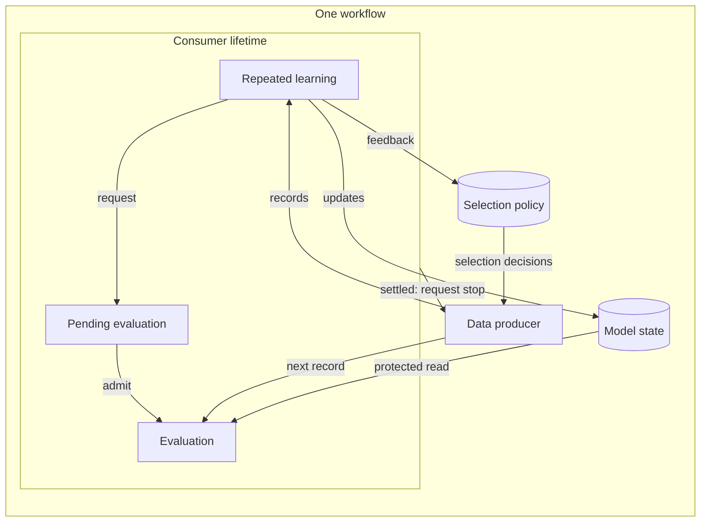

# Shared language, retained products and continuity into G5, November 2026

Continuation of [Reading18](18-framework-comparison-and-xdsl-choice.md), through the last design exchange before this history audit. The active source is verified by a fixed prefix; later audit messages are deliberately outside it.

The [language proposal](../snapshots/aa05e859-rework-model-strategy-trainer/research/xdsl_language_0_1_proposal.md) informs explicitly adopted D14/workflow-composition meanings. The shared reference, verifier, preparation and owner target are developed together, with freshness distinguished from protection and independent semantics distinguished from target behavior.

The subsequent effects/filtering/fusion work closes known acceptance/preparation gaps and adds a real cardinality boundary. [Retained products](../snapshots/f984c41a-xdsl_language/products.md) then replace a copy-only convention for selected buffer/autograd witnesses, with explicit dependencies, borrowing, release and physical settlement. The bounded profile is not general tensor alias analysis, cross-region transfer or production qualification.

The final historical exchange returns to G5. The user rejects framing language design as a reset after choosing xDSL; the assistant acknowledges that months of accepted architecture remain governing input. This audit exists to preserve that continuity. Production G5 tasks remain open; the experimental milestone totals do not close them.

Captured 2026-11-06T08:33:02.023490+00:00. 191 visible user/assistant messages. Exact bodies, annotations, historical links and line endings are preserved. Reasoning, tools, generated context and compaction summaries are omitted.

[Machine-readable provenance](19-shared-language-and-current-frontier.json) | [Sources](19-source-records.json) | [Notepad](../decision-notepad.md)

## Message index

- [001 user: how should we go about the language design?](#m001)
- [002 assistant: I’ll check the report’s language sketch and the governing requirements, then propose a concrete desi](#m002)
- [003 assistant: The governing design already establishes much of the semantic foundation: hierarchical activities, e](#m003)
- [004 assistant: I’d make the next milestone **a language 0.1 design**, developing its semantics, example programs an](#m004)
- [005 user: do you have any questions or concrete things you want to find out that we can ask in the research th](#m005)
- [006 assistant: Yes. I’d ask the research thread to turn the report’s direction into **one coherent proposed languag](#m006)
- [007 user: openspec/changes/rework-model-strategy-trainer/research/xdsl_language_0_1_proposal.md can use this t](#m007)
- [008 assistant: I’ll read the proposal and compare it with the current design and task state, then identify the conc](#m008)
- [009 assistant: The proposal gives us a concrete first slice: shared region contracts and lifecycle verification for](#m009)
- [010 assistant: I’ve read the full proposal. **It gives us a concrete basis for the next language milestone**, parti](#m010)
- [011 user: let's do that now](#m011)
- [012 assistant: I’ll turn the proposal’s bounded first slice into concrete design decisions and tracked implementati](#m012)
- [013 assistant: I’m using the OpenSpec update-change and Beads workflows for `rework-model-strategy-trainer`. The up](#m013)
- [014 assistant: The bounded design will make pending requests part of parent settlement, require producer-stop bound](#m014)
- [015 assistant: The planning edits are in place. Validation reports warnings on both existing and changed requiremen](#m015)
- [016 assistant: The update now passes standard OpenSpec validation with no errors and no new findings. Strict mode s](#m016)
- [017 assistant: The plan now requires the lifetime case, a data-only case, and a valid rearrangement to use the same](#m017)
- [018 assistant: The design also keeps completion and resource protection separate: pending evaluation keeps its cons](#m018)
- [019 assistant: The planning checks are complete, and both research reports are unchanged. I’m waiting for the requi](#m019)
- [020 assistant: Review found no blocking design defects. I’m addressing its handoff and clarity points: the unchange](#m020)
- [021 assistant: Those clarifications are in place, and the checks still pass with no new validation findings. I’m cl](#m021)
- [022 assistant: Done. The proposal now informs D14’s design decisions and four tracked implementation milestones:](#m022)
- [023 user: <external_codex_apps_open_page>{"page_id":null}</external_codex_apps_open_page>](#m023)
- [024 user: Your chnages were committed. There are some amendments to them, please read them and tell me if you ](#m024)
- [025 assistant: I’ll read the amendments against the committed plan and research proposal, then give you my assessme](#m025)
- [026 assistant: I’m using the OpenSpec explore guidance for this assessment. I’ll check the amended plan for consist](#m026)
- [027 assistant: The separate `workflow-composition` capability is a useful correction: shared lifecycle and ownershi](#m027)
- [028 assistant: **I agree with the direction.** The amendments improve the plan: shared semantics belong in `workflo](#m028)
- [029 user: So what do we do now?](#m029)
- [030 assistant: **Resolve those four points in the existing amendments, then start milestone 6.**](#m030)
- [031 user: alright, go ahead with that if it checks out](#m031)
- [032 assistant: I’ll reconcile the four semantic points, validate and review the amended plan, then start milestone ](#m032)
- [033 assistant: Using change: `rework-model-strategy-trainer`. I’m applying the OpenSpec update workflow first, then](#m033)
- [034 assistant: I’ll keep access realization and freshness selection separate in each resource-use contract. I’ll al](#m034)
- [035 assistant: The clarifications pass standard OpenSpec validation with no new findings; strict mode still reports](#m035)
- [036 assistant: The pinned xDSL 0.74 environment is available without Torch and keeps the GIL disabled on import. I’](#m036)
- [037 assistant: The review found the amended semantics sound. I’m fixing a few wording and traceability issues befor](#m037)
- [038 assistant: The planning reconciliation is complete, and section 6 is now claimed. I’m starting its implementati](#m038)
- [039 assistant: All three constructions now verify and round-trip through actual xDSL IR. Normalization expands the ](#m039)
- [040 assistant: The reference now reproduces the lifetime arithmetic (`0.8 → 0.77 → 0.635`) and evaluation of record](#m040)
- [041 assistant: The regressions caught an important distinction: sibling failure and user cancellation need separate](#m041)
- [042 assistant: The fixture now makes the completion trigger explicit: evaluation is queued at the second window’s s](#m042)
- [043 assistant: The combined checks pass: 155 tests, no Torch import, and the GIL disabled before and after. I’m mak](#m043)
- [044 assistant: The implementation checks now pass: 66 new tests and 156 combined checks, plus Ruff, formatting, typ](#m044)
- [045 assistant: Review is reading the implementation now. The comparison checks accept a different order for discard](#m045)
- [046 assistant: I’m checking the decision metadata during this review pass. The declarations need to remain availabl](#m046)
- [047 assistant: The self-audit found a small omission: flow and resource descriptions need to expose the shared deci](#m047)
- [048 assistant: Review found one correctness issue: a request could name a source absent from its handler’s declared](#m048)
- [049 assistant: The routing regression passes, and pending requests now keep an enclosing group unsettled even when ](#m049)
- [050 assistant: All 163 combined checks now pass after the corrections, including fresh normal and optimized childre](#m050)
- [051 assistant: The remaining Beads tasks now reflect the amended contracts, including version admission, reproducib](#m051)
- [052 assistant: The follow-up confirmed the lifecycle fixes and found a few local gaps: preservation checks need to ](#m052)
- [053 assistant: The final combined run passed all 176 tests, with the GIL disabled throughout and no Torch import. T](#m053)
- [054 assistant: The amended plan checked out, and **milestone 6 is complete**.](#m054)
- [055 user: can continue after committing](#m055)
- [056 assistant: I’ll commit the completed milestone and reconciled amendments first, then work through milestone 7’s](#m056)
- [057 assistant: Committed as `b145419c` — `Define shared xDSL workflow contracts and lifecycle reference`.](#m057)
- [058 assistant: The main verifier boundary is clear: it must track settlement dependencies separately from input ava](#m058)
- [059 assistant: The verifier now accepts the training, data-only and extra-scope compositions through the same rules](#m059)
- [060 assistant: The new tests cover the requested distinctions: exclusive branches may each retire a claim, concurre](#m060)
- [061 assistant: All 244 tests passed, including the new verifier and reference controls, with the GIL disabled throu](#m061)
- [062 assistant: The review is running. The report keeps initialization, physical ordering, coordinated cuts and rank](#m062)
- [063 assistant: The extension probe found a missing check: verification accepts a borrowed payload even when its con](#m063)
- [064 assistant: A further probe found an ownership cycle: a claim can be transferred out of a consumer scope and hel](#m064)
- [065 assistant: The external review failed because its provider hit a usage limit; it returned no assessment. I’ll u](#m065)
- [066 assistant: The drain-cycle regression now passes: verification rejects the cycle, and cancellation settles the ](#m066)
- [067 assistant: The fallback reviewer found one further issue: loop-carried references were resolved only to their i](#m067)
- [068 assistant: The follow-up confirmed the carry fix and found one remaining case: a nested write can wait for an e](#m068)
- [069 assistant: The fallback reviewer confirmed both fixes, including the final nested-access controls. All 267 comb](#m069)
- [070 assistant: Committed milestone 6 and the amendments as **`b145419c`**, then completed milestone 7.](#m070)
- [071 user: <external_codex_apps_open_page>{"page_id":null}</external_codex_apps_open_page>](#m071)
- [072 user: Looks fine, good to proceed after commit](#m072)
- [073 assistant: I’ll commit milestone 7, then start milestone 8: deriving prepared execution from the verified IR th](#m073)
- [074 assistant: Committed as `8f920191` (`Verify xDSL workflow lifecycle and scoped resource contracts`). The commit](#m074)
- [075 assistant: The existing engine provides the lifetime, protection and physical-drain primitives we need, but its](#m075)
- [076 assistant: The prepared-artifact layer is in place. It records the IR-derived fragments, obligations, bindings ](#m076)
- [077 assistant: The first live runs pass: the model workflow reaches `0.8 → 0.77 → 0.635`, and the data-only workflo](#m077)
- [078 assistant: The snapshot and protected-current variants both pass the controlled bounded-lag case: two stale pre](#m078)
- [079 assistant: The owner-language suite passes all 249 tests. The Torch-free cohort passes 319 tests, with the opti](#m079)
- [080 assistant: Review is running. The remaining checks confirm that all nine artifact documents match their hashes,](#m080)
- [081 assistant: A read-only probe found one more boundary issue: the target currently copies every resource at start](#m081)
- [082 assistant: The reviewer has not returned yet. Milestone 8 remains open; I’m waiting for the review before apply](#m082)
- [083 assistant: A nested-scope probe found a second issue: normal inner-group settlement can dispose a request whose](#m083)
- [084 assistant: The review returned with actionable findings, including disposed tickets left in ready storage, stal](#m084)
- [085 assistant: The fixes pass all 260 owner-language tests and the 319-test Torch-free cohort, with the GIL disable](#m085)
- [086 assistant: The follow-up review is pending. The documentation now also distinguishes the tested stop behavior f](#m086)
- [087 assistant: The follow-up is still running. The tested source is saved with the review receipt, and the affected](#m087)
- [088 assistant: The focused review has not returned yet. All fixes remain covered by passing checks; the pending ite](#m088)
- [089 assistant: The review is still pending. The source and tests have not changed since the last passing checks.](#m089)
- [090 assistant: The follow-up remains pending. I’m allowing it the configured review window before using the fallbac](#m090)
- [091 assistant: The follow-up is approaching the repository’s 25-minute review limit. If it reaches that limit witho](#m091)
- [092 assistant: The review is still pending near the timeout. The tested fixes are unchanged; the fallback review wi](#m092)
- [093 assistant: The follow-up review timed out at 1,500 seconds without an assessment. I’m starting the authorized G](#m093)
- [094 assistant: Sol independently passed the 31 focused tests and found one remaining race: a producer stopped while](#m094)
- [095 assistant: Sol confirmed the producer-stop fix and found no remaining actionable issue in that correction. The ](#m095)
- [096 assistant: Committed milestone 7 as `8f920191`, then completed milestone 8: live/cold execution through existin](#m096)
- [097 user: can commit and proceed as usual, we'll go over each after we're done](#m097)
- [098 assistant: I’ll commit milestone 8, then continue with milestone 9’s qualification work and required review. I’](#m098)
- [099 assistant: Committed milestone 8 as `61467849`.](#m099)
- [100 assistant: The qualification work is now testing a stronger boundary: results must survive erasing diagnostic h](#m100)
- [101 assistant: The first checks confirm that all three compositions can finish with histories erased and recover th](#m101)
- [102 assistant: The seeded comparisons and pressure cases now pass, including evaluation completing before a later p](#m102)
- [103 assistant: The integrated suite passed: 309 tests with the owner target, plus 319 Torch-free tests with two exp](#m103)
- [104 assistant: The preservation check passed: 1,562 previously tracked files are unchanged, including the original ](#m104)
- [105 assistant: The final capture passed all 44 fresh-process checks and 24 seeded comparisons, with source bytes un](#m105)
- [106 assistant: Review is running. I spotted one test detail to tighten afterward: the exclusion-progress check shou](#m106)
- [107 assistant: The retained negative controls show the intended distinction: the wrong scoring implementation compl](#m107)
- [108 assistant: The stronger probes passed: exclusions allow heartbeat progress with the checkpoint hook disabled, a](#m108)
- [109 assistant: The review is still active and has not returned a verdict. The implementation and evidence checks ar](#m109)
- [110 assistant: The saved cancellation-and-failure case preserves separate outcomes: the input claim is cancelled, t](#m110)
- [111 assistant: Review returned with no runtime correctness defects. It asked for a direct check of the new `stopped](#m111)
- [112 assistant: All 50 focused qualification tests passed after the corrections, including the complete admission-ga](#m112)
- [113 assistant: One integrated run failed because its pytest temporary directory disappeared during concurrent test ](#m113)
- [114 assistant: The isolated rerun passed: 313 owner tests and 319 Torch-free tests, with the GIL disabled before an](#m114)
- [115 assistant: Committed milestone 8 as `61467849`, then completed milestone 9.](#m115)
- [116 user: what needs committing from here?](#m116)
- [117 assistant: I’ll check the staged changes and confirm exactly what remains.](#m117)
- [118 assistant: Only **milestone 9 qualification** remains to commit. Everything is staged:](#m118)
- [119 user: go ahead please](#m119)
- [120 assistant: I’ll commit the staged milestone 9 changes now.](#m120)
- [121 assistant: Committed as `8ac18bd5` — `Qualify shared xDSL workflow lifecycle and cold execution`.](#m121)
- [122 user: <external_codex_apps_open_page>{"page_id":null}</external_codex_apps_open_page>](#m122)
- [123 user: &#x20;feedback for the work so far:](#m123)
- [124 assistant: I’ll check the feedback against the committed language slice and current OpenSpec plan, then define ](#m124)
- [125 assistant: I’m using the codebase-memory workflow to trace the verifier and preparation paths. I’ll first repro](#m125)
- [126 assistant: The current preparation code checks a binding’s update argument positions, but does not check whethe](#m126)
- [127 assistant: I reproduced both reports: the forward SSA use prepared successfully and then raised a `KeyError` in](#m127)
- [128 assistant: The expanded suites pass: 349 owner tests and 353 Torch-free tests, with two expected skips. The liv](#m128)
- [129 user: continue please](#m129)
- [130 assistant: The two rejection fixes are implemented and passing. The independent review stopped at an account us](#m130)
- [131 assistant: I found a documented CLI for the same review service, so the missing chat tool does not prevent a fu](#m131)
- [132 assistant: For the filtering case, I’ll use an independent source feeding a zero-or-one filter stage. The first](#m132)
- [133 assistant: Using change: `rework-model-strategy-trainer`. I’m recording this as a bounded section 10 before pro](#m133)
- [134 assistant: The full review returned with no correctness findings in the two fixes. It suggested clearer, determ](#m134)
- [135 assistant: The two early-rejection fixes are complete and reviewed. I’m continuing with the shared effects cont](#m135)
- [136 assistant: The filter now has an explicit zero-or-one result and settles every admitted input, including drops.](#m136)
- [137 assistant: The first complete runs agree on `(0, 2), (2, 6), (4, 10)` in both the reference and owner target. T](#m137)
- [138 assistant: The pressure checks now pass for late input, prefetch backpressure, pending demand across drops, sco](#m138)
- [139 assistant: The integrated suite passed: 442 owner/language tests, plus 405 Torch-free tests with three expected](#m139)
- [140 assistant: All 60 fresh cold runs and 16 paired reference/owner interleavings passed, including the negative co](#m140)
- [141 assistant: The retained evidence distinguishes admitted filter drops from admission rejection: each drop settle](#m141)
- [142 assistant: Preparation and fusion now use the same effects descriptor; unknown effects remain a barrier. The ge](#m142)
- [143 assistant: The review is tracing cold correspondence, ownership cleanup, and the rewrite path through the surro](#m143)
- [144 assistant: The early-rejection checks passed in both live and cold preparation: unavailable ordered values and ](#m144)
- [145 assistant: An extra probe found a metadata gap: the transparent fusion group was counted as a new decision. Tha](#m145)
- [146 assistant: The review returned with four small follow-ups. I’m addressing the failure-disposition mismatch, str](#m146)
- [147 assistant: All 93 focused checks pass after the corrections. Fusion now preserves reproducibility and rank clai](#m147)
- [148 assistant: The reruns passed: 449 owner/language tests, 410 Torch-free tests, all 60 cold children, and all 16 ](#m148)
- [149 assistant: The follow-up review is checking cleanup and decision analysis, where the corrections changed behavi](#m149)
- [150 assistant: The focused review confirmed the corrections and found no blocking issue. It suggested two small rob](#m150)
- [151 assistant: The final pass is complete: 449 owner/language tests, 410 Torch-free tests with three expected skips](#m151)
- [152 assistant: Completed section 10 and its reviews:](#m152)
- [153 user: commit please](#m153)
- [154 assistant: I’ll check the worktree and retained validation, then commit the milestone.](#m154)
- [155 assistant: Committed as `a09bcf5d` — **Extend shared workflow effects, filtering and fusion**.](#m155)
- [156 user: <external_codex_apps_open_page>{"page_id":null}</external_codex_apps_open_page>](#m156)
- [157 user: What should be next?](#m157)
- [158 assistant: I’ll check the current language scope and remaining milestones, then recommend the next step.](#m158)
- [159 assistant: The latest milestone covers ordered value availability, binding effects, filtering and contract-driv](#m159)
- [160 assistant: I’d move into **G5: concrete language and implementation design**, starting with tasks 5.1–5.2.](#m160)
- [161 user: Is this g5?](#m161)
- [162 assistant: I’ll check how the existing plan separates G5 design from the proposed ownership experiment.](#m162)
- [163 assistant: **It feeds G5; the quoted milestone is primarily another bounded language/runtime experiment.**](#m163)
- [164 user: Okay then lets do it and then we'll see if theres anything else](#m164)
- [165 assistant: I’ll implement the retained-use milestone: an explicit product contract, buffer/view and real PyTorc](#m165)
- [166 assistant: I’m using the existing OpenSpec change and Beads tracking for this work, with the free-threaded Pyth](#m166)
- [167 assistant: I’ll start with a scoped retained product: it names its capability or product dependencies, can be b](#m167)
- [168 assistant: Both cases now pass through preparation and the independent reference, including derived products th](#m168)
- [169 assistant: The target cases pass with ordinary imports leaving the GIL disabled. A derived view and a derived a](#m169)
- [170 assistant: All 52 fresh cold runs passed in normal and optimized Python, including cancellation, late failure, ](#m170)
- [171 assistant: Final regression checks passed: **504 owner/language tests** and **441 Torch-free tests**, with four](#m171)
- [172 assistant: The required review failed before giving an assessment because the provider returned a usage-limit e](#m172)
- [173 assistant: The snapshot check passes too: a product keeps the isolated version it observed while the live owner](#m173)
- [174 assistant: The review found two gaps: cancellation requested at the producing call’s completion checkpoint coul](#m174)
- [175 assistant: Both fixes pass their regressions, and the reviewer confirmed they resolve the findings with no furt](#m175)
- [176 assistant: The final reruns passed: **510 owner/language tests**, **445 Torch-free tests** with four expected s](#m176)
- [177 assistant: Implemented the scoped retained-product milestone.](#m177)
- [178 user: commit please](#m178)
- [179 assistant: I’ll check the final diff and retained validation evidence, then commit the milestone.](#m179)
- [180 assistant: Committed as `f984c41a` — **Add scoped products and retained resource ownership**.](#m180)
- [181 user: meaning we should start discussing details for the real thing now?](#m181)
- [182 assistant: I’ll check the remaining G5 tasks so I can distinguish the production decisions we can make now from](#m182)
- [183 assistant: **Yes. We should now discuss the production design—G5.** The experiments give us enough evidence to ](#m183)
- [184 user: Okay so, can you walk me through how the language and interactions look like? this is not the minute](#m184)
- [185 assistant: I’ll use the current proposal and examples to walk through the language from the outside: what someo](#m185)
- [186 assistant: **The language people recognise as “our system” is ours to design.** xDSL gives us tools for represe](#m186)
- [187 user: I've seen the emphasis on "small" language. can you explain why that is emphasized? what does it mat](#m187)
- [188 assistant: The useful target is **a coherent, composable language**. I used “small” as shorthand for keeping it](#m188)
- [189 user: # Response annotations:](#m189)
- [190 assistant: I framed settled architectural decisions as open choices about authoring style. That was misleading.](#m190)
- [191 assistant: I got the framing wrong. I presented this too much as a fresh language-design exercise, when we alre](#m191)

<a id="m001"></a>
## 001 User - 2026-11-02T20:26:05.159Z

Source: [01a185e6-b37c-7192-bd31-0ba5a575b23d, raw line 13163](/home/imi/.codex/sessions/2026/10/29/rollout-2026-10-29T05-24-11-01a185e6-b37c-7192-bd31-0ba5a575b23d.jsonl:13163).

how should we go about the language design?


<a id="m002"></a>
## 002 Assistant (commentary) - 2026-11-02T20:26:10.061Z

Source: [01a185e6-b37c-7192-bd31-0ba5a575b23d, raw line 13166](/home/imi/.codex/sessions/2026/10/29/rollout-2026-10-29T05-24-11-01a185e6-b37c-7192-bd31-0ba5a575b23d.jsonl:13166).

I’ll check the report’s language sketch and the governing requirements, then propose a concrete design sequence for xDSL.


<a id="m003"></a>
## 003 Assistant (commentary) - 2026-11-02T20:29:27.682Z

Source: [01a185e6-b37c-7192-bd31-0ba5a575b23d, raw line 13200](/home/imi/.codex/sessions/2026/10/29/rollout-2026-10-29T05-24-11-01a185e6-b37c-7192-bd31-0ba5a575b23d.jsonl:13200).

The governing design already establishes much of the semantic foundation: hierarchical activities, explicit cross-owner relationships, selected Python work and one run authority. The language design can make those meanings precise and map them into xDSL, using the broader case inventory to check coverage.


<a id="m004"></a>
## 004 Assistant (final_answer) - 2026-11-02T20:31:08.165Z

Source: [01a185e6-b37c-7192-bd31-0ba5a575b23d, raw line 13216](/home/imi/.codex/sessions/2026/10/29/rollout-2026-10-29T05-24-11-01a185e6-b37c-7192-bd31-0ba5a575b23d.jsonl:13216).

I’d make the next milestone **a language 0.1 design**, developing its semantics, example programs and xDSL representation together.

We already have a foundation: hierarchical activities, explicit cross-owner relationships, selected Python computation and one run authority. The [governing design](/home/imi/Projects/sd-scripts/openspec/changes/rework-model-strategy-trainer/design.md:2922) establishes those meanings; the report supplies a [candidate vocabulary](/home/imi/Projects/sd-scripts/openspec/changes/rework-model-strategy-trainer/research/ir_architecture_report.md:458). We should turn that foundation into a precise language.

**1. Define the language’s semantic vocabulary.**

Separate three things:

- **Common constructs:** activities, regions, typed values and streams, resources, composition, effects and execution relationships.
- **Domain operations:** data selection/transformation, model use, gradient contribution, advancement, evaluation and persistence.
- **Maintained recipes:** convenient combinations of those operations that users select and configure from Python.

This determines which concepts deserve first-class representation and which are compositions or implementation bindings.

We also need important distinctions to be explicit: a stream endpoint versus an individual runtime item; resource identity versus its changing state; an operation definition versus its invocations.

**2. Write a contract for each composition construct.**

Start with sequencing, concurrent composition, repetition and bounded selection, then establish how services and requested activities participate.

Each definition should specify:

- Inputs, outputs, captures and visibility.
- Resource access, effects and authority.
- Admission and child execution.
- Normal completion and pending obligations.
- Failure, orderly stop, cancellation and physical settlement.

Precise prose, diagrams and valid/invalid examples are enough initially. Use formal rules where they make an ambiguity easier to resolve.

**3. Design the representation and lowering boundaries.**

The intended compiler structure would be:

```text
Python composition
        |
Semantic xDSL operations and regions
        |
Verification, normalization and analyses
        |
Prepared coordination + selected region lowerings
        |
Runtime bindings and compiled artifacts
```

For every lowering, identify what must survive: algorithm, identities, numerical policy, resource requirements, admission, causal relationships and outcomes.

MLIR becomes a possible destination for suitable regions. The language should expose enough meaning to support those transformations without requiring every selected Python computation to become numerical IR.

**4. Work through complete programs and sketch Python authoring alongside them.**

Use the broader researched cases to check coverage. I would begin with three contrasting arrangements:

- Data-only production, transformation and feedback.
- Model work with multiple participants, optimization units and scoped authority.
- Independent lifetimes with requested work, transitions and coordinated shutdown.

For each, show the Python composition, semantic IR, required checks and intended realization. Include deliberately invalid arrangements.

This will reveal missing concepts and awkward boundaries before we settle API names. One explicit question is how Python construction-time control differs from represented runtime control.

**5. Implement the first coherent language slice.**

After reviewing the design, define the xDSL types, operations and semantic interfaces, then implement shared verification and lowering into the existing execution services.

The milestone should demonstrate that several arrangements use the same language rules and compiler path. Its acceptance criteria should cover preserved meaning, useful diagnostics, source correspondence and actual execution outcomes.

**The first deliverable should be a language design draft containing the vocabulary, operation contracts, complete example programs, xDSL mapping and lowering obligations.** That gives us something concrete to review before committing to public syntax or production classes.

<oai-mem-citation>
<citation_entries>
MEMORY.md:255-256|note=[Independent semantic expectations and separation of IR infrastructure from runtime obligations]
</citation_entries>
<rollout_ids>
01a10cff-f22a-7973-96f2-f1a98c749d19
</rollout_ids>
</oai-mem-citation>

<a id="m005"></a>
## 005 User - 2026-11-02T21:05:50.648Z

Source: [01a185e6-b37c-7192-bd31-0ba5a575b23d, raw line 13223](/home/imi/.codex/sessions/2026/10/29/rollout-2026-10-29T05-24-11-01a185e6-b37c-7192-bd31-0ba5a575b23d.jsonl:13223).

do you have any questions or concrete things you want to find out that we can ask in the research thread with this direction?


<a id="m006"></a>
## 006 Assistant (final_answer) - 2026-11-02T21:09:00.954Z

Source: [01a185e6-b37c-7192-bd31-0ba5a575b23d, raw line 13242](/home/imi/.codex/sessions/2026/10/29/rollout-2026-10-29T05-24-11-01a185e6-b37c-7192-bd31-0ba5a575b23d.jsonl:13242).

Yes. I’d ask the research thread to turn the report’s direction into **one coherent proposed language design**, with concrete decisions and examples.

The fixed premises should be: **xDSL is the working substrate; authoring is Python; ordinary users compose maintained operations; the goal is strong system machinery for stateful, heterogeneous workflows.** Start from the existing report and broader case inventory.

These are the questions I’d prioritize:

1. **What deserves first-class representation?**  
   Propose the initial operations, types and semantic interfaces. Distinguish common language constructs, domain operations, library recipes and implementation bindings. What information must remain explicit for verification and transformation, and what can safely stay inside selected computation?

2. **What is the composition contract for region-bearing operations?**  
   Propose an interface precise enough to implement entry, invocation, repetition, pending requests, completion, failure, stop, cancellation and physical settlement. How do parents derive obligations from nested children? Where are different lifecycle contracts necessary?

3. **How should values, streams and persistent resources be represented?**  
   Specify how SSA values relate to runtime invocations, stream endpoints, individual item identities, correlation, cardinality and mutable resources. How should captures and scope boundaries work? Which relationships belong in operands/results, symbols, attributes or dedicated operations?

4. **How should effects, authority and changing state compose?**  
   Propose contracts covering protected reads, mutation, aliases, RNG/buffer effects, scoped authority and unknown effects. Distinguish ordinary state evolution from governed replacement or rebinding. Which changes invalidate semantic analyses, prepared plans or compiled regions—and which should preserve them?

5. **Where should the representation levels divide?**  
   Give a concrete semantic → normalized → prepared/executable pipeline. What does each level establish, retain and resolve? Which obligations are checked statically, during preparation or during execution? How do we preserve one accepted meaning and authority across these levels?

6. **Which xDSL and MLIR facilities materially serve this design?**  
   Map the proposal onto actual xDSL operations, regions, traits, interfaces, analyses and rewriting facilities. Identify version-specific gaps. Recommend one or two useful MLIR integration boundaries, including the required lowering and semantic correspondence. Explain which machinery we could reuse there.

7. **Which transformations should influence the language’s design immediately?**  
   Choose a few consequential transformations—such as region specialization, frozen-read movement, local fusion or partitioning a compiled region. State the contracts each needs and give a counterexample showing when it becomes illegal. Preserve input association, effects, numerical policy, authority, outcomes and completion alongside values.

I’d request these outputs:

- A recommended semantic vocabulary and interface sketch.
- One data-only and one stateful model-workflow example, showing proposed Python composition and semantic IR.
- An invalid composition with a precise rejection reason.
- A compiler/lowering diagram.
- A bounded **language 0.1** proposal, with explicit deferred questions.

**Questions 1–4 are the most important.** Their answers determine what the language means; the remaining questions establish how the machinery can faithfully analyze, transform and realize it.

<a id="m007"></a>
## 007 User - 2026-11-02T21:43:45.508Z

Source: [01a185e6-b37c-7192-bd31-0ba5a575b23d, raw line 13249](/home/imi/.codex/sessions/2026/10/29/rollout-2026-10-29T05-24-11-01a185e6-b37c-7192-bd31-0ba5a575b23d.jsonl:13249).

openspec/changes/rework-model-strategy-trainer/research/xdsl_language_0_1_proposal.md can use this to inform our actions


<a id="m008"></a>
## 008 Assistant (commentary) - 2026-11-02T21:43:48.870Z

Source: [01a185e6-b37c-7192-bd31-0ba5a575b23d, raw line 13252](/home/imi/.codex/sessions/2026/10/29/rollout-2026-10-29T05-24-11-01a185e6-b37c-7192-bd31-0ba5a575b23d.jsonl:13252).

I’ll read the proposal and compare it with the current design and task state, then identify the concrete next steps it supports.


<a id="m009"></a>
## 009 Assistant (commentary) - 2026-11-02T21:46:43.186Z

Source: [01a185e6-b37c-7192-bd31-0ba5a575b23d, raw line 13294](/home/imi/.codex/sessions/2026/10/29/rollout-2026-10-29T05-24-11-01a185e6-b37c-7192-bd31-0ba5a575b23d.jsonl:13294).

The proposal gives us a concrete first slice: shared region contracts and lifecycle verification for a producer, driver, requested handler and stop boundary, plus a data-only control. The wider 0.1 vocabulary is a roadmap; we don’t need to implement all of it in that slice.


<a id="m010"></a>
## 010 Assistant (final_answer) - 2026-11-02T21:47:49.500Z

Source: [01a185e6-b37c-7192-bd31-0ba5a575b23d, raw line 13306](/home/imi/.codex/sessions/2026/10/29/rollout-2026-10-29T05-24-11-01a185e6-b37c-7192-bd31-0ba5a575b23d.jsonl:13306).

I’ve read the full proposal. **It gives us a concrete basis for the next language milestone**, particularly its region contracts, ownership rules and separation of semantic, prepared and runtime representations.

I would start with its [“Small next slice”](/home/imi/Projects/sd-scripts/openspec/changes/rework-model-strategy-trainer/research/xdsl_language_0_1_proposal.md:611):

1. **Specify the shared region contract precisely.**  
   Define invocation sources, captures, admission, request-source closure, completion and settlement. The proposed dataclasses are sketches; the important deliverable is the rules their fields express.

2. **Implement shared lifecycle verification and normalization.**  
   Cover parallel drivers, requested handlers and producer-stop coverage. Derive relationships through semantic interfaces, with domain-specific arithmetic and binding contracts kept in their own operations.

3. **Lower those descriptions into existing owner services.**  
   Runtime setup must follow the normalized/prepared IR. Returning a prebuilt case-specific execution graph would not establish the proposed language mechanism.

4. **Exercise both compositions and a valid rearrangement.**  
   Use the lifetime example and data-only control, then verify that the same rules handle another supported nesting. Include premature producer stop, capability escape, pending requests and physical failure/cancellation.

The wider operation catalogue—correlation, batching, grants, transitions and compiled islands—provides design coverage and a roadmap. It needn’t all enter the first implementation slice.

I’d also carry forward two useful distinctions from the proposal:

- **Definition analyses, prepared-realization validity and compiled/data-cache validity are separate.** Ordinary weight updates should not automatically invalidate the semantic program.
- **MLIR integration has a concrete boundary:** selected closed computational islands, with explicit ABI, effects, failure and completion contracts.

This primarily informs OpenSpec **5.3, the accepted/executable representation**, and **5.4, contract fulfillment and authoring APIs**. The next planning step is to turn the bounded slice into reviewed design decisions and tracked implementation tasks, using this report as the research input.

<oai-mem-citation>
<citation_entries>
MEMORY.md:255-256|note=[Independent conformance and separation of language infrastructure from runtime semantics]
</citation_entries>
<rollout_ids>
01a10cff-f22a-7973-96f2-f1a98c749d19
</rollout_ids>
</oai-mem-citation>

<a id="m011"></a>
## 011 User - 2026-11-02T21:49:12.702Z

Source: [01a185e6-b37c-7192-bd31-0ba5a575b23d, raw line 13313](/home/imi/.codex/sessions/2026/10/29/rollout-2026-10-29T05-24-11-01a185e6-b37c-7192-bd31-0ba5a575b23d.jsonl:13313).

let's do that now


<a id="m012"></a>
## 012 Assistant (commentary) - 2026-11-02T21:49:16.374Z

Source: [01a185e6-b37c-7192-bd31-0ba5a575b23d, raw line 13316](/home/imi/.codex/sessions/2026/10/29/rollout-2026-10-29T05-24-11-01a185e6-b37c-7192-bd31-0ba5a575b23d.jsonl:13316).

I’ll turn the proposal’s bounded first slice into concrete design decisions and tracked implementation tasks, then validate and review the planning changes.


<a id="m013"></a>
## 013 Assistant (commentary) - 2026-11-02T21:51:22.740Z

Source: [01a185e6-b37c-7192-bd31-0ba5a575b23d, raw line 13339](/home/imi/.codex/sessions/2026/10/29/rollout-2026-10-29T05-24-11-01a185e6-b37c-7192-bd31-0ba5a575b23d.jsonl:13339).

I’m using the OpenSpec update-change and Beads workflows for `rework-model-strategy-trainer`. The update will record the agreed xDSL choice, define the bounded lifecycle contract and add the implementation milestones that follow from it.


<a id="m014"></a>
## 014 Assistant (commentary) - 2026-11-02T21:55:57.727Z

Source: [01a185e6-b37c-7192-bd31-0ba5a575b23d, raw line 13396](/home/imi/.codex/sessions/2026/10/29/rollout-2026-10-29T05-24-11-01a185e6-b37c-7192-bd31-0ba5a575b23d.jsonl:13396).

The bounded design will make pending requests part of parent settlement, require producer-stop boundaries to cover their consumers, and retain protected access through physical completion. I’m splitting the implementation into four reviewed milestones: contracts and normalization, lifecycle verification, prepared execution, and integrated qualification.


<a id="m015"></a>
## 015 Assistant (commentary) - 2026-11-02T22:08:33.459Z

Source: [01a185e6-b37c-7192-bd31-0ba5a575b23d, raw line 13481](/home/imi/.codex/sessions/2026/10/29/rollout-2026-10-29T05-24-11-01a185e6-b37c-7192-bd31-0ba5a575b23d.jsonl:13481).

The planning edits are in place. Validation reports warnings on both existing and changed requirement text; I’m comparing against `HEAD` to identify which warnings this update introduced before sending it for review.


<a id="m016"></a>
## 016 Assistant (commentary) - 2026-11-02T22:12:49.737Z

Source: [01a185e6-b37c-7192-bd31-0ba5a575b23d, raw line 13557](/home/imi/.codex/sessions/2026/10/29/rollout-2026-10-29T05-24-11-01a185e6-b37c-7192-bd31-0ba5a575b23d.jsonl:13557).

The update now passes standard OpenSpec validation with no errors and no new findings. Strict mode still fails on the same 53 long-requirement warnings present at `HEAD`; I’ve recorded that baseline and opened a separate cleanup task. I’m requesting review of the planning changes now.


> Compaction boundary at raw line 13594, 2026-11-02T22:16:27.090Z. The generated summary is omitted.

<a id="m017"></a>
## 017 Assistant (commentary) - 2026-11-02T22:17:04.424Z

Source: [01a185e6-b37c-7192-bd31-0ba5a575b23d, raw line 13639](/home/imi/.codex/sessions/2026/10/29/rollout-2026-10-29T05-24-11-01a185e6-b37c-7192-bd31-0ba5a575b23d.jsonl:13639).

The plan now requires the lifetime case, a data-only case, and a valid rearrangement to use the same contracts and lowering path. That should test reusable language machinery beyond the existing fixtures. Each of the four implementation milestones has its own verification and review gate; the planning review is still running.


<a id="m018"></a>
## 018 Assistant (commentary) - 2026-11-02T22:18:32.299Z

Source: [01a185e6-b37c-7192-bd31-0ba5a575b23d, raw line 13670](/home/imi/.codex/sessions/2026/10/29/rollout-2026-10-29T05-24-11-01a185e6-b37c-7192-bd31-0ba5a575b23d.jsonl:13670).

The design also keeps completion and resource protection separate: pending evaluation keeps its consumer group alive, and physical work retains its required protection through settlement. MLIR code generation and production APIs remain later decisions; this slice establishes the contracts they would need.


<a id="m019"></a>
## 019 Assistant (commentary) - 2026-11-02T22:19:59.753Z

Source: [01a185e6-b37c-7192-bd31-0ba5a575b23d, raw line 13693](/home/imi/.codex/sessions/2026/10/29/rollout-2026-10-29T05-24-11-01a185e6-b37c-7192-bd31-0ba5a575b23d.jsonl:13693).

The planning checks are complete, and both research reports are unchanged. I’m waiting for the required review before closing this milestone; no language implementation has started.


<a id="m020"></a>
## 020 Assistant (commentary) - 2026-11-02T22:21:52.470Z

Source: [01a185e6-b37c-7192-bd31-0ba5a575b23d, raw line 13712](/home/imi/.codex/sessions/2026/10/29/rollout-2026-10-29T05-24-11-01a185e6-b37c-7192-bd31-0ba5a575b23d.jsonl:13712).

Review found no blocking design defects. I’m addressing its handoff and clarity points: the unchanged proposal must accompany the eventual commit, task references need consistent numbering, and the plan should distinguish historical validation results and independent production work from the new research sequence.


<a id="m021"></a>
## 021 Assistant (commentary) - 2026-11-02T22:23:28.112Z

Source: [01a185e6-b37c-7192-bd31-0ba5a575b23d, raw line 13764](/home/imi/.codex/sessions/2026/10/29/rollout-2026-10-29T05-24-11-01a185e6-b37c-7192-bd31-0ba5a575b23d.jsonl:13764).

Those clarifications are in place, and the checks still pass with no new validation findings. I’m closing the planning milestone and framework decision task. The next implementation milestone is shared region contracts and normalization; the changes remain uncommitted.


<a id="m022"></a>
## 022 Assistant (final_answer) - 2026-11-02T22:24:22.250Z

Source: [01a185e6-b37c-7192-bd31-0ba5a575b23d, raw line 13791](/home/imi/.codex/sessions/2026/10/29/rollout-2026-10-29T05-24-11-01a185e6-b37c-7192-bd31-0ba5a575b23d.jsonl:13791).

Done. The proposal now informs [D14’s design decisions](/home/imi/Projects/sd-scripts/openspec/changes/rework-model-strategy-trainer/design.md) and four tracked [implementation milestones](/home/imi/Projects/sd-scripts/openspec/changes/rework-model-strategy-trainer/tasks.md):

1. Shared region contracts and normalization.
2. Lifecycle, pending-request and resource verification.
3. Prepared execution through existing owner services.
4. Cross-composition and failure qualification.

The lifetime case, data-only case and valid rearrangement must share the same machinery. Production APIs and backend choices remain open.

Review completed; its handoff and clarity findings are addressed. Standard OpenSpec validation passes. Strict validation still fails on the same **53 pre-existing warnings**, tracked separately.

Next ready task: **`sd-scripts-syv.31.26.2`**, contracts and normalization.

Changes remain **uncommitted**. Your proposal is unchanged and must accompany the eventual planning commit.

<oai-mem-citation>
<citation_entries>
MEMORY.md:255-256|note=[Independent conformance and separation of language infrastructure from runtime semantics]
</citation_entries>
<rollout_ids>
01a10cff-f22a-7973-96f2-f1a98c749d19
</rollout_ids>
</oai-mem-citation>

<a id="m023"></a>
## 023 User - 2026-11-03T07:57:32.744Z

Source: [01a185e6-b37c-7192-bd31-0ba5a575b23d, raw line 13804](/home/imi/.codex/sessions/2026/10/29/rollout-2026-10-29T05-24-11-01a185e6-b37c-7192-bd31-0ba5a575b23d.jsonl:13804).

<external_codex_apps_open_page>{"page_id":null}</external_codex_apps_open_page>

<a id="m024"></a>
## 024 User - 2026-11-03T07:57:34.779Z

Source: [01a185e6-b37c-7192-bd31-0ba5a575b23d, raw line 13807](/home/imi/.codex/sessions/2026/10/29/rollout-2026-10-29T05-24-11-01a185e6-b37c-7192-bd31-0ba5a575b23d.jsonl:13807).

Your chnages were committed. There are some amendments to them, please read them and tell me if you agree


<a id="m025"></a>
## 025 Assistant (commentary) - 2026-11-03T07:57:38.647Z

Source: [01a185e6-b37c-7192-bd31-0ba5a575b23d, raw line 13811](/home/imi/.codex/sessions/2026/10/29/rollout-2026-10-29T05-24-11-01a185e6-b37c-7192-bd31-0ba5a575b23d.jsonl:13811).

I’ll read the amendments against the committed plan and research proposal, then give you my assessment of any changes in scope or semantics.


<a id="m026"></a>
## 026 Assistant (commentary) - 2026-11-03T07:58:17.657Z

Source: [01a185e6-b37c-7192-bd31-0ba5a575b23d, raw line 13825](/home/imi/.codex/sessions/2026/10/29/rollout-2026-10-29T05-24-11-01a185e6-b37c-7192-bd31-0ba5a575b23d.jsonl:13825).

I’m using the OpenSpec explore guidance for this assessment. I’ll check the amended plan for consistency and keep the files unchanged.


<a id="m027"></a>
## 027 Assistant (commentary) - 2026-11-03T08:00:13.346Z

Source: [01a185e6-b37c-7192-bd31-0ba5a575b23d, raw line 13862](/home/imi/.codex/sessions/2026/10/29/rollout-2026-10-29T05-24-11-01a185e6-b37c-7192-bd31-0ba5a575b23d.jsonl:13862).

The separate `workflow-composition` capability is a useful correction: shared lifecycle and ownership rules now have a home independent of training. The reference interpreter also strengthens the plan. I’m checking the access-mode and reproducibility rules closely, since those determine which scheduling differences are acceptable.


<a id="m028"></a>
## 028 Assistant (final_answer) - 2026-11-03T08:03:28.165Z

Source: [01a185e6-b37c-7192-bd31-0ba5a575b23d, raw line 13901](/home/imi/.codex/sessions/2026/10/29/rollout-2026-10-29T05-24-11-01a185e6-b37c-7192-bd31-0ba5a575b23d.jsonl:13901).

**I agree with the direction.** The [amendments](/home/imi/Projects/sd-scripts/openspec/changes/rework-model-strategy-trainer/design.md:2681) improve the plan: shared semantics belong in `workflow-composition`, an executable reference gives us an independent lifecycle oracle, and ownership becomes a reusable discipline. Declaring quiescence and rank requirements now, while deferring their realization, also makes sense.

I would clarify four details before fixing the contract algebra:

1. **`current_at_start` and `protected_current` overlap.** The former describes *when the version is selected*; the latter describes *how live access is protected*. An evaluation can require both. Define their distinct observable guarantees, or represent freshness selection and access realization separately.

2. **Protected reads are not necessarily schedule-dependent.** D14 says they are “schedule-dependent by construction.” A protected read ordered after the final writer can observe the same version under every permitted schedule. Conversely, snapshots alone do not establish reproducibility if admission or other decisions depend on scheduling. Derive the classification from the composition’s ordering and decision contracts.

3. **Version admission needs a comparison boundary.** Define which resource/version lineage is compared, what measures bounded lag, and when “current” is sampled. Exact-current *at admission* and current *when computation starts* can differ. This matters once products depend on several independently evolving resources.

4. **Reject unsynchronized rank-local decisions, not rank-local randomness itself.** The [randomness scenario](/home/imi/Projects/sd-scripts/openspec/changes/rework-model-strategy-trainer/specs/workflow-composition/spec.md:235) currently requires rejection whenever collective selection draws from rank-local state. One rank drawing randomly and distributing the decision should remain valid under the preceding rule.

The reference interpreter and genuine snapshot realization materially expand the implementation slice. I think that expansion is justified. The reference should take explicit scheduling/event choices and independently determine legal admissions and outcomes.

Standard validation passes; strict validation retains the same **53 inherited warnings**. I changed no files.

<oai-mem-citation>
<citation_entries>
MEMORY.md:255-256|note=[Background on independent conformance and separation of framework infrastructure from runtime semantics]
</citation_entries>
<rollout_ids>
01a10cff-f22a-7973-96f2-f1a98c749d19
</rollout_ids>
</oai-mem-citation>

<a id="m029"></a>
## 029 User - 2026-11-03T13:07:18.096Z

Source: [01a185e6-b37c-7192-bd31-0ba5a575b23d, raw line 13908](/home/imi/.codex/sessions/2026/10/29/rollout-2026-10-29T05-24-11-01a185e6-b37c-7192-bd31-0ba5a575b23d.jsonl:13908).

So what do we do now?


<a id="m030"></a>
## 030 Assistant (final_answer) - 2026-11-03T13:08:04.137Z

Source: [01a185e6-b37c-7192-bd31-0ba5a575b23d, raw line 13915](/home/imi/.codex/sessions/2026/10/29/rollout-2026-10-29T05-24-11-01a185e6-b37c-7192-bd31-0ba5a575b23d.jsonl:13915).

**Resolve those four points in the existing amendments, then start milestone 6.**

1. Update D14, `workflow-composition`, and the affected acceptance criteria: separate freshness from protection, derive reproducibility from composition, define version-comparison boundaries, and permit decisions made once and distributed.
2. Validate and review the amended plan.
3. Implement **shared contracts, actual xDSL structure, normalization, and the Torch-free reference interpreter**. Exercise the lifetime case, data-only case, and valid rearrangement through the same machinery.

Milestone 6 should establish a usable structural and semantic foundation. Its implementation can inform concrete operation layouts and Python types; we can leave public API shapes open.

After its checks and review, milestone 7 adds lifecycle and ownership verification.

<a id="m031"></a>
## 031 User - 2026-11-03T13:10:08.770Z

Source: [01a185e6-b37c-7192-bd31-0ba5a575b23d, raw line 13922](/home/imi/.codex/sessions/2026/10/29/rollout-2026-10-29T05-24-11-01a185e6-b37c-7192-bd31-0ba5a575b23d.jsonl:13922).

alright, go ahead with that if it checks out


<a id="m032"></a>
## 032 Assistant (commentary) - 2026-11-03T13:10:12.719Z

Source: [01a185e6-b37c-7192-bd31-0ba5a575b23d, raw line 13925](/home/imi/.codex/sessions/2026/10/29/rollout-2026-10-29T05-24-11-01a185e6-b37c-7192-bd31-0ba5a575b23d.jsonl:13925).

I’ll reconcile the four semantic points, validate and review the amended plan, then start milestone 6 if that review clears it. Each milestone will keep its own checks and review boundary.


<a id="m033"></a>
## 033 Assistant (commentary) - 2026-11-03T13:10:37.331Z

Source: [01a185e6-b37c-7192-bd31-0ba5a575b23d, raw line 13939](/home/imi/.codex/sessions/2026/10/29/rollout-2026-10-29T05-24-11-01a185e6-b37c-7192-bd31-0ba5a575b23d.jsonl:13939).

Using change: `rework-model-strategy-trainer`. I’m applying the OpenSpec update workflow first, then the apply workflow for section 6, with Beads tracking both steps.


<a id="m034"></a>
## 034 Assistant (commentary) - 2026-11-03T13:12:15.460Z

Source: [01a185e6-b37c-7192-bd31-0ba5a575b23d, raw line 13964](/home/imi/.codex/sessions/2026/10/29/rollout-2026-10-29T05-24-11-01a185e6-b37c-7192-bd31-0ba5a575b23d.jsonl:13964).

I’ll keep access realization and freshness selection separate in each resource-use contract. I’ll also make version admission name its comparison boundary and derive reproducibility from the composition’s ordering. That resolves the ambiguities without adding a scheduler or distributed execution to this slice.


<a id="m035"></a>
## 035 Assistant (commentary) - 2026-11-03T13:14:02.271Z

Source: [01a185e6-b37c-7192-bd31-0ba5a575b23d, raw line 13987](/home/imi/.codex/sessions/2026/10/29/rollout-2026-10-29T05-24-11-01a185e6-b37c-7192-bd31-0ba5a575b23d.jsonl:13987).

The clarifications pass standard OpenSpec validation with no new findings; strict mode still reports the same 53 inherited warnings. I’m requesting review of the amended plan now. The code graph connection is unavailable, so I’ll inspect source directly when checking the existing patterns.


<a id="m036"></a>
## 036 Assistant (commentary) - 2026-11-03T13:17:29.713Z

Source: [01a185e6-b37c-7192-bd31-0ba5a575b23d, raw line 14053](/home/imi/.codex/sessions/2026/10/29/rollout-2026-10-29T05-24-11-01a185e6-b37c-7192-bd31-0ba5a575b23d.jsonl:14053).

The pinned xDSL 0.74 environment is available without Torch and keeps the GIL disabled on import. I’m keeping milestone 6 focused on IR structure, normalization and reference lifecycle semantics; owner-integrated execution remains in milestone 8.


<a id="m037"></a>
## 037 Assistant (commentary) - 2026-11-03T13:21:44.777Z

Source: [01a185e6-b37c-7192-bd31-0ba5a575b23d, raw line 14092](/home/imi/.codex/sessions/2026/10/29/rollout-2026-10-29T05-24-11-01a185e6-b37c-7192-bd31-0ba5a575b23d.jsonl:14092).

The review found the amended semantics sound. I’m fixing a few wording and traceability issues before starting section 6, including an explicit definition of the lifecycle facts the reference will compare. The proposal is already committed unchanged; I’ll record that the new shared spec must accompany the eventual commit.


<a id="m038"></a>
## 038 Assistant (commentary) - 2026-11-03T13:24:15.343Z

Source: [01a185e6-b37c-7192-bd31-0ba5a575b23d, raw line 14124](/home/imi/.codex/sessions/2026/10/29/rollout-2026-10-29T05-24-11-01a185e6-b37c-7192-bd31-0ba5a575b23d.jsonl:14124).

The planning reconciliation is complete, and section 6 is now claimed. I’m starting its implementation. I’m also applying the free-threaded Python guidance to import checks and state ownership; the reference interpreter will be confined to one caller.


<a id="m039"></a>
## 039 Assistant (commentary) - 2026-11-03T13:32:22.405Z

Source: [01a185e6-b37c-7192-bd31-0ba5a575b23d, raw line 14178](/home/imi/.codex/sessions/2026/10/29/rollout-2026-10-29T05-24-11-01a185e6-b37c-7192-bd31-0ba5a575b23d.jsonl:14178).

All three constructions now verify and round-trip through actual xDSL IR. Normalization expands the maintained recipe, preserves source references and remaps SSA uses. Next I’m building the reference interpreter so it derives requests and admissions from protocol state, independently of runtime traces.


<a id="m040"></a>
## 040 Assistant (commentary) - 2026-11-03T13:45:59.493Z

Source: [01a185e6-b37c-7192-bd31-0ba5a575b23d, raw line 14294](/home/imi/.codex/sessions/2026/10/29/rollout-2026-10-29T05-24-11-01a185e6-b37c-7192-bd31-0ba5a575b23d.jsonl:14294).

The reference now reproduces the lifetime arithmetic (`0.8 → 0.77 → 0.635`) and evaluation of record 4. Held-call probes also keep the run unsettled through cancellation or a late producer failure. I’m turning those probes into regression tests and checking that a separate operation can reuse the shared interfaces.


<a id="m041"></a>
## 041 Assistant (commentary) - 2026-11-03T13:53:13.635Z

Source: [01a185e6-b37c-7192-bd31-0ba5a575b23d, raw line 14391](/home/imi/.codex/sessions/2026/10/29/rollout-2026-10-29T05-24-11-01a185e6-b37c-7192-bd31-0ba5a575b23d.jsonl:14391).

The regressions caught an important distinction: sibling failure and user cancellation need separate state. That is fixed, so the reference retains the originating failure while draining siblings. The focused reference tests now pass; I’m finishing the type checks and documenting its supported protocols and limits.


<a id="m042"></a>
## 042 Assistant (commentary) - 2026-11-03T14:07:02.243Z

Source: [01a185e6-b37c-7192-bd31-0ba5a575b23d, raw line 14493](/home/imi/.codex/sessions/2026/10/29/rollout-2026-10-29T05-24-11-01a185e6-b37c-7192-bd31-0ba5a575b23d.jsonl:14493).

The fixture now makes the completion trigger explicit: evaluation is queued at the second window’s successful settled boundary. The source owns that emission before publishing completion. Tests also distinguish stopping before the second window is admitted from stopping after it is admitted, when its work and evaluation request must finish.


<a id="m043"></a>
## 043 Assistant (commentary) - 2026-11-03T14:22:13.716Z

Source: [01a185e6-b37c-7192-bd31-0ba5a575b23d, raw line 14633](/home/imi/.codex/sessions/2026/10/29/rollout-2026-10-29T05-24-11-01a185e6-b37c-7192-bd31-0ba5a575b23d.jsonl:14633).

The combined checks pass: 155 tests, no Torch import, and the GIL disabled before and after. I’m making one final pass over the comparison rules to ensure they preserve required ownership order while allowing harmless differences in shutdown bookkeeping.


<a id="m044"></a>
## 044 Assistant (commentary) - 2026-11-03T14:26:08.374Z

Source: [01a185e6-b37c-7192-bd31-0ba5a575b23d, raw line 14687](/home/imi/.codex/sessions/2026/10/29/rollout-2026-10-29T05-24-11-01a185e6-b37c-7192-bd31-0ba5a575b23d.jsonl:14687).

The implementation checks now pass: 66 new tests and 156 combined checks, plus Ruff, formatting, typing and link checks. Existing experiments and both research reports are unchanged. I’m requesting the required milestone review now; section 6 remains open until it returns and any findings are addressed.


<a id="m045"></a>
## 045 Assistant (commentary) - 2026-11-03T14:31:16.861Z

Source: [01a185e6-b37c-7192-bd31-0ba5a575b23d, raw line 14718](/home/imi/.codex/sessions/2026/10/29/rollout-2026-10-29T05-24-11-01a185e6-b37c-7192-bd31-0ba5a575b23d.jsonl:14718).

Review is reading the implementation now. The comparison checks accept a different order for discarding unclaimed prefetched records, reject duplicate owned facts, and retain the physical-completion and validation relationships required before disposition.


<a id="m046"></a>
## 046 Assistant (commentary) - 2026-11-03T14:33:59.965Z

Source: [01a185e6-b37c-7192-bd31-0ba5a575b23d, raw line 14738](/home/imi/.codex/sessions/2026/10/29/rollout-2026-10-29T05-24-11-01a185e6-b37c-7192-bd31-0ba5a575b23d.jsonl:14738).

I’m checking the decision metadata during this review pass. The declarations need to remain available through flow and resource queries as well as region queries, so the later verifier can inspect admission and access policies consistently.


<a id="m047"></a>
## 047 Assistant (commentary) - 2026-11-03T14:36:36.534Z

Source: [01a185e6-b37c-7192-bd31-0ba5a575b23d, raw line 14764](/home/imi/.codex/sessions/2026/10/29/rollout-2026-10-29T05-24-11-01a185e6-b37c-7192-bd31-0ba5a575b23d.jsonl:14764).

The self-audit found a small omission: flow and resource descriptions need to expose the shared decision descriptor directly. I’ll add it with a round-trip regression after the review returns, keeping the reviewer’s snapshot stable.


<a id="m048"></a>
## 048 Assistant (commentary) - 2026-11-03T14:45:26.246Z

Source: [01a185e6-b37c-7192-bd31-0ba5a575b23d, raw line 14818](/home/imi/.codex/sessions/2026/10/29/rollout-2026-10-29T05-24-11-01a185e6-b37c-7192-bd31-0ba5a575b23d.jsonl:14818).

Review found one correctness issue: a request could name a source absent from its handler’s declared source set, allowing the handler to close too early. I’m fixing that routing check and adding a regression. I’ll also enforce normalization’s contract-preservation check and finish the metadata correction found in the self-audit before handing off.


<a id="m049"></a>
## 049 Assistant (commentary) - 2026-11-03T14:53:49.040Z

Source: [01a185e6-b37c-7192-bd31-0ba5a575b23d, raw line 14915](/home/imi/.codex/sessions/2026/10/29/rollout-2026-10-29T05-24-11-01a185e6-b37c-7192-bd31-0ba5a575b23d.jsonl:14915).

The routing regression passes, and pending requests now keep an enclosing group unsettled even when no handler body was invoked. The decision metadata and contract-preservation checks are also covered. All 72 focused tests pass; I’m rerunning the combined gates and requesting a focused follow-up review of the lifecycle fixes.


<a id="m050"></a>
## 050 Assistant (commentary) - 2026-11-03T15:04:25.836Z

Source: [01a185e6-b37c-7192-bd31-0ba5a575b23d, raw line 15014](/home/imi/.codex/sessions/2026/10/29/rollout-2026-10-29T05-24-11-01a185e6-b37c-7192-bd31-0ba5a575b23d.jsonl:15014).

All 163 combined checks now pass after the corrections, including fresh normal and optimized children. The focused follow-up review is running. I’m keeping section 6 open until that review finishes.


<a id="m051"></a>
## 051 Assistant (commentary) - 2026-11-03T15:07:39.525Z

Source: [01a185e6-b37c-7192-bd31-0ba5a575b23d, raw line 15045](/home/imi/.codex/sessions/2026/10/29/rollout-2026-10-29T05-24-11-01a185e6-b37c-7192-bd31-0ba5a575b23d.jsonl:15045).

The remaining Beads tasks now reflect the amended contracts, including version admission, reproducibility, snapshot/live access and reference comparison. The follow-up review is the only remaining gate for section 6.


<a id="m052"></a>
## 052 Assistant (commentary) - 2026-11-03T15:17:48.806Z

Source: [01a185e6-b37c-7192-bd31-0ba5a575b23d, raw line 15108](/home/imi/.codex/sessions/2026/10/29/rollout-2026-10-29T05-24-11-01a185e6-b37c-7192-bd31-0ba5a575b23d.jsonl:15108).

The follow-up confirmed the lifecycle fixes and found a few local gaps: preservation checks need to include flow, access and binding contracts, and invalid source relationships and declarations need typed errors. I’m addressing those with targeted tests before closing the milestone.


> Compaction boundary at raw line 15212, 2026-11-03T15:30:43.009Z. The generated summary is omitted.

<a id="m053"></a>
## 053 Assistant (commentary) - 2026-11-03T15:30:59.496Z

Source: [01a185e6-b37c-7192-bd31-0ba5a575b23d, raw line 15228](/home/imi/.codex/sessions/2026/10/29/rollout-2026-10-29T05-24-11-01a185e6-b37c-7192-bd31-0ba5a575b23d.jsonl:15228).

The final combined run passed all 176 tests, with the GIL disabled throughout and no Torch import. The review findings are addressed. I’m checking the milestone record and final diff before handing this back; milestone 7 remains untouched.


<a id="m054"></a>
## 054 Assistant (final_answer) - 2026-11-03T15:33:19.815Z

Source: [01a185e6-b37c-7192-bd31-0ba5a575b23d, raw line 15286](/home/imi/.codex/sessions/2026/10/29/rollout-2026-10-29T05-24-11-01a185e6-b37c-7192-bd31-0ba5a575b23d.jsonl:15286).

The amended plan checked out, and **milestone 6 is complete**.

The [shared xDSL slice](/home/imi/Projects/sd-scripts/docs_design/models-strategy-trainer/xdsl_language/README.md) now provides typed operations and regions, shared contract queries, normalization with preservation checks, and a Torch-free lifecycle reference across training, data-only work and an alternative composition.

Validation:

- **176 tests passed**, including 86 new tests.
- GIL remained disabled; Torch was never imported.
- Ruff, formatting and type checks passed.
- Planning and implementation reviews completed; actionable findings were fixed.
- Standard OpenSpec validation passes. Strict validation retains exactly the **53 inherited warnings**, with no new findings.

Your reports and other amendments are preserved. Changes remain **uncommitted**.

Next is **milestone 7: the shared lifecycle, ownership and scoped-resource verifier**. It remains unstarted; this milestone establishes structure and reference semantics, not prepared execution readiness.

<oai-mem-citation>
<citation_entries>
MEMORY.md:255-256|note=[Independent conformance and separation of framework infrastructure from runtime semantics]
</citation_entries>
<rollout_ids>
01a10cff-f22a-7973-96f2-f1a98c749d19
</rollout_ids>
</oai-mem-citation>

<a id="m055"></a>
## 055 User - 2026-11-03T21:28:12.462Z

Source: [01a185e6-b37c-7192-bd31-0ba5a575b23d, raw line 15296](/home/imi/.codex/sessions/2026/10/29/rollout-2026-10-29T05-24-11-01a185e6-b37c-7192-bd31-0ba5a575b23d.jsonl:15296).

can continue after committing


<a id="m056"></a>
## 056 Assistant (commentary) - 2026-11-03T21:28:29.979Z

Source: [01a185e6-b37c-7192-bd31-0ba5a575b23d, raw line 15302](/home/imi/.codex/sessions/2026/10/29/rollout-2026-10-29T05-24-11-01a185e6-b37c-7192-bd31-0ba5a575b23d.jsonl:15302).

I’ll commit the completed milestone and reconciled amendments first, then work through milestone 7’s shared lifecycle and resource verifier, including its checks and review.


<a id="m057"></a>
## 057 Assistant (commentary) - 2026-11-03T21:29:42.394Z

Source: [01a185e6-b37c-7192-bd31-0ba5a575b23d, raw line 15347](/home/imi/.codex/sessions/2026/10/29/rollout-2026-10-29T05-24-11-01a185e6-b37c-7192-bd31-0ba5a575b23d.jsonl:15347).

Committed as `b145419c` — `Define shared xDSL workflow contracts and lifecycle reference`.

I’m continuing with milestone 7 under `rework-model-strategy-trainer` (30/46 tasks complete). This adds checks for pending-work closure, producer shutdown, affine claims, scoped capabilities, and access/version/decision declarations. The code graph connection is still unavailable, so I’m inspecting the source directly.


<a id="m058"></a>
## 058 Assistant (commentary) - 2026-11-03T21:37:30.751Z

Source: [01a185e6-b37c-7192-bd31-0ba5a575b23d, raw line 15439](/home/imi/.codex/sessions/2026/10/29/rollout-2026-10-29T05-24-11-01a185e6-b37c-7192-bd31-0ba5a575b23d.jsonl:15439).

The main verifier boundary is clear: it must track settlement dependencies separately from input availability, so bounded feedback can remain valid while circular shutdown waits are rejected. Claim checking also needs to follow region execution rules—a claim retired once in each mutually exclusive branch is valid.

I’ll add small shared queries for item uses, endpoint uses and completion controls, then derive the verifier from those and the existing region contracts.


<a id="m059"></a>
## 059 Assistant (commentary) - 2026-11-03T21:46:10.427Z

Source: [01a185e6-b37c-7192-bd31-0ba5a575b23d, raw line 15506](/home/imi/.codex/sessions/2026/10/29/rollout-2026-10-29T05-24-11-01a185e6-b37c-7192-bd31-0ba5a575b23d.jsonl:15506).

The verifier now accepts the training, data-only and extra-scope compositions through the same rules. It records the physical and owner-protocol evidence still required at preparation and execution.

I’m testing the rejection paths next: early producer stop, missing pending-work coverage, claim duplication and capability escape. I’m also extending the reference’s version-admission checks so actual production versions can be compared independently.


<a id="m060"></a>
## 060 Assistant (commentary) - 2026-11-03T21:57:17.814Z

Source: [01a185e6-b37c-7192-bd31-0ba5a575b23d, raw line 15633](/home/imi/.codex/sessions/2026/10/29/rollout-2026-10-29T05-24-11-01a185e6-b37c-7192-bd31-0ba5a575b23d.jsonl:15633).

The new tests cover the requested distinctions: exclusive branches may each retire a claim, concurrent captures may not duplicate it, and early producer stop fails when evaluation still needs input.

Version checks also retain the actual production provenance. The reference can now show a fixed snapshot being rejected after an owner update, and work selected before an update observing the newer version when its read begins.


<a id="m061"></a>
## 061 Assistant (commentary) - 2026-11-03T22:01:52.495Z

Source: [01a185e6-b37c-7192-bd31-0ba5a575b23d, raw line 15706](/home/imi/.codex/sessions/2026/10/29/rollout-2026-10-29T05-24-11-01a185e6-b37c-7192-bd31-0ba5a575b23d.jsonl:15706).

All 244 tests passed, including the new verifier and reference controls, with the GIL disabled throughout and no Torch import. Ruff, formatting and type checks passed too.

I’m sending milestone 7 for review now. Standard OpenSpec validation passes; strict validation still reports the same 53 inherited warnings, with no new findings.


<a id="m062"></a>
## 062 Assistant (commentary) - 2026-11-03T22:04:16.372Z

Source: [01a185e6-b37c-7192-bd31-0ba5a575b23d, raw line 15735](/home/imi/.codex/sessions/2026/10/29/rollout-2026-10-29T05-24-11-01a185e6-b37c-7192-bd31-0ba5a575b23d.jsonl:15735).

The review is running. The report keeps initialization, physical ordering, coordinated cuts and rank distribution as explicit remaining obligations, which gives preparation a clear boundary for establishing execution readiness.

I’m also checking whether an extension could omit a detached-result or item-disposition contract and still pass verification.


<a id="m063"></a>
## 063 Assistant (commentary) - 2026-11-03T22:06:42.024Z

Source: [01a185e6-b37c-7192-bd31-0ba5a575b23d, raw line 15773](/home/imi/.codex/sessions/2026/10/29/rollout-2026-10-29T05-24-11-01a185e6-b37c-7192-bd31-0ba5a575b23d.jsonl:15773).

The extension probe found a missing check: verification accepts a borrowed payload even when its contract omits the detached-result guarantee. I’m keeping the review’s source stable until it returns, then I’ll add that guard and check root transfers of owned values as well.


<a id="m064"></a>
## 064 Assistant (commentary) - 2026-11-03T22:11:45.400Z

Source: [01a185e6-b37c-7192-bd31-0ba5a575b23d, raw line 15830](/home/imi/.codex/sessions/2026/10/29/rollout-2026-10-29T05-24-11-01a185e6-b37c-7192-bd31-0ba5a575b23d.jsonl:15830).

A further probe found an ownership cycle: a claim can be transferred out of a consumer scope and held by later work that waits for producer termination, while producer draining waits for that claim’s disposition. The reference blocks as expected, but verification currently accepts it.

That needs an explicit drain dependency in the verifier and cleanup for claims owned by parallel branch bodies. I’ll address both before the handoff.


<a id="m065"></a>
## 065 Assistant (commentary) - 2026-11-03T22:14:01.150Z

Source: [01a185e6-b37c-7192-bd31-0ba5a575b23d, raw line 15852](/home/imi/.codex/sessions/2026/10/29/rollout-2026-10-29T05-24-11-01a185e6-b37c-7192-bd31-0ba5a575b23d.jsonl:15852).

The external review failed because its provider hit a usage limit; it returned no assessment. I’ll use the GPT‑6.1 Sol medium fallback you requested after fixing the confirmed gaps.

The ownership fix will follow transferred claims through captures, yields and loop carries to their dispositions, then check those producer-drain dependencies for cycles.


<a id="m066"></a>
## 066 Assistant (commentary) - 2026-11-03T22:21:19.817Z

Source: [01a185e6-b37c-7192-bd31-0ba5a575b23d, raw line 15971](/home/imi/.codex/sessions/2026/10/29/rollout-2026-10-29T05-24-11-01a185e6-b37c-7192-bd31-0ba5a575b23d.jsonl:15971).

The drain-cycle regression now passes: verification rejects the cycle, and cancellation settles the branch-owned claim in the reference. Safe transfers still pass, and an unrequested handler adds no fictional drain obligation.

All 250 tests and the quality gates pass. The GPT‑6.1 Sol medium reviewer is now checking the fixed implementation.


<a id="m067"></a>
## 067 Assistant (commentary) - 2026-11-03T22:24:04.365Z

Source: [01a185e6-b37c-7192-bd31-0ba5a575b23d, raw line 16006](/home/imi/.codex/sessions/2026/10/29/rollout-2026-10-29T05-24-11-01a185e6-b37c-7192-bd31-0ba5a575b23d.jsonl:16006).

The fallback reviewer found one further issue: loop-carried references were resolved only to their initial owner. A later iteration could read a different owner without the verifier accounting for its updates, producing a false reproducibility claim.

I’ll trace the initial and yielded owners, cover zero-iteration and orderly-stop results, then rerun the affected checks and request a focused follow-up review.


<a id="m068"></a>
## 068 Assistant (commentary) - 2026-11-03T22:32:12.032Z

Source: [01a185e6-b37c-7192-bd31-0ba5a575b23d, raw line 16124](/home/imi/.codex/sessions/2026/10/29/rollout-2026-10-29T05-24-11-01a185e6-b37c-7192-bd31-0ba5a575b23d.jsonl:16124).

The follow-up confirmed the carry fix and found one remaining case: a nested write can wait for an enclosing read of the same owner to release, while that read waits for the nested body.

The new guard rejects those incompatible acquisitions while preserving read/read, different-owner nesting and independent snapshots. The reference controls confirm the blocked cases drain on cancellation.


<a id="m069"></a>
## 069 Assistant (commentary) - 2026-11-03T22:33:55.974Z

Source: [01a185e6-b37c-7192-bd31-0ba5a575b23d, raw line 16160](/home/imi/.codex/sessions/2026/10/29/rollout-2026-10-29T05-24-11-01a185e6-b37c-7192-bd31-0ba5a575b23d.jsonl:16160).

The fallback reviewer confirmed both fixes, including the final nested-access controls. All 267 combined tests pass, with the GIL disabled and no Torch import.

I’m closing milestone 7 and recording the evidence now. Milestone 8—the prepared execution path through the existing owners—is next.


<a id="m070"></a>
## 070 Assistant (final_answer) - 2026-11-03T22:35:39.204Z

Source: [01a185e6-b37c-7192-bd31-0ba5a575b23d, raw line 16186](/home/imi/.codex/sessions/2026/10/29/rollout-2026-10-29T05-24-11-01a185e6-b37c-7192-bd31-0ba5a575b23d.jsonl:16186).

Committed milestone 6 and the amendments as **`b145419c`**, then completed milestone 7.

The [shared verifier](/home/imi/Projects/sd-scripts/docs_design/models-strategy-trainer/xdsl_language/README.md) now checks lifecycle closure, producer stop/drain, ownership, access/version policies and decision declarations.

- **267 tests passed**, including 91 new verifier tests; GIL disabled, no Torch import.
- Ruff, formatting and type checks passed.
- Review-mcp hit its quota. GPT‑6.1 Sol medium fallback reviews found two issues; both were fixed and confirmed.
- Strict OpenSpec retains the same 53 inherited warnings.

Milestone 7 changes remain **uncommitted**. Next is milestone 8: deriving prepared execution through the existing owners.

<oai-mem-citation>
<citation_entries>
MEMORY.md:255-256|note=[Independent conformance and separation of framework infrastructure from runtime semantics]
</citation_entries>
<rollout_ids>
01a10cff-f22a-7973-96f2-f1a98c749d19
</rollout_ids>
</oai-mem-citation>


> Compaction boundary at raw line 16194, 2026-11-04T07:26:14.028Z. The generated summary is omitted.

<a id="m071"></a>
## 071 User - 2026-11-04T07:26:17.238Z

Source: [01a185e6-b37c-7192-bd31-0ba5a575b23d, raw line 16204](/home/imi/.codex/sessions/2026/10/29/rollout-2026-10-29T05-24-11-01a185e6-b37c-7192-bd31-0ba5a575b23d.jsonl:16204).

<external_codex_apps_open_page>{"page_id":null}</external_codex_apps_open_page>

<a id="m072"></a>
## 072 User - 2026-11-04T07:26:19.181Z

Source: [01a185e6-b37c-7192-bd31-0ba5a575b23d, raw line 16207](/home/imi/.codex/sessions/2026/10/29/rollout-2026-10-29T05-24-11-01a185e6-b37c-7192-bd31-0ba5a575b23d.jsonl:16207).

Looks fine, good to proceed after commit


<a id="m073"></a>
## 073 Assistant (commentary) - 2026-11-04T07:26:23.618Z

Source: [01a185e6-b37c-7192-bd31-0ba5a575b23d, raw line 16211](/home/imi/.codex/sessions/2026/10/29/rollout-2026-10-29T05-24-11-01a185e6-b37c-7192-bd31-0ba5a575b23d.jsonl:16211).

I’ll commit milestone 7, then start milestone 8: deriving prepared execution from the verified IR through the existing owner services. I’ll keep this next section bounded and complete its checks and review before handing it back.


<a id="m074"></a>
## 074 Assistant (commentary) - 2026-11-04T07:27:13.942Z

Source: [01a185e6-b37c-7192-bd31-0ba5a575b23d, raw line 16265](/home/imi/.codex/sessions/2026/10/29/rollout-2026-10-29T05-24-11-01a185e6-b37c-7192-bd31-0ba5a575b23d.jsonl:16265).

Committed as `8f920191` (`Verify xDSL workflow lifecycle and scoped resource contracts`). The committed source matches the reviewed 267-test receipt.

I’m continuing with the `rework-model-strategy-trainer` OpenSpec change, now at 34/46 tasks. Milestone 8 will test whether the verified composition can drive the existing owners through generic lowering, including explicit snapshot and protected-current access.


<a id="m075"></a>
## 075 Assistant (commentary) - 2026-11-04T07:29:22.606Z

Source: [01a185e6-b37c-7192-bd31-0ba5a575b23d, raw line 16327](/home/imi/.codex/sessions/2026/10/29/rollout-2026-10-29T05-24-11-01a185e6-b37c-7192-bd31-0ba5a575b23d.jsonl:16327).

The existing engine provides the lifetime, protection and physical-drain primitives we need, but its graph format is narrower than the new IR. I’m checking how to adapt local fragments while keeping parallel joins, repeats, requests and producer shutdown under that engine’s ownership. Unsupported combinations will get explicit target errors.


<a id="m076"></a>
## 076 Assistant (commentary) - 2026-11-04T07:35:49.040Z

Source: [01a185e6-b37c-7192-bd31-0ba5a575b23d, raw line 16390](/home/imi/.codex/sessions/2026/10/29/rollout-2026-10-29T05-24-11-01a185e6-b37c-7192-bd31-0ba5a575b23d.jsonl:16390).

The prepared-artifact layer is in place. It records the IR-derived fragments, obligations, bindings and realization policy, then recomputes them during cold loading.

For execution, the adapter will use the existing engine’s structured primitives and physical workers. Snapshot access will use its isolated-state retention path; model updates will use its contribution and advancement protocols.


<a id="m077"></a>
## 077 Assistant (commentary) - 2026-11-04T07:45:56.031Z

Source: [01a185e6-b37c-7192-bd31-0ba5a575b23d, raw line 16525](/home/imi/.codex/sessions/2026/10/29/rollout-2026-10-29T05-24-11-01a185e6-b37c-7192-bd31-0ba5a575b23d.jsonl:16525).

The first live runs pass: the model workflow reaches `0.8 → 0.77 → 0.635`, and the data-only workflow runs without a model or optimizer. Both keep the GIL disabled in the existing environment.

I’m now checking cold-load corruption, request lifetime, interruption and physical protection. I’m also adding the bounded-lag snapshot/current comparison, where identical arithmetic alone would miss admission differences.


<a id="m078"></a>
## 078 Assistant (commentary) - 2026-11-04T07:53:27.738Z

Source: [01a185e6-b37c-7192-bd31-0ba5a575b23d, raw line 16642](/home/imi/.codex/sessions/2026/10/29/rollout-2026-10-29T05-24-11-01a185e6-b37c-7192-bd31-0ba5a575b23d.jsonl:16642).

The snapshot and protected-current variants both pass the controlled bounded-lag case: two stale prefetched records are rejected, and record 2 is admitted using its actual production version.

The interruption checks also exposed two adapter details to tighten: cancellation before worker entry must remain distinct from physical failure, and producer cleanup must wait for consumer-owned claims still in use. I’m adding checks for those settlement boundaries before review.


<a id="m079"></a>
## 079 Assistant (commentary) - 2026-11-04T08:09:43.246Z

Source: [01a185e6-b37c-7192-bd31-0ba5a575b23d, raw line 16792](/home/imi/.codex/sessions/2026/10/29/rollout-2026-10-29T05-24-11-01a185e6-b37c-7192-bd31-0ba5a575b23d.jsonl:16792).

The owner-language suite passes all 249 tests. The Torch-free cohort passes 319 tests, with the optional owner module skipped; both runs keep the GIL disabled.

Cold artifact examples are saved for the three base compositions. Milestone 8 is awaiting its required review, which I’m starting now. Milestone 9 remains unstarted.


<a id="m080"></a>
## 080 Assistant (commentary) - 2026-11-04T08:12:08.195Z

Source: [01a185e6-b37c-7192-bd31-0ba5a575b23d, raw line 16833](/home/imi/.codex/sessions/2026/10/29/rollout-2026-10-29T05-24-11-01a185e6-b37c-7192-bd31-0ba5a575b23d.jsonl:16833).

Review is running. The remaining checks confirm that all nine artifact documents match their hashes, 1,548 other tracked files are unchanged, and OpenSpec has the same 53 inherited strict warnings with no new findings.


<a id="m081"></a>
## 081 Assistant (commentary) - 2026-11-04T08:15:46.120Z

Source: [01a185e6-b37c-7192-bd31-0ba5a575b23d, raw line 16884](/home/imi/.codex/sessions/2026/10/29/rollout-2026-10-29T05-24-11-01a185e6-b37c-7192-bd31-0ba5a575b23d.jsonl:16884).

A read-only probe found one more boundary issue: the target currently copies every resource at startup to publish initial snapshots, even for a program that requests only protected-current access. I’ll restrict that copying to declared snapshot uses and add a regression once the running review returns.


<a id="m082"></a>
## 082 Assistant (commentary) - 2026-11-04T08:17:46.262Z

Source: [01a185e6-b37c-7192-bd31-0ba5a575b23d, raw line 16905](/home/imi/.codex/sessions/2026/10/29/rollout-2026-10-29T05-24-11-01a185e6-b37c-7192-bd31-0ba5a575b23d.jsonl:16905).

The reviewer has not returned yet. Milestone 8 remains open; I’m waiting for the review before applying the snapshot correction and rerunning the affected checks.


<a id="m083"></a>
## 083 Assistant (commentary) - 2026-11-04T08:31:43.417Z

Source: [01a185e6-b37c-7192-bd31-0ba5a575b23d, raw line 17008](/home/imi/.codex/sessions/2026/10/29/rollout-2026-10-29T05-24-11-01a185e6-b37c-7192-bd31-0ba5a575b23d.jsonl:17008).

A nested-scope probe found a second issue: normal inner-group settlement can dispose a request whose handler belongs to the outer group. I’ve saved the reproducer. That boundary needs to wait for request handoff; cancellation and failure may give it an unfulfilled disposition.


<a id="m084"></a>
## 084 Assistant (commentary) - 2026-11-04T08:35:54.258Z

Source: [01a185e6-b37c-7192-bd31-0ba5a575b23d, raw line 17049](/home/imi/.codex/sessions/2026/10/29/rollout-2026-10-29T05-24-11-01a185e6-b37c-7192-bd31-0ba5a575b23d.jsonl:17049).

The review returned with actionable findings, including disposed tickets left in ready storage, stale request packets, a stop test that never exceeded its iteration limit, and missing automated checks for the saved artifacts.

I’ll fix those alongside the two confirmed probes, strengthen the differential checks, and request a focused follow-up review.


<a id="m085"></a>
## 085 Assistant (commentary) - 2026-11-04T08:50:28.279Z

Source: [01a185e6-b37c-7192-bd31-0ba5a575b23d, raw line 17185](/home/imi/.codex/sessions/2026/10/29/rollout-2026-10-29T05-24-11-01a185e6-b37c-7192-bd31-0ba5a575b23d.jsonl:17185).

The fixes pass all 260 owner-language tests and the 319-test Torch-free cohort, with the GIL disabled in both.

The added checks cover the nested handler’s pending request, live-only access without copying, disposed-ticket and stale-packet handling, saved artifact execution, and a three-window stop that prevents window 3 while preserving window 2’s evaluation request. I’m sending the fixes for focused review now.


<a id="m086"></a>
## 086 Assistant (commentary) - 2026-11-04T08:52:53.085Z

Source: [01a185e6-b37c-7192-bd31-0ba5a575b23d, raw line 17206](/home/imi/.codex/sessions/2026/10/29/rollout-2026-10-29T05-24-11-01a185e6-b37c-7192-bd31-0ba5a575b23d.jsonl:17206).

The follow-up review is pending. The documentation now also distinguishes the tested stop behavior from one remaining comparison gap: the reference exposes a separate pending/admission step, while the native repeat commits admission when its policy returns a choice. Milestone 9 will check that finer boundary.


<a id="m087"></a>
## 087 Assistant (commentary) - 2026-11-04T08:56:49.170Z

Source: [01a185e6-b37c-7192-bd31-0ba5a575b23d, raw line 17230](/home/imi/.codex/sessions/2026/10/29/rollout-2026-10-29T05-24-11-01a185e6-b37c-7192-bd31-0ba5a575b23d.jsonl:17230).

The follow-up is still running. The tested source is saved with the review receipt, and the affected quality gates are complete. Milestone 8’s final checkbox remains open until the review returns.


<a id="m088"></a>
## 088 Assistant (commentary) - 2026-11-04T09:01:38.882Z

Source: [01a185e6-b37c-7192-bd31-0ba5a575b23d, raw line 17260](/home/imi/.codex/sessions/2026/10/29/rollout-2026-10-29T05-24-11-01a185e6-b37c-7192-bd31-0ba5a575b23d.jsonl:17260).

The focused review has not returned yet. All fixes remain covered by passing checks; the pending item is the reviewer’s assessment.


<a id="m089"></a>
## 089 Assistant (commentary) - 2026-11-04T09:04:24.439Z

Source: [01a185e6-b37c-7192-bd31-0ba5a575b23d, raw line 17285](/home/imi/.codex/sessions/2026/10/29/rollout-2026-10-29T05-24-11-01a185e6-b37c-7192-bd31-0ba5a575b23d.jsonl:17285).

The review is still pending. The source and tests have not changed since the last passing checks.


<a id="m090"></a>
## 090 Assistant (commentary) - 2026-11-04T09:08:47.382Z

Source: [01a185e6-b37c-7192-bd31-0ba5a575b23d, raw line 17313](/home/imi/.codex/sessions/2026/10/29/rollout-2026-10-29T05-24-11-01a185e6-b37c-7192-bd31-0ba5a575b23d.jsonl:17313).

The follow-up remains pending. I’m allowing it the configured review window before using the fallback review route.


<a id="m091"></a>
## 091 Assistant (commentary) - 2026-11-04T09:12:43.036Z

Source: [01a185e6-b37c-7192-bd31-0ba5a575b23d, raw line 17348](/home/imi/.codex/sessions/2026/10/29/rollout-2026-10-29T05-24-11-01a185e6-b37c-7192-bd31-0ba5a575b23d.jsonl:17348).

The follow-up is approaching the repository’s 25-minute review limit. If it reaches that limit without a result, I’ll use the authorized GPT‑6.1 Sol medium fallback.


<a id="m092"></a>
## 092 Assistant (commentary) - 2026-11-04T09:15:12.568Z

Source: [01a185e6-b37c-7192-bd31-0ba5a575b23d, raw line 17377](/home/imi/.codex/sessions/2026/10/29/rollout-2026-10-29T05-24-11-01a185e6-b37c-7192-bd31-0ba5a575b23d.jsonl:17377).

The review is still pending near the timeout. The tested fixes are unchanged; the fallback review will check those same bytes if the current review does not return.


<a id="m093"></a>
## 093 Assistant (commentary) - 2026-11-04T09:16:10.257Z

Source: [01a185e6-b37c-7192-bd31-0ba5a575b23d, raw line 17386](/home/imi/.codex/sessions/2026/10/29/rollout-2026-10-29T05-24-11-01a185e6-b37c-7192-bd31-0ba5a575b23d.jsonl:17386).

The follow-up review timed out at 1,500 seconds without an assessment. I’m starting the authorized GPT‑6.1 Sol medium fallback review against the saved, tested source.


<a id="m094"></a>
## 094 Assistant (commentary) - 2026-11-04T09:21:23.111Z

Source: [01a185e6-b37c-7192-bd31-0ba5a575b23d, raw line 17434](/home/imi/.codex/sessions/2026/10/29/rollout-2026-10-29T05-24-11-01a185e6-b37c-7192-bd31-0ba5a575b23d.jsonl:17434).

Sol independently passed the 31 focused tests and found one remaining race: a producer stopped while waiting for capacity could resume and execute another record. I’m fixing the stop boundary, adding regressions, and having Sol confirm the correction.


<a id="m095"></a>
## 095 Assistant (commentary) - 2026-11-04T09:27:48.232Z

Source: [01a185e6-b37c-7192-bd31-0ba5a575b23d, raw line 17505](/home/imi/.codex/sessions/2026/10/29/rollout-2026-10-29T05-24-11-01a185e6-b37c-7192-bd31-0ba5a575b23d.jsonl:17505).

Sol confirmed the producer-stop fix and found no remaining actionable issue in that correction. The original probe now selects only record 0, and the new tests confirm that shutdown preserves consumer-owned claims through physical use.

I’m running the final combined checks and closing milestone 8’s records.


<a id="m096"></a>
## 096 Assistant (final_answer) - 2026-11-04T09:31:47.603Z

Source: [01a185e6-b37c-7192-bd31-0ba5a575b23d, raw line 17546](/home/imi/.codex/sessions/2026/10/29/rollout-2026-10-29T05-24-11-01a185e6-b37c-7192-bd31-0ba5a575b23d.jsonl:17546).

Committed milestone 7 as `8f920191`, then completed [milestone 8](/home/imi/Projects/sd-scripts/docs_design/models-strategy-trainer/xdsl_language/README.md): live/cold execution through existing owners for model, data-only and nested workflows.

263 owner-language tests and 319 Torch-free checks pass, with one optional skip; the GIL stayed disabled. Ruff, formatting and ty pass. Review findings were fixed and confirmed by GPT‑6.1 Sol medium after the review-mcp follow-up timed out.

Milestone 8 remains **uncommitted**. Milestone 9 is next. Strict OpenSpec retains the same 53 inherited warnings.

<oai-mem-citation>
<citation_entries>
MEMORY.md:255-255|note=[Independent conformance criteria for values and owner-visible outcomes]
</citation_entries>
<rollout_ids>
01a10cff-f22a-7973-96f2-f1a98c749d19
</rollout_ids>
</oai-mem-citation>

<a id="m097"></a>
## 097 User - 2026-11-04T11:38:40.159Z

Source: [01a185e6-b37c-7192-bd31-0ba5a575b23d, raw line 17553](/home/imi/.codex/sessions/2026/10/29/rollout-2026-10-29T05-24-11-01a185e6-b37c-7192-bd31-0ba5a575b23d.jsonl:17553).

can commit and proceed as usual, we'll go over each after we're done


<a id="m098"></a>
## 098 Assistant (commentary) - 2026-11-04T11:38:45.147Z

Source: [01a185e6-b37c-7192-bd31-0ba5a575b23d, raw line 17556](/home/imi/.codex/sessions/2026/10/29/rollout-2026-10-29T05-24-11-01a185e6-b37c-7192-bd31-0ba5a575b23d.jsonl:17556).

I’ll commit milestone 8, then continue with milestone 9’s qualification work and required review. I’ll save the evidence and findings so we can go through them afterward.


<a id="m099"></a>
## 099 Assistant (commentary) - 2026-11-04T11:57:27.263Z

Source: [01a185e6-b37c-7192-bd31-0ba5a575b23d, raw line 17691](/home/imi/.codex/sessions/2026/10/29/rollout-2026-10-29T05-24-11-01a185e6-b37c-7192-bd31-0ba5a575b23d.jsonl:17691).

Committed milestone 8 as `61467849`.

The first qualification pressure point is history erasure: live invocation state currently shares the diagnostic outcome map, and final measurements survive only in observation history. I’m separating live state from the archive and giving the qualification cases explicit owned result products, so the test can erase diagnostics and still recover actual results.


> Compaction boundary at raw line 17725, 2026-11-04T12:02:51.863Z. The generated summary is omitted.

<a id="m100"></a>
## 100 Assistant (commentary) - 2026-11-04T12:03:31.811Z

Source: [01a185e6-b37c-7192-bd31-0ba5a575b23d, raw line 17766](/home/imi/.codex/sessions/2026/10/29/rollout-2026-10-29T05-24-11-01a185e6-b37c-7192-bd31-0ba5a575b23d.jsonl:17766).

The qualification work is now testing a stronger boundary: results must survive erasing diagnostic histories, including during execution. I’m also adding controlled suspension points so we can test stop, cancellation, and request lifetimes across different schedules.


<a id="m101"></a>
## 101 Assistant (commentary) - 2026-11-04T12:07:33.431Z

Source: [01a185e6-b37c-7192-bd31-0ba5a575b23d, raw line 17851](/home/imi/.codex/sessions/2026/10/29/rollout-2026-10-29T05-24-11-01a185e6-b37c-7192-bd31-0ba5a575b23d.jsonl:17851).

The first checks confirm that all three compositions can finish with histories erased and recover their results from owned products and ledgers. The new suspension controls also make the gap between selecting and admitting a repeat iteration testable; I’m checking the remaining pressure cases against that boundary.


<a id="m102"></a>
## 102 Assistant (commentary) - 2026-11-04T12:12:31.110Z

Source: [01a185e6-b37c-7192-bd31-0ba5a575b23d, raw line 17935](/home/imi/.codex/sessions/2026/10/29/rollout-2026-10-29T05-24-11-01a185e6-b37c-7192-bd31-0ba5a575b23d.jsonl:17935).

The seeded comparisons and pressure cases now pass, including evaluation completing before a later producer failure. The fresh normal and `-O` smoke runs also passed with authoring blocked and the GIL disabled. Next I’m retaining the full run matrix and checking lint, types, and regression tests before review.


<a id="m103"></a>
## 103 Assistant (commentary) - 2026-11-04T12:17:22.945Z

Source: [01a185e6-b37c-7192-bd31-0ba5a575b23d, raw line 18022](/home/imi/.codex/sessions/2026/10/29/rollout-2026-10-29T05-24-11-01a185e6-b37c-7192-bd31-0ba5a575b23d.jsonl:18022).

The integrated suite passed: 309 tests with the owner target, plus 319 Torch-free tests with two expected skips. The first full cold-process matrix also passed all 44 checks. I’m finishing the retained evidence and preservation checks, then requesting the required review.


<a id="m104"></a>
## 104 Assistant (commentary) - 2026-11-04T12:21:13.099Z

Source: [01a185e6-b37c-7192-bd31-0ba5a575b23d, raw line 18083](/home/imi/.codex/sessions/2026/10/29/rollout-2026-10-29T05-24-11-01a185e6-b37c-7192-bd31-0ba5a575b23d.jsonl:18083).

The preservation check passed: 1,562 previously tracked files are unchanged, including the original owner implementations, earlier evidence, and both research reports. The retained package will also include the target and reference observations for all 24 seeded runs, so the comparisons can be inspected later.


<a id="m105"></a>
## 105 Assistant (commentary) - 2026-11-04T12:22:51.470Z

Source: [01a185e6-b37c-7192-bd31-0ba5a575b23d, raw line 18127](/home/imi/.codex/sessions/2026/10/29/rollout-2026-10-29T05-24-11-01a185e6-b37c-7192-bd31-0ba5a575b23d.jsonl:18127).

The final capture passed all 44 fresh-process checks and 24 seeded comparisons, with source bytes unchanged throughout. The final suites also kept the GIL disabled. I’m requesting review now; strict OpenSpec validation still reports the same 53 inherited warnings, with no new findings.


<a id="m106"></a>
## 106 Assistant (commentary) - 2026-11-04T12:26:01.140Z

Source: [01a185e6-b37c-7192-bd31-0ba5a575b23d, raw line 18179](/home/imi/.codex/sessions/2026/10/29/rollout-2026-10-29T05-24-11-01a185e6-b37c-7192-bd31-0ba5a575b23d.jsonl:18179).

Review is running. I spotted one test detail to tighten afterward: the exclusion-progress check should run without the harness injecting extra yields, so it measures the runtime’s own progress. I’ve recorded that correction and am keeping the reviewed source unchanged until the review returns.


<a id="m107"></a>
## 107 Assistant (commentary) - 2026-11-04T12:30:34.309Z

Source: [01a185e6-b37c-7192-bd31-0ba5a575b23d, raw line 18227](/home/imi/.codex/sessions/2026/10/29/rollout-2026-10-29T05-24-11-01a185e6-b37c-7192-bd31-0ba5a575b23d.jsonl:18227).

The retained negative controls show the intended distinction: the wrong scoring implementation completes with valid contracts but fails the numerical oracle, while the forged prepared claim is rejected before resource construction. Review is still pending.


<a id="m108"></a>
## 108 Assistant (commentary) - 2026-11-04T12:33:33.830Z

Source: [01a185e6-b37c-7192-bd31-0ba5a575b23d, raw line 18263](/home/imi/.codex/sessions/2026/10/29/rollout-2026-10-29T05-24-11-01a185e6-b37c-7192-bd31-0ba5a575b23d.jsonl:18263).

The stronger probes passed: exclusions allow heartbeat progress with the checkpoint hook disabled, and both composition arrangements match the reference’s complete consumer observations for stops before and after admission. I’ll add those regression checks once the current review finishes.


<a id="m109"></a>
## 109 Assistant (commentary) - 2026-11-04T12:36:43.183Z

Source: [01a185e6-b37c-7192-bd31-0ba5a575b23d, raw line 18297](/home/imi/.codex/sessions/2026/10/29/rollout-2026-10-29T05-24-11-01a185e6-b37c-7192-bd31-0ba5a575b23d.jsonl:18297).

The review is still active and has not returned a verdict. The implementation and evidence checks are complete; I’m allowing the review its configured window before applying the small test corrections.


<a id="m110"></a>
## 110 Assistant (commentary) - 2026-11-04T12:39:09.008Z

Source: [01a185e6-b37c-7192-bd31-0ba5a575b23d, raw line 18327](/home/imi/.codex/sessions/2026/10/29/rollout-2026-10-29T05-24-11-01a185e6-b37c-7192-bd31-0ba5a575b23d.jsonl:18327).

The saved cancellation-and-failure case preserves separate outcomes: the input claim is cancelled, the physical failure remains in the engine’s failure envelope, and prior model updates survive. I’ll make the final disposition checks assert those distinctions explicitly.


<a id="m111"></a>
## 111 Assistant (commentary) - 2026-11-04T12:40:39.160Z

Source: [01a185e6-b37c-7192-bd31-0ba5a575b23d, raw line 18343](/home/imi/.codex/sessions/2026/10/29/rollout-2026-10-29T05-24-11-01a185e6-b37c-7192-bd31-0ba5a575b23d.jsonl:18343).

Review returned with no runtime correctness defects. It asked for a direct check of the new `stopped_unadmitted` fact sequence, a specific reason for the wrong-arithmetic rejection, and clearer comparison and freeze boundaries. I’m addressing those alongside the unassisted progress check, then regenerating the evidence.


<a id="m112"></a>
## 112 Assistant (commentary) - 2026-11-04T12:43:39.135Z

Source: [01a185e6-b37c-7192-bd31-0ba5a575b23d, raw line 18383](/home/imi/.codex/sessions/2026/10/29/rollout-2026-10-29T05-24-11-01a185e6-b37c-7192-bd31-0ba5a575b23d.jsonl:18383).

All 50 focused qualification tests passed after the corrections, including the complete admission-gap fact sequence and progress without injected yields. The core target is unchanged from the reviewed version. I’m running the final integrated gates and refreshing the saved artifacts and hashes.


<a id="m113"></a>
## 113 Assistant (commentary) - 2026-11-04T12:45:28.526Z

Source: [01a185e6-b37c-7192-bd31-0ba5a575b23d, raw line 18414](/home/imi/.codex/sessions/2026/10/29/rollout-2026-10-29T05-24-11-01a185e6-b37c-7192-bd31-0ba5a575b23d.jsonl:18414).

One integrated run failed because its pytest temporary directory disappeared during concurrent test runs. The failures were fixture setup and file-write errors; I’ve retained the logs and am rerunning that cohort with a dedicated temporary directory. The Torch-free cohort passed, and the artifact capture is still progressing.


<a id="m114"></a>
## 114 Assistant (commentary) - 2026-11-04T12:48:30.344Z

Source: [01a185e6-b37c-7192-bd31-0ba5a575b23d, raw line 18457](/home/imi/.codex/sessions/2026/10/29/rollout-2026-10-29T05-24-11-01a185e6-b37c-7192-bd31-0ba5a575b23d.jsonl:18457).

The isolated rerun passed: 313 owner tests and 319 Torch-free tests, with the GIL disabled before and after. All 44 cold-process checks and 24 seeded comparisons also passed with the stronger assertions. I’m marking the shared-slice milestone complete and recording the final review and validation results.


<a id="m115"></a>
## 115 Assistant (final_answer) - 2026-11-04T12:50:58.734Z

Source: [01a185e6-b37c-7192-bd31-0ba5a575b23d, raw line 18493](/home/imi/.codex/sessions/2026/10/29/rollout-2026-10-29T05-24-11-01a185e6-b37c-7192-bd31-0ba5a575b23d.jsonl:18493).

Committed milestone 8 as `61467849`, then completed milestone 9.

- 313 owner tests and 319 Torch-free tests passed.
- 44 cold-process checks and 24 seeded comparisons passed.
- Review findings addressed; GIL remained disabled.
- Earlier implementations, evidence and both reports preserved.

[Qualification details](/home/imi/Projects/sd-scripts/docs_design/models-strategy-trainer/xdsl_language/qualification.md) are ready for our walkthrough. Milestone 9 is staged, uncommitted. Production G5 remains open; strict OpenSpec retains 53 inherited warnings.

<oai-mem-citation>
<citation_entries>
MEMORY.md:255-255|note=[Independent conformance criteria for values and owner-visible outcomes]
</citation_entries>
<rollout_ids>
01a10cff-f22a-7973-96f2-f1a98c749d19
</rollout_ids>
</oai-mem-citation>

<a id="m116"></a>
## 116 User - 2026-11-04T12:54:39.131Z

Source: [01a185e6-b37c-7192-bd31-0ba5a575b23d, raw line 18500](/home/imi/.codex/sessions/2026/10/29/rollout-2026-10-29T05-24-11-01a185e6-b37c-7192-bd31-0ba5a575b23d.jsonl:18500).

what needs committing from here?


<a id="m117"></a>
## 117 Assistant (commentary) - 2026-11-04T12:54:42.929Z

Source: [01a185e6-b37c-7192-bd31-0ba5a575b23d, raw line 18504](/home/imi/.codex/sessions/2026/10/29/rollout-2026-10-29T05-24-11-01a185e6-b37c-7192-bd31-0ba5a575b23d.jsonl:18504).

I’ll check the staged changes and confirm exactly what remains.


<a id="m118"></a>
## 118 Assistant (final_answer) - 2026-11-04T12:55:30.037Z

Source: [01a185e6-b37c-7192-bd31-0ba5a575b23d, raw line 18523](/home/imi/.codex/sessions/2026/10/29/rollout-2026-10-29T05-24-11-01a185e6-b37c-7192-bd31-0ba5a575b23d.jsonl:18523).

Only **milestone 9 qualification** remains to commit. Everything is staged:

- Runtime fixes for history erasure, request registration, admission, stop and cancellation.
- Qualification harness, independent oracles and regression tests.
- Saved artifacts, observations, hashes and review results.
- Documentation and OpenSpec completion updates.

There are **248 files: 14 code/documentation files and 234 evidence files**, with no unstaged or untracked changes. Review findings are addressed and validation passed.

I’d keep this as one commit:

`Qualify shared xDSL workflow lifecycle and cold execution`

<oai-mem-citation>
<citation_entries>
MEMORY.md:255-255|note=[Qualification context; current commit contents verified directly in Git]
</citation_entries>
<rollout_ids>
01a10cff-f22a-7973-96f2-f1a98c749d19
</rollout_ids>
</oai-mem-citation>

<a id="m119"></a>
## 119 User - 2026-11-04T13:03:09.174Z

Source: [01a185e6-b37c-7192-bd31-0ba5a575b23d, raw line 18530](/home/imi/.codex/sessions/2026/10/29/rollout-2026-10-29T05-24-11-01a185e6-b37c-7192-bd31-0ba5a575b23d.jsonl:18530).

go ahead please


<a id="m120"></a>
## 120 Assistant (commentary) - 2026-11-04T13:03:12.105Z

Source: [01a185e6-b37c-7192-bd31-0ba5a575b23d, raw line 18533](/home/imi/.codex/sessions/2026/10/29/rollout-2026-10-29T05-24-11-01a185e6-b37c-7192-bd31-0ba5a575b23d.jsonl:18533).

I’ll commit the staged milestone 9 changes now.


<a id="m121"></a>
## 121 Assistant (final_answer) - 2026-11-04T13:04:07.773Z

Source: [01a185e6-b37c-7192-bd31-0ba5a575b23d, raw line 18567](/home/imi/.codex/sessions/2026/10/29/rollout-2026-10-29T05-24-11-01a185e6-b37c-7192-bd31-0ba5a575b23d.jsonl:18567).

Committed as `8ac18bd5` — `Qualify shared xDSL workflow lifecycle and cold execution`.

Working tree is clean.

<a id="m122"></a>
## 122 User - 2026-11-04T18:39:54.906Z

Source: [01a185e6-b37c-7192-bd31-0ba5a575b23d, raw line 18580](/home/imi/.codex/sessions/2026/10/29/rollout-2026-10-29T05-24-11-01a185e6-b37c-7192-bd31-0ba5a575b23d.jsonl:18580).

<external_codex_apps_open_page>{"page_id":null}</external_codex_apps_open_page>

<a id="m123"></a>
## 123 User - 2026-11-04T18:39:55.804Z

Source: [01a185e6-b37c-7192-bd31-0ba5a575b23d, raw line 18583](/home/imi/.codex/sessions/2026/10/29/rollout-2026-10-29T05-24-11-01a185e6-b37c-7192-bd31-0ba5a575b23d.jsonl:18583).

&#x20;feedback for the work so far:


### 1. Fix the two concrete acceptance/preparation gaps

**Ordered SSA availability.** An operation in an ordered body currently can use a value defined later; acceptance and preparation succeed, followed by execution failure.

- Verify that operands in ordered bodies are entry arguments, permitted captures, or results available from earlier operations.
- Define the rule through the region’s execution contract. Graph regions and explicit recurrence need their own availability rules.
- Add rejection tests covering direct use, nested captures and normalized recipes.
- Report the offending use and definition in the diagnostic.

**Binding effects versus capability modes.** A binding declaring an update currently can receive a protected-read capability and pass preparation. The runtime correctly blocks the update, but the incompatibility is already knowable.

- At preparation, check each binding’s declared resource access/update requirements against the supplied capabilities.
- Check actual argument positions and resource identity, alongside mode compatibility.
- Retain the runtime authority/current-version checks.
- Add a negative test proving rejection occurs **before resource factories or physical work enter**.

These are targeted fixes; they don’t justify restructuring the language.

### 2. Make the binding contract serve verification and transformation

The next architectural improvement should connect **what selected work may do** to **what the machinery may safely do with it**.

Start with the effects already needed: resource reads, updates and unknown effects. Establish one authoritative contract used by preparation and transformation legality. Keep distinct:

- A binding’s declared requirements.
- The authority granted to a particular invocation.
- The effects and outcomes actually reported.
- Physical completion and settlement.

Unknown effects should conservatively constrain transformations. Avoid introducing a comprehensive effect taxonomy before there are operations and passes that need it.

### 3. Advance one genuine data-composition boundary

I’d choose **filtering with explicit cardinality and settlement**, composed with the existing producer/request machinery.

The current exclusion witness exercises admission rejection. It does not establish what happens when admitted data work intentionally produces no downstream item.

Use a small case where:

- An independently live producer supplies records.
- A filter accepts some records and drops others.
- Downstream work requests additional consumption.
- The consumer group eventually closes while production may remain physically entered.

Establish reusable rules for:

- Zero-or-one output per invocation.
- Input disposition when no output is produced.
- Provenance of retained outputs.
- Claims, outstanding-work accounting and backpressure.
- Pending downstream demand across dropped items.
- Stop, failure and cancellation during filtering.

Run it through both the independent reference and owner target. Keep the numerical work simple so lifecycle and dataflow behavior remain easy to inspect.

### 4. Require a machinery payoff

Alongside that case, implement **one small, contract-driven transformation**—for example, fusing adjacent local pure transforms.

Its legality must follow from declared contracts and wiring. Demonstrate both:

- A legal fusion preserving values, item association, outcomes and settlement.
- A rejected fusion across an incompatible effect, authority or completion boundary.

That tests whether the language gives us reusable IR machinery beyond executing increasingly elaborate examples.

### 5. Keep the scope bounded

Preserve the independent reference, cold artifact validation, archive-erasure checks and physical-interruption tests. Keep bounded target conventions—especially scalar gradient handling and optimization-unit construction—explicitly separate from language semantics.

The milestone should leave us with:

**earlier rejection of invalid programs, a stronger binding contract, one real data-cardinality construct, and one transformation justified by shared semantics.**

That is the next useful advance. I would defer another broad feasibility comparison or a large operation vocabulary until this demonstrates that new behavior enters through reusable contracts without adding central case dispatch.


<a id="m124"></a>
## 124 Assistant (commentary) - 2026-11-04T18:40:01.418Z

Source: [01a185e6-b37c-7192-bd31-0ba5a575b23d, raw line 18586](/home/imi/.codex/sessions/2026/10/29/rollout-2026-10-29T05-24-11-01a185e6-b37c-7192-bd31-0ba5a575b23d.jsonl:18586).

I’ll check the feedback against the committed language slice and current OpenSpec plan, then define the next bounded milestone around the two rejection fixes, binding effects, filtering and one contract-driven rewrite.


<a id="m125"></a>
## 125 Assistant (commentary) - 2026-11-04T18:44:54.395Z

Source: [01a185e6-b37c-7192-bd31-0ba5a575b23d, raw line 18632](/home/imi/.codex/sessions/2026/10/29/rollout-2026-10-29T05-24-11-01a185e6-b37c-7192-bd31-0ba5a575b23d.jsonl:18632).

I’m using the codebase-memory workflow to trace the verifier and preparation paths. I’ll first reproduce the two reported acceptance gaps, so the proposed changes are grounded in the current code.


<a id="m126"></a>
## 126 Assistant (commentary) - 2026-11-04T18:50:13.296Z

Source: [01a185e6-b37c-7192-bd31-0ba5a575b23d, raw line 18705](/home/imi/.codex/sessions/2026/10/29/rollout-2026-10-29T05-24-11-01a185e6-b37c-7192-bd31-0ba5a575b23d.jsonl:18705).

The current preparation code checks a binding’s update argument positions, but does not check whether those arguments carry update authority. The region checks also have no ordered-value availability check.

I’ll fix those two gaps first, with regressions for direct uses, captures and recipes. I’ll keep the effects/filter/fusion extension as the next explicit scope so its cardinality and rewrite rules can be reviewed together.


<a id="m127"></a>
## 127 Assistant (commentary) - 2026-11-04T18:59:02.082Z

Source: [01a185e6-b37c-7192-bd31-0ba5a575b23d, raw line 18826](/home/imi/.codex/sessions/2026/10/29/rollout-2026-10-29T05-24-11-01a185e6-b37c-7192-bd31-0ba5a575b23d.jsonl:18826).

I reproduced both reports: the forward SSA use prepared successfully and then raised a `KeyError` in the reference, and an update binding prepared with a protected-read capability.

The fixes now reject those cases earlier. The new tests also exercise two same-kind resources with different access modes, to ensure preparation follows the actual argument and its issuer rather than an enclosing scope.


<a id="m128"></a>
## 128 Assistant (commentary) - 2026-11-04T19:03:41.589Z

Source: [01a185e6-b37c-7192-bd31-0ba5a575b23d, raw line 18892](/home/imi/.codex/sessions/2026/10/29/rollout-2026-10-29T05-24-11-01a185e6-b37c-7192-bd31-0ba5a575b23d.jsonl:18892).

The expanded suites pass: 349 owner tests and 353 Torch-free tests, with two expected skips. The live and cold rejection tests confirm that invalid authority is rejected before factories or physical work enter.

`review-mcp` is unavailable in this session, so I’m using the previously approved GPT-6.1 Sol medium review fallback.


<a id="m129"></a>
## 129 User - 2026-11-04T19:19:16.436Z

Source: [01a185e6-b37c-7192-bd31-0ba5a575b23d, raw line 18923](/home/imi/.codex/sessions/2026/10/29/rollout-2026-10-29T05-24-11-01a185e6-b37c-7192-bd31-0ba5a575b23d.jsonl:18923).

continue please


<a id="m130"></a>
## 130 Assistant (commentary) - 2026-11-04T19:19:48.236Z

Source: [01a185e6-b37c-7192-bd31-0ba5a575b23d, raw line 18930](/home/imi/.codex/sessions/2026/10/29/rollout-2026-10-29T05-24-11-01a185e6-b37c-7192-bd31-0ba5a575b23d.jsonl:18930).

The two rejection fixes are implemented and passing. The independent review stopped at an account usage limit, so it supplied no completed assessment. I’ll check the available review route and continue with the binding-effects, filtering and fusion work.


<a id="m131"></a>
## 131 Assistant (commentary) - 2026-11-04T19:22:04.745Z

Source: [01a185e6-b37c-7192-bd31-0ba5a575b23d, raw line 18972](/home/imi/.codex/sessions/2026/10/29/rollout-2026-10-29T05-24-11-01a185e6-b37c-7192-bd31-0ba5a575b23d.jsonl:18972).

I found a documented CLI for the same review service, so the missing chat tool does not prevent a full review. I’ll use that route for the acceptance fixes; the interrupted review remains recorded as incomplete.


<a id="m132"></a>
## 132 Assistant (commentary) - 2026-11-04T19:32:21.977Z

Source: [01a185e6-b37c-7192-bd31-0ba5a575b23d, raw line 19051](/home/imi/.codex/sessions/2026/10/29/rollout-2026-10-29T05-24-11-01a185e6-b37c-7192-bd31-0ba5a575b23d.jsonl:19051).

For the filtering case, I’ll use an independent source feeding a zero-or-one filter stage. The first retained record will request two more; dropped records must settle their input claims while leaving that demand pending.

For fusion, I’ll preserve each stage’s existing entry, validation and physical-completion checks. The change will combine local IR dispatch and SSA wiring, without treating pure arithmetic as permission to erase those boundaries.


<a id="m133"></a>
## 133 Assistant (commentary) - 2026-11-04T19:38:22.476Z

Source: [01a185e6-b37c-7192-bd31-0ba5a575b23d, raw line 19101](/home/imi/.codex/sessions/2026/10/29/rollout-2026-10-29T05-24-11-01a185e6-b37c-7192-bd31-0ba5a575b23d.jsonl:19101).

Using change: `rework-model-strategy-trainer`. I’m recording this as a bounded section 10 before production G5.

The additions cover the shared effects contract, zero-or-one filtering, and a local rewrite justified by contracts and wiring. Binding requirements, invocation authority, reported effects/outcomes and physical settlement will remain distinct.


<a id="m134"></a>
## 134 Assistant (commentary) - 2026-11-04T19:53:08.897Z

Source: [01a185e6-b37c-7192-bd31-0ba5a575b23d, raw line 19212](/home/imi/.codex/sessions/2026/10/29/rollout-2026-10-29T05-24-11-01a185e6-b37c-7192-bd31-0ba5a575b23d.jsonl:19212).

The full review returned with no correctness findings in the two fixes. It suggested clearer, deterministic diagnostics; I’ll make those small corrections before moving into the effects contract. The review also confirmed that the existing artifact format and runtime authority/version checks remain intact.


> Compaction boundary at raw line 19286, 2026-11-04T20:03:24.332Z. The generated summary is omitted.

<a id="m135"></a>
## 135 Assistant (commentary) - 2026-11-04T20:03:37.209Z

Source: [01a185e6-b37c-7192-bd31-0ba5a575b23d, raw line 19302](/home/imi/.codex/sessions/2026/10/29/rollout-2026-10-29T05-24-11-01a185e6-b37c-7192-bd31-0ba5a575b23d.jsonl:19302).

The two early-rejection fixes are complete and reviewed. I’m continuing with the shared effects contract, then the filtering case and fusion pass, so the next checks exercise how those contracts govern execution and transformations.


<a id="m136"></a>
## 136 Assistant (commentary) - 2026-11-04T20:06:29.870Z

Source: [01a185e6-b37c-7192-bd31-0ba5a575b23d, raw line 19389](/home/imi/.codex/sessions/2026/10/29/rollout-2026-10-29T05-24-11-01a185e6-b37c-7192-bd31-0ba5a575b23d.jsonl:19389).

The filter now has an explicit zero-or-one result and settles every admitted input, including drops. Retained outputs carry the input’s observed versions and provenance. I’m wiring this into the producer/request case to check that drops release capacity while downstream demand stays pending.


<a id="m137"></a>
## 137 Assistant (commentary) - 2026-11-04T20:14:26.539Z

Source: [01a185e6-b37c-7192-bd31-0ba5a575b23d, raw line 19537](/home/imi/.codex/sessions/2026/10/29/rollout-2026-10-29T05-24-11-01a185e6-b37c-7192-bd31-0ba5a575b23d.jsonl:19537).

The first complete runs agree on `(0, 2), (2, 6), (4, 10)` in both the reference and owner target. The fusion pass also rewrites the SSA chain and selects a generated local execution path while retaining each stage’s physical call and validation. The opaque-effect variant still runs, and fusion stops at its barrier.


<a id="m138"></a>
## 138 Assistant (commentary) - 2026-11-04T20:17:56.449Z

Source: [01a185e6-b37c-7192-bd31-0ba5a575b23d, raw line 19622](/home/imi/.codex/sessions/2026/10/29/rollout-2026-10-29T05-24-11-01a185e6-b37c-7192-bd31-0ba5a575b23d.jsonl:19622).

The pressure checks now pass for late input, prefetch backpressure, pending demand across drops, scoped stop, cancellation, and late physical failure after consumer completion. The owner checks also pass with diagnostic history erased. I’m applying the free-threaded Python skill for the final worker-boundary and ordinary-import GIL checks, then retaining the cold-run evidence.


<a id="m139"></a>
## 139 Assistant (commentary) - 2026-11-04T20:29:43.428Z

Source: [01a185e6-b37c-7192-bd31-0ba5a575b23d, raw line 19822](/home/imi/.codex/sessions/2026/10/29/rollout-2026-10-29T05-24-11-01a185e6-b37c-7192-bd31-0ba5a575b23d.jsonl:19822).

The integrated suite passed: 442 owner/language tests, plus 405 Torch-free tests with three expected owner-test skips. Both runs kept the GIL disabled without forcing it. Fresh normal and optimized cold runs are still being collected; the final review will cover the full milestone.


<a id="m140"></a>
## 140 Assistant (commentary) - 2026-11-04T20:30:29.648Z

Source: [01a185e6-b37c-7192-bd31-0ba5a575b23d, raw line 19842](/home/imi/.codex/sessions/2026/10/29/rollout-2026-10-29T05-24-11-01a185e6-b37c-7192-bd31-0ba5a575b23d.jsonl:19842).

All 60 fresh cold runs and 16 paired reference/owner interleavings passed, including the negative controls. The preservation check also found no changes to 645 protected files, covering prior candidates, evidence, and both research reports. I’m starting the required full review through the installed review-mcp CLI; its callable MCP tool is unavailable in this session.


<a id="m141"></a>
## 141 Assistant (commentary) - 2026-11-04T20:34:03.390Z

Source: [01a185e6-b37c-7192-bd31-0ba5a575b23d, raw line 19887](/home/imi/.codex/sessions/2026/10/29/rollout-2026-10-29T05-24-11-01a185e6-b37c-7192-bd31-0ba5a575b23d.jsonl:19887).

The retained evidence distinguishes admitted filter drops from admission rejection: each drop settles its input and output reservation without fulfilling downstream demand. It also records consumer success alongside a later producer failure. That makes the lifetime and settlement boundaries checkable from owner receipts after history erasure.


<a id="m142"></a>
## 142 Assistant (commentary) - 2026-11-04T20:38:35.610Z

Source: [01a185e6-b37c-7192-bd31-0ba5a575b23d, raw line 19929](/home/imi/.codex/sessions/2026/10/29/rollout-2026-10-29T05-24-11-01a185e6-b37c-7192-bd31-0ba5a575b23d.jsonl:19929).

Preparation and fusion now use the same effects descriptor; unknown effects remain a barrier. The generated path reduces local dispatch while retaining every stage’s worker call and validation. Those are the concrete machinery benefits demonstrated here. Performance and broader language coverage remain separate questions.


<a id="m143"></a>
## 143 Assistant (commentary) - 2026-11-04T20:43:01.330Z

Source: [01a185e6-b37c-7192-bd31-0ba5a575b23d, raw line 19957](/home/imi/.codex/sessions/2026/10/29/rollout-2026-10-29T05-24-11-01a185e6-b37c-7192-bd31-0ba5a575b23d.jsonl:19957).

The review is tracing cold correspondence, ownership cleanup, and the rewrite path through the surrounding implementation. Its verdict is still pending. The evidence and documentation are ready; section 10 remains open until that review returns and any findings are addressed.


<a id="m144"></a>
## 144 Assistant (commentary) - 2026-11-04T20:45:08.343Z

Source: [01a185e6-b37c-7192-bd31-0ba5a575b23d, raw line 19976](/home/imi/.codex/sessions/2026/10/29/rollout-2026-10-29T05-24-11-01a185e6-b37c-7192-bd31-0ba5a575b23d.jsonl:19976).

The early-rejection checks passed in both live and cold preparation: unavailable ordered values and incompatible binding capabilities fail before resource factories or physical entry. The runtime authority and version checks remain in place for effects actually reported during execution.


<a id="m145"></a>
## 145 Assistant (commentary) - 2026-11-04T20:46:26.742Z

Source: [01a185e6-b37c-7192-bd31-0ba5a575b23d, raw line 19998](/home/imi/.codex/sessions/2026/10/29/rollout-2026-10-29T05-24-11-01a185e6-b37c-7192-bd31-0ba5a575b23d.jsonl:19998).

An extra probe found a metadata gap: the transparent fusion group was counted as a new decision. That downgraded a deterministic program to “unknown” and rejected its rank claim. I’ve reproduced it and will correct it after the review finishes its current snapshot.


<a id="m146"></a>
## 146 Assistant (commentary) - 2026-11-04T20:49:08.791Z

Source: [01a185e6-b37c-7192-bd31-0ba5a575b23d, raw line 20032](/home/imi/.codex/sessions/2026/10/29/rollout-2026-10-29T05-24-11-01a185e6-b37c-7192-bd31-0ba5a575b23d.jsonl:20032).

The review returned with four small follow-ups. I’m addressing the failure-disposition mismatch, strengthening receipt checks under interruption, and making duplicate settlement fail explicitly. I’ll also fix the reproducibility issue from the extra probe, then rerun the affected checks and request a focused follow-up review.


<a id="m147"></a>
## 147 Assistant (commentary) - 2026-11-04T20:56:05.661Z

Source: [01a185e6-b37c-7192-bd31-0ba5a575b23d, raw line 20142](/home/imi/.codex/sessions/2026/10/29/rollout-2026-10-29T05-24-11-01a185e6-b37c-7192-bd31-0ba5a575b23d.jsonl:20142).

All 93 focused checks pass after the corrections. Fusion now preserves reproducibility and rank claims; interrupted forwarding receipts are checked, duplicate or impostor settlements reject without changing the ledger, and reference and owner filtering agree on the sibling-failure disposition. I’m rerunning the integrated suites and cold qualification before the focused review.


<a id="m148"></a>
## 148 Assistant (commentary) - 2026-11-04T21:01:39.396Z

Source: [01a185e6-b37c-7192-bd31-0ba5a575b23d, raw line 20211](/home/imi/.codex/sessions/2026/10/29/rollout-2026-10-29T05-24-11-01a185e6-b37c-7192-bd31-0ba5a575b23d.jsonl:20211).

The reruns passed: 449 owner/language tests, 410 Torch-free tests, all 60 cold children, and all 16 paired interleavings. The focused review is now checking the corrections. The earlier qualification is retained separately, and prior candidate evidence and research reports remain unchanged.


<a id="m149"></a>
## 149 Assistant (commentary) - 2026-11-04T21:07:38.487Z

Source: [01a185e6-b37c-7192-bd31-0ba5a575b23d, raw line 20251](/home/imi/.codex/sessions/2026/10/29/rollout-2026-10-29T05-24-11-01a185e6-b37c-7192-bd31-0ba5a575b23d.jsonl:20251).

The follow-up review is checking cleanup and decision analysis, where the corrections changed behavior. Validation has finished; I’m waiting for that verdict before closing the milestone.


<a id="m150"></a>
## 150 Assistant (commentary) - 2026-11-04T21:13:08.281Z

Source: [01a185e6-b37c-7192-bd31-0ba5a575b23d, raw line 20295](/home/imi/.codex/sessions/2026/10/29/rollout-2026-10-29T05-24-11-01a185e6-b37c-7192-bd31-0ba5a575b23d.jsonl:20295).

The focused review confirmed the corrections and found no blocking issue. It suggested two small robustness guards: diagnose an unsupported forwarding provider explicitly, and preserve an already settled ticket in the reference producer’s exception path. I’m adding those and doing the final source-hash qualification pass.


<a id="m151"></a>
## 151 Assistant (commentary) - 2026-11-04T21:19:28.529Z

Source: [01a185e6-b37c-7192-bd31-0ba5a575b23d, raw line 20373](/home/imi/.codex/sessions/2026/10/29/rollout-2026-10-29T05-24-11-01a185e6-b37c-7192-bd31-0ba5a575b23d.jsonl:20373).

The final pass is complete: 449 owner/language tests, 410 Torch-free tests with three expected skips, 60 cold children, and 16 paired interleavings passed on the final sources. Both reviews and their resolutions are retained. I’m closing the milestone records and leaving the changes uncommitted.


<a id="m152"></a>
## 152 Assistant (final_answer) - 2026-11-04T21:21:04.083Z

Source: [01a185e6-b37c-7192-bd31-0ba5a575b23d, raw line 20404](/home/imi/.codex/sessions/2026/10/29/rollout-2026-10-29T05-24-11-01a185e6-b37c-7192-bd31-0ba5a575b23d.jsonl:20404).

Completed section 10 and its reviews:

- Earlier SSA and capability rejection before factories.
- Shared binding effects for preparation and transformation legality.
- Zero-or-one filtering with demand, provenance, bounds and settlement.
- Actual SSA fusion preserving physical stages, failures and rank metadata.

Validation passed: **449 owner/language tests**, **410 Torch-free tests** with three expected skips, **60 cold runs**, and **16 paired interleavings**. GIL remained disabled. Review follow-ups are addressed.

[Implementation details](/home/imi/Projects/sd-scripts/docs_design/models-strategy-trainer/xdsl_language/filtering.md) · [Verification record](/home/imi/Projects/sd-scripts/docs_design/models-strategy-trainer/xdsl_language/evidence_filtering/verification.json)

Prior reports and evidence remain unchanged. Standard OpenSpec passes; strict retains 53 pre-existing warnings. Production work remains open. **Changes are uncommitted.**

<oai-mem-citation>
<citation_entries>
MEMORY.md:255-255|note=[Independent value association and owner-outcome conformance]
MEMORY.md:301-304|note=[Review CLI outcome and retained artifact workflow]
</citation_entries>
<rollout_ids>
01a10cff-f22a-7973-96f2-f1a98c749d19
01a15ae6-0675-7c23-9755-30e4dcb8f783
</rollout_ids>
</oai-mem-citation>

<a id="m153"></a>
## 153 User - 2026-11-04T21:54:07.341Z

Source: [01a185e6-b37c-7192-bd31-0ba5a575b23d, raw line 20411](/home/imi/.codex/sessions/2026/10/29/rollout-2026-10-29T05-24-11-01a185e6-b37c-7192-bd31-0ba5a575b23d.jsonl:20411).

commit please


<a id="m154"></a>
## 154 Assistant (commentary) - 2026-11-04T21:54:10.974Z

Source: [01a185e6-b37c-7192-bd31-0ba5a575b23d, raw line 20415](/home/imi/.codex/sessions/2026/10/29/rollout-2026-10-29T05-24-11-01a185e6-b37c-7192-bd31-0ba5a575b23d.jsonl:20415).

I’ll check the worktree and retained validation, then commit the milestone.


<a id="m155"></a>
## 155 Assistant (final_answer) - 2026-11-04T21:55:26.101Z

Source: [01a185e6-b37c-7192-bd31-0ba5a575b23d, raw line 20461](/home/imi/.codex/sessions/2026/10/29/rollout-2026-10-29T05-24-11-01a185e6-b37c-7192-bd31-0ba5a575b23d.jsonl:20461).

Committed as `a09bcf5d` — **Extend shared workflow effects, filtering and fusion**.

Working tree is clean.

<oai-mem-citation>
<citation_entries>
MEMORY.md:307-307|note=[Staging implementation tests and retained evidence]
</citation_entries>
<rollout_ids>
01a15ae6-0675-7c23-9755-30e4dcb8f783
</rollout_ids>
</oai-mem-citation>


> Compaction boundary at raw line 20469, 2026-11-05T09:11:53.984Z. The generated summary is omitted.

<a id="m156"></a>
## 156 User - 2026-11-05T09:11:57.475Z

Source: [01a185e6-b37c-7192-bd31-0ba5a575b23d, raw line 20479](/home/imi/.codex/sessions/2026/10/29/rollout-2026-10-29T05-24-11-01a185e6-b37c-7192-bd31-0ba5a575b23d.jsonl:20479).

<external_codex_apps_open_page>{"page_id":null}</external_codex_apps_open_page>

<a id="m157"></a>
## 157 User - 2026-11-05T09:11:59.641Z

Source: [01a185e6-b37c-7192-bd31-0ba5a575b23d, raw line 20482](/home/imi/.codex/sessions/2026/10/29/rollout-2026-10-29T05-24-11-01a185e6-b37c-7192-bd31-0ba5a575b23d.jsonl:20482).

What should be next?


<a id="m158"></a>
## 158 Assistant (commentary) - 2026-11-05T09:12:03.663Z

Source: [01a185e6-b37c-7192-bd31-0ba5a575b23d, raw line 20486](/home/imi/.codex/sessions/2026/10/29/rollout-2026-10-29T05-24-11-01a185e6-b37c-7192-bd31-0ba5a575b23d.jsonl:20486).

I’ll check the current language scope and remaining milestones, then recommend the next step.


<a id="m159"></a>
## 159 Assistant (commentary) - 2026-11-05T09:13:01.003Z

Source: [01a185e6-b37c-7192-bd31-0ba5a575b23d, raw line 20519](/home/imi/.codex/sessions/2026/10/29/rollout-2026-10-29T05-24-11-01a185e6-b37c-7192-bd31-0ba5a575b23d.jsonl:20519).

The latest milestone covers ordered value availability, binding effects, filtering and contract-driven fusion. I’m checking the remaining language boundaries to choose a next case that answers a new architectural question.


<a id="m160"></a>
## 160 Assistant (final_answer) - 2026-11-05T09:15:12.756Z

Source: [01a185e6-b37c-7192-bd31-0ba5a575b23d, raw line 20552](/home/imi/.codex/sessions/2026/10/29/rollout-2026-10-29T05-24-11-01a185e6-b37c-7192-bd31-0ba5a575b23d.jsonl:20552).

I’d move into **G5: concrete language and implementation design**, starting with [tasks 5.1–5.2](/home/imi/Projects/sd-scripts/openspec/changes/rework-model-strategy-trainer/tasks.md:108).

The shared slice now provides useful evidence: composition contracts, lifecycle verification, effects, filtering, preparation and an actual transformation. We can use that to decide the implementation’s recurring shapes.

I’d take this sequence:

1. **Define the concrete contracts and owners.** Establish how participants, resources, views, selected bindings, optimization units and outcomes connect across authored, accepted, prepared and running representations. Keep research adapter conventions explicitly identified.

2. **Resolve one consequential remaining assumption with real differentiation.** A small trainable side network feeding a frozen base would be valuable: gradients must pass through the base, only the side network updates, and protected use must survive physical completion and interruption. The current scalar-gradient adapter hasn’t established that boundary.

3. **Derive the first production migration slice.** Specify its modules, dependency direction, displaced ownership, independent checks and rollback boundary. This supplies concrete input to tasks 5.3–5.6.

Alongside this, maintain an explicit coverage map for correlation, fan-out, batching, grants and replacement: what is implemented, what is only specified, and what needs evidence before use.

**The next deliverable should be a reviewed concrete design, with a narrowly scoped experiment wherever a design decision still depends on an untested assumption.**

<oai-mem-citation>
<citation_entries>
MEMORY.md:255-256|note=[Independent conformance and framework versus domain semantics]
</citation_entries>
<rollout_ids>
01a10cff-f22a-7973-96f2-f1a98c749d19
</rollout_ids>
</oai-mem-citation>

<a id="m161"></a>
## 161 User - 2026-11-05T09:37:45.502Z

Source: [01a185e6-b37c-7192-bd31-0ba5a575b23d, raw line 20559](/home/imi/.codex/sessions/2026/10/29/rollout-2026-10-29T05-24-11-01a185e6-b37c-7192-bd31-0ba5a575b23d.jsonl:20559).

Is this g5?


"**My next recommendation is: implement resource-backed products and retained-use ownership.**

The present target establishes detached behavior through repeated `deepcopy`, including [selected-call results](https://github.com/Enferlain/sd-scripts/blob/a09bcf5d/docs_design/models-strategy-trainer/xdsl_language/target.py#L1088). That is a reasonable bounded convention. It does not establish how tensor views, shared buffers, mapped storage or retained autograd products should cross boundaries. A non-leaf PyTorch tensor already fails that copying path.

Make the next milestone answer:

> **When work produces a value that depends on existing storage or state, who owns that dependency, which uses retain it, and what permits its release?**

Keep it bounded:

1. **Define detached products and one explicit retained/borrowed product contract.** Specify escape rules, permitted mutation, alias relationships and release after dependent physical settlement. Keep actual storage outside the IR.
2. **Exercise that contract in two small paths:** a data-only buffer/view consumer and a tiny real PyTorch computation. Ordinary closed numerical regions can return detached results; any retained derivative crossing a boundary needs an explicit obligation.
3. **Reject an illegal escape or premature reuse.** Verify that cancellation closes admission while an entered consumer still prevents release.

This advances an existing requirement—the [composition spec already distinguishes producing-call completion from retained-use completion](https://github.com/Enferlain/sd-scripts/blob/a09bcf5d/openspec/changes/rework-model-strategy-trainer/specs/workflow-composition/spec.md#L195).

After that, address **bounded retirement of bookkeeping**. Active-work bounds are established; total retained receipt storage is explicitly still finite-case evidence. Continuous production needs a principled reclamation boundary.

I would keep the current fusion boundary conservative while doing this. Purity alone cannot justify collapsing physical completion or failure boundaries. The next payoff should be handling real storage and computation faithfully through the shared machinery."


<a id="m162"></a>
## 162 Assistant (commentary) - 2026-11-05T09:37:48.414Z

Source: [01a185e6-b37c-7192-bd31-0ba5a575b23d, raw line 20562](/home/imi/.codex/sessions/2026/10/29/rollout-2026-10-29T05-24-11-01a185e6-b37c-7192-bd31-0ba5a575b23d.jsonl:20562).

I’ll check how the existing plan separates G5 design from the proposed ownership experiment.


<a id="m163"></a>
## 163 Assistant (final_answer) - 2026-11-05T09:38:50.149Z

Source: [01a185e6-b37c-7192-bd31-0ba5a575b23d, raw line 20575](/home/imi/.codex/sessions/2026/10/29/rollout-2026-10-29T05-24-11-01a185e6-b37c-7192-bd31-0ba5a575b23d.jsonl:20575).

**It feeds G5; the quoted milestone is primarily another bounded language/runtime experiment.**

[G5](/home/imi/Projects/sd-scripts/openspec/changes/rework-model-strategy-trainer/tasks.md:108) chooses concrete production types, representation boundaries, module ownership and migration steps. This proposal supplies evidence for those choices:

- **Retained-product semantics** inform resource, binding and view types in **5.1**.
- **Autograd dependencies and settlement** inform optimization/runtime types in **5.2**.
- **Verification and execution evidence** inform the accepted/prepared representation choices in **5.3**.

I agree with prioritizing it. **My earlier recommendation moved too quickly toward broad production design.** Resource-backed products expose a concrete unresolved boundary that could materially change that design. They also enable the real differentiation case I suggested.

The next scope should therefore be:

1. Define one explicit retained-use contract, alongside detached products.
2. Implement and verify it through a buffer/view example and a tiny real PyTorch computation.
3. Demonstrate illegal-escape rejection and protection through cancellation and physical settlement.
4. Carry the resulting ownership model into G5.

That advances the existing [retained-use requirement](/home/imi/Projects/sd-scripts/openspec/changes/rework-model-strategy-trainer/specs/workflow-composition/spec.md:188).

**Bounded bookkeeping retirement should remain a separate follow-up:** releasing storage dependencies and reclaiming historical receipts have different conditions.

<oai-mem-citation>
<citation_entries>
MEMORY.md:255-256|note=[Independent conformance and project-owned lifetime semantics]
</citation_entries>
<rollout_ids>
01a10cff-f22a-7973-96f2-f1a98c749d19
</rollout_ids>
</oai-mem-citation>

<a id="m164"></a>
## 164 User - 2026-11-05T10:05:09.275Z

Source: [01a185e6-b37c-7192-bd31-0ba5a575b23d, raw line 20582](/home/imi/.codex/sessions/2026/10/29/rollout-2026-10-29T05-24-11-01a185e6-b37c-7192-bd31-0ba5a575b23d.jsonl:20582).

Okay then lets do it and then we'll see if theres anything else


<a id="m165"></a>
## 165 Assistant (commentary) - 2026-11-05T10:05:16.880Z

Source: [01a185e6-b37c-7192-bd31-0ba5a575b23d, raw line 20585](/home/imi/.codex/sessions/2026/10/29/rollout-2026-10-29T05-24-11-01a185e6-b37c-7192-bd31-0ba5a575b23d.jsonl:20585).

I’ll implement the retained-use milestone: an explicit product contract, buffer/view and real PyTorch cases, and escape and cancellation checks. I’ll keep bookkeeping reclamation as a separate follow-up.


<a id="m166"></a>
## 166 Assistant (commentary) - 2026-11-05T10:05:35.777Z

Source: [01a185e6-b37c-7192-bd31-0ba5a575b23d, raw line 20598](/home/imi/.codex/sessions/2026/10/29/rollout-2026-10-29T05-24-11-01a185e6-b37c-7192-bd31-0ba5a575b23d.jsonl:20598).

I’m using the existing OpenSpec change and Beads tracking for this work, with the free-threaded Python checks. I’ll add a bounded research milestone under `rework-model-strategy-trainer` and keep the production-design tasks open.


<a id="m167"></a>
## 167 Assistant (commentary) - 2026-11-05T10:10:20.319Z

Source: [01a185e6-b37c-7192-bd31-0ba5a575b23d, raw line 20669](/home/imi/.codex/sessions/2026/10/29/rollout-2026-10-29T05-24-11-01a185e6-b37c-7192-bd31-0ba5a575b23d.jsonl:20669).

I’ll start with a scoped retained product: it names its capability or product dependencies, can be borrowed by physical calls, and must be released before leaving its owning body. Verification will reject escape, use after release and known conflicting updates. The buffer case will use a real storage view; the PyTorch case will pass a live autograd result between calls.


<a id="m168"></a>
## 168 Assistant (commentary) - 2026-11-05T10:18:05.310Z

Source: [01a185e6-b37c-7192-bd31-0ba5a575b23d, raw line 20759](/home/imi/.codex/sessions/2026/10/29/rollout-2026-10-29T05-24-11-01a185e6-b37c-7192-bd31-0ba5a575b23d.jsonl:20759).

Both cases now pass through preparation and the independent reference, including derived products that must release before their parent. The reference uses arithmetic stand-ins; I’m checking the target with actual memory views and autograd graphs, then testing cleanup while a physical consumer is held.


<a id="m169"></a>
## 169 Assistant (commentary) - 2026-11-05T10:26:38.066Z

Source: [01a185e6-b37c-7192-bd31-0ba5a575b23d, raw line 20865](/home/imi/.codex/sessions/2026/10/29/rollout-2026-10-29T05-24-11-01a185e6-b37c-7192-bd31-0ba5a575b23d.jsonl:20865).

The target cases pass with ordinary imports leaving the GIL disabled. A derived view and a derived autograd product retain their parent dependencies. The interruption checks also show that repeated cancellation leaves storage protected while the consumer is physically entered; an early release attempt is rejected, and a late failure leaves the owner unusable.


<a id="m170"></a>
## 170 Assistant (commentary) - 2026-11-05T10:34:23.845Z

Source: [01a185e6-b37c-7192-bd31-0ba5a575b23d, raw line 20952](/home/imi/.codex/sessions/2026/10/29/rollout-2026-10-29T05-24-11-01a185e6-b37c-7192-bd31-0ba5a575b23d.jsonl:20952).

All 52 fresh cold runs passed in normal and optimized Python, including cancellation, late failure, forged artifacts and a wrong-result control. The children cannot import fixture construction or the numerical stand-ins. Final regression checks are running now; the required review follows those checks.


<a id="m171"></a>
## 171 Assistant (commentary) - 2026-11-05T10:36:27.649Z

Source: [01a185e6-b37c-7192-bd31-0ba5a575b23d, raw line 20981](/home/imi/.codex/sessions/2026/10/29/rollout-2026-10-29T05-24-11-01a185e6-b37c-7192-bd31-0ba5a575b23d.jsonl:20981).

Final regression checks passed: **504 owner/language tests** and **441 Torch-free tests**, with four expected optional skips. Ruff, formatting and typing pass, and the GIL stayed disabled. The 940 protected prior files and reports are unchanged. I’m starting the required review now.


<a id="m172"></a>
## 172 Assistant (commentary) - 2026-11-05T10:38:51.807Z

Source: [01a185e6-b37c-7192-bd31-0ba5a575b23d, raw line 21010](/home/imi/.codex/sessions/2026/10/29/rollout-2026-10-29T05-24-11-01a185e6-b37c-7192-bd31-0ba5a575b23d.jsonl:21010).

The required review failed before giving an assessment because the provider returned a usage-limit error. I’ll use the GPT-6.1 Sol medium review fallback you authorized earlier and retain both outcomes separately.


<a id="m173"></a>
## 173 Assistant (commentary) - 2026-11-05T10:40:44.955Z

Source: [01a185e6-b37c-7192-bd31-0ba5a575b23d, raw line 21033](/home/imi/.codex/sessions/2026/10/29/rollout-2026-10-29T05-24-11-01a185e6-b37c-7192-bd31-0ba5a575b23d.jsonl:21033).

The snapshot check passes too: a product keeps the isolated version it observed while the live owner advances. That gives snapshot retention and protected live retention distinct behavior. The fallback review is still checking the ownership and admission paths; I’ve recorded bookkeeping retirement separately.


<a id="m174"></a>
## 174 Assistant (commentary) - 2026-11-05T10:42:01.218Z

Source: [01a185e6-b37c-7192-bd31-0ba5a575b23d, raw line 21053](/home/imi/.codex/sessions/2026/10/29/rollout-2026-10-29T05-24-11-01a185e6-b37c-7192-bd31-0ba5a575b23d.jsonl:21053).

The review found two gaps: cancellation requested at the producing call’s completion checkpoint could still admit a retained product, and an invalid derived dependency index could raise a raw `IndexError`. I’ll fix both and add regressions before rerunning the affected checks.


<a id="m175"></a>
## 175 Assistant (commentary) - 2026-11-05T10:46:12.691Z

Source: [01a185e6-b37c-7192-bd31-0ba5a575b23d, raw line 21120](/home/imi/.codex/sessions/2026/10/29/rollout-2026-10-29T05-24-11-01a185e6-b37c-7192-bd31-0ba5a575b23d.jsonl:21120).

Both fixes pass their regressions, and the reviewer confirmed they resolve the findings with no further actionable issues in the corrections. I’ve also added the completion-checkpoint cases to the cold qualification matrix so they run under both normal and optimized Python. Those final reruns are in progress.


<a id="m176"></a>
## 176 Assistant (commentary) - 2026-11-05T10:48:45.222Z

Source: [01a185e6-b37c-7192-bd31-0ba5a575b23d, raw line 21146](/home/imi/.codex/sessions/2026/10/29/rollout-2026-10-29T05-24-11-01a185e6-b37c-7192-bd31-0ba5a575b23d.jsonl:21146).

The final reruns passed: **510 owner/language tests**, **445 Torch-free tests** with four expected skips, and **68 fresh cold runs**. The review findings are resolved and confirmed by the follow-up review. I’m finishing the evidence record and closing this milestone; G5 and bookkeeping reclamation remain open.


<a id="m177"></a>
## 177 Assistant (final_answer) - 2026-11-05T10:50:20.350Z

Source: [01a185e6-b37c-7192-bd31-0ba5a575b23d, raw line 21169](/home/imi/.codex/sessions/2026/10/29/rollout-2026-10-29T05-24-11-01a185e6-b37c-7192-bd31-0ba5a575b23d.jsonl:21169).

Implemented the [scoped retained-product milestone](/home/imi/Projects/sd-scripts/docs_design/models-strategy-trainer/xdsl_language/products.md).

- Real buffer views and autograd products cross physical calls with explicit dependencies and release.
- Escape, premature reuse and conflicting updates reject.
- Cancellation retains protection until physical work settles.

Validation passed: **510 owner/language tests**, **445 Torch-free tests**, and **68 fresh cold runs**. Formatting, linting and typing pass; the GIL stayed disabled.

Review-mcp hit its quota. The authorized GPT-6.1 Sol fallback found two issues; both were fixed and confirmed resolved.

Retained products currently stay within their defining body. G5 and bookkeeping reclamation remain open. **Changes are uncommitted.**

<oai-mem-citation>
<citation_entries>
MEMORY.md:255-256|note=[Independent conformance and project-owned lifetime semantics]
MEMORY.md:301-302|note=[Explicit review outcomes and retained review artifacts]
</citation_entries>
<rollout_ids>
01a10cff-f22a-7973-96f2-f1a98c749d19
01a15ae6-0675-7c23-9755-30e4dcb8f783
</rollout_ids>
</oai-mem-citation>

<a id="m178"></a>
## 178 User - 2026-11-05T12:20:29.718Z

Source: [01a185e6-b37c-7192-bd31-0ba5a575b23d, raw line 21176](/home/imi/.codex/sessions/2026/10/29/rollout-2026-10-29T05-24-11-01a185e6-b37c-7192-bd31-0ba5a575b23d.jsonl:21176).

commit please


<a id="m179"></a>
## 179 Assistant (commentary) - 2026-11-05T12:20:36.433Z

Source: [01a185e6-b37c-7192-bd31-0ba5a575b23d, raw line 21179](/home/imi/.codex/sessions/2026/10/29/rollout-2026-10-29T05-24-11-01a185e6-b37c-7192-bd31-0ba5a575b23d.jsonl:21179).

I’ll check the final diff and retained validation evidence, then commit the milestone.


<a id="m180"></a>
## 180 Assistant (final_answer) - 2026-11-05T12:21:34.468Z

Source: [01a185e6-b37c-7192-bd31-0ba5a575b23d, raw line 21209](/home/imi/.codex/sessions/2026/10/29/rollout-2026-10-29T05-24-11-01a185e6-b37c-7192-bd31-0ba5a575b23d.jsonl:21209).

Committed as `f984c41a` — **Add scoped products and retained resource ownership**.

Working tree is clean.

<oai-mem-citation>
<citation_entries>
MEMORY.md:307-307|note=[Staging implementation tests and retained evidence]
</citation_entries>
<rollout_ids>
01a15ae6-0675-7c23-9755-30e4dcb8f783
</rollout_ids>
</oai-mem-citation>

<a id="m181"></a>
## 181 User - 2026-11-05T15:53:02.927Z

Source: [01a185e6-b37c-7192-bd31-0ba5a575b23d, raw line 21216](/home/imi/.codex/sessions/2026/10/29/rollout-2026-10-29T05-24-11-01a185e6-b37c-7192-bd31-0ba5a575b23d.jsonl:21216).

meaning we should start discussing details for the real thing now?


<a id="m182"></a>
## 182 Assistant (commentary) - 2026-11-05T15:53:10.635Z

Source: [01a185e6-b37c-7192-bd31-0ba5a575b23d, raw line 21219](/home/imi/.codex/sessions/2026/10/29/rollout-2026-10-29T05-24-11-01a185e6-b37c-7192-bd31-0ba5a575b23d.jsonl:21219).

I’ll check the remaining G5 tasks so I can distinguish the production decisions we can make now from the parts that still need targeted evidence.


<a id="m183"></a>
## 183 Assistant (final_answer) - 2026-11-05T15:53:51.530Z

Source: [01a185e6-b37c-7192-bd31-0ba5a575b23d, raw line 21229](/home/imi/.codex/sessions/2026/10/29/rollout-2026-10-29T05-24-11-01a185e6-b37c-7192-bd31-0ba5a575b23d.jsonl:21229).

**Yes. We should now discuss the production design—G5.** The experiments give us enough evidence to make concrete choices, while keeping their remaining limits explicit.

I’d start with the whole system and work through:

1. **The language boundary:** what Python composition produces, which meanings the accepted IR carries, and how maintained operations express domain behavior.
2. **Ownership and execution:** who owns resources, products, gradients and optimization units; how acceptance, preparation, readiness and physical execution connect.
3. **The implementation structure:** concrete types, module dependencies, and migration slices that remove the corresponding old authority.

The first deliverable should be an **end-to-end production diagram with concrete examples**—a representative model workflow and a data-only workflow—followed by the interfaces those examples require. That gives us something understandable to discuss before settling class names and APIs.

Remaining questions, including bookkeeping reclamation and broader product transfer, can become targeted investigations where they affect a production decision. They don’t prevent us from starting [G5](/home/imi/Projects/sd-scripts/openspec/changes/rework-model-strategy-trainer/tasks.md:115).

<oai-mem-citation>
<citation_entries>
MEMORY.md:256-256|note=[Distinguishing framework machinery from project-owned execution semantics]
</citation_entries>
<rollout_ids>
01a10cff-f22a-7973-96f2-f1a98c749d19
</rollout_ids>
</oai-mem-citation>

<a id="m184"></a>
## 184 User - 2026-11-05T16:06:48.923Z

Source: [01a185e6-b37c-7192-bd31-0ba5a575b23d, raw line 21236](/home/imi/.codex/sessions/2026/10/29/rollout-2026-10-29T05-24-11-01a185e6-b37c-7192-bd31-0ba5a575b23d.jsonl:21236).

Okay so, can you walk me through how the language and interactions look like? this is not the minute details isnce I can't contribute in that, what I'd like to know is where we can be unique/do things our way. we're using xdsl but the way we use it is ours, like how the language should look like


<a id="m185"></a>
## 185 Assistant (commentary) - 2026-11-05T16:06:53.225Z

Source: [01a185e6-b37c-7192-bd31-0ba5a575b23d, raw line 21239](/home/imi/.codex/sessions/2026/10/29/rollout-2026-10-29T05-24-11-01a185e6-b37c-7192-bd31-0ba5a575b23d.jsonl:21239).

I’ll use the current proposal and examples to walk through the language from the outside: what someone composes, how the pieces interact, and which choices are still ours to make.


<a id="m186"></a>
## 186 Assistant (final_answer) - 2026-11-05T16:13:17.024Z

Source: [01a185e6-b37c-7192-bd31-0ba5a575b23d, raw line 21278](/home/imi/.codex/sessions/2026/10/29/rollout-2026-10-29T05-24-11-01a185e6-b37c-7192-bd31-0ba5a575b23d.jsonl:21278).

**The language people recognise as “our system” is ours to design.** xDSL gives us tools for representing operations, nesting them, checking their connections and transforming them. We decide what those operations mean, what someone writes in Python, and how the resulting program behaves.

The decisions here are things like: *What counts as a meaningful piece of work? How do activities cooperate? What should be explicit? What does finishing mean?* Those are the right things to discuss together.

I would build the language around **named work, persistent resources and relationships between them**.

A model, selection policy, cache or random-number stream can persist across many activities. Producing records, learning, evaluating and publishing results are pieces of work. Records, requests, feedback and protected access connect them. That gives us a language for the whole workflow. Training supplies some of its domain vocabulary.

Here is one possible Python shape. **This is illustrative syntax; the production API is still open.**

```python
with workflow("learn-and-check", contract=...) as run:
    model = models.declare(...)
    source = data.producer(...)

    with run.group("consumers") as consumers:
        learning = training.windows(source.output, model, ...)

        checking = evaluation.on_request(
            source.output,
            model,
            view="protected_current",
        )

        learning.on_success.request(checking)

    run.parallel(source, consumers)
    run.stop_after(source, consumers.settled)
```

This Python **describes a program**. The system checks and prepares that description before executing it. A maintained recipe could contain this composition, so most users would select the recipe and its settings.

The interesting part is what the relationships mean:

- Production and learning have separate lifetimes, so production can run ahead within its bound.
- Learning finishing creates an evaluation request.
- That pending request keeps the consumer group alive while evaluation waits for its next input.
- Evaluation obtains the model state under its declared access rule when it starts.
- Once the consumer group settles, it requests producer shutdown. Production then finishes its own draining.

We can also connect learning observations back into a selection policy:



That expresses **dataflow, shared state, feedback and lifetime together**. We decide the vocabulary and rules that make those relationships understandable.

There are several places where we can give the language its own character.

**First, we choose the level at which people compose work.** A maintained `training.windows(...)` operation could expose accumulation, selected objectives and advancement as meaningful choices. Someone inspecting it could expand the recipe into its constituent work. Ordinary configurations could stay at the recipe level, while maintainers retain access to the underlying composition. We decide where those useful boundaries belong.

**Second, we choose how structure looks in Python.** My preference would be a combination:

- Short chains for local transformations such as decoding, filtering and encoding.
- Nested blocks for work that shares a lifetime or protected resource.
- Named connections for requests, feedback and completion relationships.

Each form makes a different relationship visible. We can choose names and conventions that remain consistent across data, model and other domains.

**Third, we choose which distinctions deserve everyday language.** For example, “frozen parameters,” “gradients pass through this computation,” and “use a snapshot” describe different choices. Our language can preserve those distinctions without making every composition expose machinery details. Similarly, “request evaluation,” “finish this admitted window,” and “cancel the run” should have recognisable, consistent meanings.

**Fourth, domain structure can come from composition.** A teacher/student workflow can declare its participants and their relationship. A side network can contribute to another model’s computation. A data-only scoring workflow can use production, feedback and publication without acquiring a model or optimizer. Maintained recipes give these patterns familiar names while sharing the common rules underneath.

**Fifth, explanation can be part of the language experience.** An inspected program should be able to explain “evaluation is waiting for input,” “this product still retains model storage,” or “this update conflicts with an active read,” using the activity names from the authored workflow. We control how much of that meaning survives preparation and transformation.

My preference is therefore **a small common language, meaningful domain operations, and maintained recipes that remain inspectable**. The [current proposal](/home/imi/Projects/sd-scripts/openspec/changes/rework-model-strategy-trainer/research/xdsl_language_0_1_proposal.md:9) supports that direction, but its names and Python spelling are proposals.

The first design exercise should be to shape one authored workflow together: what its work is called, where its blocks begin and end, which connections are visible, and which choices a recipe supplies. The implementation types can follow those decisions.

<oai-mem-citation>
<citation_entries>
MEMORY.md:256-256|note=[Framework infrastructure versus project-owned language semantics]
MEMORY.md:452-456|note=[Preserving topology feedback shared state and containment in explanations]
</citation_entries>
<rollout_ids>
01a10cff-f22a-7973-96f2-f1a98c749d19
01a14650-e205-7750-9522-dca86fe0d762
</rollout_ids>
</oai-mem-citation>

<a id="m187"></a>
## 187 User - 2026-11-05T16:15:26.591Z

Source: [01a185e6-b37c-7192-bd31-0ba5a575b23d, raw line 21285](/home/imi/.codex/sessions/2026/10/29/rollout-2026-10-29T05-24-11-01a185e6-b37c-7192-bd31-0ba5a575b23d.jsonl:21285).

I've seen the emphasis on "small" language. can you explain why that is emphasized? what does it matter?


<a id="m188"></a>
## 188 Assistant (final_answer) - 2026-11-05T16:16:41.777Z

Source: [01a185e6-b37c-7192-bd31-0ba5a575b23d, raw line 21292](/home/imi/.codex/sessions/2026/10/29/rollout-2026-10-29T05-24-11-01a185e6-b37c-7192-bd31-0ba5a575b23d.jsonl:21292).

The useful target is **a coherent, composable language**. I used “small” as shorthand for keeping its fundamental rules manageable, but that wording can imply an unnecessary limit on capability.

A language could have hundreds of maintained operations—filtering, encoding, model invocation, accumulation, evaluation, publication—while sharing common rules for ownership, invocation, completion and failure.

That matters for three reasons:

- **Predictable interaction.** When you combine two operations, their behavior should follow understandable rules. Each operation inventing its own cancellation or resource-lifetime behavior makes composition harder to reason about.
- **Reusable machinery.** Verification, preparation and transformations should understand declared relationships across many operations. Shared semantics let us build those facilities once and apply them broadly.
- **Extensibility.** Adding a domain operation should usually extend what the system can express through existing machinery. A genuinely new lifecycle or authority model deserves an explicit extension.

However, **fewer constructs do not automatically produce a better language**. Compressing important distinctions into generic calls, flags or opaque Python can make the vocabulary shorter while making the system harder to understand and optimize.

The retained-product work is a concrete example: storage dependencies needed their own visible meaning. Adding that concept made the language more capable and gave verification something useful to reason about.

So I wouldn’t set an operation budget or pursue minimalism for its own sake. We should add constructs when they express meaningful behavior clearly and support sound composition. “Small common core” is a design preference; **expressiveness, clarity and the machinery’s ability to understand the program are the actual criteria.**

<a id="m189"></a>
## 189 User - 2026-11-05T16:19:48.552Z

Source: [01a185e6-b37c-7192-bd31-0ba5a575b23d, raw line 21299](/home/imi/.codex/sessions/2026/10/29/rollout-2026-10-29T05-24-11-01a185e6-b37c-7192-bd31-0ba5a575b23d.jsonl:21299).


# Response annotations:
Each item contains text selected from an earlier Codex response and may include a user comment. Treat items as Annotation 1, Annotation 2, and so on in array order. Use every selection as context and address every comment. For every annotation you address, include its inline directive `:codex-annotation{index="N"}`, where N is its one-based array position (for example, `:codex-annotation{index="1"}`). Do not use unstructured annotation labels.
<response-annotations>
[{"text":"First, we choose the level at which people compose work","annotation":"who is people, and why should the the system be definedby how it's composed?","source":{"messageId":"msg_050ae6eca5468ffb016aecaaeb62c481919d754793fa9f2539","startOffset":9917,"endOffset":9972}}]
</response-annotations>

## My request:
and I don't really agree with the rest of how you phrased what you said, it makes it sound like we're throwing away months of discussion. just because we decided that we're using xdsl doesn't mean we disregard what we previously talked about


<a id="m190"></a>
## 190 Assistant (commentary) - 2026-11-05T16:20:16.414Z

Source: [01a185e6-b37c-7192-bd31-0ba5a575b23d, raw line 21304](/home/imi/.codex/sessions/2026/10/29/rollout-2026-10-29T05-24-11-01a185e6-b37c-7192-bd31-0ba5a575b23d.jsonl:21304).

I framed settled architectural decisions as open choices about authoring style. That was misleading. I’ll re-anchor the explanation in the governing design.


<a id="m191"></a>
## 191 Assistant (final_answer) - 2026-11-05T16:21:38.302Z

Source: [01a185e6-b37c-7192-bd31-0ba5a575b23d, raw line 21323](/home/imi/.codex/sessions/2026/10/29/rollout-2026-10-29T05-24-11-01a185e6-b37c-7192-bd31-0ba5a575b23d.jsonl:21323).

I got the framing wrong. I presented this too much as a fresh language-design exercise, when we already have an architecture derived through months of discussion and cases. Choosing xDSL gives us machinery for implementing that architecture.

By “people,” I meant maintainers authoring strategies and maintained operations. Ordinary users generally select and configure existing behavior. More importantly, **the system’s meaning should govern how it is composed**. I had that relationship backwards: the level and style of composition should follow the agreed concepts and responsibilities. :codex-annotation{index="1"}

The governing design already carries forward substantial decisions:

- An explicitly authored strategy selects behavior under a pre-existing contract; acceptance checks those selections.
- The accepted arrangement preserves the selected whole-run meaning, so execution does not depend on callbacks into an active strategy object.
- Participant identity, relationships, bindings, views and transitions have defined authority boundaries.
- Domain behavior, standard execution mechanics, optimization ownership and authorized extensions have distinct responsibilities.
- Preparation and execution must preserve those meanings across the heterogeneous cases we studied.

The [carry-forward rule](/home/imi/Projects/sd-scripts/openspec/changes/rework-model-strategy-trainer/design.md:20) explicitly protects that work. It also identifies the later language proposal’s vocabulary and Python sketches as research input, rather than replacements for the governing architecture.

**The freedom we’re discussing now is how we give that established system its concrete language and machinery:** how its concepts appear in IR, how relationships and changing state are represented, what transformations preserve their meaning, and how Python expresses the resulting model.

That still leaves substantial room to do things our way. But I should explain that room *within the existing design*, instead of offering broad authoring preferences as though they were the starting point. Likewise, “small” cannot justify compressing away distinctions we deliberately established.

The walkthrough should start with our agreed system and show how its parts interact, then identify the specific representation choices that remain open. My previous answer started too far downstream, with hypothetical syntax.

<oai-mem-citation>
<citation_entries>
MEMORY.md:248-249|note=[Preserving project-owned architecture and coherent run authority]
MEMORY.md:256-256|note=[Separating framework infrastructure from execution semantics]
</citation_entries>
<rollout_ids>
01a10cff-f22a-7973-96f2-f1a98c749d19
</rollout_ids>
</oai-mem-citation>


> Compaction boundary at raw line 21329, 2026-11-05T16:30:44.741Z. The generated summary is omitted.

