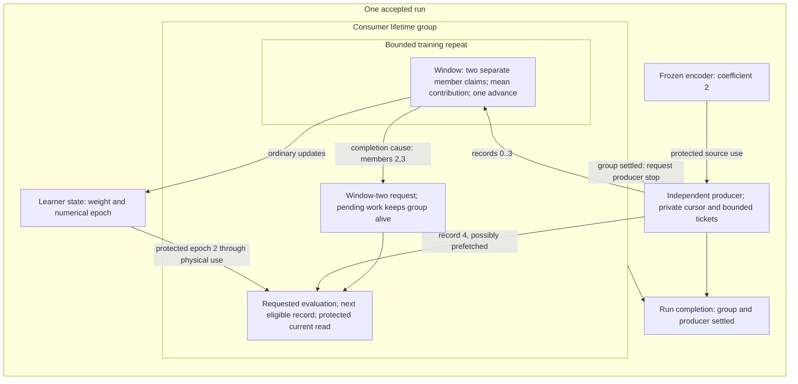

# Different-lifetime composition on Pliron 0.20.0

Research case · 31 October 2026 · `sd-scripts-syv.31.22`

A producer serves finite training and requested evaluation. Training may finish
while evaluation awaits input. The producer stops when the whole consumer group
settles; run completion separately waits for producer settlement. This is a
bounded research vocabulary and target. xDSL remains the working baseline;
final language, authoring and implementation choices remain open.
The supported interpreter is CPython 3.14t, matching the existing owner target
and repository tooling. Older interpreter versions remain unqualified.



## Case contract

For increasing keys `k`, production uses a frozen encoder to produce
`x=2*(k+1)`, with target `k+1`. The learner starts at `w=0.8`. Training selects
windows `(0,1)` and `(2,3)`, averaging two gradients of `(w*x-target)^2/2` in
each window, then advancing once with ordinary SGD at learning rate `0.01`.

| Boundary | Required meaning |
| --- | --- |
| Window admission | The repeat policy returns an accepted `Choice` before the first member claim. Orderly training stop permits that whole selected window to finish. |
| Member acquisition | Inputs are acquired separately with actual identity/source checks. Selection does not assert that both inputs are ready. Partial acquisition remains owned on failure. |
| Input settlement | Actual input use ends after backward. Retiring a production ticket does not finish the numerical window; the unit retains accumulated gradients and input associations. |
| Evaluation request | Successful completion of window two requests evaluation once. Cause `(window=1, position=2)` retains training members `(2,3)`. |
| Evaluation admission | Evaluation consumes the next eligible record, `4`. Training's prepared slot addresses cannot claim it. Production may precede request/admission. |
| Model access | Evaluation acquires current learner state after input readiness; actual epoch is observed and protection spans physical return, validation and mode restoration. |
| Consumer-group completion | Training and requested work settle, including pending evaluation and entered physical work. The group does not await producer termination. |
| Producer shutdown | Normal group completion requests stop. Enclosing failure cancels siblings and drains them. Private work, unused products and physical completion are accounted for. |
| Run completion | Both the group and producer have settled. Completed results and later failures survive independently. |

Independent rational arithmetic gives mean gradients `3`, `13.5`, and weights
`0.77`, `0.635`. Evaluation observes epoch two and predicts `6.35` on record four
(`x=10`, target `5`), with loss `0.91125`. The oracle imports only stdlib modules;
fixture tolerances are separate from production policy.

The aggregate bound is three selected, unsettled production tickets across
physical production, unpublished results, ready records and admitted input
uses. A separate provider budget limits ready records across all ports to two.
Only one production call may be physically active. Port capacity alone does not
establish the aggregate bound. Input settlement and retained gradient/source
association ownership remain distinct.

Orderly training stop before window-two selection leaves the first update and
creates no evaluation request. After selection it permits both member uses, the
update and the request to finish. Root cancellation closes admission more
broadly: pending requests can be `cancelled_unfulfilled`, partial windows can
retain gradients without an update, and unentered evaluation does not fabricate
input consumption.

## Implemented boundaries

The new `rmst-pliron-composition` executable uses the same exact locked package,
without changing B's implementation or adding LLVM dependencies. Actual semantic
operations/types represent models, producer stream/completion, consumer group,
repeat events, request, evaluator and separate group/run settlement. Run/group
regions use Pliron graph semantics; window/evaluation regions use ordered SSA.
A forward group-completion operand is a stop relationship, not a startup wait.

| Concern | Framework contribution | Project responsibility |
| --- | --- | --- |
| Representation | Registered operations/types, region interfaces, actual SSA arguments and dominance/use verification. | Payload, state-use, completion and failure semantics. |
| Shared contracts | `CompositionContract` describes operation attributes, operand/result types and regions. Renaming every source ID preserves execution. | Value/gradient chains, complete windows, request eligibility, containment, child settlement and producer-stop coverage. |
| Preparation | Native operation/region construction, parse/print and structural equivalence. | Inspectable `lc_exec` scope, call, access, request, port and lifecycle-link recipes. |
| Cold correspondence | Full framework comparison with a freshly derived expected plan; complete-document parsing reuses the corrected shared parser. | Installed/saved binding agreement and target-policy checks before model factories. Saved projections are inspection output. |
| Execution | Existing `Engine`, `Together`, `Repeat`, `Sequence`, `Requested`, input, retained-state/unit owners and physical `Workers`. | Binding installation, scalar arithmetic, provider-private cursor/ticket budgets, routing, settlement notifications and test gates. |

The verifier recognizes operation meanings rather than case identity names.
It rejects incomplete pending-work obligations, premature stop, circular group
settlement, weakened physical protection and incomplete contribution/completion
chains. Valid wider windows/horizons can be accepted semantically but rejected
by this target. The target supports one producer, one consumer group, one
two-member/two-window repeat, one evaluator and two scalar model participants.
It does not establish arbitrary composition.

The Python boundary verifies both raw documents against current installed
contracts, then compares the saved binding manifest before model factories run.
Saved `nodes`/`profile` dictionaries never authorize execution. Verified values
and binding mappings are snapshotted before lowering. Torch is optional until
owner-target materialization.

This artifact policy matches the entire saved binding manifest, including unused
entries. Adding, removing or revising even an unused installed binding requires
regenerating the prepared artifact; additive registry compatibility is not
promised by this experiment.

A small per-instance adapter adds asynchronous notifications to the existing
owner's actual progress-context exits, including failure. It does not infer
completion from recorder lists, decide scope termination or introduce another
scheduler. Failure cleanup can await consumer settlement without a cycle because
the consumer group does not await the producer. Private notification receiving
is joined inside the producer's lifetime.

Printer-generated block names are not idempotent text identifiers in this
release. Verified documents are retained intact; framework structural equivalence
authorizes reconstruction. The document SHA is an integrity observation, not a
substitute for correspondence. Composition manifests/artifacts use their own
schema `1`; B/extension schema `2` remains separate.

## Witnesses and validation

The late-input witness holds record four until training has actually ended. A
pending evaluation keeps the group alive without acquiring learner mode/access
while awaiting input. The prefetched witness publishes record four before its
request. Neither requires identical scheduling traces.

Both pressure runs then hold evaluation's real worker while record five is
ready and record six physically executes, occupying all three tickets. After
evaluation returns, the group ends and producer cancellation is observed. Run
completion and encoder protection wait for worker six. A later physical failure
can coexist with completed evaluation/updates; repeated cancellation preserves
both interruption and physical failure.

Tests also cover orderly stop on both sides of window admission, stop/cancel
after only the first member has been acquired, pending-request cancellation,
training/evaluation failure and calls cancelled before physical entry. A
deterministic control reproduced the pre-entry adapter bug before correction:
`NotEntered(CancelledError)` now preserves cancellation classification rather
than turning an orderly stop into failure. Input admitted to an evaluation whose
physical body never entered is retained as unconsumed.

Independent corruptions cover epoch, request cause, input identity, bounds,
completion order and fabricated consumption. An unchanged declaration with a
wrong objective can execute successfully but fails the numerical oracle. Cold
corruptions reject before factories. Diagnostic histories are erased during a
partial window, a pending request, physical use and final handoff; execution uses
owner facts and retains its independently checked numerical result.
`archive_erasure_points` records the three live checkpoints. A separate final
erase occurs before report construction and is not included in that list.

Fresh normal and `python -O` processes reconstruct with authoring and xDSL IR
creation/parsing/preparation disabled. The normal parent runs the oracle. GIL
state is checked after ordinary imports/execution without forcing it off.

Final local gates pass 503 Torch-free tests (four optional owner modules skipped)
and 508 owner tests in separate processes, both with the GIL disabled before and
after. The new case accounts for 47 document/native and 37 owner tests. Native
build/test/Clippy, Rust formatting, Ruff and ty pass. Eleven saved reports and
nine deliberate corruptions replay independently. These gate totals overlap in
their reused xDSL checks and should not be added as a unique-test count.

The required [review](evidence_composition/review.md) found no logic or authority
bypass in the bounded case. Small follow-ups improved malformed-artifact errors,
documented exact manifest/Python-version policy and clarified cleanup/erasure
accounting; the gates above ran again afterward. The reviewer inspected code and
retained evidence; these are local executed results, not an independent rerun.
The wider original/xDSL audit retained 1505 passes and one existing mixed
heartbeat-witness failure. A fresh isolated GIL-on probe passes; the combined
state/timing cause remains open under `sd-scripts-syv.31.23`.

## Reproduce

```bash
export CARGO_TARGET_DIR=/tmp/sd-scripts-pliron-b-target
cargo build --locked --manifest-path docs_design/models-strategy-trainer/pliron_candidate/native/Cargo.toml --bin rmst-pliron-composition
```

The owner environment installs the existing small requirements file and appends
the already installed Torch environment with a local `.pth` file. No Torch/CUDA
package was downloaded/installed; project environments and lockfiles are intact:

```bash
uv venv --python .venv-wsl/bin/python /tmp/sd-scripts-pliron-composition-owner-env
uv pip sync --python /tmp/sd-scripts-pliron-composition-owner-env/bin/python docs_design/models-strategy-trainer/pliron_candidate/requirements.txt --offline
/tmp/sd-scripts-pliron-composition-owner-env/bin/python - <<'PY'
import sysconfig
from pathlib import Path
torch_site = Path.cwd() / '.venv-wsl/lib/python3.14t/site-packages'
(Path(sysconfig.get_paths()['purelib']) / 'existing_torch_environment.pth').write_text(str(torch_site) + '\n')
PY

/tmp/sd-scripts-pliron-composition-owner-env/bin/python -m docs_design.models-strategy-trainer.pliron_candidate.composition_demo \
  --binary "$CARGO_TARGET_DIR/debug/rmst-pliron-composition" --mode late --dump-dir /tmp/pliron-composition-late
/tmp/sd-scripts-pliron-composition-owner-env/bin/python -m docs_design.models-strategy-trainer.pliron_candidate.composition_demo \
  --binary "$CARGO_TARGET_DIR/debug/rmst-pliron-composition" --mode prefetched --load /tmp/pliron-composition-late/artifact.json
```

`--fail` injects late production failure, `--cancel` also interrupts draining, and
`--erase-histories` applies live erasure. The retained
[qualification](evidence_composition/qualification.json) records commands,
environment, results, failed investigations, hashes, reports and review outcome.

B tests deliberately assert that Torch is absent from their process. Run them in
the Torch-free environment, separately from owner tests. The broader original
optimizer comparator can import Triton and enable the GIL; its audit is retained
separately and cannot establish GIL-disabled composition safety.

## Assessment boundary

The native representation and prepared claims now cover a bounded lifetime
relationship beyond B's feedback profile. Pending obligations, separate
completion boundaries and protected access participate in verification and
actual owner handoff. Domain lifetime reasoning and target policy remain
substantial project code. Reusing the owner engine supplies ownership evidence;
this is not an independent Rust ownership implementation.

Mutable-resource replacement, arbitrary composition, native numerical-backend
sharing, SSA-changing rewrites, matched maintenance/performance costs,
GPU/distributed completion and durable recovery remain unqualified. This result
does not select a production language or establish a preference over xDSL.
