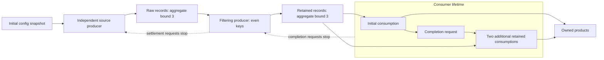

# Filtering, selected effects and local rewriting

Milestone 10 extends the shared IR for stateful, heterogeneous data and model
workflows. It adds a data-cardinality boundary and a transformation justified by
selected contracts, following the two earlier-rejection fixes. It reuses the existing
owner engine; no second scheduler, production API or numerical backend is introduced.



`filter_case.py` constructs this representation from shared operations. Selection,
predicate, extraction, arithmetic and publication are registered bindings, with
separate reference and target implementations. Keys 0, 2 and 4 independently expect
`(x + 1) * 2` = 2, 6 and 10. Keys 1 and 3 are admitted filtering work that produces
no downstream item. Request provenance identifies initial consumption; downstream
input identity identifies each retained record. A bounded unclaimed tail is allowed.

| Boundary | Meaning |
| --- | --- |
| Source and filtering production | Each output reservation counts toward that flow's aggregate bound before physical work, ready storage or consumer admission. Each flow separately bounds ready storage to two. The two flows do not share a three-record global budget. |
| Filter | One consumed claim, detached predicate input, one boolean, zero-or-one output. The original value and input versions/provenance survive retention. A dropped input settles as `filtered_out`; its output reservation settles as `no_output`. |
| Forwarding | The input receipt records `forwarded` and its actual output reservation. The output may subsequently be consumed, discarded or cancelled. Provenance is separate from live physical-use association: later consumers do not keep an already settled detached input alive. |
| Requested consumption | Initial success registers one request before publishing completion. The handler performs two admitted count-bounded iterations. Drops do not fulfill those iterations or close the group while input is pending. |
| Scoped stop | Stopping `requested` after its first iteration is admitted lets that iteration finish, prevents the second, and settles the request. Root cancellation closes broader admission and drains entered work. |
| Consumer completion | Includes the initial consumer, registered work, active iterations and physical settlement. It can request filtering stop without waiting for either producer to terminate. |
| Producer shutdown | Filtering settles admitted predicates/claims and output reservations, then requests source stop. Source settles its admitted calls and products. Run completion joins both. |

The selected `BindingContract` distinguishes declared read/update requirements and
unknown effects from invocation grants and actual returned effects/outcomes.
Preparation traces actual SSA operands to their capability issuers and resource
owners. Snapshot/protected reads satisfy declared reads; only owner-update authority
satisfies updates. Missing effect knowledge stays unknown. The effect descriptor is
also the fusion legality input. Returned updates still undergo runtime active/current
authority checks; physical completion and validation retain their own boundaries.

The actual xDSL rewrite groups adjacent unary pure stages with single-use intermediate
values. Result replacement updates downstream SSA uses. Each `fused_local` region is
a derived, transparent local realization with the enclosing invocation identity; it
cannot become a completion source. The owner target generates an unrolled coroutine
that calls the unchanged per-stage physical/validation routine. The example's three
consumer-stage dispatches become one; its three worker calls remain three. Source
origins, arguments, outcomes and settlement are preserved. No timing advantage is
claimed. A valid `extract | offset | opaque identity | double` variant executes both
ways; grouping stops at the unknown-effect stage, and cold loading rejects a forged
group crossing it. Resource and completion boundaries also remain barriers.

A transparent group contributes no new decision: reproducibility contributors and
rank claims remain attached to the original stages. An independently annotated
deterministic chain retains its classification/rank eligibility after rewriting;
an unknown original stage still prevents that claim. Input settlement rejects a
duplicate or impostor reservation before changing the owner ledger. Cleanup first
checks whether its live claim still needs settlement. Root failure/cancellation
prevents a new filter selection after physical completion and disposes the input
as discarded/cancelled respectively; a physical failure remains its own failure.

Interruption checks validate forwarding/provenance and every completed drop receipt,
including partially completed consumers and unclaimed tails. A held filtering input
survives a sibling validation failure until its physical call settles, then receives
the same discarded disposition in reference and owner execution. A deliberately
corrupted interrupted-output provenance is rejected by the independent oracle.

The language verifier does not infer this from a named case. Region, item, endpoint,
effect and resource contracts supply acceptance/preparation rules. Target protocol
implementations provide filtering and transparent local realization; the fixture
adds only composition and selected numerical bindings. The analysis follows actual
forwarded owner dependencies, not a declared owner's current version at publication.

Qualification is retained separately under `evidence_filtering/`: accepted, normalized
and prepared documents for fused/unfused and opaque variants; fresh normal/`-O`
children with authoring imports blocked; real owner state, external choices, stderr
and process exits; independent parent verdicts; and compressed paired reference/owner
facts for bounded seeded interleavings. Child assertions are not an oracle. The
parent rechecks values, input identities, versions, forwarding/drop dispositions,
admission conservation, request settlement and physical drain. A valid wrong
implementation completes but fails that independent value check. Forged preparation
and cross-barrier groups reject before resource factories.

Erased runs remove facts, outcome archives, owner traces and feed diagnostic lists at
each checkpoint. They retain actual products and control receipts: request
registrations/dispositions, flow selection/settlement, source closure and live
physical ownership. Retained ledgers are finite-case evidence, not bounded-total
production storage. Holding a predicate and a source call forces consumer completion
to precede producer drain. A physical source failure after consumer success survives
alongside the products. Filter cancellation plus later physical failure retains both
facts; invalid intermediate results and cancellation cannot authorize a later fused
stage. At least 128 individually returning drops retain heartbeat/cancellation progress.

Run a new qualification into an empty directory:

```bash
PYTHONPATH=docs_design/models-strategy-trainer:/tmp/sd-scripts-xdsl-b-env/lib/python3.14t/site-packages \
  .venv-wsl/bin/python -m xdsl_language.filter_qualification /tmp/filter-qualification-new
```

The collector refuses to overwrite a previous attempt. Python sources, both named
research reports, detached artifacts and previous evidence are hash-guarded. Runtime
GIL state is observed before/after ordinary imports without forcing it off. The
selected case uses state cells and no model or optimizer unit. Existing scalar
gradient routing and optimization-unit construction remain bounded owner-target
conventions, separate from these language contracts. Mutable-resource ownership,
general graph/recurrence semantics, arbitrary payload cardinalities, complete effect
analysis, device ordering, performance and production migration remain open.
