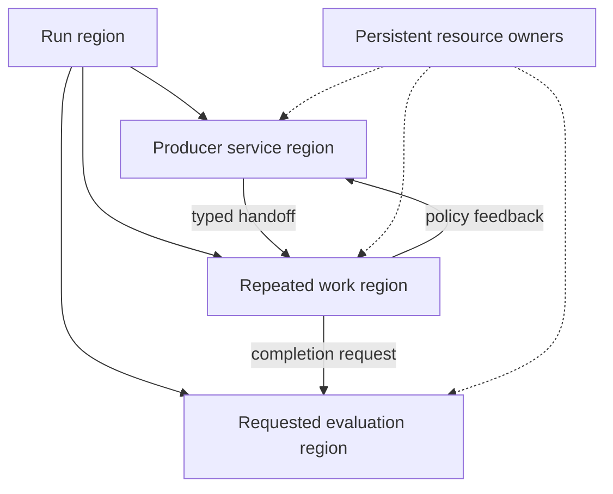
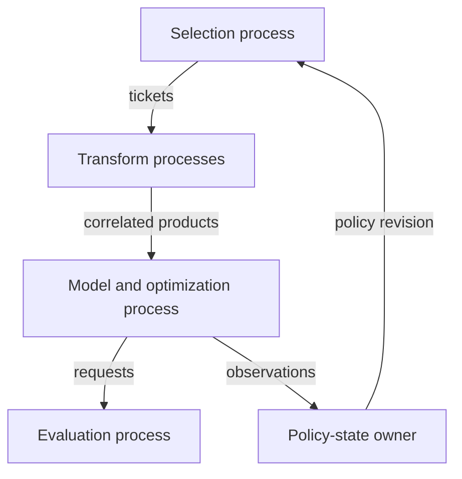
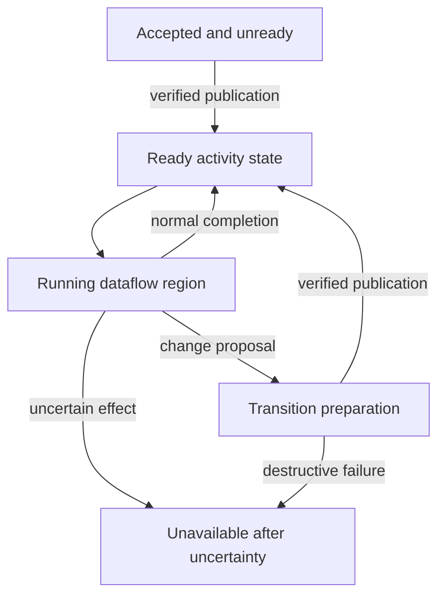
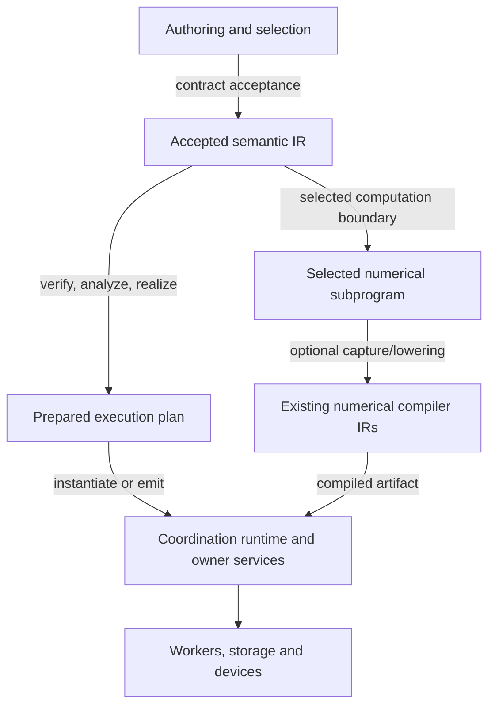

# An IR for heterogeneous data and model workflows

Technical research report · 28 October 2026 · amended after framework/backend clarification

Primary case: Enferlain/sd-scripts, model-strategy-trainer branch. Recommendations are provisional architectural decisions, not proposed production APIs.

## Research basis and reading guide

The investigation read the governing OpenSpec requirements and selected design sections, the connected candidate's graph, preparation, state, access, worker and conformance implementations, examples, assessment, and relevant regression tests. It also read implementation definitions and design material from the reference systems below. GitHub supplied source and revision evidence; Context7 supplied current framework documentation pointers; Consensus supplied a literature cross-check. The source register identifies exact files and inspected symbols.

Evidence is distinguished throughout:

- **Contract** means a stated project requirement or a reference system's documented semantics.
- **Implementation** means behavior visible in inspected source, including the scope of its checks.
- **Inference/recommendation** means my conclusion or a proposed design. All illustrative syntax is in this category.
- **Reported qualification** means a repository's recorded tests or measurements. I did not execute the candidate, reproduce its benchmarks, or qualify real model/device behavior during this research.

The primary project, KohakuNodeIR and Togeari were read at pinned revisions. Other references were read from current development branches, with branch heads recorded during the investigation; these are not claims about an installed release. Version-sensitive details are called out where they matter. Older research papers explain principles; current implementation files establish today's mechanisms.

Sections A–B give the decision and project assessment. C compares reference architectures. D–F define and bound the proposed semantic direction. G works through concrete arrangements. H–J connect it to analyses, infrastructure and one bounded experiment.

**Navigate:** [Amendment](#amendment-framework-and-backend-clarification) · [A. Recommendation](#a-executive-recommendation) · [B. Project](#b-existing-project-assessment) · [C. Comparison](#c-comparative-architecture-table) · [D. Alternatives](#d-proposed-semantic-decomposition) · [E. Stack](#e-recommended-ir-stack) · [F. Vocabulary](#f-minimal-core-vocabulary) · [G. Examples](#g-worked-examples) · [H. Passes](#h-analysispass-opportunities) · [I. Frameworks and sources](#i-framework-recommendation) · [J. Experiment](#j-actionable-next-experiment)

## Amendment: framework and backend clarification

Amended 28 October 2026. This amendment records the settled conclusions from the follow-up discussion and is reflected in Sections A, E, I and J below. The original comparative research and semantic architecture remain the foundation.

### What remains unchanged

The system should own a first-class semantic representation for hierarchical, stateful data and model work; use regions, typed flows and persistent-resource contracts; separate semantic acceptance from prepared execution; and support a generic coordination runtime with selected local/numerical work. The bounded experiment in Section J remains the next implementation step.

### Authoring language and machinery infrastructure are separate decisions

Python authoring is a fixed premise because the model ecosystem is in Python. It does not select the implementation language or structural framework of the machinery's IR. Compare custom Python, xDSL, Pliron and MLIR by how the machinery constructs, verifies, analyzes, rewrites, lowers and inspects its representations. Keep ordinary authoring ergonomics separate from those machinery-development ergonomics.

Implementation cost is another independent criterion. Removing it from the comparison increases the weight of framework capabilities and developer experience, but does not establish xDSL's semantic fit. The interim suggestion that this alone should make xDSL the default next prototype was too strong and is not adopted here.

The updated recommendation is to retain a small custom Python representation as a practical baseline for the existing-candidate experiment, while leaving the long-term structural infrastructure open. xDSL is a strong Python-native candidate to test; Pliron is a concrete native/prepared-layer candidate given the backend work. Neither has demonstrated that it represents the pressure cases better without semantic distortion. Owning the language's semantics does not require owning generic IR infrastructure.

### The evolving CubeCL backend informs integration contracts

The follow-up inspected Enferlain/pytortch-backend-experiments, scoreboard-and-consolidation-plan branch, at revision 5e24d74f53eb94bdcd2fe10146b7b4157daca65d. This repository is undergoing active work. Its observed restrictions, overlays and artifact formats are evidence about that snapshot, not permanent requirements or a claim of complete future backend coverage.

The inspected backend registers CubeCL scheduling for CUDA and invokes Inductor's compile_fx. Its numerical path produces kernel descriptors/physical plans for a Rust compiler. CubeCL IR building directly uses Pliron-backed operations and values; a separate custom-op route uses the shared artifact runtime. [Z01], [Z02], [Z04], [Z07], [Z08]

| Layer | Consequence of the backend's existence |
|---|---|
| Whole-run semantic IR | Preserve backend-neutral computation, resource, numerical and completion requirements. A first-class numerical backend does not by itself choose the workflow IR framework. |
| Prepared execution representation | Explicitly bind selected PyTorch computation, guards, effects, artifacts, numerical policy, resource access and device ordering/completion. |
| Numerical/kernel IR | Reuse the backend's own descriptor, CubeCL/Pliron and physical-compilation machinery where selected. Do not recreate those semantics in the whole-run IR. |

Pliron's relevance is stronger than the original report's wording about a possible future Rust layer: the native compiler investment already exists. The inspected package pins Pliron 0.19.0, whereas the comparative framework survey inspected a development head; API/version correspondence would need checking before sharing infrastructure. [Z03]

Shared infrastructure becomes materially valuable if the machinery actually shares analyses, representations, transformations or execution construction with the native backend. If the principal boundary remains prepared PyTorch callables/tensors, using Pliron on both sides does not automatically eliminate a boundary or enable cross-level rewrites.

One immediate contract requirement is physical completion. The launcher uses PyTorch storage/current streams and records storage use; it explicitly leaves cross-stream input readiness to caller dependencies. Python return, GPU enqueue, allocator lifetime and completion of a protected numerical use are distinct. The prepared realization must enforce the required ordering/completion without prescribing a global CPU synchronization after every call. [Z05]

Backend artifact provenance also differs from workflow input/model-state provenance. Compiler-source and patch identities help qualify an artifact; they do not establish which model numerical state or logical input produced a runtime result. Keep the correspondence explicit. [Z06]

### What the closer xDSL inspection supports

xDSL offers useful structural definitions, typed values/regions, custom verification, rewriting, pass inspection and interpreter infrastructure. These are reasons to evaluate it for the machinery; they do not supply our admission, progress, ownership, authority or partial-failure semantics. [X01], [X03], [X04], [X07], [X08]

Its infrastructure also has concrete limits. The inspected general dead-code dataflow analysis rejects nested regions and successor blocks, even though region-branch traits exist elsewhere. Do not treat that specific analysis as ready for the proposed hierarchical workflow language. MLIR interoperability likewise requires supported dialect correspondence or lowering; compatible text alone does not make custom workflow operations executable in MLIR or CubeCL. [X06], [X02], [X10]

## A. Executive recommendation

**Yes: this project should have a first-class IR. Own its semantics, keep it above numerical computation, and use two explicit representation levels. Use a disciplined custom Python representation as a practical baseline for the next bounded experiment; leave the long-term structural framework open. Evaluate xDSL and Pliron against the machinery requirements rather than selecting either from the authoring language or numerical backend alone. A whole-run MLIR dialect is not presently justified.**

| Question | Provisional decision | Implementation consequence |
|---|---|---|
| Should there be an IR? | Yes, because accepted meaning must survive authoring and support validation and alternative realizations. | Keep an inspectable accepted program; preparation must consume it rather than rediscover strategy anatomy. |
| What domain? | Stateful, hierarchical coordination of heterogeneous data and model work, including continuous production, resources, effects and lifecycle relationships. | A data-only processing run must be valid without training or optimizer placeholders. |
| Who owns semantics? | The project. | Contract versions, admission, resource access, grants, transitions and failure meanings remain project-defined even if a framework stores the IR. |
| Existing framework? | Reuse numerical IRs and compilers at selected computation boundaries. Keep custom Python as an experimental baseline; evaluate xDSL/Pliron infrastructure against demonstrated machinery needs. | Own semantics independently from storage infrastructure; do not recreate tensor arithmetic, autodiff or kernel scheduling. |
| One level or several? | Two project-owned levels: accepted semantic IR and prepared execution IR/plan. Numerical subprograms use their existing IR stacks. | Prepared placement, protection, view construction and completion mechanisms cannot leak back into authored meaning. |
| Backbone? | Operations representing activities, recursively composed through semantically defined regions, with typed value/flow connections and explicit persistent-resource contracts. | One composition model for production, preprocessing, learning, evaluation and persistence; extensions supply domain meaning. |

The central invariant should be:

> Preparation may choose how accepted work is realized. It may not choose a different algorithm, weaker admission rule, different owner, or weaker completion/failure contract.

This extends rather than overturns the project's chosen hierarchical direction. G2.6 and D10 already place cross-owner work, lifetime, value, state and authority relationships above selected Python mathematics. The candidate shows that those relationships can construct execution instead of annotating a fixed Trainer. [P01], [P02], [P14]

### A.1 What makes it an IR here

These terms overlap; they are not mutually exclusive classifications.

| Representation | What it primarily captures | When it becomes insufficient here |
|---|---|---|
| AST | Structure of an authoring language. | Syntactic nesting does not establish ownership, admission or lifetime meaning. An AST can nevertheless serve as an IR if those are its defined semantics. |
| Declarative configuration | Choices supplied to an existing implementation. | A different configuration may still execute the same hidden loop. Graph shape alone changes nothing. |
| Workflow graph | Activities and their relationships. | It can be a genuine IR, provided relationships have precise semantics and transformations preserve them. |
| Task DAG | Dependencies between a finite set of task occurrences. | It does not describe an open producer, repeated region, future request stream or feedback protocol without another language around it. |
| Execution plan | A selected realization: partitioning, implementation binding and execution strategy. | It should not become the only record of accepted algorithm and contract meaning. |
| Scheduler model | Ready work, queues, priorities, reservations and physical progress. | Those are runtime state and implementation choices, not the accepted program itself. |
| Useful IR | An explicit semantic program with invariants, analyses, transformation rules, source correspondence and one or more conforming realizations. | It fails if correctness still depends on undocumented callback conventions. |

The strongest justification is not a future optimizer. It is the need to establish cross-owner facts once, derive executable coordination, and preserve those facts under placement, specialization and change. The candidate's calls/inline and general/prepared variants are early examples of this justification, with deliberately limited CPU evidence. [P09], [P14], [P16]

A useful semantic preservation criterion is preservation of **required observations and causal relationships**, not equality of final weights alone. Relevant observations include admitted input identities and provenance, bounded policy decisions, resource use, gradient destinations, reached per-unit outcomes, requests, external effects and physical-release boundaries. Equivalent schedules may commute unrelated events. They may not erase an observation required by another owner. This is consistent with the project's equivalent-execution requirement and its independent conformance oracle. [P02], [P16]

### A.2 When an IR would be the wrong investment

Use a smaller structured executable specification if the next experiment finds all of the following: only one realization is useful; almost every operation is opaque; no boundary can legally move or specialize; validation still needs arbitrary whole-program Python execution; and the accepted graph merely repeats a fixed coordinator's structure.

An IR framework would then add syntax and maintenance without increasing what can be checked or changed. Similarly, building a universal language for every tensor operation would make this system worse: it would duplicate mature numerical compilers while making Python integrations harder.

The existing evidence does not support abandoning an IR. It does support resisting a large compiler framework before the coordination semantics have demonstrated their broader data-processing scope.

## B. Existing-project assessment

### B.1 What already behaves like an IR

**Contract evidence.** Acceptance and readiness are distinct. Accepted execution must survive release of the authoring object, retain explicit structure/effects and cover the whole run. Preparation evaluates concrete evidence under the same accepted obligations. Those are strong IR requirements independent of storage classes. [P02], [P03], [P04]

**Implementation evidence.** The candidate has several coherent representation and execution boundaries:

| Existing mechanism | Why it matters as IR evidence | What is not established |
|---|---|---|
| Run/Scope hierarchy and local Work/value links | Lifetimes and connections are retained before execution. Local ordering is derived from inputs and explicit ordering links. | A general recursively composable production grammar. |
| Contract.accept | Checks addresses, value dependencies, ownership/window structure, offered authority, producer relationships and completion dependencies; creates run-qualified references. | Full obligation revisioning or semantic proof of trusted Python bodies. |
| prepare and Lowering | Target checks precede loading; construction binds calls and creates coordination, request connections, access boundaries and activity lifetimes. | An explicit, serializable prepared IR with several qualified targets. |
| Ready/Preparation/Engine | Candidate construction is unpublished until installation; the engine enters a derived executable root. | The small Engine entrypoint alone is not the whole runtime: generated coordination and owner services are part of it. |
| RunState and owner-specific machinery | Separates participant bindings, owned state, optimization windows and input handoff facts. | The large holder should not become a universal production owner or an unrestricted runtime API. |
| Independent conformance facts | Numerical results, input associations and causal boundaries can be checked without reproducing candidate runtime types. | Exhaustive equivalence of all arrangements, targets or schedules. |

Sources: graph construction and verification [P08]; preparation and emitted coordination [P09]; runtime state [P10]; conformance [P16].

The source is particularly clear on the engine relationship. Lowering._connect derives request queues, stop relationships and consumer connections; block/sequence construct direct wiring; _scope derives repetition and concurrent activity execution. Ordinary execution does not parse Ready.source or walk the whole authored graph. The emitted source is inspection material. [P09]

### B.2 Semantics worth preserving

The valuable result is the separation of meanings, not the class list.

1. **Semantic identity differs from physical realization.** Participant identity, binding revision and numerical state are separate. Views identify invocation requirements; they are not automatically new participants or optimizer targets. [P06], [P10]
2. **Production, readiness, admission and consumption differ.** Feed/join checks all members before claiming any; provenance is actual production evidence. A failed second admission must not consume the first member. [P10], [P17]
3. **Optimization has its own pending-work owner.** Ordinary differentiation and granted work enter and hand back through the same unit owner. Returned, uncertain and unattempted mechanics remain distinguishable. [P05], [P19]
4. **Logical cancellation is not physical completion.** Workers.execute drains a running physical future before releasing its capacity; tests preserve retained protection through cancellation and later physical return/failure. [P12], [P20]
5. **Active semantic facts cannot depend on diagnostic history retention.** Input associations now follow the owners of unfinished work and queued requests, rather than surviving only in bounded trace deques. This is a representation-lifetime requirement, not merely better logging. [P17], [P14]
6. **Ordinary feedback is not structural recompilation.** Accepted policies update owned state and select bounded alternatives; replacement and arrangement change have different authority paths. [P01], [P03]

The assessment's input-association repair is important architectural evidence. A bounded diagnostic history had been insufficient for pending optimization and failure correlation. Its implemented solution attaches immutable metadata references to existing live owners. Preserve the principle—facts live as long as the obligation that needs them—without freezing that linked representation into a production API. [P14], [P17]

### B.3 Experimental restrictions that must not become semantics

The inspected candidate explicitly restricts Repeat alternatives to Block/Sequence, Requested bodies to Block, two-pass grants to a block-local profile, channels to bounded positive capacities, and work kinds to a closed union. Several of these checks combine language restrictions and CPU-target support restrictions in Contract.accept. That is reasonable for a probe, but production should distinguish **invalid accepted meaning** from **valid meaning unsupported by this realization**. [P08], [P14]

Other implementation choices include synchronous CPU modules, simple SGD, generated Python call chains, asyncio TaskGroups, conservative whole-block access in some paths, per-work access in Sequence, single-entry request queues, global quiescence for compatible replacement, and reset/preserve/reject state handling. None is a necessary universal IR construct. [P09], [P10], [P11]

The assessment reports a broad candidate test suite and useful but qualified local performance findings. It explicitly does not establish distributed/device completion, arbitrary nested control, destructive preparation, general state migration or active-run snapshot restoration. These limits should inform the next experiment, not count against the candidate for lacking compiler aesthetics. [P14], [P15]

### B.4 Gaps exposed by the broader data + model domain

| Semantic gap | Why broadening exposes it | Required direction |
|---|---|---|
| Producer is primarily an opaque implementation seam | Decode/filter/join/model-assisted preprocessing may need independent placement, checking and fusion. | Allow data work to be an inspectable composed region when another owner or transformation needs its internals. Keep private work private otherwise. |
| Keyed local handoff is not general stream semantics | Filtering, joins, sharding, fan-out and unbounded inputs need cardinality, missing-member, ordering and progress rules. | Add a data extension with explicit stream/sequence contracts; do not rename Feed into a universal streaming abstraction. |
| Closed region composition | Data/model feedback may cross nested service, repeat and requested-work lifetimes. | Define recursive composition and supported boundary interfaces. |
| Concurrency is tied to one fail-fast TaskGroup policy | A failed validation, failed source and uncertain optimizer may require different propagation rules. | Represent failure propagation and completion dependencies independently from containment. |
| Freshness coverage is incomplete | A model-assisted transform depends on input, schema, stochastic policy, model state and possibly route/numerical policy. | Represent dependency meaning and admission requirements; obtain actual versions at runtime. |
| Target readiness is mixed into acceptance | A valid stream may require a worker, storage protocol or view combination that a CPU target cannot support. | Separate semantic verification, target matching and concrete preparation evidence. |
| Prepared realization is mostly closures and services | More targets and transformations need inspectable protection/transport/completion decisions. | Introduce a small explicit prepared plan before multiplying emitters. |
| State and transition coverage is intentionally narrow | Long-running services may outlive a binding replacement or need continuity under a policy/source change. | Declare owner dependencies and continuity rules; do not infer preservation from object survival. |

Some of these are already requirements, especially cache/input provenance, independent production and coherent restoration. The change in scope chiefly demands that their common mechanisms stop being conceptually subordinate to training. It does not justify deleting the domain-specific rules already established. [P07], [P01]

## C. Comparative architecture table

The comparison is split into three keyed tables so every system can be compared without a twelve-column page. “Mechanism” means a transferable design technique, not copied source or API. “Analogy” means useful reasoning that should not determine the implementation.

### C.1 Meaning, structure, control and values

| System | What is represented / core structure | Control | Data and values |
|---|---|---|---|
| KohakuNodeIR | Executable job program; statements, nested namespaces/bodies and a graph view of the same language. [K01], [K03], [K09] | Sequential reference meaning; branch/switch/jump/each/parallel and handlers; dataflow blocks expose independent work. | Named opaque values; version pass distinguishes writes, with home versions at merges. Not simply textbook immutable SSA everywhere. [K02] |
| Togeari | Execution of bound KIR jobs; decoded program plus dynamic invocations, slots, strands and inflight work. [T01], [T11] | Control-dependent strands can park; continuation work can advance without guessing an undecided branch. | Renamed/versioned runtime slots; readers can observe completed values before ordered retirement. [T03] |
| MLIR, including SCF/Async | Extensible operations, operands/results, blocks and nested regions. Region semantics come from the containing operation. [M01] | SSACFG or graph regions; SCF preserves structured loops/choices; Async represents explicit readiness dependencies. [M04], [M05] | Typed SSA values/block arguments; graph regions need not impose SSA dominance/order. |
| Pliron | Rust extensible operation/block/region IR infrastructure. [L01], [L02] | RegionKindInterface distinguishes SSACFG and graph regions; custom operation interfaces specify behavior. [L05] | Typed SSA use-def relationships with dominance verification appropriate to region kind. |
| xDSL | Python operation/block/region infrastructure with declarative IRDL definitions. [X01], [X03] | Structured-control dialect implementations and region-branch traits; custom semantics require custom verification. [X05], [X02] | SSA objects and typed attributes. Do not infer complete MLIR feature parity from textual compatibility. |
| DaCe / SDFG | Hierarchical control-flow/state representation containing dataflow multigraphs, nested SDFGs and scopes. [D01], [D03] | Transitions/conditions/assignments and structured control-flow regions. | Data descriptors and access nodes; memlets describe movement subsets/volume/conflict resolution rather than just tensor-result wires. [D02], [D05] |
| JAX Jaxpr | Typed equation program specialized from Python; primitive applications and nested subprograms. [J01], [J04] | Control-flow primitives carry sub-jaxprs for conditionals/loops/scans. [J03] | ANF-style typed variables, literals and constants; not a whole-service lifecycle language. |
| StableHLO | Portable tensor-program operation semantics within MLIR. [S01], [S02] | Functional regions such as while/case plus communication constructs; not limited to DAGs. | Typed tensors and explicit effect-order tokens; newer specified async forms do not imply a general host workflow model. |
| TVM Relax | High-level ML program with functions, binding blocks and pure dataflow blocks; links to primitive tensor programs. [V01], [V03] | General expression/control structure outside restricted dataflow blocks. | Symbolic shapes/types and explicit bindings; pure dataflow variables have local visibility. [V04] |
| PyTorch FX | Python-level graph with call/function/module/method, attribute and input/output nodes. [Y01] | The graph captures represented calls; higher-order operations can encapsulate control. Ordinary Python control is not automatically a whole-run graph. | Python-object arguments and metadata; FX by itself is a permissive carrier. |
| PyTorch Export | A stricter computational program carried by FX plus graph signature and constraints. [Y02], [Y03] | Supported captured control operators under Export's restrictions. | Lifted state and explicit input/output roles, including mutation, gradients and tokens in the inspected signature implementation. |
| PyTorch Inductor | Numerical lowering IR of loops, buffers, layouts, external operations and scheduled kernels. [Y04], [Y05], [Y06] | Captured computation is lowered and scheduled; not an authority/lifecycle model for the containing application. | Pointwise/reduction loop bodies, mutable storage boxes, computed buffers, mutation outputs and external kernels. |
| IREE Flow / Stream / HAL | Successive levels from dispatchable tensor work to asynchronous resource programs to hardware-abstraction calls. [I01] | Explicit asynchronous sequencing/timepoints in Stream, lower-level command structure later. | Tensor encodings become size-aware opaque resources with lifetime classes. [I02], [I03] |
| Timely dataflow | Nested, potentially cyclic networks with logical timestamps and tracked progress. [N01], [N02], [N03] | Feedback edges transform timestamp progress; nested scopes expose iteration coordinates. | Streams and timestamped message containers; capability/frontier tracking distinguishes possible future production from completed progress. |
| Differential dataflow | Incrementally maintained collections over timely streams. [N05] | Iteration and incremental change processing use the underlying progress model. | Weighted changes to evolving, unordered collections; not an ordered sequence of imperative updates. |
| Apache Beam Runner API | Portable pipeline: composite/primitive PTransforms, PCollections, coders, window strategies and execution environments. [B01] | Data-driven transforms, window/trigger/timer semantics; no general replacement for arbitrary cyclic model-control protocols. | Collections explicitly carry bounded/unbounded and encoding/windowing identity. |
| Apache Flink | StreamGraph topology lowered to JobGraph/executable deployment structures. [F01], [F02] | Data-driven operators with state/timers and checkpoint coordination. | Partitioned streams and state; physical chaining and exchanges are realization choices. |
| Ptolemy II | Hierarchical actors/ports with a model of computation owned by directors. [O01], [O02] | Different composites may have different execution semantics mediated at boundaries. | Domain-dependent token/receiver semantics; process-network domains model streams rather than finite task lists. |

### C.2 State/effects, hierarchy, extensibility and lowering

| System | State and effects | Hierarchy / extensibility | Transforms and lowering |
|---|---|---|---|
| KohakuNodeIR | Signature-declared mutation and ordered external effects; sequential partial-write/error meaning. | Nested bodies, reusable definitions, host node libraries, source modules and signature contracts. [K08], [K10] | Ordering, inlining, loop/collection expansion, versioning and grouping remain in one interpretable language; origins and canonical text support inspection. [K04], [K05] |
| Togeari | Mutation gate can wait or copy; ordered effects wait for older uncertainty; invocation, attempt and binding policies are distinct. [T02], [T06], [T10] | Jobs, program regions, lanes and engines are different layers. | Decode/bind program before runtime issue; runtime renaming, batching and retirement exploit legal independence. |
| MLIR | Resource effects and speculation interfaces support generic legality queries; the rationale limits its effect discussion to CFG regions and leaves graph-region modeling open. [M02], [M03] | Dialects, types, attributes, traits and operation/region interfaces. | Pattern rewrites, dialect conversion and progressive lowering; not automatic semantics for a new dialect. |
| Pliron | Custom interfaces and verifiers; project-specific resource semantics still need definition. [L03] | Dialects and interface traits with automatically invoked interface verifiers. | Pass/analysis infrastructure and extensible operation verification; Rust implementation is a language/integration decision. [L04] |
| xDSL | MemoryEffect traits include affected values/symbols and resources; unknown effects remain distinguishable from no effects. [X02] | IRDL constraints, custom verification, traits, Python dialect definitions. | Python pattern rewriting, walkers and passes; domain legality is still supplied by the dialect author. [X04] |
| DaCe | Explicit mutable data containers, access/movement and conflict rules; allocation/storage/lifetime descriptors. | Nested SDFGs, map scopes, structured control and expandable library operations. | Graph transformations and memlet reasoning support scheduling/data-movement optimization and code generation; validation checks descriptor/connector consistency. [D04] |
| JAX Jaxpr | Current source includes equation/program effects and ordered-effect token plumbing; effect classes constrain allowed transformations. [J02] | Primitive rules and nested subprograms support interpretation, autodiff, batching and lowering. | Specialized interpretations and numerical lowering; arbitrary Python state is not automatically captured safely. |
| StableHLO | Tokens express effect order; custom calls have explicit effect-related declarations but implementation-specific behavior. | MLIR operation definitions, regions and an intentionally bounded standardized numerical vocabulary. | Verification/canonicalization/serialization and lowering to consuming compilers; compatibility of tensor programs, not application ownership. |
| Relax | Purity is explicit; well-formedness forbids impure calls and If nodes within dataflow blocks under the relevant checks. [V04] | Functions and mixed abstraction levels inside a module. | Graph rewriting and partial lowering; call_tir links to primitive programs. The current source/docs use TIRx in places, so historical TIR descriptions are not a version promise. [V02] |
| FX | Mutation/effects can exist in called Python; graph shape alone does not certify purity. | Modules, nested GraphModules and higher-order operations. | Graph rewrites and Python code generation; convenient carrier, weak whole-workflow semantic boundary by itself. |
| Export | Graph signature makes state and mutation correspondence explicit; range constraints constrain valid inputs. | Restricted captured program plus explicit state/signature bundle. | Export transformations and backend consumption; stronger guarantees than arbitrary FX without covering producer/service lifetimes. |
| Inductor | Aliasing, mutation, layouts and external operations are tracked for numerical generation. | Internal IR classes and backend/scheduler/codegen interfaces. | Loop fusion, buffer/layout decisions and target generation; this is below the proposed coordination boundary. |
| IREE | Resources carry lifetime and size; timepoints describe completed execution needed before access/reuse/free. | Distinct dialect levels and interfaces for resource/timeline/placement meaning. | Tensor-to-resource, partition/allocation/scheduling, then command/HAL lowering. |
| Timely | Stateful operators and held production capabilities affect progress; a held capability may prevent a frontier from advancing. | Nested scopes and custom operators with input-output progress summaries. | Network construction and progress propagation; primarily an execution model, not a general rewrite framework. |
| Differential | Operators maintain incremental state/arrangements under collection algebra. | Composed collection operators and nested timely scopes. | Incremental maintenance avoids recomputing unaffected data; this algebra does not describe arbitrary optimizer mutations. |
| Beam | Per-key/window state and timers, declared transform requirements, UDF/environment contracts. [B03] | Composite transforms and URN-defined payloads/extensions. | Runner translation, stage fusion and executable harness construction. [B02] |
| Flink | Operator/keyed state, stream positions and checkpoint protocols. | Operators, chains and deployment vertices; backend/state APIs extend execution. | StreamGraph-to-JobGraph generation chooses chaining/exchanges; checkpoint cuts interact with in-flight data. [F03] |
| Ptolemy II | Actor state and domain-specific effect/time behavior. | Transparent versus opaque composites and local/executive directors. | Domain-specific scheduling/execution; a common hierarchy does not imply one universal scheduler. |

### C.3 Execution relationship and transferable lessons

| System | Execution relationship | Apply here | Do not copy |
|---|---|---|---|
| KohakuNodeIR | Sequential reference defines job meaning; alternative executors preserve it under supported bound outcomes. [K06], [K07] | **Mechanism:** canonical text, checked rewrites, graph/text equivalence, source origins, reference execution and explicit binding identity. | Namespace/jump syntax; one sequential whole-run order; finite iterable snapshotting as the meaning of every data source. |
| Togeari | Generic coordination plus engines executes many independent invocations while preserving KIR job meaning. [T05], [T07], [T08] | **Mechanism:** separate ready/computed/retired states, stable invocation identity, explicit effect gates and conformance replay. [T09] | **Analogy only:** reorder buffers, strands and CPU terminology as the project's core IR; universal ordered retirement or copying of live model state. |
| MLIR | Framework hosts dialect-specific interpreters/compilers; it is not itself the application's runtime. | **Mechanism:** operation-owned region semantics and semantic interfaces; multiple abstraction levels. | Treating graph regions as a ready-made ownership/effect theory, or tensor/memory SSA as the whole application language. |
| Pliron | Infrastructure for building dialects and compilers, not a model-workflow engine. | **Mechanism:** interface verification and analysis invalidation; credible if a Rust semantic/compilation layer becomes justified. | Inferring Python ergonomics, backend support or workflow semantics from being MLIR-inspired. |
| xDSL | Python compiler construction framework; execution needs interpreter/lowering implementations. | **Mechanism:** declarative structural verification and reusable rewrite infrastructure, with a promising Python integration cost. | Assuming all MLIR interfaces and passes transfer unchanged, or that custom resource contracts become free. |
| DaCe | SDFGs are transformed and compiled into executable data-centric programs. | **Mechanism:** describe data movement separately from computation; relate outer control and inner dataflow. | Exposing every application payload as an array/memlet or adopting its kernel-oriented storage/schedule vocabulary at whole-run level. |
| JAX Jaxpr | Interpretations transform staged computation; compiled execution handles numerical regions. | **Mechanism:** small explicit vocabulary and different interpreters; effect-aware transformation eligibility. | Requiring an entire open workflow to be a functional traced array computation. Current Jaxpr also should not be described using obsolete two-class constant packaging. |
| StableHLO | Interchange/semantic contract for numerical subprograms consumed by compilers. | **Mechanism:** precise operation contracts and explicit side-effect ordering where required. | Treating its infeed/outfeed/channel operations as complete semantics for data admission, provenance or producer shutdown. |
| Relax | High-level numerical programs lower to primitives and executable VM/runtime/codegen paths. | **Mechanism:** pure optimizable islands within a richer program; preserve cross-level calls. | Claiming whole-run purity or requiring all state to enter a tensor graph. |
| FX | Can be interpreted or emitted as Python; other systems impose stronger meaning. | **Mechanism:** ergonomic inspectable Python graph and source metadata for selected computation. | Calling a graph semantically sufficient just because it has nodes and an interpreter. |
| Export | Provides a constrained executable computational artifact with explicit signature/state. | **Mechanism:** separate graph from state and interface obligations. | Assuming all selected Python or model behavior is exportable, or that export proves workflow-level authority/failure rules. |
| Inductor | Specialized host wrappers and target kernels execute captured numerical work. | **Mechanism:** leave numerical realization to the existing compiler and preserve boundary evidence. | Importing unstable internal buffer/loop IR as the accepted whole-run format. |
| IREE | Progressively lowers host/device programs to an asynchronous runtime abstraction. | **Mechanism:** make asynchronous resource completion explicit at a prepared level. | Its byte-buffer, timepoint and HAL details as author-facing workflow semantics. “Stream” here is not an event-time dataset-stream language. |
| Timely | Runtime advances cyclic dataflows and tracks logical progress. | **Mechanism:** distinguish an empty queue from proof that earlier production is finished; explicit feedback progress. | A global tensor/model version clock, or equating a Timely production capability with this project's authority grants. |
| Differential | Executes changing collection queries incrementally. | **Mechanism:** incremental data/cache/view maintenance when the selected algebra supports it. | Assuming gradients or optimizer updates can be retracted as ordinary collection differences. |
| Beam | SDK-independent pipeline lowered by a runner; UDFs execute through harness/environment contracts. | **Mechanism:** schema-level data semantics, composite/primitive separation and namespaced semantic payloads. | Window/key state as a universal resource model, opaque UDF bytes as sufficient conformance, or Beam's graph restrictions as the whole-run language. |
| Flink | Concrete stateful streaming execution with checkpoint/recovery protocols. | **Mechanism:** logical operator identity survives physical chaining; coherent cuts may need in-flight state. | Automatic replay/exactly-once claims for arbitrary model updates or external effects. |
| Ptolemy II | Directors implement local models of computation and mediate composite boundaries. | **Mechanism:** hierarchy has behavioral boundaries; heterogeneous subregions need explicit interaction contracts. | A zoo of mutually incompatible region schedulers without common resource/effect/lifecycle obligations. |

### C.4 What the literature adds—and does not establish

Lattner et al.'s MLIR paper [1] supports extensible multi-level infrastructure as a useful engineering approach; it does not establish that MLIR is the cheapest implementation for this project's semantic domain.

Murray et al.'s Naiad paper [2] shows why cyclic dataflow with logical progress is more expressive than a finite task DAG for streaming/iteration. The project need not adopt Naiad's timestamp model to learn that completion requires production/progress evidence.

Ben-Nun et al.'s DCIR paper [3] combines control- and data-centric representations in a compiler pipeline. The relevant lesson is to retain the right representation at each boundary, rather than choosing one graph style to answer every question. Its performance results are not evidence about this candidate.

## D. Proposed semantic decomposition

Three shapes are plausible. They differ in what makes the program coherent, not in whether diagrams contain rectangles.

### D.1 Shape 1: structured activities with typed flows and resources — recommended

An operation is an activity instance. A composite operation owns regions with explicit execution and lifecycle meaning. Ports connect values or flow endpoints. Resource uses and effects constrain what may overlap or change. Data/model/capability operations all inhabit this structure.



Containment determines lexical visibility and lifecycle ownership. It does **not** imply that every parent waits for every child in the same way. The containing operation defines startup, normal completion, cancellation, draining and failure propagation. Typed flow, order, request and stop relationships cross that hierarchy under explicit rules.

For a finite local computation, a region may contain a dataflow DAG. For an open producer it may describe a recurring stream transform. A repeated region can contain a sequence with a gradient window. The outer program is not required to be acyclic.

**Strength:** it matches the existing separation between accepted coordination and selected work, and can host both stream processing and model-specific protocols.

**Risk:** “region” can become an empty word. Prevent that by giving every region-bearing operation a verifier, port-binding rule, lifecycle interface and effect summary. Arbitrary nested bodies without these rules are not supported composition.

### D.2 Shape 2: process/actor network as the backbone

The program is a network of long-lived processes with typed input/output streams, local state and resource contracts. Training is one stateful consumer/process; its internal protocol contains numerical/optimization regions.



**Strength:** continuous production, backpressure, independent progress and feedback are natural. This resembles process-network thinking more than a compiler's per-function CFG.

**Cost:** a process boundary is too coarse for contribution routing, retained derivatives, temporary optimization grants and per-unit partial outcomes unless processes expose additional structured protocols. A “trainer actor” with a large opaque method would recreate the hidden loop.

The actor/network shape is credible if continuous services become the dominant workload. It should still use common resource/effect and region interfaces, rather than inventing a separate runtime for model work.

### D.3 Shape 3: state-transition/control backbone with dataflow islands

The outer representation describes legal lifecycle/authority transitions. Work inside each state is expressed as dataflow or structured computation. Independent producers are concurrent state machines; synchronization relates their transitions.



**Strength:** replacement, readiness, grants, partial failure and recovery states become explicit. DaCe demonstrates a productive control/dataflow split, though at a different semantic level. [D01]

**Cost:** making every data arrival, accumulation contribution and capability request an outer state transition creates large product-state spaces. Concurrency then needs orthogonal regions or another process language. The result can become a protocol verification language that is awkward for ordinary data composition.

Use state machines for resource/owner protocols inside the recommended architecture, not as the sole syntax for all work.

### D.4 Pressure cases distinguish the alternatives

| Pressure case | Structured activity/region backbone | Process/actor backbone | Transition backbone |
|---|---|---|---|
| Ordinary multi-input training | Keyed admission feeding a finite model/optimization region within repeat. | Input processes feed a training process with an exposed step protocol. | Ready → admit → compute → contribute → advance states; dataflow inside compute. |
| Adversarial/multiple optimizers | Choice/repeat selects D/G regions with separate unit resources and derivative contracts. | D/G processes exchange versioned data or one process exposes alternating subregions. | Alternation states make cadence explicit but duplicate subprotocols unless factored. |
| Repeated accumulation | Window region carries contribution identity; repeat body contributes; explicit close enables advancement. | Stateful accumulator process owns the window and emits ready work. | Window-open/count/ready/advancing states; dynamic count needs parameterized state. |
| Independent correlated producers | Sibling service regions; a join operation has shared key, admission and missing-member semantics. | Natural keyed stream join process. | Multiple producer machines plus join state; cumbersome without a stream extension. |
| Validation requested by completion | Request event connects a completed region to a capability service with its own completion. | Training emits requests to evaluator; lifecycle relationships still needed. | Evaluation-request transition launches an orthogonal evaluation machine. |
| Continuous feedback/backpressure | Cyclic flow through owned policy state; accepted lag/order and shutdown contracts. | Most natural shape; progress and bounded buffering remain explicit obligations. | Requires concurrent machines, channels and transition scheduling; easy to over-serialize. |
| Temporary optimization grant | Scoped region transfers specified responsibilities and verifies handback. | Process temporarily owns a capability; internal protocol must be visible. | Explicit grant/active/handback states fit well. |
| Replacement preserving identity | Governed transition operation invalidates dependent prepared artifacts and owner state. | Actor rebind protocol; active messages need version/disposition rules. | Strongest native fit, provided data work is not encoded as state explosion. |

My recommendation is Shape 1, incorporating Shape 2's explicit stream/progress contracts and Shape 3's owner state machines. This is not three independent backbones: **activities compose through regions; flows supply work; resources retain state; owner protocols constrain legal effects.**

### D.5 Structural choices within that backbone

| Shape | Verification and transformation consequences | Execution, readability and lifecycle consequences |
|---|---|---|
| Flat DAG | Simple topological validation and local fusion. No native repetition/feedback semantics. | Good inside a finite region; inadequate whole-run lifecycle representation. |
| Arbitrary cyclic graph | Cycles express feedback, but connectivity alone says nothing about initialization, progress or deadlock. | Requires explicit delay/state/progress semantics and bounded-buffer policy. Harder to read without hierarchy. |
| CFG | Good dominance, reachability and control analysis. | Poor primary notation for independently progressing services and resource lifetimes; useful after lowering selected control. |
| Hierarchical graph | Provides scopes and summaries, enabling local reasoning. | Useful only if boundaries define behavior; visual boxes alone do not establish cleanup or completion. |
| Structured regions | Verifiers can reason inductively over supported composition; transforms can preserve an enclosing contract. | Readable lifetime and control boundaries. Avoid premature flattening and restrictions to only today's nesting combinations. |
| Mixed control/data graph | Makes necessary order distinct from data dependence. | Recommended within hierarchy; different edge kinds must remain typed and have different analyses. |

### D.6 SSA: useful locally, harmful as a universal state model

Use single-definition value identities for local products, region arguments/results and immutable descriptors. They make missing definitions, use correspondence, dead values and rewrites easier to reason about. Repetition can use region arguments and yielded results rather than inventing mutable names.

Do not confuse this with immutability of a Python object or tensor reachable through a value. Resource identity, aliases, mutation and asynchronous borrowing require their own contracts. A stable stream endpoint can be defined once while carrying many runtime products; those products are not an infinite set of statically created SSA nodes.

Do not force every optimizer state, producer cursor or model numerical epoch into whole-run SSA versions. That creates long state chains and false serial dependencies, and can hide the actual owner behind a functionalization convention. Use explicit resources plus versioned evidence; use functional values where the selected subprogram's semantics support them.

MLIR's graph regions and KIR's home-version/runtime-renaming design demonstrate that useful graph IR infrastructure need not impose one universal topological SSA interpretation. These are mechanisms to understand, not instructions to reproduce either system's representation. [M01], [K02]

## E. Recommended IR stack

Maintain two project-owned representations and one runtime state system. The runtime state system is not a third mutable copy of the program.



### E.1 Layer responsibilities

| Layer | Contains | Adds or resolves | Excludes |
|---|---|---|---|
| Authoring | Builders, maintained recipes, configuration, selection conveniences, source locations. | Explicit choices and wiring, possibly expanding libraries/macros. | Runtime rediscovery of choices already made. |
| Contract + acceptance | Contract/profile versions, supported extension meanings, conformance knowledge and run-specific obligations. | Rejects known incompatibilities; records which later evidence is required. | Pretending unavailable physical evidence has been verified. |
| Accepted semantic IR | Activities/regions, typed ports/flows, resource identities, uses/effects, bounded decisions, admission/consistency, owner continuity, completion/failure and transition meanings. | Stable semantic addresses, definition revisions, dependency requirements and source correspondence. | Live modules, worker queues, concrete locks, current payloads, optimizer objects or device handles as semantic definitions. |
| Normalized semantic form | Same meaning with explicit imports/captures, resolved names and supported canonical structural forms. | Dependency/effect/lifetime summaries and explicit unresolved obligations. | Physical choices disguised as normalization. |
| Prepared execution IR/plan | Selected implementations and transport, local call chains, placement, resource/view recipes, protection protocol, completion bindings and required guards. | Target capability evidence, concrete member/alias correspondence, artifact identities and a map back to accepted operations. | Independent authorship of algorithm or authority. |
| Executable realization | Generated host callables and/or an interpreted plan, runtime registrations, compiled numerical artifacts. | Concrete resources at publication/startup and physical completion handles. | A need to re-negotiate accepted contracts each iteration. |
| Runtime state/evidence | Current bindings, owner state, actual input/provenance, attempts, unfinished work, outcomes and resource-use lifetimes. | Dynamic evidence, guarded transitions and known uncertainty. | Rewriting accepted meaning by arbitrary state mutation. |

The accepted IR should remain available after lowering. “Removing information” from the prepared form means it need not be duplicated there; it does not mean discarding the authoritative description.

### E.2 What changes between semantic and prepared levels

- **Disappears from the hot path:** builder conveniences, symbolic name lookup, static choice resolution, repeated contract negotiation and graph traversal for static wiring.
- **Becomes more explicit:** boundary placement, physical protection, stream transport, prepared view construction, derivative retention/recompute mechanisms, cleanup/drain operations and target-specific completion evidence.
- **Stays semantically binding:** resource identities, selected behavior, causal feedback, admission rules, unit destinations, authority, accepted numerical policy and failure distinctions.
- **Remains dynamic:** policy decisions, actual provenance/freshness, source exhaustion, current readiness after change, work outcomes and physical completion.

Keep the **plan recipe** separate from its instantiated handles. A prepared plan can say which completion contract a device operation implements without serializing a live CUDA event. A published generation can bind the recipe to actual objects and record dependencies.

A practical preparation key should cover the semantic definition/obligation revision, relevant resource/relationship revisions, selected implementation and target constraints. Use narrower dependencies only with evidence; avoid making every plan depend on every numerical update if its validity does not require that. The existing project already requires this distinction. [P04], [P05], [P06]

### E.3 Concrete boundary tests

| Question | Semantic representation | Preparation/runtime detail |
|---|---|---|
| Does moving the operation from local to thread/process change accepted outputs, ownership or effects? | Declare transferability/isolation and observable result contract. | Choose worker, codec, queue and context propagation. If equivalence cannot be established, that placement is unsupported. |
| Does access need to exclude updates? | Declare the resource/state/view consistency and required lifetime. | Realize via lock, reservation, immutable version, snapshot or supported synchronization. |
| Is an old encoded product usable? | Declare exact-current/version/lag policy and dependencies. | Check actual production versions at admission; protect needed storage/state through use. |
| Can validation see newer weights than its trigger? | Specify at-trigger snapshot versus current-at-start, or another explicit consistency policy. | Select/protect the actual view and record its provenance. |
| Can a callback perform backward or optimizer advancement? | Only under the selected ownership profile/grant. | Framework calls implement the authorized protocol; calling a function does not grant permission. |
| Can a slow consumer cause data to be dropped? | Lossless/drop/coalesce behavior is semantic policy. | Queue implementation and most sizes can be chosen only within that policy and its progress/resource obligations. |
| Does changing capacity cause failure or different selected work? | Then it is an observable limit/policy, not an ignorable hint. | A different physical capacity needs an equivalent supported policy or a readiness rejection. |
| Does a Future becoming cancelled mean resource access has ended? | No; required physical-use completion is semantic. | Backend-specific futures/events/acknowledgments establish it. |
| Is a tensor matmul part of cross-owner coordination? | Usually expose only the selected numerical call contract. | FX/Export/Jaxpr/StableHLO/Inductor or eager code handles its mathematics. |

MLIR Async makes a useful warning explicit: permission to execute concurrently does not guarantee concurrent progress. A workflow whose correctness requires two blocking services to progress together needs an actual progress/placement contract; merely lowering both to “async” is insufficient. [M05]

### E.4 Runtime relationship

| Mode | Appropriate use | Limitation |
|---|---|---|
| Direct semantic IR interpreter | Debugging, small reference semantics, deterministic fixtures and contract inspection. | Repeated structural interpretation may be wasteful; an interpreter alone does not prove all concurrent traces legal. |
| IR → specialized host execution | Static local chains, selected control and numerical islands. | Generated code must retain source/outcome correspondence and call shared owner protocols. |
| IR → generic coordination runtime + specialized work | Independent services, admission, resource protection, requests, transitions and physical completion. | The runtime must implement general accepted interfaces, not contain model-family or D/G-specific decisions. |
| Hybrid — recommended | Interpret a prepared coordination plan or emit some of it; specialize hot local chains; reuse external numerical compilers. | Requires one semantic contract and shared owner services across emitters. |

The candidate is already closest to the hybrid: preparation derives coordination and direct local execution; the small engine entrypoint invokes it. Togeari illustrates another split between program meaning and engine-specific physical execution, but its sequential job semantics and retirement machinery are not the whole-run model to adopt. [P09], [T05]

The generic runtime determines **which currently eligible realization runs next**. The IR and accepted policies determine **what is eligible, who may do it, what it consumes, and what its outcome means**. Neither placement nor scheduling may silently invent the next learning action or weaken input association.

### E.5 Backend-aware preparation

Design the prepared interface with the first-class PyTorch/CubeCL backend in mind while preserving support for other conforming realizations. At the selected-computation boundary, retain:

- Computation/implementation identity, compiler artifacts and their invalidation dependencies.
- Shape/layout/alias guards, numerical policy and derivative support.
- Declared mutation/RNG and other relevant effects, with correspondence to semantic resources.
- Invocation readiness, device ordering, storage lifetime, physical-use completion and failure/uncertainty.

The inspected backend's current-stream launch and storage-recording implementation makes the last distinction concrete. A CPU worker finishing a Python call does not establish that GPU use has ended. Depending on the accepted relationship, the prepared runtime may retain protection, establish a stream dependency, await device evidence or use supported isolated state. This is a backend contract; locks, events and queues remain realization mechanisms. [Z05]

The existence of Pliron-backed kernel builders makes native infrastructure reuse worth evaluating. Such reuse needs an actual common representation/analysis/lowering boundary; sharing a framework name while invoking the backend solely through PyTorch does not establish that benefit. [Z01], [Z04]

## F. Minimal core vocabulary

This is a candidate semantic vocabulary, not a type inventory to implement immediately. Its organizing rule is: **operations consume/produce values and use persistent entities; region-bearing operations compose work; contracts govern those boundaries.**

### F.1 Six core concept families

| Concept | Semantic meaning / why core | Must not know | Relationships |
|---|---|---|---|
| Operation/activity | One named instance of accepted executable behavior. It may be a leaf implementation or own regions. Core needs a common unit of composition, checking and source correspondence. | Diffusion anatomy, tensor arithmetic, worker submission APIs. | Inputs/results, resource uses, effect/outcome contract, nested regions and origin. |
| Region | A body with an enclosing operation-defined control, visibility and lifecycle contract. Needed for repetition, concurrency, requests and retained use. | A universal Python task or mandatory scheduler. | Entry arguments, yielded/exposed outputs, contained operations, captures, owner and completion/failure rules. |
| Typed port/value | A semantic product/result or reference to a flow endpoint. Needed for wiring and compatibility without embedding runtime data. | Storage addresses, actual dataset contents, every runtime tensor instance. | Producer/use identity, schema/type, cardinality/flow interface when applicable and evidence requirements. |
| Persistent entity/resource | Stable semantic subject with an owner and state/continuity contract. Needed for models, cursors, policy state, stores and optimization units. | Mandatory nn.Module, optimizer, file or actor implementation. | Declared uses, aliases/correspondence, definition/dependency revisions, transitions and prepared realizations. |
| Use/effect/authority contract | What an operation may access/change, under which consistency/lifetime, and which owner executes it. Necessary for safe composition and transformation. | A mutex/semaphore or an automatic rollback mechanism. | Entity references, effect namespaces, scoped grants, handback and outcome evidence. |
| Typed execution relationships | Required data use, order, handoff, request, stop/completion and lifetime dependencies. Necessary because these are not interchangeable edges. | Arbitrary untyped edge labels or “everything after everything” ordering. | Primarily represented through operands, region semantics and typed relationship interfaces; independently version/address relationships only when another owner relies on that identity. |

Identity, source location, definition/contract version and provenance requirements are cross-cutting metadata, not extra executable node kinds. A module/run is the container and acceptance context.

**Policies are contracted selected computation.** They consume live coordinates/observations and possibly owned state, and return a choice/request within an accepted domain. Their algorithm need not become core syntax. Their effect and choice bounds must be visible.

**Outcomes are typed result/effect evidence.** The core needs an outcome protocol for entered, returned, failed/cancelled and physically quiescent work where relevant. Optimization adds contribution/advancement/reset distinctions; persistence adds produced/published/durable distinctions. There is no universal “StepResult” containing all domains.

### F.2 A small coherent grammar sketch

```text
module = contract_reference + entity_declarations + root_operation

operation =
  semantic_kind(typed_operands, entity_uses, typed_attributes)
  with behavior_contract
  optionally containing named_regions
  yielding typed_results

region =
  bound_entry_ports + operations + explicit_exit_contract

behavior_contract =
  requirements + allowed_effects + owner_or_scoped_grant
  + completion_and_failure_meaning
```

The first supported structural combinators should be finite composition, concurrent composition, repetition and bounded selection. They are region-bearing operations with defined semantics, not four unrelated execution engines. Requested capabilities and producer services can be extensions implementing the same region/lifecycle/port interfaces.

Start with structured region bodies; do not require arbitrary goto-based CFGs. Local finite dataflow can use dependency ordering. Stream feedback crosses an explicit state/flow boundary with initialization and progress rules; a naked cycle is invalid as an explanation of behavior.

The extension system must not turn semantic_kind into an arbitrary string interpreted only by a callback. Every executable kind must resolve to a registered semantic definition, verifier, required interfaces and at least one supported realization. Unknown kinds can round-trip for inspection but cannot be accepted as executable meaning by default.

### F.3 Data-domain extensions

Data semantics should be first-class **extensions of the same activity structure**. No universal Dataset node is needed. There is no mandatory global data-ready barrier or separate preparation phase: data and model operations may alternate within one region or participate as continuously interacting sibling services. An admission boundary is introduced where coordination needs it, not as a compulsory wall between two subsystems.

| Data concern | Semantic information to retain | Runtime/prepared information |
|---|---|---|
| Source | Bounded/unbounded, work identity, source revision, replay/exhaustion and cancellation meaning, continuation owner. | Reader handles, storage clients, fetch jobs, cursor contents. |
| Stream/sequence | Element schema, key/partition identity, ordering, delivery multiplicity, termination/progress and admission interface. | Payload objects/buffers, transport and current progress. |
| Transform/decode | Input/output meaning and dependencies; cardinality; effects; optional semantics enabling fusion/batching. | Library function, codec, worker placement and vectorization. |
| Filter | Predicate identity, exclusion/disposition semantics and effect on logical membership/progress. | Actual decisions; excluded key evidence where needed by another owner. |
| Augment/random selection | Random-input policy and association with logical work; accepted stochastic behavior. | Actual seeds/keys and random state; worker order must not silently redefine reproducibility. |
| Correlate/join | Join key/relation, matching cardinality, duplicate policy, member consistency, missing/late/exhausted-member rule. | Matching buffers, actual member provenance and local atomic claim protocol. |
| Batch/pack | Logical membership, order, masks, normalization/remainder rules and consumer representation. | Buffer assembly and physical microbatching. |
| Partition/shard | Semantic partition function/domain, ownership and correspondence across redistribution. | Worker/rank mapping, transport, storage shard layout. |
| Provenance/freshness | Dependency schema and accepted exact/version/lag/mixed-state policy. | Actual source states and protected admission evidence. |
| Backpressure | Lossless/block/drop/coalesce behavior, permitted outstanding-work bounds and progress assumptions. | Credits, queues and concrete capacity within the accepted envelope. |
| Feedback | Observation/request type, target owner, causal application boundary and permitted staleness. | Control transport, acknowledgments and current policy revision. |
| Publication/persistence | Usable publication unit, visibility/durability meaning and partial-effect policy. | Files/objects/indexes, transactions where supported and acknowledgments. |
| Independent lifetime | Startup, consumer relationships, normal exhaustion, demand end, draining and remaining-work disposition. | Physical workers, cleanup and continuation state. |

The actual images, tensors, records and batches live in runtime memory, external stores or payload handles. The IR describes their **possible identities, schemas, production/consumption relationships and required evidence**. Runtime handoff facts instantiate those contracts. A thousand examples do not require a thousand static graph nodes.

The distinction is already visible in the candidate: Product contains a runtime value and actual provenance, while InputHandoff records metadata needed for semantic association without the payload. That is useful evidence, not a mandate to preserve these exact types. [P10], [P17]

Several details need deliberate rules:

- Filtering one branch of a correlated pair can strand the other. Filter before shared ticket fan-out, propagate an explicit keyed exclusion, or define unmatched-member handling. “Wait for both” is not sufficient.
- An unbounded source cannot promise whole-stream completion. Use per-key/window/frontier progress only when the source/operator contracts can establish it.
- Event time, processing time, logical example identity, policy revision and model numerical version are different coordinates. Introduce each only where required.
- A backpressured producer must not hold conflicting resources while awaiting a consumer that needs those resources. Readiness, claim and use boundaries belong in the analysis.
- A key match is not provenance compatibility, and provenance attribution is not permission to mix inconsistent model states.

Timely's progress model and Beam's collection/state/window schema provide concrete mechanisms for some of these concerns. Neither provides this project's entire admission and ownership semantics. [N01], [N02], [B01]

### F.4 Model/training-domain extensions

| Concept | Recommended representation | Reason |
|---|---|---|
| Model participant | Specialization of a persistent entity with model/schema/substructure interfaces. | Stable semantic identity is general; model anatomy is not. |
| Prepared view demand | Typed use requirement referring to a participant, route, precision/mode and derivative needs. | Demand belongs in accepted meaning; actual callable/cast/wrapper belongs in preparation. |
| Training subject / optimization unit | Domain entity with semantic membership, policies and owner protocol. | The core should not require any optimizer to exist. |
| Derivative demand | Domain operation/region contract: source, destinations, input paths, seed/cuts, required state/recompute lifetime. | Needed across owner boundaries; internal autodiff remains PyTorch or another numerical implementation. |
| Gradient contribution | Typed domain product/capability bound to invocation, destination unit and prepared correspondence. | Not just an arbitrary tensor or assertion that backward returned. |
| Accumulation window | Domain region/protocol with contribution identity, completion rule, scaling/synchronization and release obligations. | Repetition is core; gradient-window meaning is training-specific. |
| Advancement | Domain operation under the optimization owner with per-unit outcomes. | A scheduler cannot infer it from a loss node. |
| Temporary optimization authority | Core scoped-grant mechanism plus a domain-specific phase/handback protocol. | Grant structure is general; two-pass backward/perturb/reset responsibilities are not. |
| Parameter/state transition | Domain change proposal using the common governed-transition mechanism. | Preserve identity versus new incarnation, dependencies and owner continuity. |
| Objective/forward/loss mathematics | Selected computation, optionally an inspectable/captured numerical subprogram. | Do not impose a project-owned autodiff or diffusion arithmetic language. |

Prepared views need more than a dtype label. Two nominally read-only model uses can conflict through mutable buffers, mode switches, adapter selection, RNG or backend caches. Numerical weights, buffer state, logical view selection and physical mode/cache ownership are different effect dimensions. The candidate's precision investigations are a warning against deriving safety from participant read/write alone. [P15], [P11]

Likewise, frozen parameters do not imply no gradient path: a frozen model may transmit derivatives to another subject or to its inputs. A no-gradient view is a distinct requirement that must not be silently substituted for frozen optimization membership. [P02], [P21]

### F.5 Target/runtime metadata

Keep worker/process/device placement, codecs, concrete queue/credit machinery, lock/reservation choices, stream/event objects, compiled artifact IDs, memory layouts, actual prepared-view recipes and backend group membership in the prepared layer or instantiated runtime.

Some metadata is a **constraint**, not a hint: required isolation, supported numerical policy, memory/resource bounds and observable deadlines/retries can affect correctness. A placement preference is advisory only while ignoring it preserves the accepted behavior. KIR's current execution-contract material makes this distinction explicitly for timeouts, attempts and reuse. [K07], [T10]

### F.6 Effects, ownership and concurrency

Use a small common effect interface with extensible, typed effect families. Each declared effect identifies its semantic target, access/change category, relevant consistency/lifetime and owner. Domain interfaces refine it. Examples include resource read, owner-state update, model numerical mutation, view-mode mutation, RNG consumption, flow consumption/publication and external publication.

Do not reduce these to one global effect token. That is safe but can serialize unrelated producers, units and capabilities. Do not assume two writes to different names are disjoint: alias/correspondence evidence may merge their physical footprints at preparation.

Scoped borrows/leases are useful semantics when an operation must retain protected state through a derivative, consumer read or asynchronous use. The high-level requirement should describe the protected subject and last-use/completion condition. Preparation chooses live exclusion, isolated state, immutable version or supported recomputation. A version stamp alone does not preserve numerical contents.

The owner protocol should distinguish at least:

```text
not entered
entered, with possible effects
result returned / result validation failed
logical outcome settled
required physical uses and cleanup complete
```

These need not be one global sequential state machine. Some outcomes are independent components. For example, one optimizer may have returned, a second may be uncertain and a third unattempted; a cancellation request may coexist with later physical failure. Cleanup re-establishes resource usability where successful, not successful execution or rollback.

Opaque custom work must declare a conservative boundary contract. Missing effect knowledge forbids transformations that need that knowledge. A trusted implementation declaration is not a sandbox: handing arbitrary Python a live module still permits undeclared mutation. Use narrow runtime projections, maintained conformance adapters and optional debugging checks; reject unsupported authority rather than pretending metadata enforces memory safety. [P03], [P19], [X02]

### F.7 Extensibility contract

Use namespaced operation/type/attribute definitions and a registry of semantic interfaces:

| Interface | Required answer |
|---|---|
| Structural/type verification | Are ports, attributes, references and region boundaries meaningful? |
| Region/control/lifecycle | How do entry, repeated invocation, exit, requests, cancellation and failure compose? |
| Resource/effect summary | What state can be read/changed, by whom, for how long? |
| Dataflow/admission, when relevant | What identities/cardinalities/consistency and progress are required? |
| Preparation requirements | What target evidence and correspondence make this executable? |
| Lowering | Which supported realization preserves the contract? |
| Outcome/provenance | Which required facts survive composition and transformation? |

Not every extension needs every interface. A transform must request the ones its proof needs. Unknown effects are conservative; unknown lifecycle/control cannot be guessed. A new domain can reuse the core structure while supplying its own operations, types, verifiers and realization adapters.

Keep semantic attributes separate from discardable annotations. Canonical serialization must retain the former, including extension versions. An extension operation may be opaque numerically while still transparent about resource use, cardinality, admission, completion and failure.

## G. Worked examples

The sketches describe semantic boundaries only. Names such as core.concurrent, data.join and model.window are illustrative. They do not propose a parser, Python API or mandatory operation decomposition. In particular, access declarations describe obligations; they do not grant arbitrary Python permission to call infrastructure methods.

### G.1 Data preparation + training + requested validation

Two independent producers prepare different inputs for shared logical work. One preprocessing path itself uses a model. Filtering occurs before ticket fan-out, so both branches agree which keys exist.

```text
module under contract C, standard optimization profile
  entity encoder      : model, frozen optimization membership
  entity denoiser     : model
  entity weights      : optimization_unit(members = denoiser.selected_parameters)
  entity source_state : data_continuation(owner = selection)
  entity curriculum   : policy_state(owner = selection)
  entity validation   : measurement_state(owner = evaluator)

  flow tickets : Ticket<key, policy_revision, random_key>
    delivery = broadcast_to(image_work, caption_work)
  flow images : Product<key, ImageSchema>
  flow conditions : Product<key, ConditioningSchema>
  flow observations : Observation<key, value>
  flow eval_requests : Request<trigger_invocation, trigger_inputs>

  core.concurrent region run
    data.service selection owns(source_state, curriculum)
      receive acknowledged feedback at declared selection boundary
      source -> decode_metadata -> filter_eligible
      -> select_using(curriculum) -> publish tickets
      bounded lookahead; explicit exhaustion and remaining-work policy

    data.service image_work
      for each ticket:
        source_read(ticket) -> decode -> transform -> augment(ticket.random_key)
        publish images with key, schema and actual source/transform provenance

    data.service caption_work
      for each ticket:
        text_read(ticket) -> tokenize
        model.invoke encoder using view(no_parameter_gradients)
        publish conditions with key and actual encoder/schema provenance

    core.repeat learning using accepted bounded policy
      (image, condition) = data.join(images, conditions)
        match = exact logical key
        admit = declared schema + encoder freshness policy
        missing_member = fail after authoritative exhaustion for that key
      model.window weights
        loss, observation = selected_objective(image, condition)
          uses denoiser under accepted derivative/state lifetime
        model.contribute loss -> weights
        model.advance weights -> per_unit_outcome
      publish observation after normal window completion, before next learning decision
      selection acknowledges the first future ticket affected by that observation
      on normal region completion:
        emit eval_request when accepted request policy says due

    capability.service evaluator owns(validation)
      for each eval_request:
        admit evaluation inputs independently
        invoke selected measurement using protected denoiser eval view
          source_consistency = current_at_start
        aggregate using declared weighting/reduction
        report request identity, actual input/model provenance and outcome
```

The training region does not need to know how images are buffered or captions tokenized. The data regions can be lowered as separate workers or specialized into local chains. The encoder is a model participant even though it is used in data work and does not own an optimizer.

If encoder gradients are required, the detached preprocessing boundary is invalid unless a supported derivative continuation/recompute protocol preserves the path. That is a semantic/readiness issue, not a performance toggle.

The evaluator receives the trigger's identity and associations, but current_at_start intentionally does not promise the trigger's exact numerical weights. An at_trigger policy would require a protected retained version or supported snapshot. Its request, actual evaluation and result completion remain separate from learning completion.

**Potential transforms:** fuse pure decode/transform stages; independently place image/caption work; specialize local model/objective chains; choose an encoder view realization. None may alter ticket membership, RNG association, admission, requested measurement or required effects.

This combines mechanisms already visible in diffusion(), producer_continuity() and Requested lowering, while making the inspectable data pipeline broader than the current opaque producer implementation. The evaluation/data lifecycle and snapshot requirements go beyond the candidate's qualified target. [P13], [P09], [P07]

### G.2 Adversarial/multi-unit work, accumulation and temporary authority

```text
entity G : model
entity D : model
entity UG : optimization_unit(G.selected_parameters)
entity UD : optimization_unit(D.selected_parameters)
entity cadence : policy_state(owner = alternation)

core.repeat alternation
  choice = policy(cadence, accepted progress)
    alternatives = {discriminator_work, generator_work}

  region discriminator_work
    real = data.admit(real_inputs)
    model.window UD under standard owner
      fake = selected_G_forward(real.seed), gradient_cut_to_G = true
      lossD = selected_D_objective(real, fake)
      model.contribute lossD -> UD
      model.advance UD

  region generator_work
    model.window UG under standard owner
      repeat the accepted contribution count
        fake = selected_G_forward(...)
        score = selected_D_forward(fake)
          derivative_path = through D to G
          D parameter membership = outside UG
        lossG = selected_G_objective(score)
        contribution = model.contribute lossG -> UG
          accumulate_into = this window
      close window under its scaling/sync/clip rule
      model.advance UG
```

The runtime knows neither “GAN” nor a hard-coded D/G cadence. The policy chooses accepted regions, and the optimization extension checks membership, derivative routing and window ownership. D can be frozen for optimization during G work while still transmitting the derivative to G.

A two-pass algorithm is a different region under an offered grant, not another optimizer owner hidden inside selected_objective:

```text
model.granted_region for UG using offered_two_pass_profile
  transferred = specified backward, temporary perturbation and intermediate reset
  retained_by_standard_owner = final clipping, advancement and final reset
  selected implementation performs the granted phases
  checked handback -> contribution_capability(UG, invocation, preparation)
model.advance consumes that verified capability
```

These phase names illustrate the existing bounded grant. A production profile must state the exact responsibilities it offers. It must not infer arbitrary imperative authority from a callable having access to parameters.

For joint work with disjoint units UA and UB, one derivative source may feed addressed contributions to both. If UA's optimizer/reset returns and UB fails after entry, preserve UA's reached outcome, UB's uncertainty and any later unit's unattempted state. This is not an atomic update transaction. A restored temporary parameter view or released lease does not establish gradient readiness or replay safety.

The candidate's adversarial, joint, accumulation and two-pass fixtures demonstrate these distinctions through one mechanism. Its tests also reject mismatched grant handback, changed preparation and reuse of readiness after failed advancement. They support these boundary requirements within the candidate's target, not arbitrary algorithms or distributed execution. [P13], [P18], [P19]

### G.3 Continuous producer with downstream feedback

This workflow can run without a training activity. A model-assisted quality scorer feeds policy feedback and an output sink. Adding training later should add a participating consumer, not change the outer language.

```text
entity selection_state : policy_state(initial = P0, owner = source_policy)
entity cursor          : continuation_state(owner = source_policy)
entity scorer          : model
entity output_store    : publication_resource

flow work     : Product<logical_key, policy_revision, provenance, Payload>
flow feedback : PolicyObservation<origin_key, origin_policy_revision, score>

core.concurrent service_group until explicit session stop
  data.service source_policy owns(selection_state, cursor)
    region control
      accept feedback in declared logical order
      update selection_state within accepted policy family
      acknowledge the first ticket boundary affected by each update
    region production
      select next ticket using current acknowledged policy revision
      decode -> transform -> optional filter -> publish work
    contract:
      lossless accepted work, bounded outstanding production
      at most H tickets ahead of acknowledged feedback
      excluded work has explicit disposition
      control progress cannot depend on output-queue space

  data.service score_and_publish
    for each admitted work item
      score = model.invoke scorer with declared source consistency
      external.publish output_store(work, score) requiring durable acknowledgment
      only after known successful publication:
        emit feedback with origin and actual scorer provenance
    contract:
      publication precedes feedback; uncertain publication stops dependent work
      uncertain external publication is not blindly replayable

  lifecycle:
    stop closes new selection
    in-flight production is drained or discarded under accepted policy
    physical model/storage uses finish before resource release
    source continuation, handed-off work and feedback positions stay distinct
```

H is an accepted lookahead/staleness bound, not a claim that every implementation has one queue of capacity H. A lowering may use several queues, but their aggregate outstanding work and progress must satisfy the bound.

If feedback must affect the very next ticket, the producer cannot freely preselect H tickets under the old policy. If an accepted horizon allows old-policy work, each product retains the policy revision actually used. Changing the intended policy later cannot relabel buffered products.

The control-progress condition is substantive. A producer that blocks publishing a full data queue before servicing feedback may deadlock with a consumer waiting for feedback acknowledgment. Preparation must establish a supported responsive implementation or reject it; a cycle drawn in an IR is not a liveness proof.

Model replacement preserves scorer identity only under its accepted transition rule. New bindings invalidate dependent prepared views and affected owner state. Already produced items retain old provenance; admission follows their accepted version/lag policy. A new reference label cannot make old data current.

The candidate has useful producer/current-use and demand-end evidence, but no general continuous-feedback stream protocol. Timely's progress/capability machinery and process-network research explain why availability, future production and bounded buffering need more than queue inspection. [P22], [N01], [N03], [O03]

### G.4 All twelve pressure cases

| Case | Representation in the recommended shape | Critical check / unresolved target obligation |
|---|---|---|
| 1. Diffusion with multiple inputs | Correlated typed data ports feeding selected objective/model operations in a repeated region. | Logical association, schema, derivative demand and normalization; no universal latent/timestep fields. |
| 2. Adversarial/multi-optimizer | Bounded selection of regions and independent optimization-unit entities. | Cadence and derivative route; frozen membership differs from gradient transmission. |
| 3. Repeated accumulation | Window region plus repeated contribution body and explicit close. | Contribution chain, scaling/sync/clip once at the accepted boundary; unfinished windows block unsupported transitions. |
| 4. Two-pass/temporary authority | Scoped grant region with offered phase protocol and verified handback. | No overlapping owner; restoration of parameters alone is insufficient. |
| 5. Independent correlated producers | Sibling services, typed streams and keyed join/admission. | Duplicate/missing/excluded keys, atomic local claim and actual provenance. |
| 6. Validation from learning completion | Request flow from a completed region to a capability service. | Trigger completion differs from evaluation completion; actual evaluated version recorded. |
| 7. Feedback changes selection | Observation flow into owned policy state with accepted order/application horizon. | Prefetch does not silently change the feedback algorithm. |
| 8. Preprocessing uses a model | Ordinary model-resource use inside a data region. | Precision/buffer/RNG effects and any derivative path; no fake training action. |
| 9. Long-running producer/backpressure | Open service lifetime with production/progress and stop/disposition contract. | Boundedness, responsive control, aggregate in-flight resources and supported physical drain. |
| 10. Different prepared views | Multiple use demands on one participant; target constructs compatible realizations. | Mode/cache/buffer/alias compatibility, numerical policy and concurrent-use support. |
| 11. Replacement/rebinding | Governed transition with expected revisions, candidate preparation, invalidation and coherent publication. | Stable semantic identity does not preserve optimizer/cursor/cache state automatically. |
| 12. Custom behavior | Registered namespaced operation with declared ports/effects/authority/lifecycle and supported lowering. | Unknown internals limit transforms; unsupported contracts fail readiness instead of escaping through callbacks. |

## H. Analysis/pass opportunities

### H.1 Proposed pipeline

| Stage | Consumes | Establishes | Information added, transformed or removed |
|---|---|---|---|
| 1. Construction / library expansion | Authored selections, explicit wiring and known behavior definitions. | Complete proposed semantic program with source origins. | Expand conveniences; do not infer missing algorithmic intent. |
| 2. Acceptance / contract specialization | Program, active contract/profile and extension versions. | Known compatibility and run-specific obligations; later checkpoints identified. | Accepted identities/definition references and obligation set; rejected proposals do not become accepted IR. |
| 3. Structural normalization | Accepted structure and extension normalization rules. | Explicit region captures, resolved symbols, standard port forms and bounded alternative domains. | Remove authoring sugar; preserve semantic source correspondence. |
| 4. Semantic verification | Types, relationships, resource contracts and owner protocols. | No known missing values/owners, illegal scope escapes, unsupported authority overlap or malformed transitions. | Diagnostics and verified invariants; no physical readiness claim. |
| 5. Dependency/effect/lifetime/progress analysis | Verified IR plus domain summaries. | Required order, alias questions, retained-use boundaries, known completion cycles and potential waits. | Derived analysis facts and proof obligations; not another authored run. |
| 6. Target capability matching | IR requirements and target/implementation declarations. | Whether a proposed realization can in principle support the needed transports, views, derivatives and completion. | Reject unsupported target plans before expensive materialization where possible. |
| 7. Coherent realization attempt | Exact accepted revision, current authority dependencies and selected plan recipes. | Loaded/prepared candidates, member/alias/view correspondence and backend evidence. | Attempt-scoped concrete state and failures; nothing partially current. |
| 8. Prepared-plan construction and physical lowering | Verified candidates and analyses. | Explicit protection, transport, placement, completion bindings and local executable regions. | Resolve static wiring, specialize call chains, attach compiled artifacts and guards. |
| 9. Validation / publication | Completed candidate, evidence and current expected source revision. | All required obligations for the checkpoint satisfied and still fresh. | Publish one coherent generation; reject stale candidates. |
| 10. Execution and guarded transitions | Published generation plus changing inputs/state. | Actual admissions, choices, effects/outcomes and physical completion. | Runtime evidence; accepted changes derive/revalidate affected obligations rather than bypassing them. |

The stage order is logical. A backend may require optimizer construction before wrapping, or wrapping before final member resolution. That is an internal preparation dependency, not permission to weaken coherent publication. Expensive numerical compilation can also happen lazily at an explicit checkpoint if the contract preserves readiness/failure distinctions. [P04]

### H.2 What can be established when

| Concern | Static / semantic verification | Preparation / target evidence | Runtime checks |
|---|---|---|---|
| Missing dependency | Undeclared port/resource, impossible scope reference, invalid local cycle. | Selected bindings exist and satisfy the contract. | Dynamic requested key/member exists or has an authoritative missing outcome. |
| Ownership/access | Duplicate semantic owner, unauthorized grant, known retained-state mutation. | Actual aliases, mode/cache conflicts and safe physical implementation. | Current reservations, versions, entered work and handback validity. |
| Provenance/freshness | Required dependency schema/policy is present; contradictory declared constraints. | Supported production/admission evidence and any static precomputed correspondence. | Actual dependency versions/lag and protected use; stale provenance is generally not fully static. |
| Optimization | Membership definitions and window/grant structure. | Parameters/aliases, derivative support, prepared correspondence and distributed constraints. | Actual contributions, overflow/skip/uncertainty and reached per-unit mechanics. |
| Lifetime/progress | Known whole-lifetime dependency cycles and invalid escapes; model-check a restricted finite protocol if useful. | Waits induced by selected protection, transport/capacity and available progress mechanisms. | Observed closed wait sets, source exhaustion, private/backend failures and physical drain. |
| Transition | Permitted change kind and owner continuity rules. | Candidate correspondence and invalidation coverage. | Expected revisions, active uses, pending contributions and final publication freshness. |
| Physical views | Requested modes/precision/derivatives are coherent at the semantic level. | Backend supports those views, aliases and numerical requirements together. | Mutable buffers, cache state and current-view usability after failure. |
| Custom work | Boundary declarations and supported extension/profile. | Maintained adapter or conformance evidence. | Output checks and actual outcomes; arbitrary undeclared Python behavior remains trusted, not statically proven. |

Do not advertise general deadlock freedom, termination, exact replay or memory boundedness from these analyses. Restricted protocols can have strong proofs; arbitrary Python services and dynamic production cannot be fully inferred. Process-network work also shows why bounded scheduling is a real semantic problem rather than a graph-cycle check. [O03]

The candidate already carefully separates whole-scope completion cycles from input readiness and target-specific waits. Preserve that distinction. Collapsing them into a single dependency graph can falsely reject normal producer/consumer work or miss a hold-and-wait cycle. [P08], [P11]

### H.3 Transformations that justify the representation

| Transformation | Useful result | Proof/contract needed |
|---|---|---|
| Resolve static wiring and specialize local chains | Remove repeated lookup and dispatch decisions. | Same selected operations, source identities, output validation and post-invocation failure/effect behavior. Candidate calls/inline is relevant evidence. [P09] |
| Fuse pure data transforms | Reduce coordination/serialization overhead between decode/map/normalize stages. | Cardinality, ordering, RNG, errors and required observation boundaries preserved. A changed error boundary may make fusion illegal. |
| Place work locally/on workers | Exploit independent CPU work or isolation. | Payload/resource transfer contract, thread/process safety, owner-state access and completion/drain support. |
| Batch compatible invocations | Improve throughput of independent model/data calls. | Per-item behavior independent of batch mates, or an explicitly accepted batch semantics. |
| Fuse coordination boundaries | Combine dispatches while retaining semantic sub-outcomes. | No lost feedback, admission, request, owner handback or partial-failure distinction. |
| Lower data partitioning | Select physical shuffles/shards and distribute transforms. | Logical partition ownership, ordering/membership and provenance remain valid. |
| Compile numerical subregions | Use torch.compile, Export/backend paths or other selected compilers. | Supported capture, derivative/effect/numerical policy and a boundary artifact contract. |
| Materialize compatible prepared views | Reuse one representation, isolate another or serialize mode changes. | Actual correspondence, alias/mode/cache safety and derivative preservation. |
| Insert or eliminate protection | Avoid unused runtime bookkeeping and allow safe overlap. | Conservative conflict proof and target completion guarantees; absence of a use in one fixture is not a universal proof. |
| Retain versus recompute | Reduce storage or enable safe delayed work. | Recompute preserves relevant state/RNG/effects and source version; copies really isolate required contents. |
| Invalidate/reprepare incrementally | Avoid rebuilding unaffected integrations after an accepted change. | Precise dependency evidence and owner continuity; otherwise invalidate conservatively. |
| Remove dead pure work | Simplify finite regions. | No required effects, observation, failure, nontermination or lifecycle contribution. An unused result alone is insufficient. |

**Batching needs special care.** Togeari's engine contract requires an item's result to be independent of its batch mates. That is a useful criterion for physical batching of independent inference. It is not the semantics of a training batch with contrastive loss, batch-dependent normalization or coupled sampling. Such batching changes the algorithm unless represented as an accepted semantic operation. [T05]

**Numerical compilation is a boundary, not a replacement stack.** Dynamo can capture FX fragments with guards/residual Python and graph breaks. Export imposes stronger computational restrictions. Inductor lowers numerical operations into loops/buffers and schedules code generation. Use these paths where appropriate rather than treating an arbitrary whole-run closure as safely compilable. [Y07], [Y08], [Y02], [Y04]

### H.4 Conformance, provenance and versioning

Build a semantic event vocabulary with stable source operation, region invocation, logical work and unit identities. Map generated/fused operations back to one or more origins. Keep administrative lowering events separate from required semantic events.

For deterministic fixtures, compare admitted identities, actual provenance, policy choices, numerical results within the declared tolerance, addressed outcomes and causal boundaries. For explicitly nondeterministic workflows, compare allowed partial orders and contract invariants; one reference schedule is only one permitted execution.

Replay with recorded outcomes checks the program's consumption/control behavior. It does not reproduce service reliability, elapsed deadlines, hidden random state or cancelled physical attempts. The current KIR/Togeari material makes these limitations unusually explicit; retain them. [K07], [T09]

Version at least four things separately:

1. **Representation schema** — how the document is encoded.
2. **Semantic contract/extensions** — what operations, effects and obligations mean.
3. **Program/resource definitions and authority state** — which accepted arrangement/current dependencies apply.
4. **Implementation/target realization** — which selected code, artifacts and backend policy were used.

A canonical structural digest is useful for debugging, caching and correspondence. It is not proof of behavioral equivalence, complete implementation identity or reproducibility. Equal unknown implementation revisions do not establish compatibility. Store implementation references and explicit revisions in a binding manifest, not serialized Python object identity.

## I. Framework recommendation

### I.1 Infrastructure tradeoffs

**Python authoring is fixed; the table evaluates machinery-development ergonomics.** The language used to build a strategy does not require its accepted IR, prepared plan, passes or runtime to use the same implementation language.

| Option | Machinery language and ergonomics | Verification/rewriting | Serialization/debugging/source mapping | Maintenance, performance and integration |
|---|---|---|---|---|
| Custom Python objects only | Directly editable Python domain objects; maximum freedom, but project-specific traversal and mutation conventions. | Domain checks are easy to start; use-def maintenance, cloning and rewrite discipline are project work. | Weak if the only form is object repr/live closures; no stable round-trip by default. | Suitable for a probe; requires discipline to become a durable IR rather than callbacks. |
| Custom Python IR + canonical structural text | Domain-shaped Python records and explicit adapters to existing owner services. | Useful for structured coordination; analyses, invariants and their invalidation must be implemented deliberately. | Strong inspectability with a versioned structural format, source IDs and fixtures. | **Practical baseline for the next experiment, not an established long-term winner.** Own generic infrastructure only where its benefits justify the work. |
| xDSL-backed dialect | Python-native operation/type definitions, verification and transformations; compiler-oriented structure can require adaptation to our domain. | IRDL, traits, regions and rewriters provide substantial structural machinery; required workflow analyses remain custom or need extension. | Generic text, custom formats and diagnostics help; portable documents still need semantic versions, bindings and source contracts. | Strong candidate for Python machinery. Selected implementations can remain behind runtime bindings; no requirement to interpret IR in the hot path. |
| MLIR dialect | Native IR with Python bindings/IRDL options; evaluate the actual extension and debugging experience for the intended machinery. | Extensive infrastructure when our domain semantics can be expressed correctly and useful passes/interfaces apply. | Strong text/bytecode/tooling; custom semantic and runtime identity obligations remain ours. | Justified by demonstrated reusable lowering/tooling, not by Python authoring or the word IR alone. |
| Pliron dialect | Rust-native definitions and interfaces; Python authoring can target it through an explicit boundary. | Operation/interface verification, graph/SSACFG regions and pass/analysis infrastructure. | Text/location facilities are useful; domain serialization/versioning remain design work. | Concrete candidate for native/prepared machinery because the numerical backend already uses Pliron-backed CubeCL IR. Benefit depends on actual shared machinery, not indirect dependency alone. |
| Reuse KIR/Togeari as representation/runtime | Existing job-language and execution conventions are ergonomic where their semantics fit. | Checking/passes/reference/conformance are valuable. | Canonical text, origins and binding identity are strong. | Study closely; whole-run streaming/resource obligations would require substantive semantic extensions. |
| Reuse DaCe / Beam / another domain IR wholesale | Existing abstractions are productive inside their represented domains. | Strong analyses under assumptions that may not cover model authority and numerical lifetime. | Useful existing formats/tooling within their ecosystems. | Use as selected subprograms/integrations when warranted; a DAG or Python SDK alone does not establish whole-run fit. |
| Hybrid coordination IR + existing numerical/data IRs | Machinery can use the language/framework best suited to each explicit boundary. | Verify correspondence and shared obligations between levels; delegate internal numerical legality. | Retain origin/artifact maps and explicit implementation/target identity. | **Recommended system architecture.** Eager Python and compiled regions can coexist without capturing every service or data item. |

Implementation cost remains relevant to the original broad assessment, but is separate from ergonomics:

| Option | Construction/integration work to account for |
|---|---|
| Custom representation | Parser/printer or structural loader, registry, verifier, traversal, cloning, rewriting, analyses, diagnostics and versioning become project responsibilities. |
| xDSL | Integrate its structural model and tooling; implement domain definitions/interfaces, required analyses, runtime adapters and any missing framework capability. |
| MLIR | Integrate native packaging/tooling and dialect/interface/lowering definitions; Python bindings reduce some friction but do not supply workflow semantics. |
| Pliron | Integrate a Rust semantic/plan layer and Python boundary where needed; evaluate reuse against the existing backend and its version pins. |

These are qualitative engineering considerations, not measured framework benchmarks or a weighted score. Removing implementation cost does not automatically select xDSL. A pleasant Python authoring facade can target any of these representations.

The custom-representation option is defensible only with a defined language boundary, canonical serialization, structural verification, stable identities/origins and a disciplined pass interface. The framework options are defensible only if those same requirements fit without weakening semantics.

### I.2 Best next prototype, long-term option and change criteria

**Next prototype:** retain Section J's bounded experiment using the existing candidate services. A small custom typed representation with canonical structural round-trip is a practical baseline for that experiment; this is not an instruction to promote the current candidate classes into production. Use symbolic implementation references and explicit prepared-plan records.

**Long-term option:** project-owned semantic and prepared contracts, with existing compiler/data IRs for selected subprograms. The long-term storage/framework choice remains provisional. Custom Python is viable if its generic infrastructure stays understandable; xDSL is a strong Python-native infrastructure candidate; Pliron is a credible native/prepared-layer candidate given the existing backend.

**Framework evaluation:** compare the same region/flow/resource pressure cases and outcome invariants. Do not replace semantic-fit evidence with authoring-language preference, setup-cost assumptions, or the fact that one numerical backend uses a particular framework.

Change direction when evidence shows one of these concrete conditions:

- **Toward xDSL:** IRDL, regions, rewriting, inspection and the required custom interfaces represent the vertical slice cleanly; generic infrastructure is meaningfully reusable and its missing analyses are acceptable.
- **Toward MLIR:** existing dialect conversion, async/resource lowering or deployment tooling provides material reuse at our actual boundaries, with acceptable integration and semantic correspondence.
- **Toward Pliron:** native semantic/prepared machinery can directly reuse relevant infrastructure, analyses or lowering with the existing Rust backend, or otherwise has a demonstrated reason to live in Rust. An existing native kernel compiler is relevant evidence, not proof of whole-run fit.
- **Toward a process-network implementation:** explicit flow progress and long-lived service composition dominate, and process contracts simplify the same pressure cases without hiding optimization/authority.
- **Away from an IR:** the experiment cannot expose useful legality checks or alternative conforming realizations without duplicating a fixed coordinator.

The numerical backend is under active development. Its integration direction should inform extension points; current overlays, unsupported features, descriptors and target restrictions should not become permanent core semantics.

Measure preparation, repeated dispatch/coordination and backend execution separately. The accepted graph is primarily cold-path material. Framework storage does not require a particular runtime execution strategy.

### I.3 Specific source observations affecting the decision

The recommendation does not rest on generic compiler folklore:

- MLIR explicitly supports operation-defined graph and SSACFG regions, but its effect rationale warns that graph-region effect modeling is not settled there. A custom workflow dialect still owes a concurrency theory. [M01], [M02]
- Pliron's inspected RegionKindInterface really supports graph regions; it should not be dismissed as “only CFG SSA.” Its operation verification also invokes interface/custom verification and checks dominance. [L05], [L01]
- xDSL's current EffectInstance carries value/symbol and resource information, while unknown-effect queries return unknown. Some nearby comments are broader/older than those fields; inspect implementation rather than inferring capability from one sentence. [X02]
- Current JAX documentation/source has merged the historical Jaxpr/ClosedJaxpr constant packaging into Jaxpr. Its effect infrastructure is also richer than a description of JAX as “pure SSA.” These facts strengthen the lesson about small staged numerical languages, not its suitability as an open-workflow IR. [J01], [J02], [J04]
- Current Relax sources enforce a pure-dataflow boundary while allowing a richer surrounding program. That is a useful architectural pattern even though the project's outer semantics are broader. [V04]
- xDSL's inspected DeadCodeAnalysis explicitly rejects nested regions and successor blocks. Region-branch traits exist, so this is a limitation of the particular analysis rather than evidence that xDSL cannot represent hierarchy. Its general analysis stack must not be assumed ready for our language. [X06], [X02]
- xDSL passes expose pipeline callbacks and operation implementations can be registered with its interpreter. These support inspection and small reference/test adapters; they do not automatically implement concurrent services or our completion semantics. [X07], [X08]
- The inspected CubeCL backend already has native Pliron use, but its primary compiler integration is through Inductor and PyTorch. Evaluate where representations actually meet before claiming cross-level framework reuse. [Z01], [Z03], [Z04]

#### Why xDSL merits a specific machinery test

| Capability | Useful consequence here | Limit to preserve |
|---|---|---|
| IRDL definitions and custom verification | One structural contract for typed ports, results, regions and attributes. | Resource/admission/authority meaning remains project-defined. |
| Use-def structures, cloning and pattern rewriting | Restructure local chains and regions without inventing separate bookkeeping for every pass. | The framework does not prove that a rewrite preserves feedback, failure or retained state. |
| Effects and region interfaces | Passes can query common semantics across domain operations. | Memory effects alone do not describe every observable workflow interaction; unknown is not pure. |
| Pass pipelines and interactive inspection | Dump, verify and inspect intermediate forms while developing the language. | Structural validity is not semantic conformance or liveness. |
| Interpreter infrastructure | Small reference executions/test adapters can share the representation. | Production execution can remain specialized; concurrency/runtime ownership must be implemented separately. |
| MLIR interoperability | Supported regions may lower into shared compiler tooling when useful. | Custom dialect compatibility/lowering is required; there is no automatic CubeCL/Pliron bridge. |

Sources: [X03], [X04], [X02], [X07], [X08], [X09], [X10]. These capabilities are not unique to xDSL; its distinguishing practical attraction here is keeping machinery definitions and transformations directly inspectable in Python. That is a reason to test it, not a settled preference over native infrastructure.

### I.4 Evidence register

The entries below identify the actual implementation/design material behind the report. Links point to specific files and, where established, inspected revisions. They are intended as source-navigation starting points, not just project homepages.

#### Revision ledger

Development heads recorded during this investigation; the primary project and the initially pinned reference repositories were fetched at these revisions. Representative files in the other repositories were also rechecked against their recorded heads. This is a source snapshot, not a release-support matrix.

| Repository | Inspected head |
|---|---|
| llvm/llvm-project | [a6b20abcaa0a](https://github.com/llvm/llvm-project/tree/a6b20abcaa0a7b40801891e7e83056dfb8209b5c) |
| xdslproject/xdsl | [5228d6d0c428](https://github.com/xdslproject/xdsl/tree/5228d6d0c428e70061e0a4f5480f80b1e1a2e3a6) |
| jax-ml/jax | [3738fa5cc79b](https://github.com/jax-ml/jax/tree/3738fa5cc79bf12d350ef338c6302d13b9e74b4c) |
| openxla/stablehlo | [18101d040232](https://github.com/openxla/stablehlo/tree/18101d040232d41ff365dbf2b3339d2484f0c9c5) |
| pytorch/pytorch | [d59dc179d8eb](https://github.com/pytorch/pytorch/tree/d59dc179d8ebf3ffe1ddfd8c5b3490bd0c740f43) |
| apache/beam | [cba73417cd23](https://github.com/apache/beam/tree/cba73417cd23a9bde511bdfc1ed54b82f5978e48) |
| apache/flink | [eead57e7a073](https://github.com/apache/flink/tree/eead57e7a073c6d69e3fa48e0baebcd7f597fad5) |
| icyphy/ptII | [99295d3e3c21](https://github.com/icyphy/ptII/tree/99295d3e3c211408285b7dd13cb058ad4772baed) |
| TimelyDataflow/differential-dataflow | [aa8745f93ea8](https://github.com/TimelyDataflow/differential-dataflow/tree/aa8745f93ea8abe131104fc7885ba4fd47e63902) |
| Enferlain/sd-scripts | [27cbc744c6a8](https://github.com/Enferlain/sd-scripts/tree/27cbc744c6a85d9e039787711ce3964b67406f29) |
| Enferlain/pytortch-backend-experiments (follow-up snapshot) | [5e24d74f53eb](https://github.com/Enferlain/pytortch-backend-experiments/tree/5e24d74f53eb94bdcd2fe10146b7b4157daca65d) |
| KohakuBlueleaf/KohakuNodeIR | [0e63fab43034](https://github.com/KohakuBlueleaf/KohakuNodeIR/tree/0e63fab430349d819975d9dc5b51891edea236e9) |
| KohakuBlueleaf/Togeari | [14503f47ee2f](https://github.com/KohakuBlueleaf/Togeari/tree/14503f47ee2f6cb5862ee17e831924406d543857) |
| pliron-org/pliron | [3800010875dd](https://github.com/pliron-org/pliron/tree/3800010875dd2bd014eee17895969a7297ac7753) |
| spcl/dace | [4e155cd3882b](https://github.com/spcl/dace/tree/4e155cd3882b1ac2c3bc1d1ea9e938d7c60c2f22) |
| apache/tvm | [2bf0532998d4](https://github.com/apache/tvm/tree/2bf0532998d4dc7879cb342e873608b90c1d4497) |
| iree-org/iree | [bbabcc0584a4](https://github.com/iree-org/iree/tree/bbabcc0584a4aeef83a24f2e2c63ec91d69f3f23) |
| TimelyDataflow/timely-dataflow | [d49754514be6](https://github.com/TimelyDataflow/timely-dataflow/tree/d49754514be62a3cacde26a5da6e1cd988a66680) |

#### Exact source files and documentation

**Primary project: contracts, candidate and evidence**

- **P01** — [openspec/changes/rework-model-strategy-trainer/design.md][P01]. D6–D10 and G2.6: identity, authority, preparation, hierarchical run semantics.
- **P02** — [openspec/changes/rework-model-strategy-trainer/specs/accepted-training-execution/spec.md][P02]. Acceptance/readiness, whole-run structure, equivalent execution and derivative lifetime.
- **P03** — [openspec/changes/rework-model-strategy-trainer/specs/training-contract/spec.md][P03]. Profiles, obligations, checkpoints and explicit custom conformance.
- **P04** — [openspec/changes/rework-model-strategy-trainer/specs/training-runtime-preparation/spec.md][P04]. Attempt-scoped preparation, concrete evidence and coherent publication.
- **P05** — [openspec/changes/rework-model-strategy-trainer/specs/training-optimization/spec.md][P05]. Semantic membership, independent/joint advancement and partial outcomes.
- **P06** — [openspec/changes/rework-model-strategy-trainer/specs/run-participant-state/spec.md][P06]. Incarnation, route/view, revisions, scoped projections and freshness.
- **P07** — [openspec/changes/rework-model-strategy-trainer/specs/training-capability-coordination/spec.md][P07]. Data/cache provenance, admission, independent production, evaluation and restoration.
- **P08** — [docs_design/models-strategy-trainer/execution_candidate/graph.py][P08]. Scope/Work declarations; ordered, Contract.accept, check_completion.
- **P09** — [docs_design/models-strategy-trainer/execution_candidate/prepare.py][P09]. prepare; Lowering._connect/block/sequence/_scope/producer; publication and Engine.
- **P10** — [docs_design/models-strategy-trainer/execution_candidate/state.py][P10]. Product/InputHandoff; Feed/join; UnitRuntime; RunState use/retain/advance/replace/capture.
- **P11** — [docs_design/models-strategy-trainer/execution_candidate/access.py][P11]. Physical mode analysis, access acquisition boundaries and check_waits.
- **P12** — [docs_design/models-strategy-trainer/execution_candidate/workers.py][P12]. Workers.lifetime/execute: physical-future drain through cancellation.
- **P13** — [docs_design/models-strategy-trainer/execution_candidate/examples.py][P13]. diffusion, adversarial, joint, two_pass, producer_continuity, routed_views, accumulation.
- **P14** — [docs_design/models-strategy-trainer/execution_candidate/system_assessment.md][P14]. 28 October assessment: evidence, restrictions, input associations and qualification limits.
- **P15** — [docs_design/models-strategy-trainer/execution_candidate/README.md][P15]. Dated connected-execution, worker, precision, access, RNG and conformance investigations.
- **P16** — [docs_design/models-strategy-trainer/execution_candidate/conformance.py][P16]. Independent adaptive/partial-outcome oracles and causal-order checks.
- **P17** — [docs_design/models-strategy-trainer/execution_candidate/test_input_associations.py][P17]. Atomic admission, metadata prefix lifetime, queued requests and failure associations.
- **P18** — [docs_design/models-strategy-trainer/execution_candidate/test_repeated_regions.py][P18]. Accumulation composition, concurrent production and partial outcomes.
- **P19** — [docs_design/models-strategy-trainer/execution_candidate/test_optimization_ownership.py][P19]. Entry/handback ownership and failed advancement readiness.
- **P20** — [docs_design/models-strategy-trainer/execution_candidate/test_worker_lifetimes.py][P20]. Cancellation/physical drain, retained state and failure evidence.
- **P21** — [docs_design/models-strategy-trainer/execution_candidate/test_routed_views.py][P21]. Required derivatives, source isolation, views and premature release.
- **P22** — [docs_design/models-strategy-trainer/execution_candidate/test_producer_lifecycle.py][P22]. Producer continuation, demand end, cleanup and current-use boundaries.

**KohakuNodeIR**

- **K01** — [docs/spec/semantics.md][K01]. Sequential job meaning, control, mutation/ordered effects and failures.
- **K02** — [docs/spec/passes.md][K02]. Pass semantics, versions, home names, canonical hashes.
- **K03** — [docs/spec/graph.md][K03]. Graph/text correspondence, control/data wires and regions.
- **K04** — [src/kohakunode/check/checker.py][K04]. _Checker: CFG/reaching definitions, structural/type diagnostics.
- **K05** — [src/kohakunode/lower/passes.py][K05]. PASSES, REQUIRES, run_passes, origin-preserving grouping and hashes.
- **K06** — [src/kohakunode/run/interpreter.py][K06]. Interpreter: control/value reference execution and call hooks.
- **K07** — [docs/spec/execution-contract.md][K07]. Logical invocation versus attempts, policies, reuse and replay limitations.
- **K08** — [src/kohakunode/sig/model.py][K08]. Node signature/effect declarations.
- **K09** — [src/kohakunode/syntax/ast.py][K09]. Program, statements and origin-bearing structure.
- **K10** — [docs/spec/modules.md][K10]. Source module and dependency identity.

**Togeari**

- **T01** — [docs/internals/runtime/front-end/run-ahead.md][T01]. Parking structured control and continuation/phi behavior.
- **T02** — [docs/internals/runtime/back-end/effects.md][T02]. Ordered/mutation gates and alias versions.
- **T03** — [docs/internals/runtime/retire/window-and-retire.md][T03]. Writeback versus retirement and job completion.
- **T05** — [src/togeari/core/contracts/engine.py][T05]. Engine protocol, batching independence and physical implementation contracts.
- **T06** — [src/togeari/core/runtime/backend/issue.py][T06]. IssueStage.gate and issue_one.
- **T07** — [src/togeari/core/runtime/retire/retire.py][T07]. RetireStage and effect/event retirement.
- **T08** — [src/togeari/core/runtime/backend/writeback.py][T08]. Output settlement and mutation versions.
- **T09** — [src/togeari/conformance/replay.py][T09]. Recorded outcome replay and optional re-execution.
- **T10** — [docs/guides/execution-policy.md][T10]. Observable execution policy versus advisory hints.
- **T11** — [src/togeari/core/program/execution.py][T11]. Execution manifests and binding/reuse identity.

**MLIR**

- **M01** — [mlir/docs/LangRef.md][M01]. Operations, values, SSACFG/graph regions and scope.
- **M02** — [mlir/docs/Rationale/SideEffectsAndSpeculation.md][M02]. Effects/speculation and explicit graph-region limitation.
- **M03** — [mlir/include/mlir/Interfaces/SideEffectInterfaces.td][M03]. MemoryEffectsOpInterface and speculation declarations.
- **M04** — [mlir/include/mlir/Dialect/SCF/IR/SCFOps.td][M04]. Structured control and region/loop interfaces.
- **M05** — [mlir/include/mlir/Dialect/Async/IR/AsyncOps.td][M05]. Async_ExecuteOp: dependencies and permitted sequential execution.

**Pliron**

- **L01** — [src/operation.rs][L01]. Operation and verify_operation/verify_value_dominance.
- **L02** — [src/region.rs][L02]. Region containment and verification.
- **L03** — [src/op.rs][L03]. Op interfaces, interface verifier registration and casting.
- **L04** — [src/pass.rs][L04]. Pass manager, cached analyses and invalidation.
- **L05** — [src/builtin/op_interfaces.rs][L05]. RegionKindInterface, Graph/SSACFG and graph-region constraints.

**xDSL**

- **X01** — [xdsl/ir/core.py][X01]. Operation, Region, SSA values and structural verification.
- **X02** — [xdsl/traits.py][X02]. EffectInstance/MemoryEffect/get_effects; region-branch traits.
- **X03** — [xdsl/irdl/operations.py][X03]. Declarative definitions and generated verification.
- **X04** — [xdsl/pattern_rewriter.py][X04]. PatternRewriter and rewrite infrastructure.
- **X05** — [xdsl/dialects/scf.py][X05]. Structured control operation definitions/verifiers.

**DaCe / SDFG**

- **D01** — [doc/sdfg/ir.rst][D01]. Stateful Dataflow multiGraphs language and elements.
- **D02** — [dace/memlet.py][D02]. Memlet subset/volume/dynamic/WCR semantics.
- **D03** — [dace/sdfg/state.py][D03]. SDFGState, ControlFlowRegion, LoopRegion, ConditionalBlock.
- **D04** — [dace/sdfg/validation.py][D04]. Control/dataflow/connector/memlet validation.
- **D05** — [dace/data/core.py][D05]. Data descriptors, arrays, streams, storage and lifetime.

**JAX**

- **J01** — [jax/_src/core.py][J01]. Jaxpr, equations, primitives, evaluation and effect verification.
- **J02** — [jax/_src/effects.py][J02]. Effects, ordered tokens and transformation-specific effect sets.
- **J03** — [jax/_src/lax/control_flow/loops.py][J03]. Loop/scan primitive implementation and subprogram checks.
- **J04** — [docs.jax.dev/en/latest/601/jaxpr.html][J04]. Current Jaxpr language documentation, including merged constant packaging.

**StableHLO**

- **S01** — [docs/spec.md][S01]. Tensor operations, while, custom_call, tokens and execution model.
- **S02** — [stablehlo/dialect/StablehloOps.td][S02]. StableHLO operation/interface declarations.

**TVM Relax**

- **V01** — [docs/deep_dive/relax/abstraction.rst][V01]. Relax graph abstraction and symbolic shapes.
- **V02** — [docs/deep_dive/relax/learning.rst][V02]. Cross-level call_tir and dataflow block boundaries.
- **V03** — [include/tvm/relax/expr.h][V03]. BindingBlock, DataflowBlock, SeqExpr and Function.
- **V04** — [src/relax/analysis/well_formed.cc][V04]. Normalized form, variable scope and purity checks.

**PyTorch boundaries**

- **Y01** — [torch/fx/graph.py][Y01]. FX Graph/Node construction and Python code generation.
- **Y02** — [docs/source/user_guide/torch_compiler/export/ir_spec.md][Y02]. Export versus FX; graph/state/signature/constraint contract.
- **Y03** — [torch/export/graph_signature.py][Y03]. InputKind/OutputKind and lifted state/mutation/gradient/token roles.
- **Y04** — [torch/_inductor/graph.py][Y04]. GraphLowering.run_node and scheduling/code generation boundary.
- **Y05** — [torch/_inductor/ir.py][Y05]. Loops, buffers, layouts, external kernels and mutable storage.
- **Y06** — [torch/_inductor/scheduler.py][Y06]. Scheduler nodes, dependence/fusion and target generation.
- **Y07** — [docs.pytorch.org/docs/main/user_guide/torch_compiler/compile/programming_model.dynamo_core_concepts.html][Y07]. Dynamo tracing, guards, residual bytecode and graph breaks.
- **Y08** — [docs.pytorch.org/docs/main/user_guide/torch_compiler/torch.compiler_faq.html][Y08]. Dynamo → AOTAutograd → Inductor boundaries and backend isolation.

**IREE**

- **I01** — [compiler/src/iree/compiler/Dialect/Stream/IR/StreamDialect.td][I01]. Flow/Stream/HAL progression and tensor/resource/timepoint semantics.
- **I02** — [compiler/src/iree/compiler/Dialect/Stream/IR/StreamTypes.td][I02]. Resource lifetime and timepoint type definitions.
- **I03** — [compiler/src/iree/compiler/Dialect/Stream/IR/StreamOps.td][I03]. Async/cmd/resource operations, allocation and completion requirements.

**Timely and Differential dataflow**

- **N01** — [timely/src/dataflow/operators/capability.rs][N01]. Capability delay/downgrade/drop and progress implications.
- **N02** — [timely/src/progress/frontier.rs][N02]. Antichain and partial-order frontier implementation.
- **N03** — [timely/src/dataflow/operators/core/feedback.rs][N03]. Feedback/LoopVariable and timestamp summaries.
- **N05** — [differential-dataflow/src/collection.rs][N05]. Collection: evolving changes, unordered collections, scopes and probes.

**Apache Beam**

- **B01** — [model/pipeline/src/main/proto/org/apache/beam/model/pipeline/v1/beam_runner_api.proto][B01]. PTransform, PCollection, state/timers, coders, environments and requirements.
- **B02** — [sdks/python/apache_beam/runners/portability/fn_api_runner/translations.py][B02]. Portable pipeline translation, stages and fusion.
- **B03** — [beam.apache.org/contribute/runner-guide/][B03]. Runner/Fn API, keyed/window state, timers, windowing and runner obligations.

**Apache Flink**

- **F01** — [flink-runtime/src/main/java/org/apache/flink/streaming/api/graph/StreamGraph.java][F01]. Logical streaming topology and execution-plan inputs.
- **F02** — [flink-runtime/src/main/java/org/apache/flink/streaming/api/graph/StreamingJobGraphGenerator.java][F02]. StreamGraph → JobGraph, chaining, exchanges and operator IDs.
- **F03** — [nightlies.apache.org/flink/flink-docs-master/docs/ops/state/checkpointing_under_backpressure/][F03]. Checkpoint barriers, in-flight state and unaligned-checkpoint limitations.

**Ptolemy and process networks**

- **O01** — [ptolemy/actor/CompositeActor.java][O01]. Opaque/transparent hierarchy and local/executive directors.
- **O02** — [ptolemy/actor/Director.java][O02]. Director-owned execution model and composite lifecycle.
- **O03** — [ptolemy.berkeley.edu/papers/95/parksThesis/thesis.pdf][O03]. Parks, Bounded Scheduling of Process Networks (1995), especially Chapters 2, 3 and 6.

**Follow-up evidence: xDSL machinery and the evolving PyTorch/CubeCL backend**

- **X06** — [xdsl/analysis/dead_code_analysis.py][X06]. DeadCodeAnalysis: nested-region and successor-block restrictions.
- **X07** — [xdsl/passes.py][X07]. ModulePass validity expectations and PassPipeline callbacks.
- **X08** — [xdsl/interpreter.py][X08]. InterpreterFunctions registration, PythonValues and region execution.
- **X09** — [xdsl/interactive/app.py][X09]. Interactive pipeline construction, input/output views and operation-count differences.
- **X10** — [docs/guides/mlir_interoperation.md][X10]. Supported mirrored dialects and external MLIR toolchain requirements.
- **Z01** — [cubecl_torch/inductor/backend.py][Z01]. CUDA scheduling registration and compile_fx integration.
- **Z02** — [cubecl_torch/inductor/codegen.py][Z02]. Inductor kernel descriptors, scheduling and generated compiler calls.
- **Z03** — [cubecl_torch/native/Cargo.toml][Z03]. Native CubeCL dependencies and the Pliron 0.19.0 pin.
- **Z04** — [cubecl_torch/native/src/ir.rs][Z04]. Direct Pliron-backed CubeCL operation/value building.
- **Z05** — [cubecl_torch/runtime/launch.py][Z05]. Current-stream launch, storage recording and cross-stream readiness obligations.
- **Z06** — [cubecl_torch/runtime/artifact.py][Z06]. KernelArtifact contract and audited compiler-source provenance.
- **Z07** — [cubecl_torch/compiler/build.py][Z07]. Descriptor/physical-plan compilation and artifact construction.
- **Z08** — [cubecl_torch/ops/library.py][Z08]. torch.library registration and the descriptor-to-shared-artifact custom-op route.

#### Literature cross-check

Publication metadata was retrieved through Consensus and checked against primary publication/author material. Citation counts below are the returned metadata, not a ranking criterion or a measure of architectural suitability.

| Reference | Publication and primary material | Retrieved citation count |
|---|---|---|
| [1] | Chris Lattner, Mehdi Amini, Uday Bondhugula, Albert Cohen, Andy Davis, Jacques Pienaar, River Riddle, Tatiana Shpeisman, Nicolas Vasilache and Oleksandr Zinenko. **MLIR: Scaling Compiler Infrastructure for Domain Specific Computation**. CGO 2021, pp. 2–14. DOI: [10.1109/CGO51591.2021.9370308](https://doi.org/10.1109/CGO51591.2021.9370308). [Primary publication page](https://research.google/pubs/mlir-scaling-compiler-infrastructure-for-domain-specific-computation/); [prepublication full text, with an earlier title](https://arxiv.org/pdf/2002.11054). | 771 |
| [2] | Derek G. Murray, Frank McSherry, Rebecca Isaacs, Michael Isard, Paul Barham and Martín Abadi. **Naiad: A Timely Dataflow System**. SOSP 2013, pp. 439–455. DOI: [10.1145/2517349.2522738](https://doi.org/10.1145/2517349.2522738). [Author-hosted full text](https://www.microsoft.com/en-us/research/wp-content/uploads/2013/11/naiad_sosp2013.pdf), especially §2. | 895 |
| [3] | Tal Ben-Nun, Berke Ates, Alexandru Calotoiu and Torsten Hoefler. **Bridging Control-Centric and Data-Centric Optimization**. CGO 2023, pp. 173–185. DOI: [10.1145/3579990.3580018](https://doi.org/10.1145/3579990.3580018). [Author-hosted full text](https://htor.inf.ethz.ch/publications/img/dcir-cgo23.pdf), especially §§2–3. | 11 |

The process-network discussion additionally uses Thomas M. Parks, **Bounded Scheduling of Process Networks**, PhD dissertation / UCB/ERL-95-105, University of California, Berkeley, December 1995 [O03]. Its historical mechanisms are used as theory; current Ptolemy source supplies hierarchy/actor implementation evidence.


## J. Actionable next experiment

**Implement one isolated vertical slice: make a composed data region a first-class peer of model work, then lower the same accepted description into unfused and fused local data execution using the existing owner protocols.**

The biggest remaining architectural uncertainty is not whether operations can be printed as MLIR. It is whether a small common composition model can expose data production, correlation and feedback without hiding model authority—or forcing data work back inside a trainer-specific producer callback.

### J.1 Objective and minimal representation

Add a small research package alongside the candidate, leaving production and the governing specs unchanged.

Represent only:

- Module/contract reference and persistent entity declarations.
- Operations with typed ports, entity uses/effects and source IDs.
- Recursive regions for finite, concurrent and repeated composition.
- A data flow contract for keyed products, exclusion, bounded outstanding work, admission and close/progress.
- Symbolic implementation references resolved by a test registry.
- A prepared plan containing local chains, handoff/protection requirements and source correspondence.

Do not make every semantic concern a new node. Store schemas, effect declarations, lifecycle rules and choice domains as typed contracts on the relevant operations/ports/entities. Reuse the existing optimization operations through a domain adapter rather than redesigning autodiff or optimizer protocols.

The canonical structural format should load back into the same semantic structure without retaining the authoring object or serializing Python closures. JSON is sufficient for the custom baseline; a framework-backed test can use its structural text with explicit version/binding metadata. A readable dump should show resource uses, source IDs and region/flow boundaries. No polished public DSL is required.

### J.2 Three tiny pressure fixtures

| Fixture | Minimal work | What it tests |
|---|---|---|
| A. Correlated preparation + accumulation + requested evaluation | A few keyed records; two independent preparation paths, one tiny model-based transform; two contributions per window; one requested measurement. Filter before fan-out or propagate explicit exclusion. | Data/model composition, provenance/admission, nested lifetimes, window association and independent request completion. |
| B. Continuous data-only feedback | Open synthetic producer, slow scorer/sink, accepted bound of two outstanding tickets, keyed feedback with a stated application boundary, then explicit stop. No optimizer. | The language genuinely has a broader domain; backpressure/control progress and shutdown do not rely on a learning clock. |
| C. Existing adversarial or two-pass arrangement | Adapt one existing fixture; inject failure after contribution/entered advancement or failed handback. Keep its numerical implementation. | Domain extension does not require trainer-specific core dispatch and does not lose differentiated outcomes/authority. |

Use scalar/tiny CPU computation. These fixtures test semantics, not throughput of a real diffusion model or general distributed support.

### J.3 Reuse and deliberate exclusions

**Reuse:** participant/unit identity and state services, input admission/association handling, standard/granted optimization ownership, protected current use, worker physical-drain handling and the independent conformance fact style. Reuse existing numerical fixtures and their known negative cases. The candidate has already paid to discover these invariants. [P10], [P12], [P16], [P17], [P19]

**Do not mechanically reuse:** the closed Work/Scope union, restrictions tying Repeat and Requested to today's body types, arbitrary callables as serializable IR identity, global CPU replacement restrictions as universal semantics, or the combined semantic/target acceptance checks. Do not move the candidate files into production as the experiment's success condition.

A narrow lowering adapter may compile a composed data region into one candidate Producer implementation while retaining its inspectable semantic stages and prepared plan. That closure is a backend artifact; it must not become the authoritative description or redefine admission/feedback. Pure stage fusion must preserve any required per-stage outcome/source mapping.

### J.4 The one transformation

Produce two plans from the same accepted document:

1. **Unfused:** independently visible local data stages with the declared handoffs.
2. **Fused:** combine eligible pure local stages into a direct chain; preserve semantic admission, exclusion, provenance, failure and observation boundaries.

Both use the same resource/optimization services. Reuse the candidate's calls/inline comparison where applicable; do not build a new numerical compiler, process backend or second general engine.

Add a tiny independent data/decision oracle and adapt the current numerical/outcome oracle. Force out-of-order production and cancellation during physical work. Check the required causal relationships rather than requiring identical incidental trace order.

### J.5 Success and failure criteria

**Success requires all of the following:**

- The same core structures represent all three fixtures; removing training from B requires no fake model-training region or optimizer result.
- Construction, canonical round-trip and preparation do not retain the authoring object.
- Known incompatible wiring, illegal access/grants, unmatched members and unsupported target requirements fail at the right stage, with source IDs.
- Unfused/fused plans preserve logical input associations, actual provenance, policy decisions/application boundaries, required observation order and addressed outcomes.
- A rejected correlated admission consumes no members. Filtered/excluded keys cannot leave an unexplained infinite wait.
- Backpressure respects the declared aggregate bound and control progress; stop preserves unfinished-work disposition and drains physical uses.
- Invalid returned output is a post-invocation failure with possible effects. Cancellation/cleanup never becomes implicit successful completion or rollback.
- Active association/outcome facts survive deliberate eviction of diagnostic history.
- Repeated work uses pre-resolved wiring; genuinely changing policy/admission/freshness checks remain dynamic.

**Failure is informative:** if the normalized structure needs GAN-specific or trainer-specific cases in the core, if data filtering/join/progress requires hidden protocol in callbacks, or if fusion cannot preserve known failures/owners without reconstructing the original graph ad hoc, the proposed boundary is too weak or too broad. Revise the semantic decomposition before selecting infrastructure or public APIs.

### J.6 Decision enabled

This experiment should decide whether **structured activities + typed flow/resource contracts** are sufficient as the common semantic foundation, and which obligations require a data extension rather than a new core concept.

If it succeeds, the next production-design step is to specify those demonstrated contracts and a prepared-plan interface, then choose module/type placement. If it fails primarily on continuous progress, test a process-network backbone against the same fixtures. Use the same fixtures and conformance facts to evaluate xDSL or Pliron when selecting machinery infrastructure; custom bookkeeping cost is one trigger for that comparison, not its only criterion. A numerical-backend integration test should also establish device ordering/completion at the prepared boundary before claiming GPU qualification, without expanding this first semantic experiment into a backend rewrite.

The immediate implementation target is therefore **one explicit composed data-region path, one semantics-preserving transformation, and three tiny conformance fixtures**. That produces evidence for the architecture without committing the project to a new public language or a rewrite.


[P01]: https://github.com/Enferlain/sd-scripts/blob/27cbc744c6a85d9e039787711ce3964b67406f29/openspec/changes/rework-model-strategy-trainer/design.md
[P02]: https://github.com/Enferlain/sd-scripts/blob/27cbc744c6a85d9e039787711ce3964b67406f29/openspec/changes/rework-model-strategy-trainer/specs/accepted-training-execution/spec.md
[P03]: https://github.com/Enferlain/sd-scripts/blob/27cbc744c6a85d9e039787711ce3964b67406f29/openspec/changes/rework-model-strategy-trainer/specs/training-contract/spec.md
[P04]: https://github.com/Enferlain/sd-scripts/blob/27cbc744c6a85d9e039787711ce3964b67406f29/openspec/changes/rework-model-strategy-trainer/specs/training-runtime-preparation/spec.md
[P05]: https://github.com/Enferlain/sd-scripts/blob/27cbc744c6a85d9e039787711ce3964b67406f29/openspec/changes/rework-model-strategy-trainer/specs/training-optimization/spec.md
[P06]: https://github.com/Enferlain/sd-scripts/blob/27cbc744c6a85d9e039787711ce3964b67406f29/openspec/changes/rework-model-strategy-trainer/specs/run-participant-state/spec.md
[P07]: https://github.com/Enferlain/sd-scripts/blob/27cbc744c6a85d9e039787711ce3964b67406f29/openspec/changes/rework-model-strategy-trainer/specs/training-capability-coordination/spec.md
[P08]: https://github.com/Enferlain/sd-scripts/blob/27cbc744c6a85d9e039787711ce3964b67406f29/docs_design/models-strategy-trainer/execution_candidate/graph.py
[P09]: https://github.com/Enferlain/sd-scripts/blob/27cbc744c6a85d9e039787711ce3964b67406f29/docs_design/models-strategy-trainer/execution_candidate/prepare.py
[P10]: https://github.com/Enferlain/sd-scripts/blob/27cbc744c6a85d9e039787711ce3964b67406f29/docs_design/models-strategy-trainer/execution_candidate/state.py
[P11]: https://github.com/Enferlain/sd-scripts/blob/27cbc744c6a85d9e039787711ce3964b67406f29/docs_design/models-strategy-trainer/execution_candidate/access.py
[P12]: https://github.com/Enferlain/sd-scripts/blob/27cbc744c6a85d9e039787711ce3964b67406f29/docs_design/models-strategy-trainer/execution_candidate/workers.py
[P13]: https://github.com/Enferlain/sd-scripts/blob/27cbc744c6a85d9e039787711ce3964b67406f29/docs_design/models-strategy-trainer/execution_candidate/examples.py
[P14]: https://github.com/Enferlain/sd-scripts/blob/27cbc744c6a85d9e039787711ce3964b67406f29/docs_design/models-strategy-trainer/execution_candidate/system_assessment.md
[P15]: https://github.com/Enferlain/sd-scripts/blob/27cbc744c6a85d9e039787711ce3964b67406f29/docs_design/models-strategy-trainer/execution_candidate/README.md
[P16]: https://github.com/Enferlain/sd-scripts/blob/27cbc744c6a85d9e039787711ce3964b67406f29/docs_design/models-strategy-trainer/execution_candidate/conformance.py
[P17]: https://github.com/Enferlain/sd-scripts/blob/27cbc744c6a85d9e039787711ce3964b67406f29/docs_design/models-strategy-trainer/execution_candidate/test_input_associations.py
[P18]: https://github.com/Enferlain/sd-scripts/blob/27cbc744c6a85d9e039787711ce3964b67406f29/docs_design/models-strategy-trainer/execution_candidate/test_repeated_regions.py
[P19]: https://github.com/Enferlain/sd-scripts/blob/27cbc744c6a85d9e039787711ce3964b67406f29/docs_design/models-strategy-trainer/execution_candidate/test_optimization_ownership.py
[P20]: https://github.com/Enferlain/sd-scripts/blob/27cbc744c6a85d9e039787711ce3964b67406f29/docs_design/models-strategy-trainer/execution_candidate/test_worker_lifetimes.py
[P21]: https://github.com/Enferlain/sd-scripts/blob/27cbc744c6a85d9e039787711ce3964b67406f29/docs_design/models-strategy-trainer/execution_candidate/test_routed_views.py
[P22]: https://github.com/Enferlain/sd-scripts/blob/27cbc744c6a85d9e039787711ce3964b67406f29/docs_design/models-strategy-trainer/execution_candidate/test_producer_lifecycle.py
[K01]: https://github.com/KohakuBlueleaf/KohakuNodeIR/blob/0e63fab430349d819975d9dc5b51891edea236e9/docs/spec/semantics.md
[K02]: https://github.com/KohakuBlueleaf/KohakuNodeIR/blob/0e63fab430349d819975d9dc5b51891edea236e9/docs/spec/passes.md
[K03]: https://github.com/KohakuBlueleaf/KohakuNodeIR/blob/0e63fab430349d819975d9dc5b51891edea236e9/docs/spec/graph.md
[K04]: https://github.com/KohakuBlueleaf/KohakuNodeIR/blob/0e63fab430349d819975d9dc5b51891edea236e9/src/kohakunode/check/checker.py
[K05]: https://github.com/KohakuBlueleaf/KohakuNodeIR/blob/0e63fab430349d819975d9dc5b51891edea236e9/src/kohakunode/lower/passes.py
[K06]: https://github.com/KohakuBlueleaf/KohakuNodeIR/blob/0e63fab430349d819975d9dc5b51891edea236e9/src/kohakunode/run/interpreter.py
[K07]: https://github.com/KohakuBlueleaf/KohakuNodeIR/blob/0e63fab430349d819975d9dc5b51891edea236e9/docs/spec/execution-contract.md
[K08]: https://github.com/KohakuBlueleaf/KohakuNodeIR/blob/0e63fab430349d819975d9dc5b51891edea236e9/src/kohakunode/sig/model.py
[K09]: https://github.com/KohakuBlueleaf/KohakuNodeIR/blob/0e63fab430349d819975d9dc5b51891edea236e9/src/kohakunode/syntax/ast.py
[K10]: https://github.com/KohakuBlueleaf/KohakuNodeIR/blob/0e63fab430349d819975d9dc5b51891edea236e9/docs/spec/modules.md
[T01]: https://github.com/KohakuBlueleaf/Togeari/blob/14503f47ee2f6cb5862ee17e831924406d543857/docs/internals/runtime/front-end/run-ahead.md
[T02]: https://github.com/KohakuBlueleaf/Togeari/blob/14503f47ee2f6cb5862ee17e831924406d543857/docs/internals/runtime/back-end/effects.md
[T03]: https://github.com/KohakuBlueleaf/Togeari/blob/14503f47ee2f6cb5862ee17e831924406d543857/docs/internals/runtime/retire/window-and-retire.md
[T05]: https://github.com/KohakuBlueleaf/Togeari/blob/14503f47ee2f6cb5862ee17e831924406d543857/src/togeari/core/contracts/engine.py
[T06]: https://github.com/KohakuBlueleaf/Togeari/blob/14503f47ee2f6cb5862ee17e831924406d543857/src/togeari/core/runtime/backend/issue.py
[T07]: https://github.com/KohakuBlueleaf/Togeari/blob/14503f47ee2f6cb5862ee17e831924406d543857/src/togeari/core/runtime/retire/retire.py
[T08]: https://github.com/KohakuBlueleaf/Togeari/blob/14503f47ee2f6cb5862ee17e831924406d543857/src/togeari/core/runtime/backend/writeback.py
[T09]: https://github.com/KohakuBlueleaf/Togeari/blob/14503f47ee2f6cb5862ee17e831924406d543857/src/togeari/conformance/replay.py
[T10]: https://github.com/KohakuBlueleaf/Togeari/blob/14503f47ee2f6cb5862ee17e831924406d543857/docs/guides/execution-policy.md
[T11]: https://github.com/KohakuBlueleaf/Togeari/blob/14503f47ee2f6cb5862ee17e831924406d543857/src/togeari/core/program/execution.py
[M01]: https://github.com/llvm/llvm-project/blob/a6b20abcaa0a7b40801891e7e83056dfb8209b5c/mlir/docs/LangRef.md
[M02]: https://github.com/llvm/llvm-project/blob/a6b20abcaa0a7b40801891e7e83056dfb8209b5c/mlir/docs/Rationale/SideEffectsAndSpeculation.md
[M03]: https://github.com/llvm/llvm-project/blob/a6b20abcaa0a7b40801891e7e83056dfb8209b5c/mlir/include/mlir/Interfaces/SideEffectInterfaces.td
[M04]: https://github.com/llvm/llvm-project/blob/a6b20abcaa0a7b40801891e7e83056dfb8209b5c/mlir/include/mlir/Dialect/SCF/IR/SCFOps.td
[M05]: https://github.com/llvm/llvm-project/blob/a6b20abcaa0a7b40801891e7e83056dfb8209b5c/mlir/include/mlir/Dialect/Async/IR/AsyncOps.td
[L01]: https://github.com/pliron-org/pliron/blob/3800010875dd2bd014eee17895969a7297ac7753/src/operation.rs
[L02]: https://github.com/pliron-org/pliron/blob/3800010875dd2bd014eee17895969a7297ac7753/src/region.rs
[L03]: https://github.com/pliron-org/pliron/blob/3800010875dd2bd014eee17895969a7297ac7753/src/op.rs
[L04]: https://github.com/pliron-org/pliron/blob/3800010875dd2bd014eee17895969a7297ac7753/src/pass.rs
[L05]: https://github.com/pliron-org/pliron/blob/3800010875dd2bd014eee17895969a7297ac7753/src/builtin/op_interfaces.rs
[X01]: https://github.com/xdslproject/xdsl/blob/5228d6d0c428e70061e0a4f5480f80b1e1a2e3a6/xdsl/ir/core.py
[X02]: https://github.com/xdslproject/xdsl/blob/5228d6d0c428e70061e0a4f5480f80b1e1a2e3a6/xdsl/traits.py
[X03]: https://github.com/xdslproject/xdsl/blob/5228d6d0c428e70061e0a4f5480f80b1e1a2e3a6/xdsl/irdl/operations.py
[X04]: https://github.com/xdslproject/xdsl/blob/5228d6d0c428e70061e0a4f5480f80b1e1a2e3a6/xdsl/pattern_rewriter.py
[X05]: https://github.com/xdslproject/xdsl/blob/5228d6d0c428e70061e0a4f5480f80b1e1a2e3a6/xdsl/dialects/scf.py
[D01]: https://github.com/spcl/dace/blob/4e155cd3882b1ac2c3bc1d1ea9e938d7c60c2f22/doc/sdfg/ir.rst
[D02]: https://github.com/spcl/dace/blob/4e155cd3882b1ac2c3bc1d1ea9e938d7c60c2f22/dace/memlet.py
[D03]: https://github.com/spcl/dace/blob/4e155cd3882b1ac2c3bc1d1ea9e938d7c60c2f22/dace/sdfg/state.py
[D04]: https://github.com/spcl/dace/blob/4e155cd3882b1ac2c3bc1d1ea9e938d7c60c2f22/dace/sdfg/validation.py
[D05]: https://github.com/spcl/dace/blob/4e155cd3882b1ac2c3bc1d1ea9e938d7c60c2f22/dace/data/core.py
[J01]: https://github.com/jax-ml/jax/blob/3738fa5cc79bf12d350ef338c6302d13b9e74b4c/jax/_src/core.py
[J02]: https://github.com/jax-ml/jax/blob/3738fa5cc79bf12d350ef338c6302d13b9e74b4c/jax/_src/effects.py
[J03]: https://github.com/jax-ml/jax/blob/3738fa5cc79bf12d350ef338c6302d13b9e74b4c/jax/_src/lax/control_flow/loops.py
[J04]: https://docs.jax.dev/en/latest/601/jaxpr.html
[S01]: https://github.com/openxla/stablehlo/blob/18101d040232d41ff365dbf2b3339d2484f0c9c5/docs/spec.md
[S02]: https://github.com/openxla/stablehlo/blob/18101d040232d41ff365dbf2b3339d2484f0c9c5/stablehlo/dialect/StablehloOps.td
[V01]: https://github.com/apache/tvm/blob/2bf0532998d4dc7879cb342e873608b90c1d4497/docs/deep_dive/relax/abstraction.rst
[V02]: https://github.com/apache/tvm/blob/2bf0532998d4dc7879cb342e873608b90c1d4497/docs/deep_dive/relax/learning.rst
[V03]: https://github.com/apache/tvm/blob/2bf0532998d4dc7879cb342e873608b90c1d4497/include/tvm/relax/expr.h
[V04]: https://github.com/apache/tvm/blob/2bf0532998d4dc7879cb342e873608b90c1d4497/src/relax/analysis/well_formed.cc
[Y01]: https://github.com/pytorch/pytorch/blob/d59dc179d8ebf3ffe1ddfd8c5b3490bd0c740f43/torch/fx/graph.py
[Y02]: https://github.com/pytorch/pytorch/blob/d59dc179d8ebf3ffe1ddfd8c5b3490bd0c740f43/docs/source/user_guide/torch_compiler/export/ir_spec.md
[Y03]: https://github.com/pytorch/pytorch/blob/d59dc179d8ebf3ffe1ddfd8c5b3490bd0c740f43/torch/export/graph_signature.py
[Y04]: https://github.com/pytorch/pytorch/blob/d59dc179d8ebf3ffe1ddfd8c5b3490bd0c740f43/torch/_inductor/graph.py
[Y05]: https://github.com/pytorch/pytorch/blob/d59dc179d8ebf3ffe1ddfd8c5b3490bd0c740f43/torch/_inductor/ir.py
[Y06]: https://github.com/pytorch/pytorch/blob/d59dc179d8ebf3ffe1ddfd8c5b3490bd0c740f43/torch/_inductor/scheduler.py
[Y07]: https://docs.pytorch.org/docs/main/user_guide/torch_compiler/compile/programming_model.dynamo_core_concepts.html
[Y08]: https://docs.pytorch.org/docs/main/user_guide/torch_compiler/torch.compiler_faq.html
[I01]: https://github.com/iree-org/iree/blob/bbabcc0584a4aeef83a24f2e2c63ec91d69f3f23/compiler/src/iree/compiler/Dialect/Stream/IR/StreamDialect.td
[I02]: https://github.com/iree-org/iree/blob/bbabcc0584a4aeef83a24f2e2c63ec91d69f3f23/compiler/src/iree/compiler/Dialect/Stream/IR/StreamTypes.td
[I03]: https://github.com/iree-org/iree/blob/bbabcc0584a4aeef83a24f2e2c63ec91d69f3f23/compiler/src/iree/compiler/Dialect/Stream/IR/StreamOps.td
[N01]: https://github.com/TimelyDataflow/timely-dataflow/blob/d49754514be62a3cacde26a5da6e1cd988a66680/timely/src/dataflow/operators/capability.rs
[N02]: https://github.com/TimelyDataflow/timely-dataflow/blob/d49754514be62a3cacde26a5da6e1cd988a66680/timely/src/progress/frontier.rs
[N03]: https://github.com/TimelyDataflow/timely-dataflow/blob/d49754514be62a3cacde26a5da6e1cd988a66680/timely/src/dataflow/operators/core/feedback.rs
[N05]: https://github.com/TimelyDataflow/differential-dataflow/blob/aa8745f93ea8abe131104fc7885ba4fd47e63902/differential-dataflow/src/collection.rs
[B01]: https://github.com/apache/beam/blob/cba73417cd23a9bde511bdfc1ed54b82f5978e48/model/pipeline/src/main/proto/org/apache/beam/model/pipeline/v1/beam_runner_api.proto
[B02]: https://github.com/apache/beam/blob/cba73417cd23a9bde511bdfc1ed54b82f5978e48/sdks/python/apache_beam/runners/portability/fn_api_runner/translations.py
[B03]: https://beam.apache.org/contribute/runner-guide/
[F01]: https://github.com/apache/flink/blob/eead57e7a073c6d69e3fa48e0baebcd7f597fad5/flink-runtime/src/main/java/org/apache/flink/streaming/api/graph/StreamGraph.java
[F02]: https://github.com/apache/flink/blob/eead57e7a073c6d69e3fa48e0baebcd7f597fad5/flink-runtime/src/main/java/org/apache/flink/streaming/api/graph/StreamingJobGraphGenerator.java
[F03]: https://nightlies.apache.org/flink/flink-docs-master/docs/ops/state/checkpointing_under_backpressure/
[O01]: https://github.com/icyphy/ptII/blob/99295d3e3c211408285b7dd13cb058ad4772baed/ptolemy/actor/CompositeActor.java
[O02]: https://github.com/icyphy/ptII/blob/99295d3e3c211408285b7dd13cb058ad4772baed/ptolemy/actor/Director.java
[O03]: https://ptolemy.berkeley.edu/papers/95/parksThesis/thesis.pdf
[1]: https://consensus.app/papers/mlir-scaling-compiler-infrastructure-for-domain-specific-lattner-amini/676503b7ea395074a34d8496ca0f1035/?utm_source=chatgpt
[2]: https://consensus.app/papers/naiad-a-timely-dataflow-system-murray-mcsherry/0960b2a5a37b5653af87f3e369ed0153/?utm_source=chatgpt
[3]: https://consensus.app/papers/bridging-controlcentric-and-datacentric-optimization-ben-nun-ates/ae1141dbe0aa57c29b988a07358298b6/?utm_source=chatgpt

[X06]: https://github.com/xdslproject/xdsl/blob/5228d6d0c428e70061e0a4f5480f80b1e1a2e3a6/xdsl/analysis/dead_code_analysis.py
[X07]: https://github.com/xdslproject/xdsl/blob/5228d6d0c428e70061e0a4f5480f80b1e1a2e3a6/xdsl/passes.py
[X08]: https://github.com/xdslproject/xdsl/blob/5228d6d0c428e70061e0a4f5480f80b1e1a2e3a6/xdsl/interpreter.py
[X09]: https://github.com/xdslproject/xdsl/blob/5228d6d0c428e70061e0a4f5480f80b1e1a2e3a6/xdsl/interactive/app.py
[X10]: https://github.com/xdslproject/xdsl/blob/5228d6d0c428e70061e0a4f5480f80b1e1a2e3a6/docs/guides/mlir_interoperation.md
[Z01]: https://github.com/Enferlain/pytortch-backend-experiments/blob/5e24d74f53eb94bdcd2fe10146b7b4157daca65d/cubecl_torch/inductor/backend.py
[Z02]: https://github.com/Enferlain/pytortch-backend-experiments/blob/5e24d74f53eb94bdcd2fe10146b7b4157daca65d/cubecl_torch/inductor/codegen.py
[Z03]: https://github.com/Enferlain/pytortch-backend-experiments/blob/5e24d74f53eb94bdcd2fe10146b7b4157daca65d/cubecl_torch/native/Cargo.toml
[Z04]: https://github.com/Enferlain/pytortch-backend-experiments/blob/5e24d74f53eb94bdcd2fe10146b7b4157daca65d/cubecl_torch/native/src/ir.rs
[Z05]: https://github.com/Enferlain/pytortch-backend-experiments/blob/5e24d74f53eb94bdcd2fe10146b7b4157daca65d/cubecl_torch/runtime/launch.py
[Z06]: https://github.com/Enferlain/pytortch-backend-experiments/blob/5e24d74f53eb94bdcd2fe10146b7b4157daca65d/cubecl_torch/runtime/artifact.py
[Z07]: https://github.com/Enferlain/pytortch-backend-experiments/blob/5e24d74f53eb94bdcd2fe10146b7b4157daca65d/cubecl_torch/compiler/build.py
[Z08]: https://github.com/Enferlain/pytortch-backend-experiments/blob/5e24d74f53eb94bdcd2fe10146b7b4157daca65d/cubecl_torch/ops/library.py
