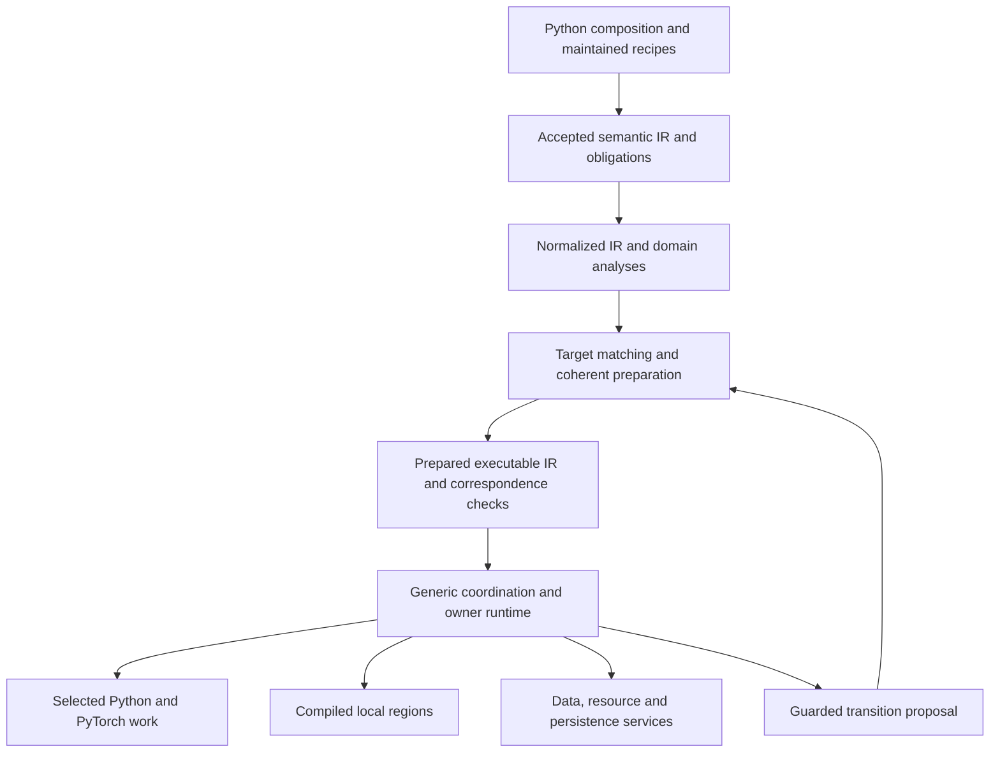

# xDSL language 0.1: semantic and composition proposal

2 November 2026 · Design proposal, not an implemented or accepted production API

Fixed premises: xDSL is the working substrate; authoring is Python; ordinary users compose maintained operations; the language serves stateful, heterogeneous workflows. Model training is one domain. This proposal does not reopen framework selection.

The source baseline is sd-scripts `fe46babff6330282d56fdcd8b9dc0ce5bf3fb124`, with xDSL 0.74.0 (`cdb5f7057f3539a2c9647e2b409bff2010af36af`). Proposed identifiers and syntax below are illustrative. Existing candidate classes, fixture protocols and dialect names are research evidence rather than production interfaces. No new implementation qualification is claimed.

## Recommendation

Use **region-bearing operations with explicit invocation, ownership and settlement contracts** as the backbone. Typed SSA carries invocation-local products and references to endpoints/resources. Persistent state belongs to declared owners. Data and model dialects add operations and protocols through shared interfaces. Library recipes expand into these operations; selected Python performs computations behind verified bindings.

Implement a small structured control vocabulary first. Domain operations must either compose those lifecycle protocols or supply a maintained, verified lowering to them. Do not let an arbitrary region-bearing operation silently invent asynchronous ownership. Keep actual rows, tensors, models, futures and queues outside semantic IR.

Acceptance establishes one revisioned meaning and its obligations. Normalization makes that meaning easier to analyze. Preparation resolves a target realization and current dependencies. Execution instantiates the obligations and enforces dynamic checks. Prepared plans remain subordinate to accepted meaning.

The original report already recommends this direction in sections F–H [S1]. This document makes its interfaces, lifecycle rules and initial exclusions more concrete. The governing identity, authority, preparation and transition requirements remain those in the design and specs [S2–S4].

## 1. What deserves first-class representation

Expose something when another operation, owner, verifier, transformation, preparation target or outcome consumer must reason about it. Internal mathematics and private implementation scheduling can remain opaque when their declared boundary is sufficient.

### 1.1 Four different extension surfaces

| Surface | Initial contents | What it establishes |
|---|---|---|
| Common language | Activities, structured invocation, explicit captures, persistent resource declarations, protected scopes, requests and typed execution relationships | The common rules for work, references, ownership and lifecycle |
| Domain operations | Data production/filtering/correlation; model invocation; contributions/windows/advancement; persistence | Meaning and legality specific to a domain, visible through common interfaces |
| Library recipes | A preprocessing pipeline, a two-input learning recipe, an evaluation schedule, a maintained two-pass algorithm | Convenient compositions that expand into inspectable operations; no second runtime authority |
| Implementation bindings | Python functions, PyTorch modules, codecs, storage clients, selected compilers and physical-completion adapters | Concrete implementation of a declared operation contract for a supported target |

An ordinary user chooses maintained operations and recipes. Registering a callable does not authorize it to define a new lifecycle, optimizer owner or hidden input protocol. Maintainers can add genuinely new semantic operations through a namespaced dialect and the relevant interfaces.

### 1.2 Initial common operation families

| Family | Proposed operations | Semantic purpose |
|---|---|---|
| Program and identity | `wf.run`, `wf.resource`, `wf.activity` | Acceptance boundary, owner-addressed persistent subjects and named activity definitions |
| Structured invocation | `wf.sequence`, `wf.parallel`, `wf.repeat`, `wf.choose`, `wf.yield` | Ordered children, concurrent children, repeated invocation and accepted alternatives |
| Requested invocation | `wf.requests`, `wf.request` | A request handler template and creation of an owned pending invocation |
| Selected work | `wf.call` | Invoke a versioned implementation with a declared signature, effects, outcomes and completion ABI |
| Scoped access | `wf.access` | Acquire an authorized projection and keep its protection through all admitted uses and required settlement |
| Governed change | `wf.transition` | Submit a typed, revision-checked change proposal; no implicit publication |
| Execution relationships | `wf.stop_after`, `wf.on_completed` | Inspectable lifetime/request relationships with typed boundary semantics |

These are operation families, not a requirement to make each semantic noun a node. Activity declarations name independently governed invocation/lifetime boundaries; an ordinary leaf call need not acquire another activity wrapper. Pure ordered local regions need no independent long-lived owner.

`wf.on_completed` is wiring, not an unrestricted Python callback. It routes an addressed, successful completion fact into a declared request or policy operation. A normalization may expand it into explicit event/request operations.

Resource declarations identify a kind, owner, initialization/continuity contract and allowed uses. A model, policy state, cursor, RNG stream, store and optimization unit are specializations. Do not create a universal object containing all their mutable fields. Each owner controls its own state and contributes its own outcomes.

### 1.3 Initial domain vocabulary

**Data:** `data.channel`, `data.produce`, `data.each`, `data.emit`, `data.filter`, `data.fork`, `data.correlate`, `data.batch`, and item disposition/admission operations introduced by normalization. Producer and consumer bodies are real regions. Filtering and batching declare cardinality, identity and exclusion/remainder behavior. Initial correlation is a bounded exact-key/member join with atomic claim; arbitrary event-time windows and unbounded unmatched state are deferred.

**Model:** participant and view-demand attributes/types, `model.invoke` and `model.evaluate`. Frozen optimization membership, gradient transmission, execution mode, mutable buffers and physical representation are independent dimensions. A frozen base can transmit gradients to a side network; the language must not replace it with a no-gradient invocation [S1, S2].

**Training:** unit declarations, `train.window`, `train.contribute`, `train.advance`, `train.reset`, and an optional maintained `train.grant` protocol. Contributions are addressed owner products, not arbitrary tensors. A window declares normalization, expected members, allowed partial-window treatment and advancement responsibility. Two-pass temporary authority is a specific supported grant profile, not arbitrary mutation permission.

**Policy and persistence:** owned policy updates and `persist.write`/publication operations with declared external effects. Ordinary policy evolution uses the existing state definition. Publication, durability and exact restoration are distinct contracts. Language 0.1 supports observable publication outcomes, not general exactly-once persistence.

### 1.4 Information that stays explicit

Keep types and port schemas; item/cardinality and correlation requirements; resource/view demands; owner and authority boundaries; captures; relevant effects; completion/failure obligations; request/lifetime wiring; accepted dynamic alternatives; numerical/derivative policy where transformations depend on it; contract/binding versions; source origins and required provenance.

An operation may keep convolution internals, augmentation mathematics, private buffers and worker scheduling inside selected computation when those details do not cross its contract. Its implementation must not hide input acquisition, detached physical work, optimizer advancement or external publication that contradicts the declared boundary.

## 2. A composition contract for region-bearing operations

Use a common **RegionSemantics** interface, implemented as a project xDSL trait/interface. Its result is a typed static description used by verification, analysis and lowering. It is not an author-supplied dictionary of claims and does not execute selected user code during analysis.

### 2.1 Interface sketch

```python
# Semantic interface sketch; not runnable production code.
class RegionSemantics(OpTrait):
    def describe(self, op) -> RegionContract: ...

@dataclass(frozen=True)
class RegionContract:
    regions: tuple[RegionRole, ...]       # body, alternatives, child scopes, handler
    captures: tuple[CaptureRule, ...]     # argument mapping and use/escape permissions
    invocation: InvocationModel          # sequence, parallel, repeat, choice, requests
    admissions: AdmissionContract        # creation, capacity, closing and ownership
    completion: CompletionContract       # own condition plus child obligations
    interruption: InterruptionContract   # orderly stop, cancellation, child failure
    settlement: SettlementContract       # entered work, cleanup, outputs, dispositions

class FlowSemantics(OpTrait):
    def describe(self, op) -> FlowContract: ...

class ResourceSemantics(OpTrait):
    def requirements(self, op) -> tuple[UseRequirement, ...]: ...
    def effects(self, op) -> EffectSummary: ...

class RealizationSemantics(OpTrait):
    def requirements(self, op) -> TargetRequirements: ...
    def lower(self, op, checked_context) -> PreparedFragment: ...
```

`InvocationModel` is a small algebra of maintained lifecycle protocols, not an arbitrary function. A domain window can lower to a sequence of a member-repeat region and an advancement epilogue. An extension introducing a new protocol must provide its semantic verifier and maintained runtime realization; unsupported lifecycle contracts reject preparation.

`CompletionContract` distinguishes outputs available before termination, successful logical completion, admission closure and settlement. `SettlementContract` describes which obligations may transfer to another owner and what evidence permits release. A final return instruction cannot erase pending work.

At minimum, each `RegionRole` declares its entry argument types and capture mapping, which invocation source supplies each changing argument, the yielded result types, whether results become available before settlement, and the exact allowed ownership transfers. Invocation sources are finite descriptors: parent entry, predecessor completion, admitted stream item, repeat-policy choice or accepted request. They are not pointers to scheduling callbacks.

Normalize invocation structure to `Once(body)`, `Sequence(children)`, `Parallel(children, stop_policy)`, `Repeat(body, carries, policy)` and `Requests(body, sources, bound)`. Managed access adds acquire/restore/release obligations around such a structure. A producer service composes a production repeat and independently serviceable control reception under an explicit stop rule. It does not require another universal scheduler model.

The prepared runtime needs a small command/event protocol: admit an invocation with addressed arguments, register a request/product obligation, close an admission source, request stop, report entered/returned/validated work, await settlement, transfer/dispose owned work, and publish a scoped outcome. Parent state advances from these owner events. The language defines when each command is legal; queues, futures and locks implement it below the semantic boundary. A new domain region lowers to this protocol after its own contracts are checked.

### 2.2 Invocation identity and lifecycle

A region body is a static template. Each execution creates a runtime invocation identified by its parent invocation, operation origin and a local ordinal or request ID. Repeat iterations and concurrent requests have distinct locals and obligations. Model epochs, data keys and global training steps do not substitute for invocation identity.

A useful control-state skeleton is:

`created → pending → admitted → running → closing → settling → terminal`

An unadmitted request may instead be rejected/withdrawn with a disposition. Actual entered physical calls still have to settle. Keep independent outcome dimensions alongside this control state:

- selected work not entered / entered / returned or raised;
- validation accepted or rejected;
- known, unattempted or uncertain effects;
- logical completion status;
- cancellation/stop requests;
- physical-use and cleanup completion;
- resulting resource usability.

A physically settled failed invocation can leave a participant unusable. A cancellation request can coexist with a later physical failure. A successful optimizer update can coexist with a later failed reset. There is no universal rollback or all-or-nothing region update [S3, S4].

### 2.3 Lifecycle contracts that must remain different

| Operation/protocol | Entry and invocation | Normal completion | Stop/failure/cancellation |
|---|---|---|---|
| Sequence | Admit the first child; each next child starts only after the preceding child satisfies its required successful boundary | All selected children complete and settle | Stop closes future admissions at the declared boundary; failure prevents dependent children; entered work settles |
| Parallel join | Admit declared children independently, subject to resource and input checks | Every required child is terminal/settled; pending child work is included | Child failure initiates the declared sibling-stop policy; retain each child's partial outcomes and drain |
| Serial repeat | Fresh invocation per iteration; bounded policy selects an accepted body/alternative; at most one active iteration in 0.1 | Accepted exhaustion/count/policy stop, then current iteration settles | Orderly stop finishes the admitted semantic iteration; cancellation follows its declared partial-work policy |
| Requested handler | Handler exists as a template; accepted requests become parent-owned pending obligations before execution admission | Request sources are closed and pending/admitted invocations are zero and settled | Close new admissions; queued requests get explicit dispositions; entered handlers drain |
| Producer/service | Open or finite production, with explicit source/control and consumer relationships | Natural exhaustion or accepted stop, plus all selected work and outputs accounted for | Close selection, settle/dispose outstanding products and drain entered physical work before release |
| Access scope | Resolve freshness and acquire a compatible protected projection atomically before body use | Body and all uses covered by the scope settle, then release/restore | Partial acquisition unwinds; entered uses retain protection until drain; failed restoration withdraws usability |

The default sequence is conservative: successful settlement precedes dependent child entry. Fine-grained overlap uses explicit streams/parallel structure or a separately verified lowering. This gives 0.1 a clear baseline rather than making all combinations implicitly concurrent.

Completion sources for requested handlers must be explicit. If training may request evaluation, the handler's source closes only after training has published all permitted requests. Registration of a completion-generated request and publication of that completion are one logical coordinator action: a parent cannot observe an empty pending set in between and terminate.

`wf.parallel` may contain ordinary drivers and requested handlers. Its completion rule includes closure of those drivers' request sources and settlement of their handlers. `wf.stop_after @producer, @consumers` observes the consumer group's **settled boundary**, including pending evaluation. It cannot abbreviate that boundary to training completion.

Orderly stop closes new loop iterations/selections while allowing completion-generated requests promised by already admitted work to register and finish. Thus stopping before window two creates no evaluation request; stopping after window two is admitted finishes that window and preserves its request. Run cancellation may prohibit further handler execution, but it must retain and explicitly dispose of any required request instead of reporting it as completed. Request registration capacity must be obtained without holding a conflicting model-use scope; a blocked emitter remains an owned obligation.

Use `max_outstanding_requests` for the bound over accepted requests that are pending, admitted, running or settling, and `max_active = 1` for handlers in the first target. A transport's queue capacity is a separate choice. This avoids defining termination or boundedness only in terms of currently running handlers.

### 2.4 How parents derive obligations

Every child summary exposes possible invocation sources, captures, resource requirements, effects, request targets, output/disposition obligations and lifetime dependencies. A parent composes these summaries:

1. **Sequence:** preserve order and dependent-success requirements; identify state transferred to later children. Summing possible work is not the same as simultaneous live work.
2. **Choice:** join possible effects/requirements conservatively; ownership and result contracts must be valid on every alternative. Exactly one alternative executes per invocation.
3. **Parallel:** combine possible live requirements and check conflicts/waits; completion joins all required obligations, including pending work.
4. **Repeat:** summarize one invocation plus loop-carried owned state and the policy contract. A serial infinite repeat does not create infinitely many simultaneously live invocations.
5. **Requests:** include both currently executing and accepted pending requests, with a declared capacity and source-closure rule.
6. **Access:** contain all child uses or permit only an explicit transfer to another recognized owner whose lifetime is sufficient.

Conceptually, settlement requires closed admission sources, no outstanding invocation/physical/cleanup obligations, and a disposition or valid transfer for every owned product. Separate owners can hold the records; no universal event log is required. Pending obligations must survive diagnostic history eviction.

Reject whole-lifetime cycles in the restricted stop/completion relation. Do not reject ordinary stream feedback merely because its data graph is cyclic. Feedback requires initialized state or another explicit enabling condition. Analyze input readiness waits separately from lifetime waits; arbitrary selected code prevents a general deadlock/termination proof.

All reactive sources and request queues have finite **live-work bounds** in 0.1, even when their total production is unbounded. Progress contracts include servicing control and yielding after a bounded amount of nonblocking selection work, including exclusions. They cannot preempt a non-returning selected implementation. This follows the returning-filter repair rather than treating queue capacity as a progress proof [S5].

## 3. Values, streams, item identities and persistent resources

### 3.1 Initial type families

| Type family | Meaning | Important exclusion |
|---|---|---|
| Payload type `T` | Typed invocation-local value, tensor/buffer handle or domain product | The IR definition is not the stored runtime tensor |
| `!data.stream<T, contract>` | Reference to a scoped stream endpoint with ordering/delivery/admission protocol | Copying the reference does not duplicate the stream or its items |
| `!data.item<T>` | An admitted item plus owned semantic association and disposition obligation | The payload may be shareable; its claim cannot be duplicated implicitly |
| `!wf.ref<kind>` | Reference to a persistent semantic subject | Naming a resource does not grant mutation or protected use |
| `!wf.cap<kind, mode>` | Scoped access/delegation capability with an invocation-bound lifetime | No implicit escape, storage or unrestricted conversion to a live object |
| `!wf.events<E>` / request payload | Addressed control facts or requests carried by a maintained channel protocol | An SSA edge is not proof that a request has executed or settled |
| Domain products | Views, contributions, window results, publication receipts | Their owners define validity, identity and outcomes |

Use builtin scalar/tensor types where they express the contract accurately. Domain payload schemas must identify the axes, representation, masks or logical-example boundaries required by consumers. Do not introduce universal image-batch, latent or timestep fields.

A declaration symbol is an authored address. A logical run authority establishes the resource incarnation to which it resolves. Repeated scope-local declarations create distinct runtime instances; restoring the same logical run and starting a new run have different identity contracts. Binding replacement can preserve an incarnation while changing its binding revision. Neither the symbol spelling nor a Python object's identity is that incarnation.

### 3.2 SSA is static wiring over runtime instances

Within an invocation, an SSA result denotes one product of that invocation. The same static definition in a repeated body yields a distinct runtime instance on every execution. A stream endpoint is a reference to many future items. Individual records are not static IR nodes.

Distinguish at least operation origin, invocation/attempt identity, stream instance, logical item key, correlation membership, request cause and actual production provenance. Their relationships are structured runtime facts. For example, an evaluation caused by training members `(2,3)` may consume item `4`; those identities must never share one overloaded field.

Initial admission is lossless and locally atomic. For a join, inspect every offered member's identity, schema and provenance before committing any claim. Rejection cannot consume only one member. Missing/excluded/duplicate/exhausted-member rules are explicit. A filter on one branch must propagate keyed exclusion or use an accepted unmatched-member rule; otherwise a join may wait forever.

Cardinality is a semantic interface: one-to-one, zero-or-one, bounded expansion, fan-out, keyed join, batch/pack. Payload schema equality does not prove cardinality or correlation compatibility. A batch retains member identity, order, remainder/normalization policy and any masks. Physical batching is separate from algorithmic batching.

`data.item` is affine in the semantic ownership sense. Inspection may borrow it; transfer/retirement consumes its obligation. `data.fork` explicitly creates related child obligations and retains the root's aggregate credit until all required children settle. Mutually exclusive branches can each consume the same incoming claim if the structured ownership verifier proves exactly one branch executes. xDSL SSA use counts alone do not prove this property.

### 3.3 Bounds, data storage and backpressure

Actual payloads live in runtime memory or external storage. Endpoints, schemas, identity rules and required provenance live in IR. Prepared transport descriptors choose queues, credits, serializers and placement.

An aggregate source bound begins when a work item is selected/reserved, covering physical production, unpublished output, ready transport and consumer-held items. Ready capacity is an additional bound. Filtering/exclusion must retire the corresponding reservation without fabricating consumption. A control-feedback path must remain serviceable while output publication is blocked.

The owner uses an explicit disposition such as consumed, excluded, rejected, discarded-on-stop, failed-before-publication or transferred. Cancellation does not authorize inventing a successful acknowledgement. Archive-free tests should continue to prove that execution and pending ownership do not consult diagnostic history [S5–S7].

### 3.4 Captures and representation choices

Independently invoked activity, repeat, handler and access bodies have explicit capture operands mapped to block arguments. Use `IsolatedFromAbove` where appropriate. Immutable configuration can be captured by value; persistent subjects by reference; streams by endpoint; authority only under a checked scoped capture rule. Live mutable Python closures are not an artifact format.

No invocation-local product escapes into a longer-lived activity without an explicit yield, transfer or retained-product protocol. Protected views/capabilities cannot be yielded as ordinary values. A detached result can escape if its contract establishes valid storage, provenance and no remaining protected-use dependency. An autograd product requiring later source use needs an explicit retained obligation; a version stamp alone is insufficient.

| IR mechanism | Use it for |
|---|---|
| Operands/results and block arguments | Local dependencies, explicit captures, endpoint references, capability use and yielded products |
| Symbols / `SymbolRefAttr` | Persistent declarations, named activities, implementation descriptors, contract definitions and allowed cross-scope identity references |
| Typed semantic properties/attributes | Numerical/consistency policy, cardinality, accepted bounds, source origin and contract versions |
| Dedicated relationship operations | Stop, request-routing or transition relationships that introduce execution/lifetime obligations and need generic discovery |
| Locations / discardable annotations | Python source attribution, diagnostics and non-authoritative inspection data |

Every semantic symbol reference must be exposed through an interface to the dependency verifier. Putting an important edge in an attribute does not make it invisible by convention. Raw descriptive strings or source locations cannot authorize execution.

## 4. Effects, authority and changing state

### 4.1 Effect and access contracts

```python
@dataclass(frozen=True)
class UseRequirement:
    subject: ResourceSelector
    access: AccessMode          # snapshot read, current read, owner update, grant...
    view: ViewRequirement      # route, precision, mode, derivative needs
    consistency: ConsistencyRule
    extent: UseExtent          # body, backward, child settlement, explicit transfer

@dataclass(frozen=True)
class Effect:
    subject: ResourceSelector
    kind: EffectKind           # typed, namespaced; not a free-form permission string
    phase: EffectPhase         # entry, body, publication, settlement
    owner: OwnerRequirement

@dataclass(frozen=True)
class EffectSummary:
    known: tuple[Effect, ...]
    exhaustive: bool           # false preserves unknown effects as a barrier
    outcomes: OutcomeContract
    completion: PhysicalCompletionContract
```

Initial effect families cover value/storage reads and writes, owner-state updates, flow admission/publication/disposition, requests, RNG consumption, model numerical mutation, buffer/mode/cache mutation, governed transitions and external publication. Unknown effects can coexist with known reads; do not discard the known portion of a partial summary.

Resource selectors refer to semantic subjects/subresources, not arbitrary Python addresses. Preparation resolves concrete members, aliases and coupled backend groups. Different names are not proof of disjointness. Conversely, one global effect token would unnecessarily serialize unrelated resources.

A read-only parameter declaration does not imply a pure invocation: module buffers, training/evaluation mode, adapter switches, RNG and autocast/backend caches may change. The view-demand contract must expose these dimensions. Maintained model adapters supply the relevant effects and concurrency evidence.

Unknown effects do not grant unknown authority. A registered opaque computation still has a bounded authorized resource/access envelope and supported completion contract. Missing effect detail conservatively blocks relevant transformations or parallel placement within that envelope. If even its authority/resource boundary is unknown, executable acceptance fails. Unknown operation kinds may round-trip for inspection but cannot execute without a registered semantic definition and realization.

### 4.2 Protection and authority

`wf.access` obtains current freshness evidence and the protection/isolated realization as one owner operation. Checking a revision and later acquiring protection is insufficient. A current-at-start evaluation resolves the state when its execution starts; it does not silently use the training-trigger snapshot.

Protection survives required backward work, admitted nested uses and physical completion. In 0.1, ordinary differentiable calls keep their required access through contribution/backward inside the enclosing training protocol. General escaping autograd graphs are unsupported unless a maintained retained-product owner explicitly accepts the debt.

Do not hold a conflicting protected resource while waiting for unrelated input admission. First obtain/admit the required input, then enter the protected computation, unless a target-specific proof permits the overlap. Preparation checks known hold-and-wait cycles induced by actual alias/protection choices.

Temporary authority is an owner-issued scoped delegation with exact subjects, allowed actions, phases and handback evidence. A contribution edge names the required handback; it does not establish live readiness. Restoration followed by an exception can leave the grant unverified and dependent advancement prohibited. Unsupported authority requests reject acceptance or preparation at the earliest authoritative boundary [S6].

Physical completion is part of the binding ABI. Host return suffices only for a binding that has joined its physical work and cleanup. An asynchronous device target needs an event/stream or equivalent adapter retaining protection until the relevant work completes. A Python return or cancelled future alone cannot settle it. New ordinary work closes on cancellation; required drain and cleanup continue, and late failures remain observable.

Register entry/completion ownership before executor handoff. If submission raises ambiguously, the owner must either establish that selected entry was prevented or retain and drain potentially entered work. Reporting it as unattempted and releasing protection merely because submission raised would recreate the earlier worker-handoff defect described by the execution-candidate research.

### 4.3 Ordinary evolution versus governed transition

Ordinary evolution updates state under an existing accepted definition: cursor advancement, policy feedback, RNG state, optimizer progress and numerical epochs. A bounded choice among accepted alternatives also preserves accepted meaning.

A governed transition changes binding, route, relationship, unit definition, accepted arrangement or another protected semantic dependency. `wf.transition` submits an expected-revision proposal to the appropriate authority/coordinator. It cannot change the current registry by mutating an attribute or replacing a Python object.

Initial 0.1 support should include compatible replacement/rebinding at a declared safe boundary with explicit preserve/reset rules. Arbitrary topology surgery, overlapping old/new execution and general optimizer-state migration are deferred. The representation can describe a broader request and reject an unsupported target, rather than silently approximating it.

Replacement preserves participant identity only under the accepted continuity contract. It can invalidate all prepared members/views and optimizer state correspondence. An incompatible replacement creates a new incarnation; retirement does not free an old reference for reassignment. Destructive preparation withdraws guarantees before mutation; a failed optimistic candidate cannot restore them [S2].

### 4.4 Three invalidation systems

| Change | Semantic analyses | Prepared realization | Compiled code / materialized data |
|---|---|---|---|
| New record, feedback value or ordinary iteration | Preserve definition analyses | Preserve unless a declared dependency changes | Reuse code; update ordinary runtime state |
| Weight update | Preserve accepted program analyses | Preserve control/binding plan; refresh dependent numerical-view guarantees | Code can survive; converted-weight/snapshot data may become stale |
| Binding/route or relevant relationship change | Recompute realization-dependent facts; pure definition facts may survive | Withdraw affected views/units/groups until coherent reprepare | Reuse code only when code/ABI/layout/alias/numerical guards still hold; rebind physical resources explicitly |
| Contract, effect, capture, unit definition or topology change | Invalidate affected summaries under a new verified revision | Reprepare affected plan and obligations | Recompile affected regions where their dependency key changes |
| Placement change preserving declared behavior | Definition facts may survive | Recheck transport, protection and completion | Target/layout-dependent artifacts may change |

Compiler caches key immutable IR/contract/target dependencies. Runtime owners separately track current state revisions and physical validity. Begin 0.1 by recomputing inexpensive semantic summaries after changed passes; preserve a cached summary only with an explicit justified dependency set. Fine-grained incremental compilation is an optimization, not a validity shortcut.

### 4.5 Conservative generic optimization

Do not mark `wf.call` or lifecycle operations generically `Pure` merely because their arithmetic is pure. Failure, outcome attribution, request creation and settlement can be observable. Leave generic effects unknown or conservatively expose coordination/outcome resources; apply project transformations through the richer interface.

True numerical operations inside a verified computational island can expose normal memory/speculation traits when justified. RNG must be an explicit owned stream or job-keyed input; implicit global RNG is a barrier to movement and parallelization. Numerical reassociation, precision changes and batching require the accepted policy. MLIR's effect rationale itself leaves graph-region effect modeling open; it is not a ready concurrency theory for this language [S13].

## 5. Representation levels and one authority

| Level | Establishes and retains | Resolves/adds | Does not claim |
|---|---|---|---|
| Python composition / proposed IR | Maintained selections, recipes, source spans, explicit intended wiring | Builder conveniences and user configuration | Acceptance, physical readiness or live resources |
| Accepted semantic IR | Verified definitions, identities, authority profile, domain/region/flow contracts, allowed choices and revisioned obligations | Contract specialization and deferred evidence requirements | Available model objects, physical layouts or target support for every accepted program |
| Normalized semantic IR | The same meaning with explicit captures, request routing, item/admission boundaries and canonical structured forms | Expanded recipes, resolved references, derived summaries | A new independent authority or permission to alter the algorithm |
| Prepared/executable IR | A checked realization of one accepted revision and its obligations | Versioned binding/codec selections, concrete member/alias evidence, view/protection recipes, transport/placement, compiled artifacts, dependency guards and completion adapters | Permanently current views or successful future outcomes |
| Runtime instances | Actual owner state, invocations, item associations, requests, reservations and physical work | Current freshness, admissions, dynamic choices, effects, dispositions and settlement facts | Static proof of hidden Python behavior or automatic recovery |

Normalization is a representation phase, not a second language authority. Preserve the accepted document and origin map; normalization has declared semantics-preserving expansion rules. Prepared fragments identify which source operations and obligations they realize, including many-to-one fused dispatch and retained per-leaf outcomes.

Static verification checks names/types/captures, region protocol, known ownership conflicts, lifetime coverage, legal authority and declared flow compatibility. Preparation checks installed versions, concrete aliases/members, physical views, target completion, numerical policy and realizability. Execution checks actual identities/provenance, current revisions, runtime reservations, selected outputs, handback and physical settlement.

Preparation may construct candidates or perform legitimate backend work before all concrete evidence exists. It must not publish dependent readiness or authorize execution before that evidence is validated. Replacement-only and destructive preparation have different failure guarantees, as the governing design requires. Avoid promoting the candidates' stronger pre-factory test boundary into an unconditional production sequence [S2, S7].

The artifact envelope records semantic schema/extension versions, accepted content identity, realization policy, required installed contract identities, prepared text, source mapping and dependency requirements. Saved summaries and projections are inspectable outputs. Cold loading derives them from verified documents/contracts; it cannot trust saved observations to authorize execution.

Exact expected-plan comparison remains useful for a closed realization policy. Once multiple conforming policies exist, compare against the selected policy or verify explicit lowering obligations: source coverage, types, authority, effects, lifecycle and permitted changes. General arbitrary-program equivalence is not a production verifier goal.



The return edge represents governed re-realization under accepted transition rules. An amendment to accepted meaning also revises and revalidates B/C before preparation. Runtime outcomes are evidence about execution, not another executable graph.

## 6. Mapping to xDSL and a useful MLIR boundary

### 6.1 Concrete xDSL facilities

| Facility in xDSL 0.74.0 | Use here | Project obligation / limit |
|---|---|---|
| `IRDLOperation`, `irdl_op_definition`, operand/result/region/property definitions, custom `verify_` | Declarative operation/type structure and local semantic checks | Domain contracts, cross-operation ownership and lifecycle legality |
| `Block`, `Region`, block arguments and explicit terminators | Invocation templates and local data dependencies | Runtime invocation semantics, captures and ownership transfer |
| `IsolatedFromAbove`, `IsTerminator`, `NoTerminator` | Enforce relevant structural boundaries and terminator forms | `NoTerminator` is not a complete declaration or verifier for our graph-region semantics |
| `SymbolOpInterface`, `SymbolTable`, `SymbolRefAttr` | Named resources, activities, descriptors and scoped references | Typed reference/use discovery and activity/lifetime dependency analysis |
| Project `OpTrait` interfaces | RegionSemantics, FlowSemantics, ResourceSemantics and RealizationSemantics | Shared contract implementations and registration, not central operation-name dispatch |
| `MemoryEffect`, `EffectInstance`, `Resource` | Conservative interoperability with memory-effect-aware passes | Failure, authority, asynchronous settlement, views and flow effects need richer project contracts |
| `ModulePass`, `PassPipeline` | Normalization, verification, analysis and lowering stages | Domain analysis cache/dependency policy; no claim of a Pliron-style analysis manager in the candidate |
| `PatternRewriteWalker`, `PatternRewriter`, cloning and replacement | Local transformations and explicit result-use replacement | Prove domain legality; transformed IR must pass both structural and semantic checks |
| Parser/printer, structural equivalence, locations | Detached artifacts, round-trip checks and source attribution | Compatibility policy, forward-reference handling, semantic correspondence and preservation of origins |
| Interpreter implementation registration | Small reference execution of pure/finite fragments and conformance probes | The asynchronous owner runtime is not supplied by the numerical interpreter |

Sources: actual pinned IRDL, core IR, traits, pass, rewrite and interpreter implementations [S8–S11]. These are infrastructure mappings, not proof that existing generic passes understand our custom semantics.

Use one-block structured ordered bodies for 0.1. A run/parallel graph may contain static declarations and typed relationships, while local sequence bodies obey ordered availability. Declare the distinction in RegionSemantics and check it. Keep stream feedback through explicit endpoints/state. Prefer declaration-first endpoint wiring to gratuitous forward SSA cycles.

The candidate already demonstrates a small forward-result mapping helper before structural equivalence for mixed/lifetime graphs. Retain and test a narrowly scoped equivalent helper if needed; do not substitute printed-text equality or a digest for actual def/use correspondence [S7].

The pinned `DeadCodeAnalysis` documents missing control-flow handling and rejects relevant nested/successor structures. It is not the engine for whole-run liveness. Implement domain lifetime, dependency and wait analyses against RegionSemantics, with existing xDSL traversal and use-def facilities. The current prepared-call fusion has no SSA results; result-remapping APIs exist, but a production pass that uses them needs new conformance tests [S7, S10].

Source attribution should be explicit now: every authored operation gets Python source information and a semantic origin. Expansion records origin ancestry; specialization/fusion preserves the leaf origins; generated failures identify both invocation and origin. Distinguish these semantic origin records from discardable display annotations.

### 6.2 Recommend one initial MLIR integration boundary

**Compile a selected, closed, finite data/numerical island whose contract is understood.** Examples are a typed normalization/feature transform or a maintained arithmetic subregion. Keep data admission, requests, persistent-resource authority and stop/drain outside it. PyTorch model computation can continue through its own selected compilation path.

The boundary requires:

1. A maintained lowering from the island to supported MLIR dialects and types: initially `func`, `arith`, `scf` and `memref`/`llvm`; add `math`, `tensor`, `linalg` or `vector` only with explicit conversions and target tests.
2. An ABI for dtype, shape, layout, aliasing, allocation ownership and error/status return. Convert invalid-input/failure behavior to explicit checks/status where needed; LLVM undefined behavior cannot replace an accepted failure outcome.
3. Captured immutable snapshots or explicit input buffers, numerical/fast-math policy and any RNG inputs. No escaping Python object or live model capability.
4. Source/result correspondence and a physical-completion adapter, including the lifetime of input/output buffers.
5. Verification after conversion and conformance against the maintained reference implementation, including masks, edge cases and numerical tolerance policy.

Reusable machinery includes supported canonicalization, scalar/control-flow conversion and LLVM code generation. Tensor-based islands can later use tiling/vectorization and One-Shot Bufferize only for operations implementing the required interfaces; ownership-based deallocation is a separate obligation [S14].

The pinned xDSL interoperability guide demonstrates a concrete supported-dialect conversion through `mlir-opt`/`mlir-translate` and LLVM 22.1.2. Match that version explicitly; generic textual similarity is not universal compatibility [S11]. A Python invocation wrapper/ABI is still project work.

Defer whole-run lowering to MLIR async and a custom MLIR workflow dialect. Both are possible integration topics, but neither currently supplies the Python owner/resource protocol or a demonstrated beneficiary. This proposal needs one useful boundary, not an additional parallel coordination stack.

## 7. Transformations that influence the language immediately

| Transformation | Required contract | Legal example | Counterexample / rejection |
|---|---|---|---|
| Static region/call specialization | Accepted static selector, explicit captures and versioned bindings; preserved source and outcome obligations | Expand a maintained recipe and resolve a statically chosen preprocessing path once | Specializing from one observed feedback value erases an accepted future alternative; reject because the selector is runtime-owned state |
| Ordered local fusion | Connected schemas/cardinality, known effects, transparent lifetime, per-leaf validation/failure and same completion obligations | Group pure/frozen unary stages into one dispatch while retaining every leaf guard and origin | An opaque stage, filter-progress boundary, feedback acknowledgement or protected-scope exit cannot disappear into an unchecked group |
| Frozen-read movement/materialization | Snapshot identity pinned over the destination extent, compatible capture/alias lifetime, and an explicitly movable effect/failure contract | Resolve an immutable coefficient snapshot during permitted preparation and reuse its detached value | A frozen model invocation can fail and has per-invocation outcomes; frozen weights alone do not authorize hoisting the call. A compatible binding replacement can also invalidate a pinned view |
| Partition/compile a local region | Closed typed boundary, numerical/derivative policy, alias/ownership and physical-completion ABI; guards and outcomes retained | Compile a finite typed transform, leaving admission and external publication in the host | Detaching a frozen base forward breaks gradients to a trainable side network. Reordering RNG or returning before an asynchronous buffer use settles also violates the contract |

For 0.1 implement specialization and the already-qualified style of guarded local fusion first. Design the capture/effect interfaces so frozen-read movement and compiled partitioning can be added without redefining values or authority. Default to declining a transformation when its proof interface is missing.

Fusion preserves the semantic leaf trace: stage B cannot enter after stage A fails validation, and a fused physical use cannot release protection early. Partitioning preserves logical item/member associations and distinct unit outcomes even when physical calls change. Numerical equality of one final loss is insufficient [S5–S7].

## 8. Worked compositions

The Python sketches below are illustrative builder syntax, not an available package. Semantic sketches show proposed structure and contracts rather than parser-ready assembly. `capture(%outer as %inner)` explicitly abbreviates an operand-to-region-block-argument mapping; it is not an implicit lexical capture. Named relationships resolve in their declared enclosing scope.

### 8.1 Data-only feedback

```python
with workflow("score_records") as run:
    feedback = data.channel(PolicyUpdate, capacity=3)
    source = data.producer(
        source=biased_keys(initial_key=0, initial_bias=0),
        transform=ops.sequence(ops.double(), ops.offset(1)),
        feedback=feedback,
        apply_feedback=policies.score_modulo(5),
        max_selected_unsettled=3,
        ready_capacity=2,
    )
    consumer = data.consume(
        source.output,
        count=4,
        body=ops.sequence(
            ops.square(),
            persistence.publish(require_receipt=True),
            policies.send_feedback(feedback),
        ),
    )
    run.parallel(producer=source, consumer=consumer)
    run.stop_after(source, consumer.settled)
```

```mlir
wf.run @score_records {
  %records = data.channel : !data.stream<i64, #data.ordered_lossless>
  %feedback = data.channel {capacity = 3} : !data.stream<!policy.update>
  wf.parallel @work capture(%records as %r, %feedback as %f) {
    wf.activity @producer capture(%r as %out, %f as %updates) {
      wf.resource @cursor : !state.cursor {initial = 0, owner = parent}
      wf.resource @policy : !policy.bias {initial = 0, owner = parent}
      data.produce %out feedback(%updates) state(@cursor, @policy)
          {source = @biased_keys, update = @score_mod_5,
           max_live = 3, ready_capacity = 2, selection_quantum = 64} {
        ^record(%item : !data.item<i64>):
          %x = data.payload %item
          %a = wf.call @double(%x) : (i64) -> i64
          %b = wf.call @offset_1(%a) : (i64) -> i64
          data.emit %item payload(%b) to %out
      }
    }
    wf.activity @consumer capture(%r as %in, %f as %reply) {
      data.each %in {count = 4} {
        ^record(%item : !data.item<i64>):
          %x = data.payload %item
          %score = wf.call @square(%x) : (i64) -> i64
          %receipt = persist.write %score association(%item)
          %update = wf.call @feedback_from_receipt(%score, %receipt)
          data.feedback %item update(%update) to %reply
      }
    }
    wf.stop_after @producer, @consumer {boundary = settled}
  }
}
```

`data.feedback` transfers the consumer's disposition to the producer protocol. The producer validates the addressed update, applies it under its policy owner and retires that root reservation once. Selection reflects the feedback already applied at selection time; prefetch within the accepted horizon remains possible. Invalid publication receipts do not become acknowledgements. Shutdown dispositions account for any extra selected records.

This deliberately contains no model, optimizer or training clock. A filter/augmentation can enter as a maintained stage once its cardinality, exclusion and RNG contract is present. It uses the same activity/ownership machinery rather than requiring a new outer engine.

### 8.2 Stateful model work with production outliving training

Use the existing lifetime fixture as the numerical anchor, while proposing reusable composition instead of its fixed grammar [S4].

```python
with workflow("learn_then_evaluate") as run:
    encoder = models.participant("encoder", binding=scale_model(2.0), frozen=True)
    learner = models.participant("learner", binding=scale_model(0.8))
    unit = training.sgd("main", subjects=learner.parameters("weight"), lr=0.01)
    produced = data.producer(
        source=increasing_keys(),
        transform=models.encode(encoder, value="key_plus_one"),
        max_selected_unsettled=3, ready_capacity=2,
    )
    with run.group("consumers") as consumers:
        learning = training.windows(
            produced.output, unit=unit, windows=2, members=2,
            objective=losses.squared_error_half(learner),
            gradient_normalization="mean",
        )
        evaluation = requests.handler(
            max_outstanding_requests=1, sources=[learning],
            body=evaluation_ops.next_record(
                produced.output, learner,
                consistency="protected_current_at_start",
            ),
        )
        learning.on_window_completed(ordinal=1).request(evaluation)
    run.parallel(producer=produced, consumers=consumers)
    run.stop_after(produced, consumers.settled)
```

The group is a library recipe expanding to a parallel driver/request-handler composition. It closes the handler's request source only after learning has published its completion-generated requests. Request identity retains training members `(2,3)`; evaluation obtains a new record independently.

```mlir
wf.run @learn_then_evaluate {
  %encoder = wf.resource @encoder : !wf.ref<model> {binding = @scale_2, frozen = true}
  %learner = wf.resource @learner : !wf.ref<model> {binding = @scale_0_8}
  %unit = train.unit @main subject(%learner) {parameter = "weight", sgd_lr = 0.01}
  %records = data.channel : !data.stream<!example.encoded_record>
  wf.parallel @work capture(%encoder as %enc, %learner as %model,
                            %unit as %u, %records as %r) {
    wf.activity @producer capture(%enc as %encoder_p, %r as %out) {
      data.produce %out {source = @increasing_keys, max_live = 3, ready_capacity = 2} {
        ^record(%item : !data.item<!example.raw>):
          %encoded = wf.access %encoder_p {mode = frozen_read} {
            ^use(%view : !model.view<frozen>):
              %value = wf.call @encode_key_plus_one(%view, %item)
              wf.yield %value
          }
          data.emit %item payload(%encoded) to %out
      }
    }
    wf.activity @consumers capture(%model as %m, %u as %unit_c, %r as %input) {
      wf.parallel @members capture(%m as %learner_c, %unit_c as %uc, %input as %in) {
        wf.activity @training capture(%learner_c as %lm, %uc as %tu, %in as %records_t) {
          wf.repeat {count = 2} capture(%lm as %model_t, %tu as %unit_t, %records_t as %input_t) {
            %completed = train.window %unit_t from(%input_t) {members = 2, normalization = mean}
              member(%item : !data.item<!example.encoded_record>) {
                wf.access %model_t {mode = differentiable_current_read} {
                  ^use(%view : !model.view<differentiable>):
                    %loss = wf.call @squared_error_half(%view, %item)
                    train.contribute %loss to %unit_t association(%item)
                }
                data.retire %item {disposition = consumed}
              }
              epilogue {
                train.advance %unit_t
                train.reset %unit_t
              }
            wf.request @evaluation cause(%completed) {when = #wf.iteration_is<1>}
          }
        }
        wf.requests @evaluation {sources = [@training], max_outstanding_requests = 1}
            capture(%learner_c as %model_e, %in as %input_e) {
          ^request(%cause : !train.window_completion):
            %item = data.next %input_e
            %result = wf.access %model_e {mode = protected_current_at_start} {
              ^use(%view : !model.view<evaluation>):
                %value = model.evaluate %view, %item cause(%cause)
                wf.yield %value
            }
            data.retire %item {disposition = consumed}
            wf.yield %result
        }
      }
    }
    wf.stop_after @producer, @consumers {boundary = settled}
  }
}
```

The window owns pending contributions and their source stamps through advancement/reset. Member access covers backward/contribution before its read scope releases; the unit's pending-window protocol prevents an intervening incompatible writer. Input association metadata can remain with the contribution owner after an item's payload/credit is retired.

For selected key `k`, the encoder produces `x = 2*(k+1)` and target `k+1`. Two mean-gradient windows on keys `(0,1)` and `(2,3)` yield weights `0.77` and `0.635`. Evaluation on key `4` yields prediction `6.35` and loss `0.91125`. Its protected read sees epoch two in this fixture. These are independent expectations, not values stored as executable IR.

Evaluation waits for its item before acquiring the learner view. Training completion can leave its request pending, so the consumer group remains live. Producer stop follows group settlement. A held production call must physically settle even if evaluation has completed; any late failure survives alongside the evaluation result.

### 8.3 Invalid composition and precise rejection

Changing the final relationship to `stop_after(produced, learning.settled)` is invalid while the evaluator can still request another record.

```text
WF-LIFE-004 at stop_after(producer, training.settled):
  stream produced by @producer is consumed by @consumers::@evaluation;
  that consumer is outside @training's settled lifetime closure;
  @training may finish with an accepted evaluation request still pending.
Required: a stop boundary covering every permitted consumer and pending request,
          here @consumers.settled, or a separately accepted disposal/transfer rule.
```

The verifier obtains consumers through FlowSemantics and request-source closure through RegionSemantics. It does not inspect the evaluator's Python body to discover a hidden read. Similarly, yielding `%view` from either access scope is rejected as a capability escape, and duplicating an item claim without `data.fork` is rejected as invalid ownership.

## 9. Bounded language 0.1 and next implementation slice

### Included

- Python composition of maintained operations and recipes, with detached xDSL accepted/prepared artifacts and source origins.
- A single logical run authority with multiple explicit state owners.
- Structured sequence, parallel join, serial repeat, finite choice, producer services, bounded requested work and protected access.
- Bounded live-work streams with finite or open total production; one-to-one/filter/fan-out/batch contracts and bounded exact-member correlation.
- Current-at-start and pinned-snapshot use demands, explicit view/buffer/RNG effects, owner-issued authority and one optional maintained two-pass grant profile.
- Addressed contributions, windows, independent unit outcomes and explicit advancement/reset responsibility. Supported combinations are target-qualified; no arbitrary overlapping optimizer ownership is inferred.
- Safe-boundary compatible replacement/rebinding with explicit state preserve/reset treatment and coherent reprepare. Unsupported migration is rejected.
- Static specialization, guarded local fusion, and explicit compiled-island interfaces.

### Explicitly deferred

Arbitrary CFGs, arbitrary new runtime lifecycle protocols, general distributed joins/watermarks, concurrent repeat iterations, hot topology surgery, automatic optimizer-state migration, escaping arbitrary autograd graphs, transparent speculative execution/retry, durable exactly-once effects, exact distributed snapshots, arbitrary Python sandboxing, generic whole-run DCE, and whole-run MLIR lowering. These are explicit unsupported contracts, not silently weakened behavior.

GPU/distributed placement is not excluded from the language. Each target must establish its actual aliases, synchronization, numerical policy and physical-completion contract. Existing host witnesses do not qualify a new device target. The main numerical implementation can remain PyTorch and the evolving backend.

### Coverage of the original twelve pressure families

| Pressure family | Proposed language mechanism | Bound or unresolved realization |
|---|---|---|
| Multi-input diffusion-style work | Typed data admission/correlation, selected model/objective calls and unit inputs | Domain representation/numerical support supplied by maintained operations |
| Adversarial/multi-optimizer work | Repeat/choice/sequence plus independent unit identities and outcomes | No implicit shared-parameter ownership; target must qualify the accepted ordering/gradient split |
| Repeated accumulation | Window region composed from member repetition and advancement epilogue | Explicit incomplete-window rule and source-state validity |
| Two-pass optimization | Scoped grant plus maintained phase/handback profile | Unsupported authority splits rejected |
| Independent correlated producers | Sibling services and bounded atomic keyed correlation | General event-time/late-data joins deferred |
| Requested validation | Request handler, source closure and completion routing | Bounded accepted-unsettled requests and current-at-start use |
| Downstream selection feedback | Producer-owned policy and addressed acknowledged control input | Accepted lag/application rule, no rediscovery of authoring |
| Model-assisted data work | Model use/view contracts inside data activities | Same participant/view/gradient rules as elsewhere |
| Long-running production | Open service with finite live-work bounds and stop/settlement | No claim of general termination or durable recovery |
| Different prepared views | Per-use requirements plus physical alias/mode/cache checks | Target-specific precision/concurrency evidence |
| Replacement/rebinding | Revision-checked transition and coherent reprepare | Initial safe-boundary compatible changes; general surgery/migration deferred |
| Custom behavior | Namespaced maintained operation contracts and versioned implementation bindings | Unknown numerical internals allowed within an explicit authorized envelope |

### Small next slice

Implement the RegionSemantics description and a shared verifier/normalizer for **parallel driver + requested handler + producer stop coverage**, using the existing lifetime fixture. Add the data-only producer/consumer variant as the control. Reuse owner services, independent arithmetic/causal oracles, physical gates and cold-correspondence probes. Replace case-specific lifecycle reasoning with shared contract queries; retain domain arithmetic and binding adapters.

Success means adding both compositions without central dispatch on case names; detecting the invalid stop edge and access escape before execution; deriving runtime setup from normalized/prepared IR; matching independent outcomes with diagnostic histories removed; and preserving physical drain/failure under cancellation. Verify a valid alternative region composition, not only the original fixture's exact operation count.

Failure means the common interface merely returns a prebuilt case-specific graph, omits pending requests, or needs a new whole-run coordinator for the data-only variant. Such a result calls for revising the lifecycle algebra, not expanding the public vocabulary around the fixture.

This is a language-mechanism experiment on the selected substrate. It does not require a repository rewrite or another framework comparison.

## 10. Evidence register

The normative proposals are sections 1–9 above. Existing implementation claims are grounded in the following sources. Links pin the inspected repository/framework revisions; MLIR documentation is the official live reference inspected on 2 November 2026.

- **[S1] Original IR architecture report**, especially F, G.4 and H: https://github.com/Enferlain/sd-scripts/blob/fe46babff6330282d56fdcd8b9dc0ce5bf3fb124/openspec/changes/rework-model-strategy-trainer/research/ir_architecture_report.md
- **[S2] Governing design**, D6–D10, G3.5 and G2.6: https://github.com/Enferlain/sd-scripts/blob/fe46babff6330282d56fdcd8b9dc0ce5bf3fb124/openspec/changes/rework-model-strategy-trainer/design.md
- **[S3] Accepted execution requirements**, input associations, effects, current-use protection and failure: https://github.com/Enferlain/sd-scripts/blob/fe46babff6330282d56fdcd8b9dc0ce5bf3fb124/openspec/changes/rework-model-strategy-trainer/specs/accepted-training-execution/spec.md
- **[S4] xDSL lifetime case**, pending requests, group stop coverage, current-at-start evaluation and settlement: https://github.com/Enferlain/sd-scripts/blob/fe46babff6330282d56fdcd8b9dc0ce5bf3fb124/docs_design/models-strategy-trainer/xdsl_candidate/lifetime_case.md
- **[S5] xDSL candidate README**, domain integrations, extension contracts, archive erasure and exclusion-progress repair: https://github.com/Enferlain/sd-scripts/blob/fe46babff6330282d56fdcd8b9dc0ce5bf3fb124/docs_design/models-strategy-trainer/xdsl_candidate/README.md
- **[S6] Existing grant and optimization integration**, its source protocol and limits: https://github.com/Enferlain/sd-scripts/blob/fe46babff6330282d56fdcd8b9dc0ce5bf3fb124/docs_design/models-strategy-trainer/xdsl_candidate/grant_contract.py and https://github.com/Enferlain/sd-scripts/blob/fe46babff6330282d56fdcd8b9dc0ce5bf3fb124/docs_design/models-strategy-trainer/grant_target.py
- **[S7] Machinery/grouping evidence**, actual framework contribution and correspondence limits: https://github.com/Enferlain/sd-scripts/blob/fe46babff6330282d56fdcd8b9dc0ce5bf3fb124/docs_design/models-strategy-trainer/machinery_comparison.md and https://github.com/Enferlain/sd-scripts/blob/fe46babff6330282d56fdcd8b9dc0ce5bf3fb124/docs_design/models-strategy-trainer/grouping_comparison.md
- **[S8] xDSL IRDL definitions and core IR**: https://github.com/xdslproject/xdsl/blob/cdb5f7057f3539a2c9647e2b409bff2010af36af/xdsl/irdl/operations.py and https://github.com/xdslproject/xdsl/blob/cdb5f7057f3539a2c9647e2b409bff2010af36af/xdsl/ir/core.py
- **[S9] xDSL traits**, isolation, symbols and effects: https://github.com/xdslproject/xdsl/blob/cdb5f7057f3539a2c9647e2b409bff2010af36af/xdsl/traits.py
- **[S10] xDSL passes, rewriting and limited generic dead-code analysis**: https://github.com/xdslproject/xdsl/blob/cdb5f7057f3539a2c9647e2b409bff2010af36af/xdsl/passes.py ; https://github.com/xdslproject/xdsl/blob/cdb5f7057f3539a2c9647e2b409bff2010af36af/xdsl/pattern_rewriter.py ; https://github.com/xdslproject/xdsl/blob/cdb5f7057f3539a2c9647e2b409bff2010af36af/xdsl/analysis/dead_code_analysis.py
- **[S11] xDSL interpreter and MLIR interoperability guide**: https://github.com/xdslproject/xdsl/blob/cdb5f7057f3539a2c9647e2b409bff2010af36af/xdsl/interpreter.py and https://github.com/xdslproject/xdsl/blob/cdb5f7057f3539a2c9647e2b409bff2010af36af/docs/guides/mlir_interoperation.md
- **[S12] MLIR language reference**, operations, regions and extensible interfaces: https://mlir.llvm.org/docs/LangRef/
- **[S13] MLIR side effects and speculation**, including its stated graph-region limitation: https://mlir.llvm.org/docs/Rationale/SideEffectsAndSpeculation/
- **[S14] MLIR bufferization**, interfaces, tensor/buffer boundary and separate deallocation: https://mlir.llvm.org/docs/Bufferization/
